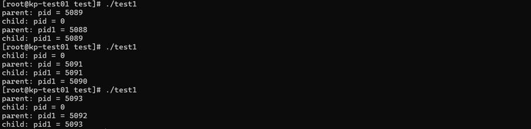
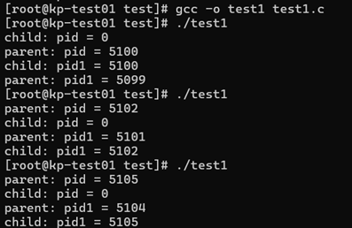
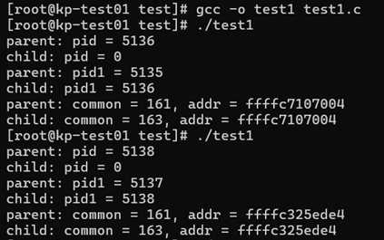
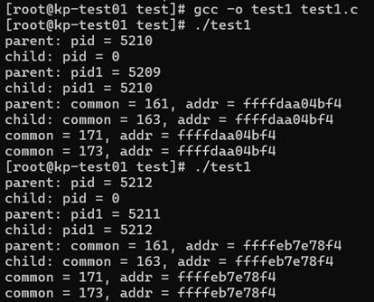
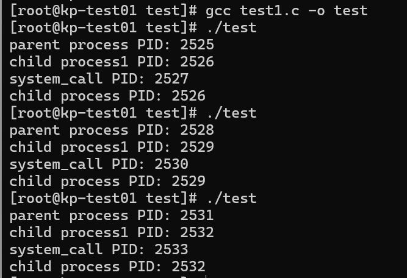
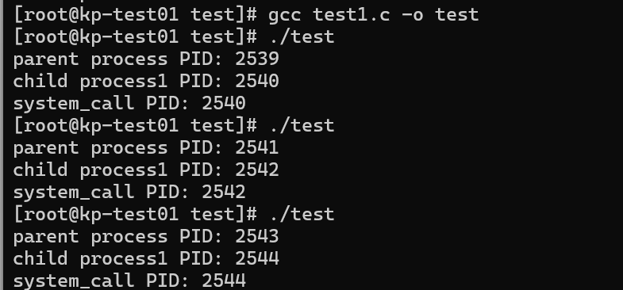
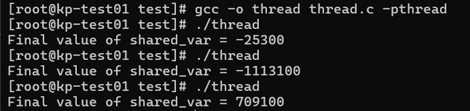
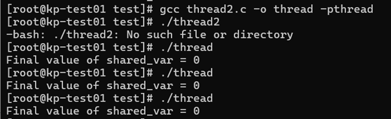
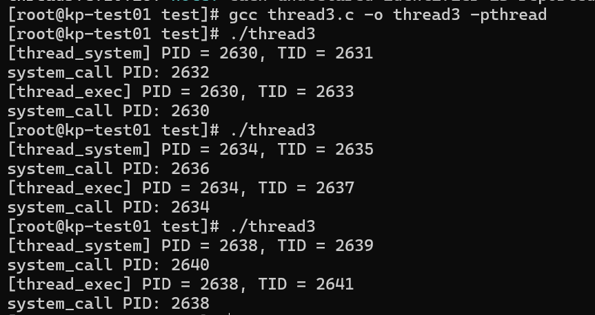
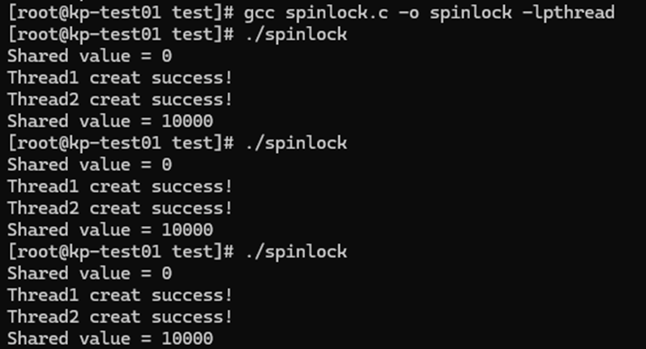

# Lab1  openEuler系统环境实验

## 进程相关实验

**步骤1 :**运行给定的程序，结果如下：



**步骤2 :**删去wait()后，运行结果如下：



可以看出父进程和子进程是并发执行的，父子进程输出顺序随机，在父进程中 `fork()` 的返回值是子进程的pid，而在子进程中 `fork()` 的返回值是0。

去除 `wait(NULL)` 后，由于父进程没有执行 `wait()`，父进程可以不再等待子进程，则可能先于子进程结束，导致子进程变为孤儿进程；若父进程未正确处理子进程退出，可能会产生“僵尸进程”。

**步骤3 :**

设置全局变量

```c
int common = 162;
```

在父进程中：

```c
common++;
```

在子进程中：

```C
common--;
```

**运行结果：**



可以看到父进程和子进程中输出的值并不相同，即这两个 `common` 并不是同一个变量。但是它们的地址却一致，这是因为此地址仅为 `common` 在其各自的进程地址空间内的相对地址。而子进程是从父进程 `fork()` 而来的，因此他们的 `common` 的相对地址也一致。

**步骤4 :**

在 return 前增加对全局变量 `common` 的操作

```c
common += 10;
```

**运行结果：**



可以看到父进程和子进程分别在`return`之前对各自的`value`进行了+10操作。父进程和子进程各自维护变量的独立值，无论父进程还是子进程修改，均不会影响对方的结果。验证了每个进程拥有独立的数据段副本，进程退出时，其独立的地址空间被系统释放，不会对其他进程造成影响。

**步骤 5 :**在子进程中调用 system()与 exec 族函数

**system_call.c:**

```
pid_t pid = getpid();
pthread_t tid = pthread_self();
printf("[system_call] PID = %d, TID = %lu\n", pid, tid);
```

**运行结果：**

**system()**

****
```c
system("./system_call");
printf("child process PID: %d\n", pid1);
exit(1);
```
****




**exec函数**

****
```c
char *args[] = {"./system_call", NULL};
execvp(args[0], args);
printf("child process PID: %d\n", pid1);
perror("exec failed");
exit(1);
```
****



在子进程中开始处调用 `execvp("./system_call", NULL);`， 此处的 `"./system_call"` 的作用是输出进程的 pid 值。可以看到子进程直接去执行了 `./system_call`，不会执行源程序中打印 pid 的部分。这是因为当进程调用`execvp`时该进程的用户空间和数据将被新程序替换。

使用`system()`调用时， `system(...)` 内实际上调用了一次 `fork()`,也就是子进程创建出来一个自己的子进程，即父进程的"**孙子进程**"去执行 `./system_call` (因为 `./system_call` 中输出的 pid 不同于子进程执行源程序时输出的 pid)。因此无论`system()`在子进程开始处或者末尾处调用，输出均相同。

## 线程相关实验

编译代码，由于调用`pthread.h`，应在`gcc`末尾添加`-pthread`

```bash
gcc thread.c -o thread -pthread
```

**步骤1 ：**创建两个线程，分别对同一个共享变量多次操作，观察输出结果。

创建两个线程，分别对共享变量进行100000次+/-100操作。add_func进行+100操作，sub_fuc进行-100操作。

```c
/* create the thread */
pthread_create(&t1, NULL, add_func, NULL);
pthread_create(&t2, NULL, sub_func, NULL);
```

调用 `pthread_join(tid, NULL)` 对两个线程进行阻塞等待，并在结束后分别打印 `shared_var` 的值。

```c
pthread_join(t1, NULL);
pthread_join(t2, NULL);
```

```c
// Thread 1
for(i = 0; i < 100000; i++) {
    shared_var += 100;
}
// Thread 2
for(i = 0; i < 100000; i++) {
    shared_var -= 100;
}
```

**运行结果：**



可以观察到，多次运行程序，输出结果不同。与预期输出结果0并不一致。由于两个线程均要对`shared_var`的值进行修改，但是却没有实现互斥访问，造成结果输出错误。

**步骤2: **定义信号量 signal，使用 PV 操作实现共享变量的访问与互斥。

定义初始化信号量

```C
sem_t signal; /* create signal */
...
// 互斥
sem_wait(&signal);   // P 操作：申请资源（进入临界区）
shared_var += 100;
sem_post(&signal);   // V 操作：释放资源（离开临界区）
```

**运行结果：**



可以观察到，实现了两个线程对共享变量的互斥访问，输出正确结果0。

**步骤3: **system()与 exec 族函数的基础上，将这两个函数的调用改为在线程中实现，输出进程 PID 。使用`syscall(SYS_gettid)`获取线程的 TID 进行分析。



观察结果可验证，`system()` 调用时在线程中创建新进程来运行被调用的外部程序，而`execvp()`调用时，直接将外部程序加载进当前进程，替换掉线程的后续执行代码。

## 自旋锁实验

补充主函数代码：

```c
int main() { 
    pthread_t thread1, thread2; 
    spinlock_t lock; 
    // 初始化自旋锁
    spinlock_init(&lock);
    // 输出初始共享变量
    printf("Shared value = %d\n", shared_value);
    // 创建两个线程
    pthread_create(&thread1, NULL, thread_function, &lock);
    printf("Thread1 creat success!\n");
    pthread_create(&thread2, NULL, thread_function, &lock);
    printf("Thread2 creat success!\n");
    // 等待线程结束
    pthread_join(thread1, NULL);
    pthread_join(thread2, NULL);
    // 输出最终共享变量
    printf("Shared value = %d\n", shared_value);
    return 0; 
}
```

**运行结果：**



可以观察到自旋锁用于在线程竞争共享资源的同步机制，输出结果与预期结果一致。使用自旋锁可以保证同一时间只有一个线程在对临界区进行操作，而其他线程处于忙等状态，保证了对临界区的互斥访问。


