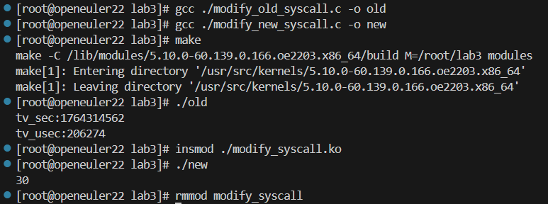
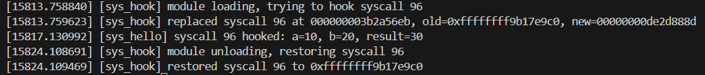
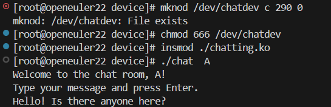
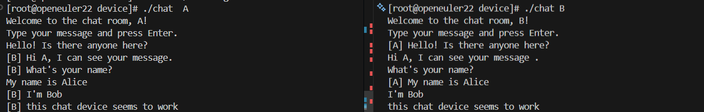
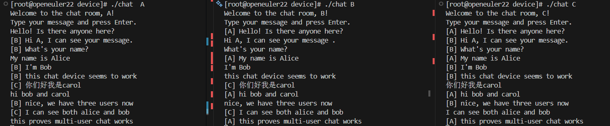

# 3  Linux的动态模块与设备驱动

## 实验目的

（1）学习内核通过动态模块来动态加载内核新功能的机制；

（2）理解LINUX字符设备驱动程序的基本原理；

（3）掌握字符设备的驱动运作机制；

（4）学会编写字符设备驱动程序；

（5）学会编写用户程序通过对字符设备的读写完成不同用户间的通信。

## 实验内容

（1）编译、安装与卸载动态模块；

（2）实现系统调用的篡改；

（3）编写一个简单的字符设备驱动程序，以内核空间模拟字符设备，完成对该设备的打开、读写和释放操作；

（4）编写聊天程序实现不同用户通过该设备的一对一、一对多、多对多聊天。

## 实验思想

Linux 内核采用monolithic架构，系统所有核心功能均在一个大的内核空间中运行。传统情况下若要扩展内核功能，需要重新配置并重新编译内核，这不仅耗时，也会影响系统的稳定性。为了解决这一问题，Linux提供了动态可加载模块的机制，使得开发者可以在系统运行过程中动态装载、卸载内核功能，提高内核的灵活性与可扩展性。

在本实验中，通过编写和加载内核模块，掌握内核模块的构建方式、初始化与注销函数的实现、模块与内核之间的接口机制，并理解模块加载后的行为与权限。通过修改系统调用实验，体会内核中系统调用表的组织原理、特权级别、内存保护机制等。

Linux 的字符设备驱动通过`file_operations`结构体向 VFS提供统一接口，使得用户对设备文件 open、read、write、release 等操作都能被映射到驱动程序中的对应函数。本实验将基于此机制实现一个简单的字符设备驱动，理解用户态与内核态之间的数据交互方式、主设备号与次设备号的含义、驱动的注册与注销流程。

通过编写用户态聊天程序，实现不同用户进程利用同一字符设备进行一对一、一对多、多对多通信，进一步理解驱动程序的同步与互斥逻辑，加深对Linux设备驱动与内核机制的理解。

 

## 实验步骤

（1）编写动态模块源码，包括模块初始化函数 `mymodule_init()` 与模块退出函数 `mymodule_exit()`，并添加 MODULE_LICENSE、MODULE_AUTHOR 等信息。

（2）编写Makefile文件，配置当前内核版本对应的内核源码路径，采用 obj-m 方式生成外部模块。

（3）运行`make`对模块进行编译，确认生成.ko模块文件。

（4）加载模块：使用`insmod`将模块加载入内核，并使用`lsmod`、`dmesg`验证模块是否成功加载。

（5）编写系统调用篡改模块：查找系统调用表地址、保存旧系统调用函数地址、替换为自定义函数，实现`syscall`的动态替换。

（6）加载系统调用修改模块并运行测试程序，观察系统调用结果的变化，理解系统调用表修改的作用与风险。

（7）在测试程序中调用`syscall`，比较修改前后系统调用返回值与行为，验证模块功能。

（8）卸载修改系统调用模块，确保系统调用表恢复正常。

（9）编写字符设备驱动程序源码：定义并实现设备的 `open`、`read`、`write`、`release` 函数；通过 `register_chrdev()` 注册字符设备。

（10）实现 `file_operations` 结构体并绑定驱动入口函数，使得读写设备文件能够触发驱动程序逻辑。

（11）加载字符设备驱动模块，确认 /dev/ 目录下对应设备文件已创建。

（12）编写用户态读写测试程序，调用 `open`、`read`、`write` 访问字符设备，验证内核态与用户态数据交互。

（13）运行测试程序，观察读写设备内容、变量更新情况，分析 `copy_to_user` 与 `copy_from_user` 函数的作用。

（14）编写聊天程序，实现不同用户进程通过字符设备通讯，模拟一对一、一对多、多对多通信模型。

（15）添加同步与互斥机制，防止并发访问造成数据覆盖或竞争。

（16）重复加载、卸载模块，观察设备驱动在不同使用场景下的行为，体会模块安装与卸载过程中的资源管理。

 

## 动态模块加载与系统调用篡改

### 进行系统调用篡改的动态模块

由于实验指导书中给出的代码示例已不适用于现代操作系统内核（新的内核版本默认不支持、也不鼓励直接篡改系统调用表），本实验在查阅相关资料的基础上，对原有方案进行了调整：通过修改 x86_64 架构下 CR0 寄存器中的 WP（Write Protect）写保护位，临时关闭内核对只读页的写保护，从而在内核态模拟实现对系统调用表 `sys_call_table` 的篡改。

具体而言，在基于 Linux 5.10 的 openEuler 环境中，首先利用以下指令查询当前内核中 `sys_call_table` 的实际地址`0xffffffff9c0002c0`：

```bash
cat /proc/kallsyms | awk '$3=="sys_call_table"{print $1}'
ffffffff9c0002c0
```

以硬编码的方式将该地址保存在模块源码中的 `sys_call_table_addr` 变量中。随后在模块中定义要替换的系统调用号 `SYS_HOOK_NO` 为 96，对应内核中的 `SYS_gettimeofday`，并通过保存原始系统调用函数指针 `old_syscall_func` 和修改 `sys_call_table[SYS_HOOK_NO]` 的方式，实现对该系统调用行为的动态替换。

在代码实现上，该模块首先必要的内核头文件，并使用 `MODULE_LICENSE`、`MODULE_AUTHOR`、`MODULE_DESCRIPTION` 等宏对模块元信息进行声明，保证模块可以在高版本内核中正常编译和加载。通过 `module_init(sys_hook_init)`、`module_exit(sys_hook_exit)` 与内核模块框架完成注册，保证模块可以被内核加载与卸载。

```c
MODULE_LICENSE("GPL");
MODULE_AUTHOR("Name");
MODULE_DESCRIPTION("Experiment: modify a syscall on Linux 5.10");
/* 模块加载入口：完成系统调用表篡改 */
static int __init sys_hook_init(void)
{
    pr_info("[sys_hook] module loading, trying to hook syscall %d\n",
            SYS_HOOK_NO);
    return hook_syscall();
}

/* 模块卸载入口：恢复系统调用表 */
static void __exit sys_hook_exit(void)
{
    pr_info("[sys_hook] module unloading, restoring syscall %d\n",
            SYS_HOOK_NO);
    unhook_syscall();
}

module_init(sys_hook_init);
module_exit(sys_hook_exit);
```

为突破内核只读保护，模块中实现了 `clear_wp()` 与 `restore_wp()` 两个静态函数：前者通过内联汇编指令读取 `CR0` 寄存器值，清除其中的 WP 位，并写回修改后的值，从而在极短时间内允许对内核只读区域进行写操作；后者则在完成篡改后恢复原始 CR0 值，重新启用写保护，避免对内核安全性造成长时间影响。

```c
/* 
 * 清除 CR0 中的 WP 位，使得内核代码页临时可写。
 * 返回修改前的 cr0 值，方便之后恢复。
 */
static unsigned long clear_wp(void)
{
    unsigned long cr0;
    asm volatile("mov %%cr0, %0" : "=r"(cr0));
    asm volatile("mov %0, %%cr0" :: "r"(cr0 & ~CR0_WP_BIT));
    return cr0;
}

/* 恢复 CR0 原来的值，重新开启写保护 */
static void restore_wp(unsigned long cr0)
{
    asm volatile("mov %0, %%cr0" :: "r"(cr0));
}
```

系统调用替换函数 `sys_hello` 使用 `asmlinkage long sys_hello(const struct pt_regs *regs)` 的形式定义，符合 Linux 5.x 体系结构中通过 `pt_regs` 传递系统调用参数的规范，通过 `regs->di`、`regs->si` 读取用户空间传入的两个长整型参数，计算它们的和并返回，同时利用 `printk` 输出调试信息，记录被 hook 的系统调用号及传入参数。

```c
static asmlinkage long sys_hello(const struct pt_regs *regs)
{
    long a = regs->di;
    long b = regs->si;
    long r = a + b;
    printk(KERN_INFO "[sys_hello] syscall %d hooked: a=%ld, b=%ld, result=%ld\n",
           SYS_HOOK_NO, a, b, r);
    return r;
}
```

在系统调用表实际篡改过程中，核心逻辑封装在 `hook_syscall()` 与 `unhook_syscall()` 两个函数中。`hook_syscall()` 首先检查 `sys_call_table_addr` 是否为非零，以避免未正确获取系统调用表地址时对内核进行非法写操作；随后将 `sys_call_table_addr + SYS_HOOK_NO * sizeof(void *)` 处强制转换为 `unsigned long *`，得到系统调用表中第 96 项的入口地址，并将其原始值保存到全局变量 `old_syscall_func` 中，便于模块卸载时恢复。接着调用 `clear_wp()` 临时关闭 CR0 中的 WP 写保护位，将该表项指向自定义的 `sys_hello` 函数指针，最后调用 `restore_wp()` 恢复 CR0 寄存器，完成一次原子化的“关闭保护–修改–重新保护”过程。`unhook_syscall()` 的实现与之相反，在模块卸载时重新计算第 96 项的表项地址，关闭写保护后将其写回为 `old_syscall_func`，再恢复 CR0，保证系统调用表不被永久篡改。模块入口函数 `sys_hook_init()` 在模块加载时调用 `hook_syscall()` 完成系统调用替换，出口函数 `sys_hook_exit()` 在模块卸载时调用 `unhook_syscall()` 负责恢复。

```c
/*
 * 修改 sys_call_table，将 sys_call_table[SYS_HOOK_NO] 替换为 sys_hello。
 */
static int hook_syscall(void)
{
    unsigned long *syscall_entry;
    unsigned long old_cr0;

    if (!sys_call_table_addr) {
        pr_err("[sys_hook] sys_call_table_addr is 0 — please set it correctly.\n");
        return -EINVAL;
    }

    /* 找到 sys_call_table 中第 SYS_HOOK_NO 项 */
    syscall_entry = (unsigned long *)(sys_call_table_addr +
                                      SYS_HOOK_NO * sizeof(void *));
    /* 保存原来的函数指针 */
    old_syscall_func = *syscall_entry;

    /* 临时关闭写保护，写入新的函数地址 */
    old_cr0 = clear_wp();
    *syscall_entry = (unsigned long)sys_hello;
    restore_wp(old_cr0);

    pr_info("[sys_hook] replaced syscall %d at %p, old=0x%lx, new=%p\n",
            SYS_HOOK_NO, syscall_entry, old_syscall_func, sys_hello);
    return 0;
}

/*
 * 恢复原来的系统调用。
 * 在模块卸载时调用，保证内核不会一直处于被篡改状态。
 */
static void unhook_syscall(void)
{
    unsigned long *syscall_entry;
    unsigned long old_cr0;

    /* 如果没成功 hook 过，直接返回 */
    if (!sys_call_table_addr || !old_syscall_func)
        return;

    syscall_entry = (unsigned long *)(sys_call_table_addr +
                                      SYS_HOOK_NO * sizeof(void *));
    old_cr0 = clear_wp();
    *syscall_entry = old_syscall_func;
    restore_wp(old_cr0);

    pr_info("[sys_hook] restored syscall %d to 0x%lx\n",
            SYS_HOOK_NO, old_syscall_func);
}
```

通过上述步骤，本实验成功完成了一个可在运行时加载、能够动态修改 `SYS_gettimeofday` 行为的内核动态模块，为后续测试程序对篡改效果的验证奠定了基础。

### 测试程序与运行结果

为验证系统调用是否被成功替换，我分别编写了 `modify_old_syscall.c` 与 `modify_new_syscall.c` 两个测试程序：前者在未加载动态模块或卸载模块之后，通过 `SYS_gettimeofday` 获取并打印当前时间，用于验证系统调用处于正常状态；后者在加载篡改模块之后，同样通过 `SYS_gettimeofday` 这一系统调用号传入两个整数参数 `10` 和 `20`，观察返回值是否变为两数之和，从而判断系统调用表是否已正确被新的 `sys_hello` 替换。

```c
// modify_old_syscall.c
#include <stdio.h>
#include <sys/time.h>
#include <unistd.h>
#include <sys/syscall.h>

int main(void)
{
    struct timeval tv;
    long ret = syscall(SYS_gettimeofday, &tv, NULL); 
    if (ret == -1) {
        perror("syscall");
        return 1;
    }

    printf("tv_sec:%ld\n", (long)tv.tv_sec);
    printf("tv_usec:%ld\n", (long)tv.tv_usec);
    return 0;
}

// modify_new_syscall.c
#include <stdio.h>
#include <unistd.h>
#include <sys/syscall.h>

int main(void)
{
    long ret = syscall(SYS_gettimeofday, 10, 20); 
    printf("%ld\n", ret); // 输出应为30
    return 0;
}

```

首先对两个用户态测试程序以及内核模块进行编译，生成可执行文件 `old`、`new` 和模块文件 `modify_syscall.ko`。在未加载内核模块的情况下运行 `old` 程序，可以看到 `SYS_gettimeofday` 按照原有语义正常返回当前时间，说明此时系统调用表尚未被修改；随后加载编写好的动态模块，并运行 `new` 程序，通过相同的系统调用号传入两个整型参数，观察返回值是否为两数之和。可以看到 `./new` 的输出结果为 `30`，与预期的 `10 + 20` 一致，表明用户态调用的仍是系统调用号 96，但其内核侧实现已被替换为自定义的 `sys_hello`。结果如下：



为进一步验证内核行为，使用 `dmesg | tail` 查看模块加载、系统调用执行与模块卸载过程中的内核日志：



从日志可以清晰地看到模块加载时成功替换了系统调用号 96，对应的新函数在接收到参数 `a=10`、`b=20` 时计算结果为 `30`，卸载模块时又将该系统调用恢复为原始地址。

综合用户态输出与内核日志信息，可以得出结论：本实验实现的动态模块成功完成了对 `SYS_gettimeofday` 系统调用的篡改，并在模块卸载后正确恢复了系统调用表。

### 小结与安全性分析

本节通过编写并加载内核动态模块，在 Linux 5.10 环境下成功实现了对系统调用表的在线篡改，将 `SYS_gettimeofday` 替换为自定义的 `sys_hello`，并通过两个用户态测试程序验证了篡改前后系统调用行为的变化，证明模块实现正确。需要注意的是，本实验采用硬编码的方式获取 `sys_call_table` 地址，并通过修改 CR0 寄存器关闭写保护来完成表项替换，这种方式仅适用于当前内核版本，且会暂时削弱内核自身的保护机制，在实际生产环境中并不推荐使用。本实验主要用于加深对内核模块机制、系统调用实现方式以及内核地址保护机制的理解。

## Linux 设备驱动

### 字符设备驱动程序的实现

本实验基于字符设备驱动实现了一个内核态“聊天室”，主设备号为 `CHAT_MAJOR = 290`，设备名为 `"chatdev"`，通过 `register_chrdev(CHAT_MAJOR, "chatdev", &chat_fops)` 完成注册。驱动内部定义了一个全局的聊天设备结构体 `struct chat_dev_t`，包含一个大小为 4KB 的环形缓冲区 `buf[BUF_SIZE]`、全局写指针 `head`、互斥锁 `mutex` 以及读进程等待队列 `wait_queue_head_t wq`，用于在多用户环境下缓存消息并协调并发访问。

```c
struct chat_dev_t {
    char buf[BUF_SIZE];
    unsigned long head;       // 全局写指针
    struct mutex lock;        // 保护 buf 和 head
    wait_queue_head_t wq;     // 读者等待队列
};

static struct chat_dev_t chat_dev;
```

为了让每个打开设备的进程拥有独立的“阅读进度”，驱动为每个 `file` 维护一个私有数据 `struct chat_private`，其中仅包含一个读指针 `tail`，表示该进程当前读到的缓冲区位置。`chat_open` 中通过 `kmalloc` 分配 `struct chat_private`，并在持有 `chat_dev.lock` 的情况下，根据当前全局 `head` 初始化 `tail`：若历史消息超过 4KB，则只从缓冲区中最旧的可见位置开始读取，否则从 0 开始。`chat_release` 中释放该私有结构体内存。

```c
struct chat_private {
    unsigned long tail;       // 每个文件独立的读指针
};

static int chat_open(struct inode *inode, struct file *filp)
{
    struct chat_private *priv = kmalloc(sizeof(*priv), GFP_KERNEL);
    if (!priv) return -ENOMEM;

    mutex_lock(&chat_dev.lock);
    if (chat_dev.head > BUF_SIZE)
        priv->tail = chat_dev.head - BUF_SIZE;
    else
        priv->tail = 0;
    mutex_unlock(&chat_dev.lock);

    filp->private_data = priv;
    return 0;
}
```

读操作 `chat_read` 采用阻塞方式实现：首先使用 `wait_event_interruptible(chat_dev.wq, chat_dev.head != priv->tail)` 等待缓冲区中出现新数据，当其它进程写入新消息并唤醒等待队列后，当前读进程获得唤醒机会。进入临界区后，通过比较 `chat_dev.head - priv->tail` 检查是否出现“读者太慢导致被覆盖”的情况，若差值大于缓冲区大小，则将 `tail` 前移到 `head - BUF_SIZE` 位置，只保留最近 4KB 的最新消息。随后根据用户请求长度 `len` 和可读字节数计算本次读取的实际字节数 `count`，并通过 `(priv->tail + i) & (BUF_SIZE - 1)` 的方式在环形缓冲区中取数据，利用 `put_user` 拷贝到用户空间，最后更新 `priv->tail`。

```c
static ssize_t chat_read(struct file *filp, char __user *buf, size_t len, loff_t *off)
{
    struct chat_private *priv = filp->private_data;
    unsigned long count;
    int i, ret = 0;

    if (wait_event_interruptible(chat_dev.wq, chat_dev.head != priv->tail))
        return -ERESTARTSYS;

    mutex_lock(&chat_dev.lock);
    if (chat_dev.head - priv->tail > BUF_SIZE)
        priv->tail = chat_dev.head - BUF_SIZE;

    count = chat_dev.head - priv->tail;
    if (count > len) count = len;

    for (i = 0; i < count; i++) {
        char c = chat_dev.buf[(priv->tail + i) & (BUF_SIZE - 1)];
        if (put_user(c, buf + i)) { ret = -EFAULT; goto out; }
    }
    priv->tail += count;
    ret = count;
out:
    mutex_unlock(&chat_dev.lock);
    return ret;
}
```

写操作 `chat_write` 负责将用户发送的聊天消息写入环形缓冲区。函数首先限制单次写入长度不能超过缓冲区大小（`len > BUF_SIZE` 时直接返回 `-EINVAL`），然后在持有互斥锁的情况下，利用 `get_user` 从用户空间逐字节取出数据写入 `chat_dev.buf[(chat_dev.head + i) & (BUF_SIZE - 1)]`，并将 `head` 前移 `len` 个字节。写入完成后通过 `wake_up_interruptible(&chat_dev.wq)` 唤醒所有在等待队列上阻塞的读进程，实现消息广播。

```c
static ssize_t chat_write(struct file *filp, const char __user *buf, size_t len, loff_t *off)
{
    int i, ret = 0;

    if (len > BUF_SIZE) return -EINVAL;

    mutex_lock(&chat_dev.lock);
    for (i = 0; i < len; i++) {
        char c;
        if (get_user(c, buf + i)) { ret = -EFAULT; goto out; }
        chat_dev.buf[(chat_dev.head + i) & (BUF_SIZE - 1)] = c;
    }
    chat_dev.head += len;
    ret = len;
    wake_up_interruptible(&chat_dev.wq);
out:
    mutex_unlock(&chat_dev.lock);
    return ret;
}
```

此外，驱动还实现了 `chat_poll` 接口以支持 `select/poll` 等多路复用机制，在用户程序使用 `select()` 监听设备时，当 `chat_dev.head != priv->tail`（即有新数据可读）时返回 `EPOLLIN | EPOLLRDNORM`，表明设备处于可读状态。模块初始化函数 `chat_init` 负责初始化互斥锁、等待队列和 `head` 指针，并完成字符设备注册，退出函数 `chat_exit` 则在卸载模块时注销设备。

------

### 用户态聊天室程序的实现

用户态程序通过打开字符设备 `/dev/chatdev` 与内核聊天设备交互，每个进程对应一个聊天室用户。程序启动时从命令行参数中读取用户名，并以只读写打开设备文件：

```c
#define DEVICE_PATH "/dev/chatdev"

int fd = open(DEVICE_PATH, O_RDWR);
if (fd < 0) {
    perror("Failed to open device");
    return 1;
}
```

主循环中使用 `select()` 同时监听标准输入（`STDIN_FILENO`）和设备文件描述符 `fd`，实现边收消息边发消息的功能。当标准输入就绪时，通过 `fgets` 读取用户输入，并去掉末尾换行符，然后按照统一格式封装为 `[用户名] 消息内容\n` 的字符串后写入设备，实现“发送消息”：

```c
FD_ZERO(&fds);
FD_SET(STDIN_FILENO, &fds);
FD_SET(fd, &fds);
max_fd = (fd > STDIN_FILENO) ? fd : STDIN_FILENO;

int ret = select(max_fd + 1, &fds, NULL, NULL, NULL);

if (FD_ISSET(STDIN_FILENO, &fds)) {
    if (fgets(write_buf, BUF_SIZE, stdin) == NULL) break;
    write_buf[strcspn(write_buf, "\n")] = 0; // 去掉换行

    snprintf(msg_buf, sizeof(msg_buf), "[%s] %s\n", name, write_buf);
    write(fd, msg_buf, strlen(msg_buf));
}
```

当设备文件描述符就绪时，程序调用 `read(fd, read_buf, sizeof(read_buf) - 1)` 从驱动中取出新消息，并直接在终端打印。为避免简单的“回声”效果，用户程序通过前缀过滤的方式尽量不重复打印自己的消息：构造前缀字符串 `"[用户名]"`，如果读出的内容以该前缀开头，则可以选择不打印，保留给其它用户使用；本实验中采用了简单的 `strstr` 判断并输出的方式，重点在于演示多进程共享同一设备实现聊天室的基本过程。

```c
if (FD_ISSET(fd, &fds)) {
    int n = read(fd, read_buf, sizeof(read_buf) - 1);
    if (n > 0) {
        read_buf[n] = '\0';
        char my_prefix[64];
        snprintf(my_prefix, sizeof(my_prefix), "[%s]", name);

        if (strstr(read_buf, my_prefix) != read_buf) {
            printf("%s", read_buf);
            fflush(stdout);
        }
    }
}
```

通过上述设计，任意多个用户态进程运行该程序并同时打开 `/dev/chatdev`，即可在同一“聊天室”中共享消息流，实现简易的多人聊天功能。

------

### 读写同步与互斥机制

在内核驱动内部，对共享数据结构 `chat_dev.buf` 与 `chat_dev.head` 的访问通过 `mutex` 进行互斥保护，保证任意时刻只有一个执行线程（读或写）可以修改这些共享变量，避免了并发条件下的竞态问题。所有与缓冲区相关的读写操作（包括更新 head、更新各个进程的 tail）都在 `mutex_lock(&chat_dev.lock)` 与 `mutex_unlock(&chat_dev.lock)` 之间完成，从而实现多用户并发场景下的互斥访问。

同步方面，驱动采用等待队列 `wait_queue_head_t wq` 配合 `wait_event_interruptible()` 和 `wake_up_interruptible()` 实现“写消息唤醒读者”的机制：当读进程在调用 `chat_read` 时发现当前没有新数据（`head == priv->tail`），会在等待队列上睡眠，直到其他用户写入新消息并调用 `wake_up_interruptible(&chat_dev.wq)` 才会被唤醒，从而实现了阻塞式读取和多用户消息推送。在用户态，程序使用 `select()` 同时监听终端输入和设备可读状态，避免了忙轮询，提高了整个聊天室的交互性和资源利用率。

------

### 一对一、一对多、多对多聊天的实现方式

本实验的聊天模型本质上是**基于字符设备的广播式消息通道**：所有写入 `/dev/chatdev` 的消息都会被追加到驱动维护的全局环形缓冲区中，而每个打开设备的进程都维护自己独立的读指针 `tail`，从而可以按照自己的节奏从同一缓冲区中依次读取所有消息。这种设计天然支持多种聊天模式：

- **一对一聊天**：当只有两个用户进程同时打开设备并互相发送消息时，设备中的所有消息仅在这两人之间传递，对这两个人来说就是一对一聊天的场景；
- **一对多聊天**：当一个用户发送消息，多个用户只读不写时，发送者的每条消息都会被写入全局缓冲区，并被所有接收者进程从各自的 `tail` 位置读出，相当于一个发送者广播给多个接收者；
- **多对多聊天**：当多个用户同时读写设备时，每个人发送的消息都会追加到同一缓冲区，并被所有在线用户读取，形成了典型的多人聊天室场景。

驱动层并不区分“发送给谁”，而是对所有打开设备的进程一视同仁进行广播；聊天的“身份”和“来源”通过用户态程序在消息前加上的 `"[用户名]"` 前缀进行区分。不同聊天模式的本质差别主要体现在参与进程的数量和读写角色上，而驱动本身始终提供统一的多对多广播机制，从而满足实验中对“一对一、一对多、多对多聊天”的要求。

------

### 实验结果

在加载聊天字符设备驱动模块后，通过 `mknod /dev/chatdev c 290 0` 手动创建设备节点，将主设备号 290、次设备号 0 的字符设备映射为 `/dev` 目录中的一个特殊文件；随后使用 `chmod 666 /dev/chatdev` 赋予所有用户对该设备的读写权限，以便多个普通用户进程可以同时通过 `/dev/chatdev` 参与聊天室通信。

首先，用户A加入聊天室并发送了一条消息，此时聊天室中只有一个用户。



随后，用户B加入聊天室，可以观察到B能够收到A发送的历史消息。随后，B与A进行聊天，可以观察到双方的消息读写都正常运行。



之后，用户C加入，进行多人聊天：



三个用户都可以正常通过预设的设备文件进行聊天，符合预期的聊天室功能。

## 实验总结

### 实验中的问题与解决过程

1. **指导书示例代码与现代内核不兼容**
    刚开始照着实验指导书的示例写系统调用篡改模块，发现在 Linux 5.10环境下发现无法直接修改 `sys_call_table`，示例中的接口和写法也已经过时。之后通过查资料，采用了“查出 `sys_call_table` 实际地址 + 修改 CR0 中 WP 写保护位”的方式，重新设计了模块结构：
   - 使用硬编码的 `sys_call_table_addr`（由 `/proc/kallsyms` / `System.map` 获得）；
   - 在 `clear_wp()` / `restore_wp()` 中通过内联汇编修改 CR0；
   - 在 `hook_syscall()` / `unhook_syscall()` 中保存原函数指针、篡改并恢复 `sys_call_table[96]`。
     经过多次加载、卸载模块和测试程序验证，最终在 5.10 内核上正确实现了 `SYS_gettimeofday` 的替换。
2. **字符设备驱动的状态管理一度设计不当**
   在实现聊天室驱动时，一开始将读写指针都写成全局变量，结果导致所有用户共享同一个“读位置”：某个客户端一旦 `read()` 过，其他客户端就看不到之前的消息。经过调试后，意识到应该将“每个打开实例的状态”挂在 `struct file` 的 `private_data` 上，于是引入 `struct chat_private { unsigned long tail; }`，在 `open` 时为每个 `filp` 分配一份，并在 `read` / `poll` 中使用各自的 `tail`。改完后，各个客户端可以独立从全局环形缓冲区中按自己的进度阅读消息。
3. **环形缓冲区读写索引处理错误导致数据错乱**
   在实现环形缓冲区时，最初简单用 `buf[head + i]`、`buf[tail + i]` 访问数组，没有考虑越界和回绕问题，当消息量较多时读取出现乱码和异常。随后结合 `BUF_SIZE` 为 2 的幂的特点，改用 `(index) & (BUF_SIZE - 1)` 实现快速取模，并在 `chat_read` 中增加“读者太慢”的检查逻辑：当 `head - tail > BUF_SIZE` 时，将 `tail` 强制追至 `head - BUF_SIZE`，只保留最新的 4KB 消息，从而解决了缓冲区覆盖和访问越界问题。
4. **`poll_wait` / `select` 协作机制不理解导致 `select()` 行为异常**
   在用户程序中使用 `select()` 同时监听标准输入和 `/dev/chatdev` 时，一开始在驱动的 `chat_poll` 中只判断 `head != tail` 返回 `EPOLLIN`，没有调用 `poll_wait`，结果 `select()` 要么一直阻塞，要么无法被正确唤醒。查阅资料后了解到：`poll_wait(filp, &chat_dev.wq, wait)` 的作用是将当前进程挂到等待队列上，只有这样 `wake_up_interruptible(&chat_dev.wq)` 才能唤醒 `select()`。补上 `poll_wait` 后，`select()` 才能在新消息写入时被唤醒，聊天室程序可以正常“边收边发”。

### 实验收获

1. **理解了 Linux 动态内核模块的基本使用方法**
    通过编写两个内核模块（系统调用篡改模块、字符设备驱动模块），实践了动态模块的使用方法：
   - 模块源码编写（`module_init` / `module_exit`、`MODULE_LICENSE` 等）；
   - 编写内核模块专用 Makefile，通过内核构建系统生成 `.ko`；
   - 使用 `insmod` / `rmmod` 动态加载、卸载模块，结合 `lsmod`、`dmesg` 观察模块状态和日志。
     对“内核功能可以在运行时按需装卸”的概念有了直观认识，也体会到模块代码一旦出错可能直接导致系统异常，必须更加谨慎。
2. **加深了对系统调用实现与内核保护机制的理解**
    在实现 `SYS_gettimeofday` 的篡改过程中，实践了：
   - 如何通过 `sys_call_table` 将系统调用号映射到函数指针；
   - CR0 中 WP 写保护位对内核只读区域的保护作用；
   - 通过 `pt_regs` 在 5.10 内核中获取系统调用参数。
      同时也体会到，这种硬编码地址 + 修改 `sys_call_table` 的方式虽然能完成教学实验，但在真实系统中风险很高，也印证了“内核并不鼓励直接篡改系统调用表”的说法。
3. **掌握了字符设备驱动的基本框架与 file_operations 机制**
    在聊天室驱动部分，完整实现了一个基础的字符设备驱动：
   - 使用 `register_chrdev` 注册主设备号，提供 `open`、`release`、`read`、`write`、`poll` 等回调；
   - 利用 `struct file` + `private_data` 保存每个打开实例的状态（读指针）；
   - 使用 `copy_to_user` / `copy_from_user`、`get_user` / `put_user` 在内核态与用户态之间安全传递数据。
     通过这个过程，我对“VFS 通过 file_operations 将用户的系统调用分发到具体驱动”的机制有了更清晰的认识。
4. **体验了基于字符设备的一对多、多对多通信设计**
    聊天室驱动将字符设备抽象为一个“共享消息通道”，所有写入 `/dev/chatdev` 的消息进入同一个环形缓冲区，所有打开该设备的进程都可以从自己的 `tail` 开始依次读取，实现了：
   - 只有两个客户端时的“一对一”聊天；
   - 一个发送、多方只读时的“一对多”广播；
   - 多个客户端同时读写时的典型“多对多聊天室”。
     这一设计让“用驱动实现进程间通信”的概念从抽象变成了可运行的程序。
5. **熟悉了等待队列与多路复用在同步中的具体用法**
    实验中同时用到了：
   - 内核等待队列 + `wait_event_interruptible` / `wake_up_interruptible` 实现阻塞式读取与唤醒；
   - 驱动中的 `poll` 回调 + 用户态的 `select` 协同工作，实现单线程同时等待键盘输入和设备数据。
     对于“如何在内核中等待事件、如何在用户态优雅地同时等待多个 IO 源”的理解更加具体，也为后续理解 epoll、网络编程等打下基础。

### 意见与建议

1. **建议更新实验指导书中的示例代码**
   本次在参考实验指导书示例代码实现系统调用篡改时，遇到了较多“版本不兼容”的问题，例如直接修改系统调用表的方式在 5.10 内核下已经不再适用，部分接口和写法也已过时。建议在后续版本中增加基于现代内核版本的参考代码或伪代码，以及如何获取 `sys_call_table` 地址、如何处理 CR0 的写保护等方法。这样可以减少同学在环境差异上的时间消耗，把精力更多放在理解原理上。
2. **可以在实验文档中增加对关键结构与机制的简要说明**
   在写驱动时，`struct file`、`private_data`、`wait_queue_head_t`、`poll_wait` 等结构和函数需要自己查内核文档和示例才能理解。建议在实验指导书中：简要介绍：file_operations、struct file、private_data等，并解释常见内核错误码（如 `-EFAULT`、`-ERESTARTSYS`、`-EINVAL`）的典型用途。

