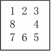

# 实验一：重排九宫问题

## 问题描述

重排九宫问题是在一个 3×3 的棋盘上放置数字 0∼8 的九个方块，其中 0 表示空格。一次合法操作为：将空格与其上下左右相邻的一个数字交换位置。给定一个初始布局，要求通过若干次合法移动，得到指定的目标布局，并输出移动步数与移动序列。下图是目标布局的要求：



由于重排九宫并非所有初始状态都能到达目标状态，程序首先需要判断给定初始布局是否可解；若不可解则直接返回无解；若可解则使用搜索算法求解，并给出从初始状态到目标状态的一条解路径。

## 实验代码整体框架

本实验我选择使用 Java 实现，为了便于组织与复用，我将整个功能拆分为多个模块。整体流程为：

1. 读取用户输入的九宫格初始状态；
2. 构造棋盘状态 `Board`；
3. 根据用户选择的搜索策略调用对应求解器；
4. 返回 `Solution`，输出搜索，以及求解路径中的棋盘序列。

### 模块概览

以下是各实验代码模块及其作用：

- `Board.java`：棋盘状态表示与状态操作核心模块。
- `Move.java`：移动方向枚举。
- `Node.java`：搜索节点数据结构。
- `Solution.java`：结果封装。
- `AStarSolver.java`：A\* 搜索实现。
- `BFSSolver.java`：广度优先搜索实现。
- `Main.java`：程序入口与交互输出。

### 代码分析

在该部分，我将针对框架代码做分析，体现每部分都具体发挥了怎样的作用。

#### `Node.java`

```java
public final class Node {
    public final Board board;
    public final int g;      // cost so far
    public final int h;      // heuristic
    public final int f;      // g + h
    public final Node parent;
    public final Move move;  // move taken from parent -> this

    public Node(Board board, int g, Node parent, Move move) {
        this.board = board;
        this.g = g;
        this.h = board.manhattan();
        this.f = this.g + this.h;
        this.parent = parent;
        this.move = move;
    }
}
```

成员变量：

- `board`：当前结点对应的棋盘状态。
- `g`：代价函数，从起点到当前状态的已走步数，每走一步代价为 1，即与深度相同。
- `h`：启发函数，用曼哈顿距离计算。
- `f`：估价函数，`f(n) = g(n) + h(n)`。
- `parent`：指向父结点，用于最终找到目标后回溯路径。
- `move`：从 `parent` 状态移动到当前状态所执行的动作，用于回溯时拼成移动序列。

------

#### `Move.java`

`Move` 是一个枚举，把四个方向移动抽象成统一的数据结构，使得生成邻居状态时不需要写四段重复代码。

```java
public enum Move {
    U(-1, 0, 'U'),
    D(1, 0, 'D'),
    L(0, -1, 'L'),
    R(0, 1, 'R');

    public final int dr;
    public final int dc;
    public final char code;

    Move(int dr, int dc, char code) {
        this.dr = dr;
        this.dc = dc;
        this.code = code;
    }
}
```

每个 Move 有三个信息：

- `dr`：行变化
- `dc`：列变化
- `code`：输出路径时用的字符表示

例如：

- `U(-1,0)`：空格上移 → 行号减少 1
- `R(0,1)`：空格右移 → 列号增加 1

------

#### `Board.java`

`Board` 表示一个 3×3 的拼图状态，是九宫生成逻辑的核心。下面将其分为多个部分介绍。

1、 数据结构与目标状态定义：

```java
private final int n;          // dimension (for 8-puzzle it's 3)
private final int[] tiles;    // length n*n, 0 is blank
private final int blank;      // index of 0
private final int manhattan;  // cached heuristic
```

- `n`：棋盘维度（在重排九宫问题中固定为 3）。
- `tiles`：一维数组保存棋盘，长度 `n*n=9`。其中下标 `idx = r*n + c`，数值 `0` 表示空格。
- `blank`：空格在 `tiles` 中的下标，方便快速生成邻居。
- `manhattan`：曼哈顿距离缓存值。

接下来设置目标状态：

```java
private static final int N_GOAL = 3;
private static final int[] GOAL = {
    1, 2, 3,
    8, 0, 4,
    7, 6, 5
};
```

------

2、找到当前状态下各数字在目标位置中的下标：

```java
private static final int[] GOAL_POS = buildGoalPos();
private static int[] buildGoalPos() {
    int[] pos = new int[N_GOAL * N_GOAL];
    Arrays.fill(pos, -1);
    for (int i = 0; i < GOAL.length; i++) pos[GOAL[i]] = i;
    return pos;
}
```

这段代码将各位置初始化为 -1，之后扫描目标数组，把每个 `tile` 值映射到目标位置 `index`。加入这个部分，在算曼哈顿距离时可以更快地找到每个 `tile` 的目标坐标。

------

3、 构造函数：

```java
public Board(int n, int[] tiles) {
    if (n <= 0) throw new IllegalArgumentException("n must be > 0");
    if (tiles == null || tiles.length != n * n) throw new IllegalArgumentException("tiles length must be n*n");
    if (n != N_GOAL) throw new IllegalArgumentException("This solver is configured for 3x3 goal only.");

    this.n = n;
    this.tiles = Arrays.copyOf(tiles, tiles.length);

    int b = -1;
    boolean[] seen = new boolean[n * n];
    for (int i = 0; i < this.tiles.length; i++) {
        int v = this.tiles[i];
        if (v < 0 || v >= n * n) throw new IllegalArgumentException("tile value out of range: " + v);
        if (seen[v]) throw new IllegalArgumentException("duplicate tile: " + v);
        seen[v] = true;
        if (v == 0) b = i;
    }
    if (b == -1) throw new IllegalArgumentException("no blank(0) tile");
    this.blank = b;

    this.manhattan = computeManhattan();
}
```

构造函数实现了对非法状态的检查，保证在初始化时用户提供的九宫格是正确合法的。在构造时计算一遍曼哈顿距离进行缓存，在启发函数中就可以快速使用这个数据。

------

4、访问器：

```java
public int n() { return n; }
public int[] tilesCopy() { return Arrays.copyOf(tiles, tiles.length); }
public int blankIndex() { return blank; }
public int manhattan() { return manhattan; }
```

这部分主要是提供给在模块外部使用，以保护内部信息安全，起到封装的效果。各变量作用如下：

- `tilesCopy()` 返回副本，保护 `Board` 的不可变性。
- `blankIndex()` 给 neighbors() 用也很方便。
- `manhattan()` 返回缓存值。

------

5、目标检测：

```java
public boolean isGoal() {
    return Arrays.equals(this.tiles, GOAL);
}
```

当前状态和目标数组逐元素相等即达到目标。

------

6、可解性判断：

核心思想：拼图可达性与逆序数奇偶性有关。

```java
int invStart = inversionCount(this.tiles);
int invGoal  = inversionCount(GOAL);
```

(1) 奇数阶的规则

```java
if (n % 2 == 1) {
    return (invStart % 2) == (invGoal % 2);
}
```

适用于当前问题，当且仅当 start 与 goal 的逆序数奇偶性相同时问题可解。

(2) 偶数阶的规则

```java
int startBlankRowFromBottom = n - (blank / n);
int goalBlankIndex = GOAL_POS[0];
int goalBlankRowFromBottom = n - (goalBlankIndex / n);

int startKey = (invStart + startBlankRowFromBottom) % 2;
int goalKey  = (invGoal  + goalBlankRowFromBottom) % 2;
return startKey == goalKey;
```

对偶数阶矩阵，需要把空格从底部数在第几行也纳入奇偶性。

------

7、 逆序数计算：

逆序数是在一维展开序列中，统计`i<j` 且 `arr[i]>arr[j]`的对数，用于上述的逆序数奇偶性校验以判断问题是否可解。代码如下：

```java
private int inversionCount(int[] arr) {
    int inv = 0;
    for (int i = 0; i < arr.length; i++) {
        if (arr[i] == 0) continue;
        for (int j = i + 1; j < arr.length; j++) {
            if (arr[j] == 0) continue;
            if (arr[i] > arr[j]) inv++;
        }
    }
    return inv;
}
```

------

8、 曼哈顿距离：

```java
private int computeManhattan() {
    int dist = 0;
    for (int idx = 0; idx < tiles.length; idx++) {
        int v = tiles[idx];
        if (v == 0) continue;

        int goalIdx = GOAL_POS[v];
        int goalR = goalIdx / n;
        int goalC = goalIdx % n;

        int r = idx / n;
        int c = idx % n;

        dist += Math.abs(r - goalR) + Math.abs(c - goalC);
    }
    return dist;
}
```

曼哈顿距离的计算方法是：遍历每个 `tile`，找到它在目标中的坐标 `(goalR, goalC)`，判断当前坐标 `(r, c)`与目标坐标距离`|r-goalR| + |c-goalC|`，最后对全部距离进行求和得到结果。

------

9、邻居生成：

```java
public static final class Neighbor {
    public final Move move;
    public final Board board;
}
```

`Neighbor`类表示一个相邻状态，其中`move`表示采取的动作，`board`表示采取动作得到的新棋盘。

```java
public List<Neighbor> neighbors() {
    int r = blank / n;
    int c = blank % n;
    List<Neighbor> res = new ArrayList<>(4);
    for (Move m : Move.values()) {
        int nr = r + m.dr;
        int nc = c + m.dc;
        if (nr < 0 || nr >= n || nc < 0 || nc >= n) continue;
        int nb = nr * n + nc;

        int[] next = Arrays.copyOf(tiles, tiles.length);
        next[blank] = next[nb];
        next[nb] = 0;

        res.add(new Neighbor(m, new Board(n, next)));
    }
    return res;
}
```

`Neighbor`的生成步骤如下：

1. 把空格一维下标 `blank` 转成二维坐标 `(r,c)`
2. 枚举四个移动方向
3. 计算移动后的坐标 `(nr,nc)`，越界则跳过
4. 把新坐标转回一维下标 `nb`
5. 复制一份 `tiles`
6. 将空格与数字交换
7. 构造一个新的 `Board`，并包装为 `Neighbor(move, board)`

------

10、辅助函数的Override：

```java
@Override
public boolean equals(Object o) {
    if (this == o) return true;
    if (!(o instanceof Board other)) return false;
    return this.n == other.n && Arrays.equals(this.tiles, other.tiles);
}
```

判断两个棋盘相等：维度相同且 `tiles` 内容完全相同。

```java
@Override
public int hashCode() {
    int result = Integer.hashCode(n);
    result = 31 * result + Arrays.hashCode(tiles);
    return result;
}
```

哈希码：用于把 `Board` 放入 `HashSet` 做 visited 集合、或放入 `HashMap` 记录最优 g 值等。

```java
@Override
public String toString() {
    StringBuilder sb = new StringBuilder();
    for (int i = 0; i < tiles.length; i++) {
        if (i % n == 0) sb.append('\n');
        sb.append(String.format("%2d ", tiles[i]));
    }
    return sb.toString();
}
```

格式化输出：每行 n 个数字，前面换行，使打印结果像棋盘。

------

#### `Solution.java`

`Solution` 是求解结果对象：把一次求解的最终信息，包括是否可解、步数、动作序列、路径、扩展结点数等统一返回给 `Main` 打印。

```java
import java.util.*;

public final class Solution {
    public final boolean solvable;
    public final int moves;
    public final String moveSequence;     // e.g. "URDL..."
    public final List<Board> pathBoards;  // start -> goal
    public final int expanded;

    public Solution(boolean solvable, int moves, String moveSequence, List<Board> pathBoards, int expanded) {
        this.solvable = solvable;
        this.moves = moves;
        this.moveSequence = moveSequence;
        this.pathBoards = pathBoards;
        this.expanded = expanded;
    }

    public static Solution unsolvable(int expanded) {
        return new Solution(false, -1, "", List.of(), expanded);
    }
}
```

其各成员变量定义：

- `solvable`：判断是否可解。不可解时其余字段一般为默认值。
- `moves`：最短路径步数。不可解时设为 -1。
- `moveSequence`：动作序列，比如 `URDL`。由回溯 `Node.parent` 和 `Node.move.code` 拼出来。
- `pathBoards`：从初始状态到目标状态过程的状态序列，用于展示每一步状态变化。
- `expanded`：搜索算法扩展的总结点数。

在使用搜索算法进行搜索时，调用该构造函数进行解的构造，并在初始状态无解时快速返回。

------

#### `Solver.java`

`Solver` 是一个抽象基类，用于统一不同搜索算法的对外接口与结果构造方式，作为一个API供`Main`函数进行调用。

```java
import java.util.*;

public abstract class Solver {
    public abstract Solution solve(Board start);

    protected Solution buildSolution(Node goal, int expanded) {
        List<Board> boards = new ArrayList<>();
        StringBuilder moves = new StringBuilder();

        Node cur = goal;
        while (cur != null) {
            boards.add(cur.board);
            if (cur.move != null) moves.append(cur.move.code);
            cur = cur.parent;
        }
        Collections.reverse(boards);
        moves.reverse();

        return new Solution(true, boards.size() - 1, moves.toString(), boards, expanded);
    }
}
```

`Solver` 中提供了受保护的辅助方法 `buildSolution(Node goal, int expanded)`，用于在搜索成功到达目标状态后构造最终解。该方法从目标结点开始，沿着 `Node` 中保存的 `parent` 指针逐步回溯到起始结点，依次收集路径上的棋盘状态以及对应的移动操作，并将得到的结果进行反转，从而恢复出从起点到终点的正向解路径。最终，方法将路径长度、移动序列、状态路径以及搜索过程中扩展的结点数统一封装为 `Solution` 对象返回，构成最后的结果输出。

------

#### `Main.java`

`Main`函数主要负责与用户交互，构造棋盘并调用搜索方法进行搜索，最终给出解的结果。

```java
import java.util.*;

public class Main {

    public static void main(String[] args) {
        // Input: 9 integers (0..8), 0 is blank. Can be in one line or multiple lines.
        // Example:
        // 1 2 3
        // 4 5 6
        // 7 0 8
        Scanner sc = new Scanner(System.in);

        // ----- choose solver -----
        System.out.println("Choose search method:");
        System.out.println("  1) A* Search");
        System.out.println("  2) BFS (Breadth-First Search)");
        System.out.print("Enter 1 or 2 (default 1): ");

        String choiceLine = sc.nextLine().trim();
        int choice = 1;
        if (!choiceLine.isEmpty()) {
            try {
                choice = Integer.parseInt(choiceLine);
            } catch (NumberFormatException ignored) {
                choice = 1;
            }
        }
        Solver solver;
        if (choice == 2) {
            solver = new BFSsolver();
            System.out.println(">> Using BFS");
        } else {
            solver = new AStarSolver();
            System.out.println(">> Using A*");
        }

        // ----- read board -----
        System.out.println("\nPlease input 9 integers (0..8), where 0 is the blank.");
        System.out.println("You can input in one line or multiple lines. Example:");
        System.out.println("1 2 3");
        System.out.println("4 5 6");
        System.out.println("7 0 8");
        System.out.print("Input: ");

        int n = 3;
        int[] tiles = new int[n * n];
        int count = 0;

        while (count < tiles.length && sc.hasNextInt()) {
            tiles[count++] = sc.nextInt();
        }

        if (count < tiles.length) {
            System.out.println("Input error: please provide 9 integers (0..8), where 0 is the blank.");
            System.out.println("Example:\n1 2 3\n4 5 6\n7 0 8");
            return;
        }

        Board start;
        try {
            start = new Board(n, tiles);
        } catch (IllegalArgumentException e) {
            System.out.println("Invalid board: " + e.getMessage());
            return;
        }

        System.out.println("Start:" + start);
        if (choice != 2)  System.out.println("Heuristic (Manhattan) = " + start.manhattan());

        // ----- solve -----
        Solution sol = solver.solve(start);

        if (!sol.solvable) {
            System.out.println("\nThis puzzle is UNSOLVABLE.");
            System.out.println("Expanded nodes = " + sol.expanded);
            return;
        }

        System.out.println("\nSOLVED!");
        System.out.println("Moves = " + sol.moves);
        System.out.println("Move sequence = " + sol.moveSequence);
        System.out.println("Expanded nodes = " + sol.expanded);

        System.out.println("\nPath:");
        for (int i = 0; i < sol.pathBoards.size(); i++) {
            System.out.println("Step " + i + ":" + sol.pathBoards.get(i));
        }
    }
}
```

该方法主要做了这些事：

1. 选择搜索方法，默认为A* 算法，`choice=1`选择A* ，`choice=2`选择BFS。
2. 读取用户输入的初始棋盘状态
3. 构造 Board 并处理非法输入
4. 打印起始状态，计算启发函数
5. 交给具体算法进行求解，输出`Solution`并展示每一步搜索的过程。

------

## 广度优先搜索解决问题

### 算法思想

广度优先搜索BFS是一种盲目搜索方法。它从初始状态出发，按照由近及远的层次顺序逐层扩展结点，先扩展所有距离初始状态一步可达的状态，再扩展两步可达的状态，以此类推。由于本问题中每次移动的代价相同，因此 BFS 第一次到达目标状态时得到的路径一定是最短步数解。

算法通常维护一个 OPEN 表和一个 CLOSE 表：OPEN 表用于保存已生成但尚未扩展的结点，并以FIFO的方式取出结点；CLOSE 表用于记录已访问过的状态，避免重复扩展与循环搜索。

在该实验中，我实际实现的BFS算法整体步骤如下：

1. **初始化**：将初始状态 $S_0$ 放入 OPEN 表，同时将 $S_0$ 记入 CLOSE 表，并为其设置父指针为空、步数代价为 0。
2. **判空**：若 OPEN 表为空，则说明不存在从初始状态到目标状态的可行路径，搜索失败，退出。
3. **取队头结点**：从 OPEN 表的队头取出一个结点作为当前结点 $n$，并将其标记为已扩展。
4. **目标检测**：判断结点 $n$ 是否为目标状态。若是，则搜索成功，转第 7 步输出解并退出。
5. **扩展结点**：对结点 $n$ 执行所有合法移动，生成其后继结点集合 $M$。
6. **处理后继结点**：对每个后继结点 $m∈M$，若该状态未在 CLOSE 表中出现过，则将其加入 CLOSE 表，并将其插入 OPEN 表的队尾，同时记录其父结点为 $n$、记录由 $n→m$ 的移动操作，并令其步数代价为当前步数代价加 1；若该状态已出现过，则忽略该结点。
7. **输出路径**：从目标结点沿父指针逐步回溯至初始结点，得到状态序列与移动序列；反转后输出最短步数及移动步骤。
8. **循环**：转第 2 步继续搜索，直到找到目标或 OPEN 为空。

### 代码实现

BFS的实现在`BFSsolver`中完成，采用对`Solver`的继承。代码如下：

```java
import java.util.*;

public final class BFSsolver extends Solver {

    @Override
    public Solution solve(Board start) {
        if (!start.isSolvable()) {
            return Solution.unsolvable(0);
        }
        if (start.isGoal()) {
            return new Solution(true, 0, "", List.of(start), 0);
        }

        // BFS queue (FIFO)
        ArrayDeque<Node> q = new ArrayDeque<>();

        // visited set: first time we see a Board is the shortest path (unit cost)
        HashSet<Board> visited = new HashSet<>();

        Node startNode = new Node(start, 0, null, null);
        q.add(startNode);
        visited.add(start);

        int expanded = 0;

        while (!q.isEmpty()) {
            Node cur = q.poll();
            expanded++;

            if (cur.board.isGoal()) {
                return buildSolution(cur, expanded);
            }

            for (Board.Neighbor nb : cur.board.neighbors()) {
                if (visited.add(nb.board)) { // true if first time seen
                    q.add(new Node(nb.board, cur.g + 1, cur, nb.move));
                }
            }
        }

        // If solvable, BFS should eventually find the goal.
        return Solution.unsolvable(expanded);
    }
}
```

代码中关键变量含义如下：

- `start`：初始棋盘状态，由 `Main` 构造并传入。
- `q`：队列结构，表示 BFS 的 OPEN 表，采用 FIFO 规则，用于存放已生成但尚未扩展的结点。
- `visited`：集合结构，表示 BFS 的 CLOSE 表 ，用于记录已经出现过的棋盘状态，防止重复入队导致搜索回环。
- `startNode`：起始搜索结点，封装了 `start` 状态及其路径信息，`g=0`，`parent=null`，`move=null`。
- `expanded`：扩展结点计数器，每当从 OPEN 表取出一个结点并对其进行扩展时计数加 1，用于实验对比算法搜索规模。
- `cur`：当前从队列队头取出的结点，也就是本轮要扩展的结点。
- `nb`：当前结点的一个邻居状态及其对应移动操作，通过 `neighbors()` 生成。

算法开始时，首先判断初始状态是否可解，不可解则直接返回无解；若初始状态已经是目标，则直接返回步数为 0 的解，避免进入搜索循环。随后创建 OPEN 表和 CLOSE表，用队列作为 OPEN 表、集合作为 CLOSE 表，并将起始结点加入 OPEN，同时将起始状态加入 CLOSE，保证该状态不会被重复生成。

当 OPEN 表非空时，不断从队头取出结点 `cur`，并将 `expanded` 加 1，表示该结点被实际扩展。随后进行目标检测，若 `cur` 为目标，则直接调用 `buildSolution` 回溯父指针得到路径并返回，若未到达目标，则生成 `cur` 的所有合法后继。对每个后继状态，只有当它在 CLOSE 表中未出现过时，才将其加入 CLOSE 并插入 OPEN 队尾，同时为新结点设置 `g=cur.g+1`、`parent=cur`以及对应的移动信息。由于 BFS 的层次推进特性，在单位代价条件下第一次访问某个状态就对应最短路径，因此能够保证最终解的最优性。

若 OPEN 最终为空仍未找到目标，则返回无解并携带扩展结点数。

------

## A*算法解决问题

### 算法思想

A* 算法是一种在状态空间中搜索最短路径的启发式搜索方法。它为每个状态 $n$ 定义估价函数：
$$
f(n)=g(n)+h(n)
$$

- $g(n)$：从初始状态到当前状态的实际代价。本问题中为已移动步数，每次移动代价为 1。
- $h(n)$：从当前状态到目标状态的启发式估计代价。本实现采用曼哈顿距离：所有非 0 数字到其目标位置的行列距离之和。

算法用一个优先队列按 $f$ 值从小到大取出最有希望的状态扩展，从而更快逼近目标，同时在启发式合理的情况下能够找到最短解。

在该实验中，我实际实现的A*算法整体步骤如下：

1. **初始化**：将初始状态 $S_0$ 放入 OPEN 表；令 $g(S_0)=0$，计算启发值 $h(S_0)$，得到 $f(S_0)=g+h$。同时建立“最优代价记录表”，记录每个状态当前已知的最小 $g$以及父指针信息。
2. **判空**：若 OPEN 表为空，则搜索失败，退出。
3. **取最优节点**：从 OPEN 表取出 $f$ 值最小的节点作为当前节点 $n$（若 $f$ 相同，可按 $h$ 更小等规则打破平局）。
4. **一致性检查**：若当前节点 $n$ 对应的 $g(n)$ 不是该状态的最小已知代价，则丢弃该节点，转第 2 步。
5. **目标检测**：若 $n$ 为目标状态，则搜索成功，转第 9 步输出解并退出。
6. **扩展节点**：对节点 $n$ 执行一次合法移动，生成后继状态集合 $M$。
7. **处理后继状态**：对每个 $m\in M$，令 $g'(m)=g(n)+1$，并分别处理：
   ① **新状态**：若 $m$ 未在记录表中出现过，则记录 $g(m)=g'(m)$，设置父指针 $parent(m)=n$ 与对应移动，并将 $m$ 加入 OPEN 表；
   ② **已出现但可改进**：若 $m$ 已出现且 $g'(m) < g(m)$，则更新 $g(m)$、更新父指针与移动信息，并将更新后的$m$加入 OPEN 表；
   ③ **不可改进**：若 $g'(m)\ge g(m)$，则忽略该后继状态。
8. **排序依据**：OPEN 表始终按估价函数 $f(x)=g(x)+h(x)$ 的升序维护（优先扩展 $f$ 最小的节点）。
9. **输出路径**：从目标节点沿父指针回溯至初始节点，得到状态序列与移动序列；反转后输出最短步数及移动步骤。
10. **循环**：转第 2 步继续搜索，直到成功或 OPEN 为空。

### 代码实现

```java
import java.util.*;

public final class AStarSolver extends Solver {

    @Override
    public Solution solve(Board start) {
        if (!start.isSolvable()) {
            return Solution.unsolvable(0);
        }
        if (start.isGoal()) {
            return new Solution(true, 0, "", List.of(start), 0);
        }

        PriorityQueue<Node> open = new PriorityQueue<>((a, b) -> {
            if (a.f != b.f) return Integer.compare(a.f, b.f);
            if (a.h != b.h) return Integer.compare(a.h, b.h);
            return Integer.compare(b.g, a.g); // tie-break: prefer deeper if same f/h
        });

        // best known g for each board
        HashMap<Board, Integer> bestG = new HashMap<>();
        Node startNode = new Node(start, 0, null, null);
        open.add(startNode);
        bestG.put(start, 0);

        int expanded = 0;

        while (!open.isEmpty()) {
            Node cur = open.poll();

            Integer bg = bestG.get(cur.board);
            if (bg == null || cur.g != bg) {
                continue; // outdated entry
            }

            expanded++;

            if (cur.board.isGoal()) {
                return buildSolution(cur, expanded);
            }

            for (Board.Neighbor nb : cur.board.neighbors()) {
                int ng = cur.g + 1;
                Integer old = bestG.get(nb.board);
                if (old == null || ng < old) {
                    bestG.put(nb.board, ng);
                    open.add(new Node(nb.board, ng, cur, nb.move));
                }
            }
        }

        // For solvable puzzles, A* with consistent heuristic should find a goal.
        return Solution.unsolvable(expanded);
    }
}
```

该实现中关键变量含义如下：

- `start`：初始棋盘状态。
- `open`：优先队列结构，表示 A* 的 OPEN 表，队列内结点按估价函数 $f=g+h$ 升序排列，每次取出 $f$ 最小的结点进行扩展。
- `bestG`：最优代价记录表，键为棋盘状态，值为当前已知到达该状态的最小 `g`；用于判断某状态是否被更优路径更新，并用于过滤 OPEN 中的过期条目。
- `startNode`：起始搜索结点，`g=0`，`parent=null`，`move=null`。
- `expanded`：扩展结点计数器，统计实际被扩展的结点数。
- `cur`：当前从 OPEN 表取出的结点。
- `bg`：记录表中 `cur` 状态对应的最小 `g` 值，用于一致性检查。
- `nb`：邻居状态及其移动信息。
- `ng`：从当前结点走一步到达后继状态的新的路径代价，即 `cur.g+1`。
- `old`：后继状态此前在记录表中的最小 `g` 值，用于判断是否需要更新。

算法开始时，与 BFS 相同，先处理不可解与已是目标两类情况，减少无意义的搜索。创建优先队列作为 OPEN 表，其排序规则以 $f$ 为主，当 $f$ 相等时进一步按 $h$ 较小优先，用于在估价相同情况下更偏向更接近目标的状态；若 $f,h$ 都相同，则采用更深的结点优先作为平局处理策略。随后将起点结点加入 OPEN，并在最优代价表中记录起点的最小 `g=0`。

搜索时，每轮从 OPEN 取出当前 $f$ 最小的结点 `cur`，但由于同一状态可能被多次加入 OPEN，因此需要用 `bestG` 做一致性检查：若 `cur` 的 `g` 不等于记录表中该状态的最小 `g`，说明该结点是过期条目，直接丢弃并继续下一轮。通过一致性检查后，计数器 `expanded` 加一，并检查是否到达目标；若到达目标，则调用 `buildSolution` 通过父指针回溯输出最短路径。

对当前结点扩展得到的每个后继，计算新的代价 `ng=cur.g+1`。若后继状态从未出现过，或 `ng` 小于记录表中已有的最小代价 `old`，则更新 `bestG`，并将新的结点加入 OPEN；若无法改进，则忽略该后继。

当 OPEN 为空仍未找到目标时返回无解，并带上扩展结点数。

------

## 结果展示与对比

采用同样的初始棋盘状态，分别运用A*算法和BFS算法进行搜索，观察并对比解的情况。

初始状态都设置为该方阵：

```
3 4 2
1 8 0
7 6 5
```

以下是**A*算法**结果：

```tex
Choose search method:
  1) A* Search
  2) BFS (Breadth-First Search)
Enter 1 or 2 (default 1): 1
>> Using A*

Please input 9 integers (0..8), where 0 is the blank.
You can input in one line or multiple lines. Example:
1 2 3
4 5 6
7 0 8
Input: 
3 4 2
1 8 0
7 6 5
Start:
 3  4  2 
 1  8  0 
 7  6  5 
Heuristic (Manhattan) = 7

SOLVED!
Moves = 9
Move sequence = ULLDRRULD
Expanded nodes = 10

Path:
Step 0:
 3  4  2 
 1  8  0 
 7  6  5 
Step 1:
 3  4  0 
 1  8  2 
 7  6  5 
Step 2:
 3  0  4 
 1  8  2 
 7  6  5 
Step 3:
 0  3  4 
 1  8  2 
 7  6  5 
Step 4:
 1  3  4 
 0  8  2 
 7  6  5 
Step 5:
 1  3  4 
 8  0  2 
 7  6  5 
Step 6:
 1  3  4 
 8  2  0 
 7  6  5 
Step 7:
 1  3  0 
 8  2  4 
 7  6  5 
Step 8:
 1  0  3 
 8  2  4 
 7  6  5 
Step 9:
 1  2  3 
 8  0  4 
 7  6  5 
```

以下是**BFS**结果：

```tex
Choose search method:
  1) A* Search
  2) BFS (Breadth-First Search)
Enter 1 or 2 (default 1): 2
>> Using BFS

Please input 9 integers (0..8), where 0 is the blank.
You can input in one line or multiple lines. Example:
1 2 3
4 5 6
7 0 8
Input: 
3 4 2
1 8 0
7 6 5
Start:
 3  4  2 
 1  8  0 
 7  6  5 

SOLVED!
Moves = 9
Move sequence = ULLDRRULD
Expanded nodes = 343

Path:
Step 0:
 3  4  2 
 1  8  0 
 7  6  5 
Step 1:
 3  4  0 
 1  8  2 
 7  6  5 
Step 2:
 3  0  4 
 1  8  2 
 7  6  5 
Step 3:
 0  3  4 
 1  8  2 
 7  6  5 
Step 4:
 1  3  4 
 0  8  2 
 7  6  5 
Step 5:
 1  3  4 
 8  0  2 
 7  6  5 
Step 6:
 1  3  4 
 8  2  0 
 7  6  5 
Step 7:
 1  3  0 
 8  2  4 
 7  6  5 
Step 8:
 1  0  3 
 8  2  4 
 7  6  5 
Step 9:
 1  2  3 
 8  0  4 
 7  6  5 
```

从两段输出可以看出，在相同初始状态下，A* 与 BFS 都成功找到了到达目标状态的解，并且两者给出的最短步数一致（`Moves = 9`），动作序列也完全一致（`Move sequence = ULLDRRULD`），说明两种算法在单位步长代价下都能得到正确的最短解；同时路径打印出的 `Step 0 ~ Step 9` 也一一对应，进一步验证了解的正确性与一致性。

二者差异主要体现在搜索效率上。A* 的启发函数能够为每个状态提供距离目标还有多远的估计，因此搜索过程中会优先扩展 $f(n)=g(n)+h(n)$ 更小的状态。在该例中，初始状态的启发值为 `Heuristic (Manhattan) = 7`，A* 在启发信息的引导下仅扩展了 **10 个结点**就找到了目标（`Expanded nodes = 10`）。相比之下，BFS 不利用任何启发信息，只能按层次逐层进行盲目搜索：为了保证找到 9 步的最短解，它必须系统性地扩展大量深度不超过 9 的状态，最终扩展结点数达到 **343 个**（`Expanded nodes = 343`）。因此，尽管两种算法都能得到同样的最短解，但 A* 在该实验中以远少于 BFS 的扩展规模完成搜索，体现出启发式搜索在状态空间较大时显著的效率优势。

## 实验总结

本实验围绕重排九宫问题，分别实现并对比了广度优先搜索BFS与 A* 启发式搜索两种求解方法。代码通过模块化分别实现各个功能，首先以棋盘状态作为基本对象，提供目标判定、可解性判断与邻居状态生成等基础能力，在此之上以搜索结点封装路径代价与回溯信息，使不同算法能够复用同一套路径还原机制。在算法封装上，我选择抽象出统一的求解器接口，令 BFS 与 A* 仅需关注各自的 OPEN 表组织与扩展规则即可完成搜索。最后由主程序负责读取输入、选择算法并输出求解结果与过程，从而实现算法替换方便、结构清晰、便于对比与扩展。

在算法实现上，BFS 使用 FIFO 规则维护 OPEN 表，逐层扩展结点；由于本问题每步代价恒为 1，BFS 第一次到达目标即可保证最短步数解。A* 则在 OPEN 表中按照 $f(n)=g(n)+h(n)$ 的升序优先扩展，其中 $h$ 采用曼哈顿距离，使搜索更倾向于选择更接近目标的状态；同时通过最优代价记录表记录每个状态当前已知的最小 $g$，并过滤优先队列中的过期条目，避免重复扩展带来的开销。在对比实验中，选取相同初始棋盘：
$$
\begin{matrix}
3 & 4 & 2\\
1 & 8 & 0\\
7 & 6 & 5
\end{matrix}
$$
两种算法均得到相同的最短解：`Moves = 9`、`Move sequence = ULLDRRULD`，且输出的路径状态序列完全一致，验证了实现的正确性与最优性。在效率方面二者差异显著：A* 在启发式引导下仅扩展 **10** 个结点即可到达目标，而 BFS 为覆盖到第 9 层需要扩展 **343** 个结点，说明在状态空间较大时，启发式信息能够大幅减少无效搜索，显著提升求解效率。

综合来看，本实验体现了两类搜索的典型特征：BFS 思路简单、最短性保证直接，但容易出现组合爆炸，扩展结点数随深度快速增长；A* 在启发函数合理且实现了代价记录与一致性检查的情况下，既能保持最短解性质，又能在扩展规模上远优于 BFS。通过统一的 `Solver/Solution` 输出接口与扩展结点统计，本实验不仅完成了功能性求解，也能对两种算法的搜索行为与性能差异进行直观量化，完成了要求的预期内容。

