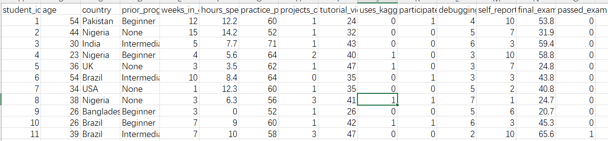

# 实验二：BP算法解决分类问题

## 问题描述

对于该实验，我选择使用互联网上搜索到的有关学生考试结果的数据集进行分类模型的训练。其任务为一个二分类问题：给定每个学生的学习过程与行为特征，预测该学生是否能够通过期末考试。

为了避免信息泄露，本实验在建模时不使用考试最终分数作为输入特征，仅以学习行为相关特征作为模型输入，训练 BP神经网络模型学习从特征到标签的映射关系。模型输出对两类的预测概率分布，并依据最大概率得到最终分类结果。实验的目标是通过训练集学习模型参数，在测试集上评估模型的泛化性能，并用 loss/accuracy 曲线、混淆矩阵、ROC 曲线与 AUC 等指标对分类效果进行直观展示与分析。

## 数据集

### 数据集的选择与处理

本实验选用互联网上公开的学生学习与考试表现数据集 `python_learning_exam_performance.csv`。数据以表格形式组织，每一行对应一名学生样本，列字段包含学生的基本信息、学习行为与课程参与情况等，最后以 `passed_exam` 作为分类标签，取值为 0 或 1，分别表示未通过和通过。数据集中还包含 `final_exam_score`以及 `student_id`等字段。这是数据集的示例：



结合本实验的目标，`passed_exam` 被设定为模型输出标签，其余字段作为候选输入特征。

为了避免信息泄露，本实验在构建输入特征时显式移除了与标签存在直接因果关联、会导致模型不准的字段：

- `final_exam_score`：最终分数与是否通过高度同源，若作为输入会使分类失去意义；
- `student_id`：仅为样本标识，不具备可泛化的预测信息；
- `passed_exam`：作为标签列，不参与特征输入。

因此，模型输入仅由学生学习行为与课程参与等有效特征构成，保证模型精度。

### 数据集的划分

为了评估模型的泛化能力，本实验将数据划分为训练集与测试集，默认比例为：

- 测试集占比 `test_ratio = 0.2`
- 训练集占比 `1 - test_ratio = 0.8`

划分过程的核心思想是：

1. 使用固定随机种子 `seed` 打乱全部样本索引，保证实验可复现；
2. 按比例截取前 `test_n` 个样本作为测试集，其余作为训练集；
3. 返回 `X[tr], y[tr], X[te], y[te]` 四个数组。

以下是相关代码：

```python
def train_test_split(X, y, test_ratio=0.2, seed=42):
    rng = np.random.default_rng(seed)
    n = X.shape[0]
    idx = np.arange(n)
    rng.shuffle(idx)
    test_n = max(1, min(n - 1, int(round(n * test_ratio))))
    te = idx[:test_n]
    tr = idx[test_n:]
    return X[tr], y[tr], X[te], y[te]
```

由于输入特征的量纲差异较大，在划分完成后需要对数据进行标准化处理：

- 用训练集计算每一维特征的均值 `mean` 与标准差 `std`；
- 将训练集与测试集分别做变换：
  训练集：`(Xtr - mean) / std`
  测试集：`(Xte - mean) / std`

其中测试集标准化使用的是训练集统计量，避免将测试集信息“泄露”到训练过程，保证评估结果可信。标准差过小的特征会被置为 1.0 以防止数值除零问题。

以下是相关代码：

```python
def standardize_fit_transform(Xtr, Xte):
    mean = Xtr.mean(axis=0)
    std = Xtr.std(axis=0)
    std[std < 1e-12] = 1.0
    return (Xtr - mean) / std, (Xte - mean) / std
```

通过以上步骤，最终得到可直接输入 BP 神经网络的数值化特征矩阵与对应标签，并为后续模型训练与测试评估提供一致的数据基础。

## 模型实现

本实验使用一个两层的前馈神经网络MLP完成二分类任务，模型训练采用 BP算法对参数进行迭代更新。下面说明模型构建及评估的方法及代码实现。

### 数学工具说明

#### 激活函数`sigmoid(x)`:

隐藏层使用 Sigmoid 作为非线性变换。实现中对正负输入分别处理，避免直接计算 `exp(-x)` 或 `exp(x)` 造成数值溢出，提高稳定性。Sigmoid 的作用是将线性输出压缩到 0 到 1 的范围，引入非线性表达能力。代码如下：

```python
def sigmoid(x):
    out = np.empty_like(x)
    pos = x >= 0
    neg = ~pos
    out[pos] = 1.0 / (1.0 + np.exp(-x[pos]))
    z = np.exp(x[neg])
    out[neg] = z / (1.0 + z)
    return out
```

#### Softmax 函数 `softmax(logits)`

输出层采用 Softmax 将网络输出的 logits 转换为类别概率分布。实现中先执行
$$
z = logits - \max(logits)
$$
进行平移，避免 `exp` 溢出，然后归一化得到每一类的概率。对于二分类任务，最终得到二维概率向量，其中第二维可视为$P(pass)$，用于后续阈值判断与 ROC/AUC 计算。代码如下：

```python
def softmax(logits):
    z = logits - logits.max(axis=1, keepdims=True)
    expz = np.exp(z)
    return expz / expz.sum(axis=1, keepdims=True)
```

#### One-Hot 编码 `one_hot(y, K)`

反向传播计算交叉熵梯度时需要将标签从整数类别转换为 one-hot 向量。例如二分类时，标签 0 对应 `[1,0]`，标签 1 对应 `[0,1]`，便于统一矩阵化求导。代码如下：

```python
def one_hot(y, K):
    oh = np.zeros((y.shape[0], K), dtype=np.float64)
    oh[np.arange(y.shape[0]), y] = 1.0
    return oh
```

### 评价指标与可视化相关函数

#### 混淆矩阵 `confusion_matrix(y_true, y_pred, K)`

该函数用于统计分类结果的整体分布情况，生成一个大小为 $$K \times K$$ 的矩阵 `cm`，其中：行表示真实类别，列表示预测类别，`cm[t, p]` 表示真实类别为 $$t$$ 且被预测为 $$p$$ 的样本数量。

对于二分类（$$K=2$$）时，混淆矩阵结构为：
$$
cm=
\begin{bmatrix}
TN & FP \\
FN & TP
\end{bmatrix}
$$

- $$TN$$：真实为 0，预测为 0（正确判为未通过）
- $$FP$$：真实为 0，预测为 1（把未通过错判为通过）
- $$FN$$：真实为 1，预测为 0（把通过错判为未通过）
- $$TP$$：真实为 1，预测为 1（正确判为通过）

混淆矩阵的直观优势是比单一准确率更能说明模型错在哪里，尤其适合类别不平衡的情况。以下是其代码实现：

```python
def confusion_matrix(y_true, y_pred, K):
    cm = np.zeros((K, K), dtype=int)
    for t, p in zip(y_true, y_pred):
        cm[t, p] += 1
    return cm

```

#### 由混淆矩阵计算指标 `metrics_from_cm(cm)`

该函数在二分类前提下，从混淆矩阵提取 $$TN, FP, FN, TP$$，并计算常用指标：

1. **准确率 Accuracy**

$$
Accuracy=\frac{TP+TN}{TP+TN+FP+FN}
$$

表示所有样本里预测正确的比例。

2. **精确率 Precision**

$$
P=\frac{TP}{TP+FP}
$$

表示预测为通过的样本中，有多少是真的通过。如果精确率高，说明模型预测通过时更可靠，误报少。

3. **召回率 Recall**

$$
R=\frac{TP}{TP+FN}
$$

表示真实通过的样本中，有多少被成功找出来。如果召回率低，说明漏报多，很多真实通过被判成未通过。

4. **F1 值**

$$
F1=\frac{2 \cdot Precision \cdot Recall}{Precision+Recall}
$$

F1 是 Precision 和 Recall 的调和平均，适合在既不希望误报也不希望漏报的场景下作为综合指标。

以下是其代码实现：

```python
def metrics_from_cm(cm):
    # binary: rows=true [0,1], cols=pred [0,1]
    TN, FP = cm[0,0], cm[0,1]
    FN, TP = cm[1,0], cm[1,1]
    acc = (TP + TN) / max(1, (TP + TN + FP + FN))
    prec = TP / max(1, (TP + FP))
    rec  = TP / max(1, (TP + FN))
    f1   = 0.0 if (prec + rec) == 0 else 2 * prec * rec / (prec + rec)
    return acc, prec, rec, f1
```

#### ROC 曲线与 AUC `roc_curve_and_auc(y_true, score_pos)`

函数的两个输入变量分别为：

- `y_true`：真实标签，取值为 0/1
- `score_pos`：模型对正类（pass=1）的预测分数，通常取$P(\text{pass})$

函数先将样本按 `score_pos` 从大到小排序，相当于从最像正类到最不像正类依次降低阈值。每扫过一个样本，相当于把阈值调到该样本分数附近，然后更新：

- 真阳性率 TPR：
  $$
  TPR=\frac{TP}{P}
  $$
  其中 $P$ 是真实正类数量。

- 假阳性率 FPR：
  $$
  FPR=\frac{FP}{N}
  $$
  其中 $$N$$ 是真实负类数量。

每一个阈值都对应一个点 $$(FPR,TPR)$$，连起来就是 ROC 曲线。

AUC 是 ROC 曲线下面积，用梯形法则计算：
$$
AUC=\int_{0}^{1} TPR(FPR), dFPR
$$
AUC 的含义可以理解为：随机抽一个正样本和一个负样本，模型把正样本打分排在负样本前面的概率。
一般来说：AUC 越接近 1 越好；AUC = 0.5 接近随机。

该函数最后返回三个值：`fpr`：一系列 FPR 点；`tpr`：一系列 TPR 点；`auc`：面积数值

其代码如下：

```python
def roc_curve_and_auc(y_true, score_pos):
    # y_true in {0,1}; score_pos in [0,1] or real-valued
    order = np.argsort(-score_pos)  # descending score
    y = y_true[order]
    s = score_pos[order]

    P = np.sum(y == 1)
    N = np.sum(y == 0)
    P = max(1, P)
    N = max(1, N)

    tpr = [0.0]
    fpr = [0.0]
    tp = 0
    fp = 0

    # step through thresholds
    for i in range(len(s)):
        if y[i] == 1:
            tp += 1
        else:
            fp += 1
        tpr.append(tp / P)
        fpr.append(fp / N)

    # AUC via trapezoidal rule
    auc = 0.0
    for i in range(1, len(tpr)):
        auc += (fpr[i] - fpr[i-1]) * (tpr[i] + tpr[i-1]) / 2.0
    return np.array(fpr), np.array(tpr), auc
```

### MLP 网络结构（`class MLP`）

#### 网络初始化

本实验的 MLP 为 **单隐藏层网络**，结构为：
$$
D \rightarrow H \rightarrow K
$$
其中：

- $$D$$为输入特征维度（One-Hot 之后的列数）
- $$H$$为隐藏层神经元个数（默认为 64，可调）
- $$K$$为输出类别数，本实验为二分类，$$K=2$$

模型参数包括：

- 第一层权重与偏置：$$W_1 \in \mathbb{R}^{D \times H},\ b_1 \in \mathbb{R}^{H}$$
- 第二层权重与偏置：$$W_2 \in \mathbb{R}^{H \times K},\ b_2 \in \mathbb{R}^{K}$$

初始化采用正态分布随机初始化，并根据层大小设置标准差，避免初始输出过大或过小影响训练。初始化代码如下：

```python
def __init__(self, D, H, K, seed=123):
    rng = np.random.default_rng(seed)
    s1 = np.sqrt(2.0 / (D + H))
    s2 = np.sqrt(2.0 / (H + K))
    self.W1 = rng.normal(0.0, s1, size=(D, H))
    self.b1 = np.zeros((H,), dtype=np.float64)
    self.W2 = rng.normal(0.0, s2, size=(H, K))
    self.b2 = np.zeros((K,), dtype=np.float64)
```

#### 前向传播

给定输入矩阵 $$X \in \mathbb{R}^{N \times D}$$，在神经网络中该矩阵这样传播：

1. 隐藏层线性变换：
   $$
   z_1 = XW_1 + b_1
   $$

2. Sigmoid 激活：
   $$
   a_1 = \sigma(z_1)
   $$

3. 输出层线性变换：
   $$
   z_2 = a_1W_2 + b_2
   $$

4. Softmax 得到类别概率：
   $$
   p = \text{softmax}(z_2)
   $$

其中 $$p \in \mathbb{R}^{N \times K}$$，每一行是样本属于各类别的预测概率。实现中同时缓存 `X, a1, p`，用于后续反向传播计算梯度。其代码如下：

```python
def forward(self, X):
    z1 = X @ self.W1 + self.b1
    a1 = sigmoid(z1)
    z2 = a1 @ self.W2 + self.b2
    p = softmax(z2)
    return p, (X, a1, p)
```

前向传播完成后，需要计算其损失函数。实验中使用交叉熵损失来计算，对每个样本取其真实类别对应的预测概率并取负对数，最后对 batch 取平均：
$$
L = -\frac{1}{N}\sum_{i=1}^{N}\log(p_{i,y_i})
$$
代码中使用 `clip` 限制概率下界，避免出现 `log(0)` 造成数值错误。

损失函数代码如下：

```python
def loss(self, p, y):
    eps = 1e-12
    return -np.log(np.clip(p[np.arange(y.shape[0]), y], eps, 1.0)).mean()
```

#### 反向传播

反向传播根据链式法则计算参数梯度，并加入 L2 正则抑制过拟合。核心思路是从输出层误差开始逐层传播：

1. 输出层误差：
   $$
   dz_2 = \frac{p - Y}{N}
   $$
   其中 $$Y$$ 为 one-hot 标签矩阵。

2. 第二层参数梯度：
   $$
   dW_2 = a_1^T dz_2 + \lambda W_2,\quad db_2 = \sum dz_2
   $$

3. 反传到隐藏层：
   $$
   da_1 = dz_2 W_2^T
   $$

4. Sigmoid 导数：
   $$
   dz_1 = da_1 \cdot a_1(1-a_1)
   $$

5. 第一层参数梯度：
   $$
   dW_1 = X^T dz_1 + \lambda W_1,\quad db_1 = \sum dz_1
   $$

其中 $$\lambda$$ 对应代码中的 `l2` 参数。

反向传播代码如下：

```python
def backward(self, cache, y, l2=1e-4):
    X, a1, p = cache
    N = X.shape[0]
    K = p.shape[1]
    Y = one_hot(y, K)
    dz2 = (p - Y) / N

    dW2 = a1.T @ dz2 + l2 * self.W2
    db2 = dz2.sum(axis=0)

    da1 = dz2 @ self.W2.T
    dz1 = da1 * (a1 * (1.0 - a1))

    dW1 = X.T @ dz1 + l2 * self.W1
    db1 = dz1.sum(axis=0)
    return dW1, db1, dW2, db2
```

#### 参数更新

采用最基础的梯度下降更新规则，学习率为 `lr`：
$$
W_{new}=  W - lr \cdot dW,\quad b_{new} = b - lr \cdot db
$$
代码如下：

```python
def step(self, grads, lr=0.05):
    dW1, db1, dW2, db2 = grads
    self.W1 -= lr * dW1
    self.b1 -= lr * db1
    self.W2 -= lr * dW2
    self.b2 -= lr * db2
```

训练过程在每个 epoch 中执行一次前向传播 → 损失计算 → 反向传播 → 参数更新，并记录损失函数与训练和测试的 accuracy 用于绘图展示。

#### 预测接口：输出概率与输出类别

模型训练完成后，需要将网络输出用于测试集评估与结果可视化。为此，`class MLP` 提供了两个预测接口，分别输出“概率形式的预测结果”和“离散类别形式的预测结果”。

1. **概率预测 `predict_proba(X)`**
   该函数内部调用一次前向传播，直接返回 Softmax 输出的类别概率矩阵：

   - 输出记为 $$p$$，形状为 $$N \times K$$；
   - 对于第 $$i$$ 个样本，$$p_{i,k}$$ 表示预测其属于类别 $$k$$ 的概率；
   - 在本实验二分类任务中，$$K=2$$，因此 $$p_{i,1}$$ 即为预测通过考试的概率，可记为：

   $$
   P(\text{pass}) = p_{i,1}
   $$

   该概率输出用于 ROC 曲线、AUC 计算以及预测概率分布直方图等可视化分析。代码如下：

   ```python
   def predict_proba(self, X):
       p, _ = self.forward(X)
       return p
   ```

   

2. **类别预测 `predict(X)`**
   分类评估通常需要离散类别标签。该函数先调用 `predict_proba(X)` 得到概率矩阵 $$p$$，再对每个样本选择概率最大的类别作为最终预测结果：
   $$
   \hat{y}*i=\arg\max*{k} p_{i,k}
   $$
   对于二分类任务，上式等价于比较两类概率大小：若 $$p_{i,1} > p_{i,0}$$ 则预测为 pass=1，否则预测为 fail=0。该输出用于计算 accuracy、混淆矩阵等离散指标，从而直观反映分类正确与错误的分布情况。代码如下：

   ```python
   def predict(self, X):
       p = self.predict_proba(X)
       return np.argmax(p, axis=1)
   ```


通过以上函数，基于BP算法构建的神经网络已经实现了最基础的功能，能够对数据集进行学习与分类。接下来关注`main`函数部分对该模型的具体调用方法，用于画图的相关代码报告中略去不提。

## 模型的训练与评估

`main()` 函数负责将神经网络的完整流程串联起来，使模型能够在指定数据集上完成二分类训练并输出的结果。

程序首先通过命令行参数设置实验超参数与输入输出选项，例如隐藏层规模 `--hidden`、训练轮数 `--epochs`、学习率 `--lr`、L2 正则 `--l2`、测试集比例 `--test_ratio`、随机种子 `--seed` 等。这样可以在不改代码的情况下快速对比不同配置对分类效果的影响，并保证实验可复现。代码如下：

```python
ap = argparse.ArgumentParser()
ap.add_argument("--csv", default="python_learning_exam_performance.csv")
ap.add_argument("--hidden", type=int, default=64)
ap.add_argument("--epochs", type=int, default=300)
ap.add_argument("--lr", type=float, default=0.05)
ap.add_argument("--l2", type=float, default=1e-4)
ap.add_argument("--test_ratio", type=float, default=0.2)
ap.add_argument("--seed", type=int, default=42)
ap.add_argument("--out", default="report_bp")
args = ap.parse_args()
```

在命令行中运行程序时，使用方法如下：

```bash
python bp_exam.py --csv python_learning_exam_performance.csv --epochs 300 --hidden 64 --lr 0.05 --out bp
```

这表示读取我预设的数据集`python_learning_exam_performance.csv`，隐藏层规模 $H$ 设置为64，训练轮数设置为300轮，学习率设置为0.05，`l2`、测试集比例、随机种子采用预设的默认值，输出的图片前缀为`bp`。

在读取 CSV 后，程序将 `passed_exam` 作为标签向量 $$y$$，并显式移除以下列：`passed_exam`、`final_exam_score`、`student_id`，原因已在先前陈述。随后对剩余特征执行 One-Hot 编码与缺失值处理，得到数值矩阵 $$X$$。这一步保证 MLP 的输入是统一的实数向量形式，同时避免模型直接读答案。以下是相关代码：

```python
df = pd.read_csv(args.csv)

# label
if "passed_exam" not in df.columns:
    raise SystemExit("Cannot find column: passed_exam")
y = df["passed_exam"].astype(int).to_numpy()

# avoid leakage & id
drop_cols = ["passed_exam", "final_exam_score", "student_id"]
for c in drop_cols:
    if c in df.columns:
        df = df.drop(columns=[c])

# categorical -> one-hot
Xdf = pd.get_dummies(df, dummy_na=True).fillna(0.0)
X = Xdf.to_numpy(dtype=np.float64)
```

数据通过随机打乱后按比例划分为训练集$X_{tr}, y_{tr}$与测试集$$X_{te}, y_{te}$$。划分完成后对特征进行标准化：用训练集的均值与标准差对训练集与测试集同时变换。代码如下：

```python
Xtr, ytr, Xte, yte = train_test_split(X, y, test_ratio=args.test_ratio, seed=args.seed)
Xtr, Xte = standardize_fit_transform(Xtr, Xte)
```

程序根据训练集特征维度确定输入维度 $$D$$，并设置类别数 $$K=2$$。随后实例化模型：输入层维度：$$D$$，隐藏层神经元数：$$H=\text{hidden}$$，输出层维度：$$K=2$$

因此网络结构为：
$$
D \rightarrow H \rightarrow 2
$$
模型参数在初始化阶段随机生成，为后续 BP 更新提供起点。代码如下：

```python
D = Xtr.shape[1]
K = 2
class_names = ["fail", "pass"]

model = MLP(D=D, H=args.hidden, K=K, seed=args.seed + 100)

losses, acc_tr, acc_te = [], [], []
rng = np.random.default_rng(args.seed + 999)
```

模型训练以 epoch 为单位迭代。每一轮训练主要包含：

1. 打乱训练集顺序：生成一个随机排列索引，使每轮训练输入顺序不同。
2. 前向传播：计算输出概率分布 $$p$$。
3. 计算损失：用交叉熵损失衡量预测与真实标签差异。
4. 反向传播：由 BP 算法计算各层梯度，并加入 L2 正则项抑制过拟合。
5. 梯度下降更新：按学习率 `lr` 对参数做一次更新。

训练过程中每一轮都会在训练集与测试集上调用 `model.predict()` 得到离散预测类别，并计算训练、测试准确率，用于观察模型是否收敛以及是否出现过拟合趋势。代码如下：

```python
for ep in range(1, args.epochs + 1):
    idx = rng.permutation(len(Xtr))
    Xb, yb = Xtr[idx], ytr[idx]  # full-batch, shuffled

    p, cache = model.forward(Xb)
    loss = model.loss(p, yb)
    grads = model.backward(cache, yb, l2=args.l2)
    model.step(grads, lr=args.lr)

    pred_tr = model.predict(Xtr)
    pred_te = model.predict(Xte)
    a_tr = (pred_tr == ytr).mean()
    a_te = (pred_te == yte).mean()

    losses.append(loss); acc_tr.append(a_tr); acc_te.append(a_te)

    if ep == 1 or ep % 10 == 0 or ep == args.epochs:
        print(f"Epoch {ep:4d} | loss={loss:.4f} | train_acc={a_tr:.4f} | test_acc={a_te:.4f}")
```

训练结束后，程序在测试集上输出两类结果：

1. 概率输出：调用 `model.predict_proba(Xte)` 得到 $$p \in \mathbb{R}^{N_{te}\times 2}$$，并取正类概率：
   $$
   score\_pos = P(\text{pass}) = p[:,1]
   $$
   该概率用于 ROC 曲线与 AUC 计算，评估模型对正负样本的区分能力。

2. 离散预测与混淆矩阵指标：由概率取最大值类别得到预测标签 $$\hat{y}$$，构造混淆矩阵，并计算 Accuracy、Precision、Recall、F1 等指标，直观分析分类表现。

## 模型性能分析

按先前指令运行程序进行 300 轮训练后，将BP-MLP 模型在训练集与测试集上的表现输出为图片便于直观观察，并输出了测试集指标与混淆矩阵。整体来看，模型能够较好地区分通过与未通过两类样本，但在当前默认阈值下，对通过这一类的 $R$ 偏低，表现为漏判较多。下面根据具体输出进行分析。

**1. 收敛情况：Loss 与 Accuracy 曲线**

从 Training Loss 曲线可以看到，训练损失随 epoch 增加稳定下降（约从 0.57 降到 0.28 左右），说明模型通过反向传播不断减小交叉熵损失，训练过程收敛良好。


从 Accuracy Curves 可见，训练集准确率逐步上升并最终达到约 0.87 左右，测试集准确率也随训练推进缓慢上升并稳定在 0.85 左右。训练与测试曲线之间存在一定间隔，但没有出现训练集持续升高而测试集下降的情况，因此可以认为本次训练未出现严重过拟合，模型具备一定的泛化能力。


2. **测试集总体指标输出：**

   ```tex
   BP-MLP Binary Classification Report (passed_exam)
   Features(after one-hot) D=25, Hidden H=64, Epochs=300
   Train N=2400, Test N=600
   
   Test Metrics:
     Accuracy  = 0.8500
     Precision = 0.8710
     Recall    = 0.2389
     F1        = 0.3750
     AUC       = 0.9393
   
   Confusion Matrix (rows=true, cols=pred):
   [[483   4]
    [ 86  27]]
   ```

   测试集输出指标如下：

   - $$Accuracy = 0.8500$$：总体分类正确率为 $$85\%$$，说明模型在整体上能取得较高正确率。
   - $$Precision = 0.8710$$：当模型预测为通过时，其中约 $$87.1\%$$ 确实为真实通过，误报较少。
   - $$Recall = 0.2389$$：真实“通过”的样本中，仅约 $$23.9\%$$ 被模型识别出来，说明漏报严重。
   - $$F1 = 0.3750$$：由于 Recall 偏低，导致 $P$ 与 $R$ 的综合指标 F1 不高。
   - $$AUC = 0.9393$$：AUC 较高，说明模型对两类样本的排序和区分能力很强；即使在 $$0.5$$ 阈值下 Recall 低，也不代表模型不会分类，而更可能是阈值选择导致过于保守导致。

   综合来看，模型偏向把样本判为未通过，因此准确率和 P 看起来不错，但 R 不足。

3. **混淆矩阵分析**

   混淆矩阵（rows=true, cols=pred）为：
   $$
   \begin{bmatrix}
   483 & 4 \\
   86 & 27
   \end{bmatrix}
   $$
   解释如下：

   - 真实的 fail 案例中，$$483$$ 个被正确预测为 fail，只有 $$4$$ 个被误判为 pass（$$FP=4$$ 很小）；
   - 真实的 pass 案例 中，只有 $$27$$ 个被正确预测为 pass，但有 $$86$$ 个被误判为 fail（$$FN=86$$ 很大）。

   因此，主要错误来自 FN，这也直接解释了 Recall 很低：
   $$
   Recall=\frac{TP}{TP+FN}=\frac{27}{27+86}\approx 0.2389
   $$
   同时 Precision 较高则来自 FP 很小：
   $$
   Precision=\frac{TP}{TP+FP}=\frac{27}{27+4}\approx 0.8710
   $$
   综上可见：模型对未通过判断非常谨慎且准确，但对通过样本识别不足。我认为可能与训练集中对于通过的样本给出的数据不足有关。


4. **ROC 曲线与概率分布图**

   ROC 曲线的 $$AUC=0.9393$$ 表明模型对正负类的区分能力强，当调整判定阈值时，可以在较低的 FPR 下获得较高的 TPR。

   结合 Predicted Probability Distribution (Test) 的概率直方图可以看到：

   - 真实 fail(0) 的 $$P(\text{pass})$$ 大多集中在较低区间（接近 $$0 \sim 0.2$$），说明模型对负类概率输出较自信；
   - 真实 pass(1) 的 $$P(\text{pass})$$ 分布整体更靠右，但大量样本仍落在 $$0.5$$ 以下，导致按默认规则（$$\hat{y}=\arg\max p$$，二分类近似等价于 $$P(\text{pass})>0.5$$ 判为 pass）时，会把不少真实 pass 判成 fail，从而产生大量 FN。

   因此可以得出相同的结论：模型本身能把 pass 排在 fail 前面，但在默认阈值下判正类过于严格，导致 Recall 低。


## 实验总结

本实验采用学生考试成绩相关数据集，围绕是否能够通过期末考试的二分类任务，构建了一个使用 BP训练的 MLP 模型，实现了从原始表格特征到分类结果的完整流程。实验过程中首先对数据进行了预处理：将 `passed_exam` 作为监督学习标签，并显式移除可能造成信息泄露或无泛化意义的字段；对离散特征进行 one-hot 编码、对数值特征做标准化处理，最终得到维度为 $$D=25$$ 的输入向量，保证模型能够稳定训练并具备可解释的评估过程。

在模型设计上，本实验实现了一个单隐层 MLP（$$D \rightarrow H \rightarrow 2$$），使用 Sigmoid 作为隐层激活函数，Softmax 输出两类概率分布，损失函数采用交叉熵，并在反向传播中加入 L2 正则以抑制过拟合。训练采用 full-batch 梯度下降更新参数，并记录 loss/accuracy 曲线以观察收敛情况。结果表明训练过程收敛稳定，训练损失持续下降，训练集与测试集准确率均呈上升并趋于稳定，说明模型能够有效学习特征与标签之间的映射关系，且没有出现明显的训练崩溃或震荡问题。

在测试集评估中，模型取得 $$Accuracy=0.85$$，并得到 $$AUC=0.9393$$。其中较高的 AUC 说明模型对正负样本具有较强的区分能力；但混淆矩阵显示模型对正类（pass=1）的识别较为保守：$$TP=27, FN=86$$ 导致 $$Recall=0.2389$$，而 $$FP=4$$ 很小使得 $$Precision=0.8710$$ 较高。也就是说，模型整体预测正确率较高，但主要错误来自将通过错判为未通过的漏判。这一现象与预测概率分布图一致：大量真实 pass 样本的 $$P(\text{pass})$$ 落在 $$0.5$$ 以下，使得默认阈值策略下 Recall 偏低。由此可见，本实验不仅验证了 BP-MLP 在表格二分类任务上的可行性，也直观体现了不同评价指标所反映的侧重点差异：Accuracy 不能完全揭示类别偏置，而混淆矩阵、Precision/Recall/F1 与 ROC-AUC 能更全面地描述模型行为。

总体而言，本实验成功完成了 BP 神经网络分类器从数据处理、模型训练到可视化评估的全流程实现，并以多种指标与图表对分类效果进行了直观展示。若采用更为完善的数据集并优化模型结构与数学方法，该神经网络有希望能够取得更加优秀的性能表现。