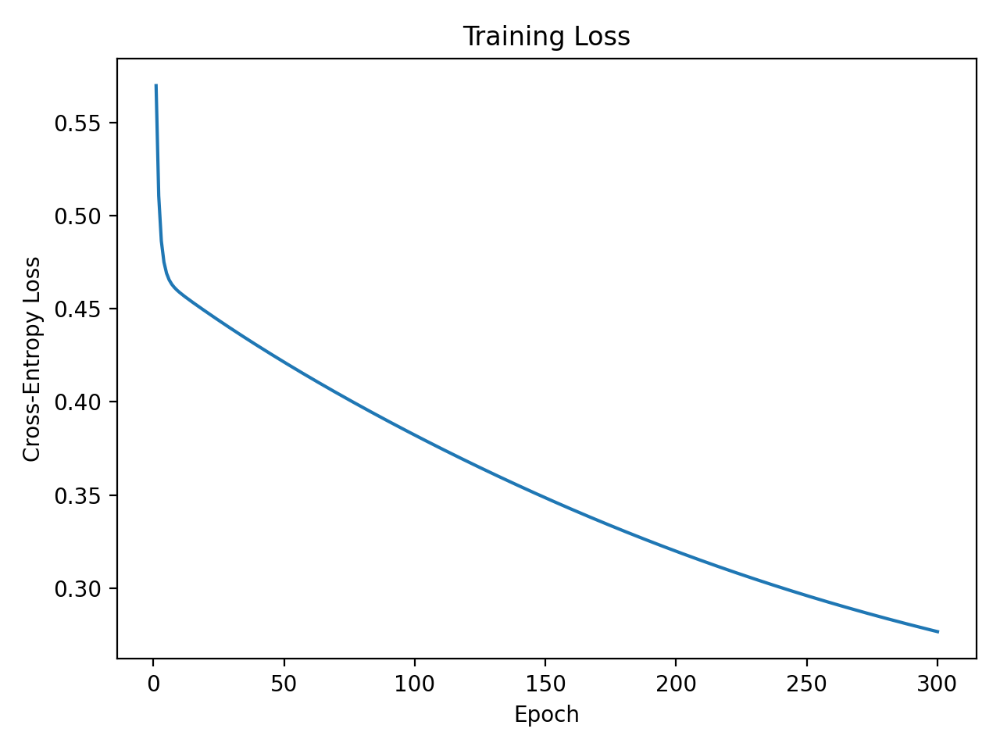
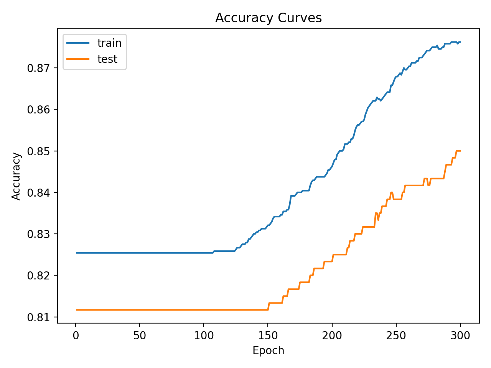
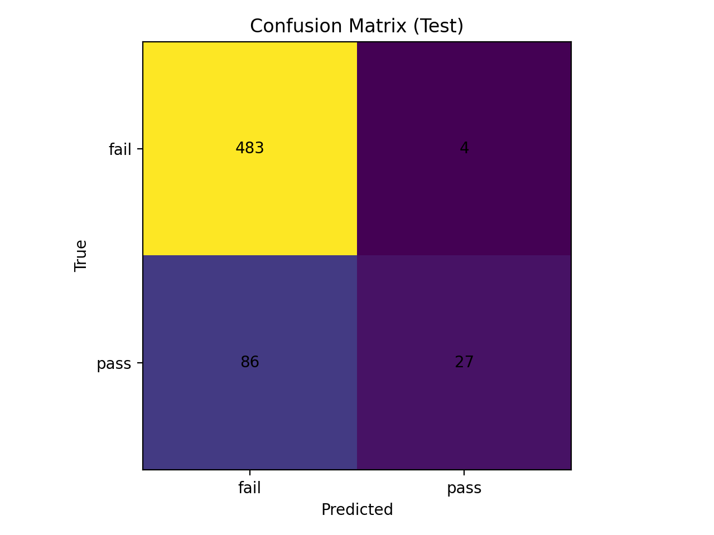
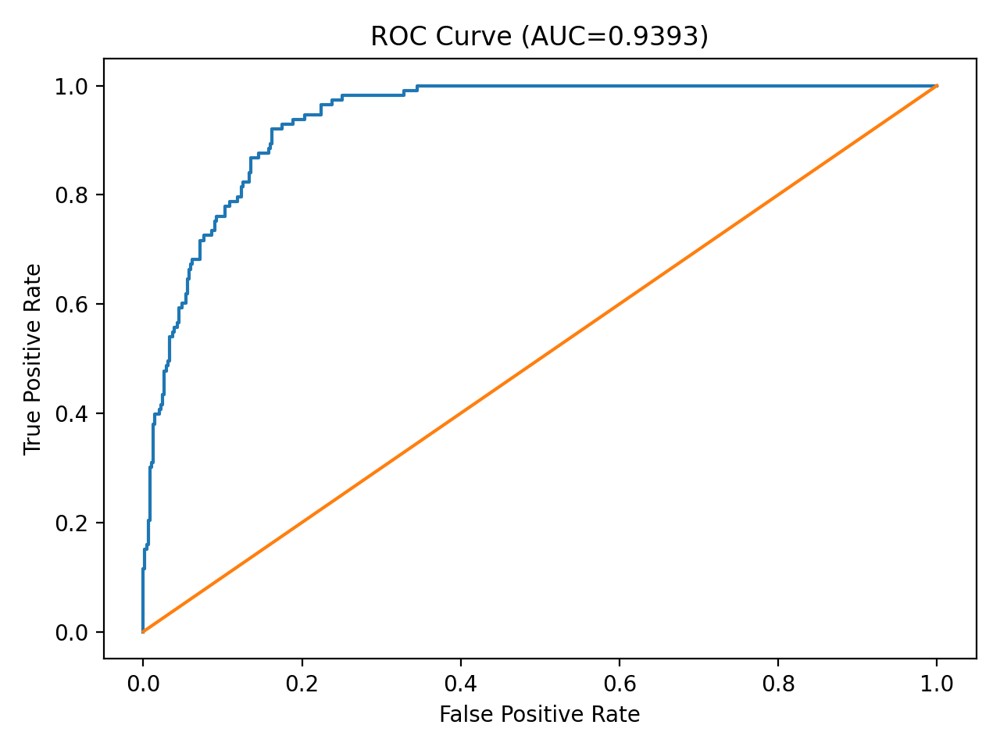
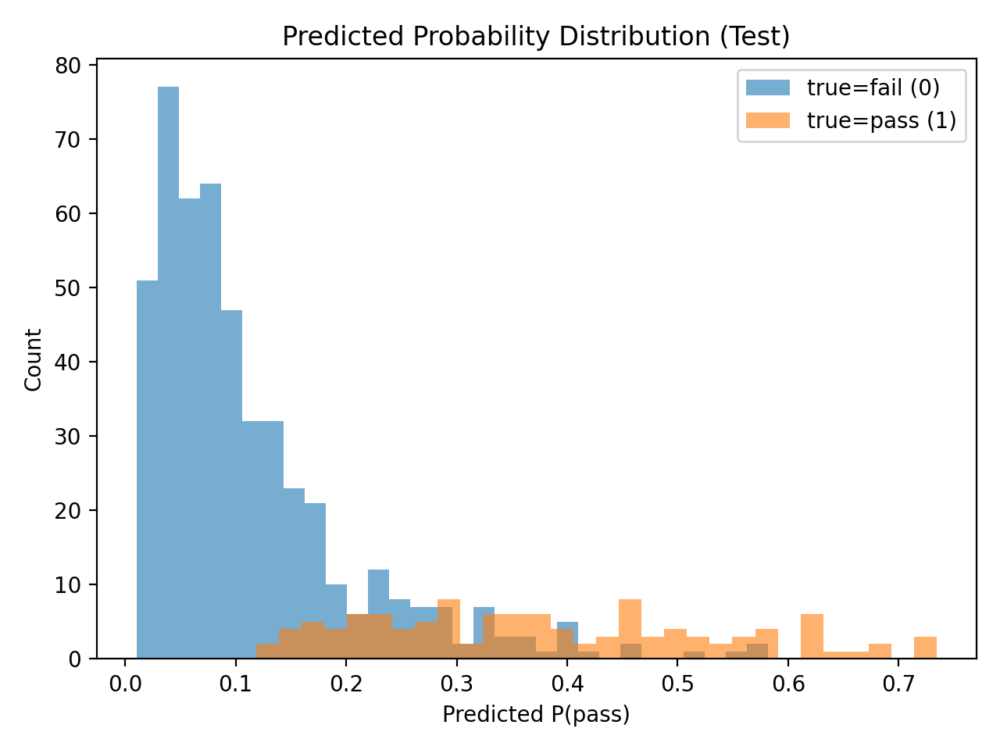

# 实验一：重排九宫问题

## 问题描述

重排九宫问题是在一个 3×3 的棋盘上放置数字 0∼8 的九个方块，其中 0 表示空格。一次合法操作为：将空格与其上下左右相邻的一个数字交换位置。给定一个初始布局，要求通过若干次合法移动，得到指定的目标布局，并输出移动步数与移动序列。下图是目标布局的要求：


由于重排九宫并非所有初始状态都能到达目标状态，程序首先需要判断给定初始布局是否可解；若不可解则直接返回无解；若可解则使用搜索算法求解，并给出从初始状态到目标状态的一条解路径。

## 实验代码整体框架

本实验我选择使用 Java 实现，为了便于组织与复用，我将整个功能拆分为多个模块。整体流程为：

1. 读取用户输入的九宫格初始状态；
2. 构造棋盘状态 `Board`；
3. 根据用户选择的搜索策略调用对应求解器；
4. 返回 `Solution`，输出搜索，以及求解路径中的棋盘序列。

### 模块概览

以下是各实验代码模块及其作用：

- `Board.java`：棋盘状态表示与状态操作核心模块。
- `Move.java`：移动方向枚举。
- `Node.java`：搜索节点数据结构。
- `Solution.java`：结果封装。
- `AStarSolver.java`：A\* 搜索实现。
- `BFSSolver.java`：广度优先搜索实现。
- `Main.java`：程序入口与交互输出。

### 代码分析

在该部分，我将针对框架代码做分析，体现每部分都具体发挥了怎样的作用。

#### `Node.java`

```java
public final class Node {
    public final Board board;
    public final int g;      // cost so far
    public final int h;      // heuristic
    public final int f;      // g + h
    public final Node parent;
    public final Move move;  // move taken from parent -> this

    public Node(Board board, int g, Node parent, Move move) {
        this.board = board;
        this.g = g;
        this.h = board.manhattan();
        this.f = this.g + this.h;
        this.parent = parent;
        this.move = move;
    }
}
```

成员变量：

- `board`：当前结点对应的棋盘状态。
- `g`：代价函数，从起点到当前状态的已走步数，每走一步代价为 1，即与深度相同。
- `h`：启发函数，用曼哈顿距离计算。
- `f`：估价函数，`f(n) = g(n) + h(n)`。
- `parent`：指向父结点，用于最终找到目标后回溯路径。
- `move`：从 `parent` 状态移动到当前状态所执行的动作，用于回溯时拼成移动序列。

------

#### `Move.java`

`Move` 是一个枚举，把四个方向移动抽象成统一的数据结构，使得生成邻居状态时不需要写四段重复代码。

```java
public enum Move {
    U(-1, 0, 'U'),
    D(1, 0, 'D'),
    L(0, -1, 'L'),
    R(0, 1, 'R');

    public final int dr;
    public final int dc;
    public final char code;

    Move(int dr, int dc, char code) {
        this.dr = dr;
        this.dc = dc;
        this.code = code;
    }
}
```

每个 Move 有三个信息：

- `dr`：行变化
- `dc`：列变化
- `code`：输出路径时用的字符表示

例如：

- `U(-1,0)`：空格上移 → 行号减少 1
- `R(0,1)`：空格右移 → 列号增加 1

------

#### `Board.java`

`Board` 表示一个 3×3 的拼图状态，是九宫生成逻辑的核心。下面将其分为多个部分介绍。

1、 数据结构与目标状态定义：

```java
private final int n;          // dimension (for 8-puzzle it's 3)
private final int[] tiles;    // length n*n, 0 is blank
private final int blank;      // index of 0
private final int manhattan;  // cached heuristic
```

- `n`：棋盘维度（在重排九宫问题中固定为 3）。
- `tiles`：一维数组保存棋盘，长度 `n*n=9`。其中下标 `idx = r*n + c`，数值 `0` 表示空格。
- `blank`：空格在 `tiles` 中的下标，方便快速生成邻居。
- `manhattan`：曼哈顿距离缓存值。

接下来设置目标状态：

```java
private static final int N_GOAL = 3;
private static final int[] GOAL = {
    1, 2, 3,
    8, 0, 4,
    7, 6, 5
};
```

------

2、找到当前状态下各数字在目标位置中的下标：

```java
private static final int[] GOAL_POS = buildGoalPos();
private static int[] buildGoalPos() {
    int[] pos = new int[N_GOAL * N_GOAL];
    Arrays.fill(pos, -1);
    for (int i = 0; i < GOAL.length; i++) pos[GOAL[i]] = i;
    return pos;
}
```

这段代码将各位置初始化为 -1，之后扫描目标数组，把每个 `tile` 值映射到目标位置 `index`。加入这个部分，在算曼哈顿距离时可以更快地找到每个 `tile` 的目标坐标。

------

3、 构造函数：

```java
public Board(int n, int[] tiles) {
    if (n <= 0) throw new IllegalArgumentException("n must be > 0");
    if (tiles == null || tiles.length != n * n) throw new IllegalArgumentException("tiles length must be n*n");
    if (n != N_GOAL) throw new IllegalArgumentException("This solver is configured for 3x3 goal only.");

    this.n = n;
    this.tiles = Arrays.copyOf(tiles, tiles.length);

    int b = -1;
    boolean[] seen = new boolean[n * n];
    for (int i = 0; i < this.tiles.length; i++) {
        int v = this.tiles[i];
        if (v < 0 || v >= n * n) throw new IllegalArgumentException("tile value out of range: " + v);
        if (seen[v]) throw new IllegalArgumentException("duplicate tile: " + v);
        seen[v] = true;
        if (v == 0) b = i;
    }
    if (b == -1) throw new IllegalArgumentException("no blank(0) tile");
    this.blank = b;

    this.manhattan = computeManhattan();
}
```

构造函数实现了对非法状态的检查，保证在初始化时用户提供的九宫格是正确合法的。在构造时计算一遍曼哈顿距离进行缓存，在启发函数中就可以快速使用这个数据。

------

4、访问器：

```java
public int n() { return n; }
public int[] tilesCopy() { return Arrays.copyOf(tiles, tiles.length); }
public int blankIndex() { return blank; }
public int manhattan() { return manhattan; }
```

这部分主要是提供给在模块外部使用，以保护内部信息安全，起到封装的效果。各变量作用如下：

- `tilesCopy()` 返回副本，保护 `Board` 的不可变性。
- `blankIndex()` 给 neighbors() 用也很方便。
- `manhattan()` 返回缓存值。

------

5、目标检测：

```java
public boolean isGoal() {
    return Arrays.equals(this.tiles, GOAL);
}
```

当前状态和目标数组逐元素相等即达到目标。

------

6、可解性判断：

核心思想：拼图可达性与逆序数奇偶性有关。

```java
int invStart = inversionCount(this.tiles);
int invGoal  = inversionCount(GOAL);
```

(1) 奇数阶的规则

```java
if (n % 2 == 1) {
    return (invStart % 2) == (invGoal % 2);
}
```

适用于当前问题，当且仅当 start 与 goal 的逆序数奇偶性相同时问题可解。

(2) 偶数阶的规则

```java
int startBlankRowFromBottom = n - (blank / n);
int goalBlankIndex = GOAL_POS[0];
int goalBlankRowFromBottom = n - (goalBlankIndex / n);

int startKey = (invStart + startBlankRowFromBottom) % 2;
int goalKey  = (invGoal  + goalBlankRowFromBottom) % 2;
return startKey == goalKey;
```

对偶数阶矩阵，需要把空格从底部数在第几行也纳入奇偶性。

------

7、 逆序数计算：

逆序数是在一维展开序列中，统计`i<j` 且 `arr[i]>arr[j]`的对数，用于上述的逆序数奇偶性校验以判断问题是否可解。代码如下：

```java
private int inversionCount(int[] arr) {
    int inv = 0;
    for (int i = 0; i < arr.length; i++) {
        if (arr[i] == 0) continue;
        for (int j = i + 1; j < arr.length; j++) {
            if (arr[j] == 0) continue;
            if (arr[i] > arr[j]) inv++;
        }
    }
    return inv;
}
```

------

8、 曼哈顿距离：

```java
private int computeManhattan() {
    int dist = 0;
    for (int idx = 0; idx < tiles.length; idx++) {
        int v = tiles[idx];
        if (v == 0) continue;

        int goalIdx = GOAL_POS[v];
        int goalR = goalIdx / n;
        int goalC = goalIdx % n;

        int r = idx / n;
        int c = idx % n;

        dist += Math.abs(r - goalR) + Math.abs(c - goalC);
    }
    return dist;
}
```

曼哈顿距离的计算方法是：遍历每个 `tile`，找到它在目标中的坐标 `(goalR, goalC)`，判断当前坐标 `(r, c)`与目标坐标距离`|r-goalR| + |c-goalC|`，最后对全部距离进行求和得到结果。

------

9、邻居生成：

```java
public static final class Neighbor {
    public final Move move;
    public final Board board;
}
```

`Neighbor`类表示一个相邻状态，其中`move`表示采取的动作，`board`表示采取动作得到的新棋盘。

```java
public List<Neighbor> neighbors() {
    int r = blank / n;
    int c = blank % n;
    List<Neighbor> res = new ArrayList<>(4);
    for (Move m : Move.values()) {
        int nr = r + m.dr;
        int nc = c + m.dc;
        if (nr < 0 || nr >= n || nc < 0 || nc >= n) continue;
        int nb = nr * n + nc;

        int[] next = Arrays.copyOf(tiles, tiles.length);
        next[blank] = next[nb];
        next[nb] = 0;

        res.add(new Neighbor(m, new Board(n, next)));
    }
    return res;
}
```

`Neighbor`的生成步骤如下：

1. 把空格一维下标 `blank` 转成二维坐标 `(r,c)`
2. 枚举四个移动方向
3. 计算移动后的坐标 `(nr,nc)`，越界则跳过
4. 把新坐标转回一维下标 `nb`
5. 复制一份 `tiles`
6. 将空格与数字交换
7. 构造一个新的 `Board`，并包装为 `Neighbor(move, board)`

------

10、辅助函数的Override：

```java
@Override
public boolean equals(Object o) {
    if (this == o) return true;
    if (!(o instanceof Board other)) return false;
    return this.n == other.n && Arrays.equals(this.tiles, other.tiles);
}
```

判断两个棋盘相等：维度相同且 `tiles` 内容完全相同。

```java
@Override
public int hashCode() {
    int result = Integer.hashCode(n);
    result = 31 * result + Arrays.hashCode(tiles);
    return result;
}
```

哈希码：用于把 `Board` 放入 `HashSet` 做 visited 集合、或放入 `HashMap` 记录最优 g 值等。

```java
@Override
public String toString() {
    StringBuilder sb = new StringBuilder();
    for (int i = 0; i < tiles.length; i++) {
        if (i % n == 0) sb.append('\n');
        sb.append(String.format("%2d ", tiles[i]));
    }
    return sb.toString();
}
```

格式化输出：每行 n 个数字，前面换行，使打印结果像棋盘。

------

#### `Solution.java`

`Solution` 是求解结果对象：把一次求解的最终信息，包括是否可解、步数、动作序列、路径、扩展结点数等统一返回给 `Main` 打印。

```java
import java.util.*;

public final class Solution {
    public final boolean solvable;
    public final int moves;
    public final String moveSequence;     // e.g. "URDL..."
    public final List<Board> pathBoards;  // start -> goal
    public final int expanded;

    public Solution(boolean solvable, int moves, String moveSequence, List<Board> pathBoards, int expanded) {
        this.solvable = solvable;
        this.moves = moves;
        this.moveSequence = moveSequence;
        this.pathBoards = pathBoards;
        this.expanded = expanded;
    }

    public static Solution unsolvable(int expanded) {
        return new Solution(false, -1, "", List.of(), expanded);
    }
}
```

其各成员变量定义：

- `solvable`：判断是否可解。不可解时其余字段一般为默认值。
- `moves`：最短路径步数。不可解时设为 -1。
- `moveSequence`：动作序列，比如 `URDL`。由回溯 `Node.parent` 和 `Node.move.code` 拼出来。
- `pathBoards`：从初始状态到目标状态过程的状态序列，用于展示每一步状态变化。
- `expanded`：搜索算法扩展的总结点数。

在使用搜索算法进行搜索时，调用该构造函数进行解的构造，并在初始状态无解时快速返回。

------

#### `Solver.java`

`Solver` 是一个抽象基类，用于统一不同搜索算法的对外接口与结果构造方式，作为一个API供`Main`函数进行调用。

```java
import java.util.*;

public abstract class Solver {
    public abstract Solution solve(Board start);

    protected Solution buildSolution(Node goal, int expanded) {
        List<Board> boards = new ArrayList<>();
        StringBuilder moves = new StringBuilder();

        Node cur = goal;
        while (cur != null) {
            boards.add(cur.board);
            if (cur.move != null) moves.append(cur.move.code);
            cur = cur.parent;
        }
        Collections.reverse(boards);
        moves.reverse();

        return new Solution(true, boards.size() - 1, moves.toString(), boards, expanded);
    }
}
```

`Solver` 中提供了受保护的辅助方法 `buildSolution(Node goal, int expanded)`，用于在搜索成功到达目标状态后构造最终解。该方法从目标结点开始，沿着 `Node` 中保存的 `parent` 指针逐步回溯到起始结点，依次收集路径上的棋盘状态以及对应的移动操作，并将得到的结果进行反转，从而恢复出从起点到终点的正向解路径。最终，方法将路径长度、移动序列、状态路径以及搜索过程中扩展的结点数统一封装为 `Solution` 对象返回，构成最后的结果输出。

------

#### `Main.java`

`Main`函数主要负责与用户交互，构造棋盘并调用搜索方法进行搜索，最终给出解的结果。

```java
import java.util.*;

public class Main {

    public static void main(String[] args) {
        // Input: 9 integers (0..8), 0 is blank. Can be in one line or multiple lines.
        // Example:
        // 1 2 3
        // 4 5 6
        // 7 0 8
        Scanner sc = new Scanner(System.in);

        // ----- choose solver -----
        System.out.println("Choose search method:");
        System.out.println("  1) A* Search");
        System.out.println("  2) BFS (Breadth-First Search)");
        System.out.print("Enter 1 or 2 (default 1): ");

        String choiceLine = sc.nextLine().trim();
        int choice = 1;
        if (!choiceLine.isEmpty()) {
            try {
                choice = Integer.parseInt(choiceLine);
            } catch (NumberFormatException ignored) {
                choice = 1;
            }
        }
        Solver solver;
        if (choice == 2) {
            solver = new BFSsolver();
            System.out.println(">> Using BFS");
        } else {
            solver = new AStarSolver();
            System.out.println(">> Using A*");
        }

        // ----- read board -----
        System.out.println("\nPlease input 9 integers (0..8), where 0 is the blank.");
        System.out.println("You can input in one line or multiple lines. Example:");
        System.out.println("1 2 3");
        System.out.println("4 5 6");
        System.out.println("7 0 8");
        System.out.print("Input: ");

        int n = 3;
        int[] tiles = new int[n * n];
        int count = 0;

        while (count < tiles.length && sc.hasNextInt()) {
            tiles[count++] = sc.nextInt();
        }

        if (count < tiles.length) {
            System.out.println("Input error: please provide 9 integers (0..8), where 0 is the blank.");
            System.out.println("Example:\n1 2 3\n4 5 6\n7 0 8");
            return;
        }

        Board start;
        try {
            start = new Board(n, tiles);
        } catch (IllegalArgumentException e) {
            System.out.println("Invalid board: " + e.getMessage());
            return;
        }

        System.out.println("Start:" + start);
        if (choice != 2)  System.out.println("Heuristic (Manhattan) = " + start.manhattan());

        // ----- solve -----
        Solution sol = solver.solve(start);

        if (!sol.solvable) {
            System.out.println("\nThis puzzle is UNSOLVABLE.");
            System.out.println("Expanded nodes = " + sol.expanded);
            return;
        }

        System.out.println("\nSOLVED!");
        System.out.println("Moves = " + sol.moves);
        System.out.println("Move sequence = " + sol.moveSequence);
        System.out.println("Expanded nodes = " + sol.expanded);

        System.out.println("\nPath:");
        for (int i = 0; i < sol.pathBoards.size(); i++) {
            System.out.println("Step " + i + ":" + sol.pathBoards.get(i));
        }
    }
}
```

该方法主要做了这些事：

1. 选择搜索方法，默认为A* 算法，`choice=1`选择A* ，`choice=2`选择BFS。
2. 读取用户输入的初始棋盘状态
3. 构造 Board 并处理非法输入
4. 打印起始状态，计算启发函数
5. 交给具体算法进行求解，输出`Solution`并展示每一步搜索的过程。

------

## 广度优先搜索解决问题

### 算法思想

广度优先搜索BFS是一种盲目搜索方法。它从初始状态出发，按照由近及远的层次顺序逐层扩展结点，先扩展所有距离初始状态一步可达的状态，再扩展两步可达的状态，以此类推。由于本问题中每次移动的代价相同，因此 BFS 第一次到达目标状态时得到的路径一定是最短步数解。

算法通常维护一个 OPEN 表和一个 CLOSE 表：OPEN 表用于保存已生成但尚未扩展的结点，并以FIFO的方式取出结点；CLOSE 表用于记录已访问过的状态，避免重复扩展与循环搜索。

在该实验中，我实际实现的BFS算法整体步骤如下：

1. **初始化**：将初始状态 $S_0$ 放入 OPEN 表，同时将 $S_0$ 记入 CLOSE 表，并为其设置父指针为空、步数代价为 0。
2. **判空**：若 OPEN 表为空，则说明不存在从初始状态到目标状态的可行路径，搜索失败，退出。
3. **取队头结点**：从 OPEN 表的队头取出一个结点作为当前结点 $n$，并将其标记为已扩展。
4. **目标检测**：判断结点 $n$ 是否为目标状态。若是，则搜索成功，转第 7 步输出解并退出。
5. **扩展结点**：对结点 $n$ 执行所有合法移动，生成其后继结点集合 $M$。
6. **处理后继结点**：对每个后继结点 $m∈M$，若该状态未在 CLOSE 表中出现过，则将其加入 CLOSE 表，并将其插入 OPEN 表的队尾，同时记录其父结点为 $n$、记录由 $n→m$ 的移动操作，并令其步数代价为当前步数代价加 1；若该状态已出现过，则忽略该结点。
7. **输出路径**：从目标结点沿父指针逐步回溯至初始结点，得到状态序列与移动序列；反转后输出最短步数及移动步骤。
8. **循环**：转第 2 步继续搜索，直到找到目标或 OPEN 为空。

### 代码实现

BFS的实现在`BFSsolver`中完成，采用对`Solver`的继承。代码如下：

```java
import java.util.*;

public final class BFSsolver extends Solver {

    @Override
    public Solution solve(Board start) {
        if (!start.isSolvable()) {
            return Solution.unsolvable(0);
        }
        if (start.isGoal()) {
            return new Solution(true, 0, "", List.of(start), 0);
        }

        // BFS queue (FIFO)
        ArrayDeque<Node> q = new ArrayDeque<>();

        // visited set: first time we see a Board is the shortest path (unit cost)
        HashSet<Board> visited = new HashSet<>();

        Node startNode = new Node(start, 0, null, null);
        q.add(startNode);
        visited.add(start);

        int expanded = 0;

        while (!q.isEmpty()) {
            Node cur = q.poll();
            expanded++;

            if (cur.board.isGoal()) {
                return buildSolution(cur, expanded);
            }

            for (Board.Neighbor nb : cur.board.neighbors()) {
                if (visited.add(nb.board)) { // true if first time seen
                    q.add(new Node(nb.board, cur.g + 1, cur, nb.move));
                }
            }
        }

        // If solvable, BFS should eventually find the goal.
        return Solution.unsolvable(expanded);
    }
}
```

代码中关键变量含义如下：

- `start`：初始棋盘状态，由 `Main` 构造并传入。
- `q`：队列结构，表示 BFS 的 OPEN 表，采用 FIFO 规则，用于存放已生成但尚未扩展的结点。
- `visited`：集合结构，表示 BFS 的 CLOSE 表 ，用于记录已经出现过的棋盘状态，防止重复入队导致搜索回环。
- `startNode`：起始搜索结点，封装了 `start` 状态及其路径信息，`g=0`，`parent=null`，`move=null`。
- `expanded`：扩展结点计数器，每当从 OPEN 表取出一个结点并对其进行扩展时计数加 1，用于实验对比算法搜索规模。
- `cur`：当前从队列队头取出的结点，也就是本轮要扩展的结点。
- `nb`：当前结点的一个邻居状态及其对应移动操作，通过 `neighbors()` 生成。

算法开始时，首先判断初始状态是否可解，不可解则直接返回无解；若初始状态已经是目标，则直接返回步数为 0 的解，避免进入搜索循环。随后创建 OPEN 表和 CLOSE表，用队列作为 OPEN 表、集合作为 CLOSE 表，并将起始结点加入 OPEN，同时将起始状态加入 CLOSE，保证该状态不会被重复生成。

当 OPEN 表非空时，不断从队头取出结点 `cur`，并将 `expanded` 加 1，表示该结点被实际扩展。随后进行目标检测，若 `cur` 为目标，则直接调用 `buildSolution` 回溯父指针得到路径并返回，若未到达目标，则生成 `cur` 的所有合法后继。对每个后继状态，只有当它在 CLOSE 表中未出现过时，才将其加入 CLOSE 并插入 OPEN 队尾，同时为新结点设置 `g=cur.g+1`、`parent=cur`以及对应的移动信息。由于 BFS 的层次推进特性，在单位代价条件下第一次访问某个状态就对应最短路径，因此能够保证最终解的最优性。

若 OPEN 最终为空仍未找到目标，则返回无解并携带扩展结点数。

------

## A*算法解决问题

### 算法思想

A* 算法是一种在状态空间中搜索最短路径的启发式搜索方法。它为每个状态 $n$ 定义估价函数：
$$
f(n)=g(n)+h(n)
$$

- $g(n)$：从初始状态到当前状态的实际代价。本问题中为已移动步数，每次移动代价为 1。
- $h(n)$：从当前状态到目标状态的启发式估计代价。本实现采用曼哈顿距离：所有非 0 数字到其目标位置的行列距离之和。

算法用一个优先队列按 $f$ 值从小到大取出最有希望的状态扩展，从而更快逼近目标，同时在启发式合理的情况下能够找到最短解。

在该实验中，我实际实现的A*算法整体步骤如下：

1. **初始化**：将初始状态 $S_0$ 放入 OPEN 表；令 $g(S_0)=0$，计算启发值 $h(S_0)$，得到 $f(S_0)=g+h$。同时建立“最优代价记录表”，记录每个状态当前已知的最小 $g$以及父指针信息。
2. **判空**：若 OPEN 表为空，则搜索失败，退出。
3. **取最优节点**：从 OPEN 表取出 $f$ 值最小的节点作为当前节点 $n$（若 $f$ 相同，可按 $h$ 更小等规则打破平局）。
4. **一致性检查**：若当前节点 $n$ 对应的 $g(n)$ 不是该状态的最小已知代价，则丢弃该节点，转第 2 步。
5. **目标检测**：若 $n$ 为目标状态，则搜索成功，转第 9 步输出解并退出。
6. **扩展节点**：对节点 $n$ 执行一次合法移动，生成后继状态集合 $M$。
7. **处理后继状态**：对每个 $m\in M$，令 $g'(m)=g(n)+1$，并分别处理：
   ① **新状态**：若 $m$ 未在记录表中出现过，则记录 $g(m)=g'(m)$，设置父指针 $parent(m)=n$ 与对应移动，并将 $m$ 加入 OPEN 表；
   ② **已出现但可改进**：若 $m$ 已出现且 $g'(m) < g(m)$，则更新 $g(m)$、更新父指针与移动信息，并将更新后的$m$加入 OPEN 表；
   ③ **不可改进**：若 $g'(m)\ge g(m)$，则忽略该后继状态。
8. **排序依据**：OPEN 表始终按估价函数 $f(x)=g(x)+h(x)$ 的升序维护（优先扩展 $f$ 最小的节点）。
9. **输出路径**：从目标节点沿父指针回溯至初始节点，得到状态序列与移动序列；反转后输出最短步数及移动步骤。
10. **循环**：转第 2 步继续搜索，直到成功或 OPEN 为空。

### 代码实现

```java
import java.util.*;

public final class AStarSolver extends Solver {

    @Override
    public Solution solve(Board start) {
        if (!start.isSolvable()) {
            return Solution.unsolvable(0);
        }
        if (start.isGoal()) {
            return new Solution(true, 0, "", List.of(start), 0);
        }

        PriorityQueue<Node> open = new PriorityQueue<>((a, b) -> {
            if (a.f != b.f) return Integer.compare(a.f, b.f);
            if (a.h != b.h) return Integer.compare(a.h, b.h);
            return Integer.compare(b.g, a.g); // tie-break: prefer deeper if same f/h
        });

        // best known g for each board
        HashMap<Board, Integer> bestG = new HashMap<>();
        Node startNode = new Node(start, 0, null, null);
        open.add(startNode);
        bestG.put(start, 0);

        int expanded = 0;

        while (!open.isEmpty()) {
            Node cur = open.poll();

            Integer bg = bestG.get(cur.board);
            if (bg == null || cur.g != bg) {
                continue; // outdated entry
            }

            expanded++;

            if (cur.board.isGoal()) {
                return buildSolution(cur, expanded);
            }

            for (Board.Neighbor nb : cur.board.neighbors()) {
                int ng = cur.g + 1;
                Integer old = bestG.get(nb.board);
                if (old == null || ng < old) {
                    bestG.put(nb.board, ng);
                    open.add(new Node(nb.board, ng, cur, nb.move));
                }
            }
        }

        // For solvable puzzles, A* with consistent heuristic should find a goal.
        return Solution.unsolvable(expanded);
    }
}
```

该实现中关键变量含义如下：

- `start`：初始棋盘状态。
- `open`：优先队列结构，表示 A* 的 OPEN 表，队列内结点按估价函数 $f=g+h$ 升序排列，每次取出 $f$ 最小的结点进行扩展。
- `bestG`：最优代价记录表，键为棋盘状态，值为当前已知到达该状态的最小 `g`；用于判断某状态是否被更优路径更新，并用于过滤 OPEN 中的过期条目。
- `startNode`：起始搜索结点，`g=0`，`parent=null`，`move=null`。
- `expanded`：扩展结点计数器，统计实际被扩展的结点数。
- `cur`：当前从 OPEN 表取出的结点。
- `bg`：记录表中 `cur` 状态对应的最小 `g` 值，用于一致性检查。
- `nb`：邻居状态及其移动信息。
- `ng`：从当前结点走一步到达后继状态的新的路径代价，即 `cur.g+1`。
- `old`：后继状态此前在记录表中的最小 `g` 值，用于判断是否需要更新。

算法开始时，与 BFS 相同，先处理不可解与已是目标两类情况，减少无意义的搜索。创建优先队列作为 OPEN 表，其排序规则以 $f$ 为主，当 $f$ 相等时进一步按 $h$ 较小优先，用于在估价相同情况下更偏向更接近目标的状态；若 $f,h$ 都相同，则采用更深的结点优先作为平局处理策略。随后将起点结点加入 OPEN，并在最优代价表中记录起点的最小 `g=0`。

搜索时，每轮从 OPEN 取出当前 $f$ 最小的结点 `cur`，但由于同一状态可能被多次加入 OPEN，因此需要用 `bestG` 做一致性检查：若 `cur` 的 `g` 不等于记录表中该状态的最小 `g`，说明该结点是过期条目，直接丢弃并继续下一轮。通过一致性检查后，计数器 `expanded` 加一，并检查是否到达目标；若到达目标，则调用 `buildSolution` 通过父指针回溯输出最短路径。

对当前结点扩展得到的每个后继，计算新的代价 `ng=cur.g+1`。若后继状态从未出现过，或 `ng` 小于记录表中已有的最小代价 `old`，则更新 `bestG`，并将新的结点加入 OPEN；若无法改进，则忽略该后继。

当 OPEN 为空仍未找到目标时返回无解，并带上扩展结点数。

------

## 结果展示与对比

采用同样的初始棋盘状态，分别运用A*算法和BFS算法进行搜索，观察并对比解的情况。

初始状态都设置为该方阵：

```
3 4 2
1 8 0
7 6 5
```

以下是**A*算法**结果：

```tex
Choose search method:
  1) A* Search
  2) BFS (Breadth-First Search)
Enter 1 or 2 (default 1): 1
>> Using A*

Please input 9 integers (0..8), where 0 is the blank.
You can input in one line or multiple lines. Example:
1 2 3
4 5 6
7 0 8
Input: 
3 4 2
1 8 0
7 6 5
Start:
 3  4  2 
 1  8  0 
 7  6  5 
Heuristic (Manhattan) = 7

SOLVED!
Moves = 9
Move sequence = ULLDRRULD
Expanded nodes = 10

Path:
Step 0:
 3  4  2 
 1  8  0 
 7  6  5 
Step 1:
 3  4  0 
 1  8  2 
 7  6  5 
Step 2:
 3  0  4 
 1  8  2 
 7  6  5 
Step 3:
 0  3  4 
 1  8  2 
 7  6  5 
Step 4:
 1  3  4 
 0  8  2 
 7  6  5 
Step 5:
 1  3  4 
 8  0  2 
 7  6  5 
Step 6:
 1  3  4 
 8  2  0 
 7  6  5 
Step 7:
 1  3  0 
 8  2  4 
 7  6  5 
Step 8:
 1  0  3 
 8  2  4 
 7  6  5 
Step 9:
 1  2  3 
 8  0  4 
 7  6  5 
```

以下是**BFS**结果：

```tex
Choose search method:
  1) A* Search
  2) BFS (Breadth-First Search)
Enter 1 or 2 (default 1): 2
>> Using BFS

Please input 9 integers (0..8), where 0 is the blank.
You can input in one line or multiple lines. Example:
1 2 3
4 5 6
7 0 8
Input: 
3 4 2
1 8 0
7 6 5
Start:
 3  4  2 
 1  8  0 
 7  6  5 

SOLVED!
Moves = 9
Move sequence = ULLDRRULD
Expanded nodes = 343

Path:
Step 0:
 3  4  2 
 1  8  0 
 7  6  5 
Step 1:
 3  4  0 
 1  8  2 
 7  6  5 
Step 2:
 3  0  4 
 1  8  2 
 7  6  5 
Step 3:
 0  3  4 
 1  8  2 
 7  6  5 
Step 4:
 1  3  4 
 0  8  2 
 7  6  5 
Step 5:
 1  3  4 
 8  0  2 
 7  6  5 
Step 6:
 1  3  4 
 8  2  0 
 7  6  5 
Step 7:
 1  3  0 
 8  2  4 
 7  6  5 
Step 8:
 1  0  3 
 8  2  4 
 7  6  5 
Step 9:
 1  2  3 
 8  0  4 
 7  6  5 
```

从两段输出可以看出，在相同初始状态下，A* 与 BFS 都成功找到了到达目标状态的解，并且两者给出的最短步数一致（`Moves = 9`），动作序列也完全一致（`Move sequence = ULLDRRULD`），说明两种算法在单位步长代价下都能得到正确的最短解；同时路径打印出的 `Step 0 ~ Step 9` 也一一对应，进一步验证了解的正确性与一致性。

二者差异主要体现在搜索效率上。A* 的启发函数能够为每个状态提供距离目标还有多远的估计，因此搜索过程中会优先扩展 $f(n)=g(n)+h(n)$ 更小的状态。在该例中，初始状态的启发值为 `Heuristic (Manhattan) = 7`，A* 在启发信息的引导下仅扩展了 **10 个结点**就找到了目标（`Expanded nodes = 10`）。相比之下，BFS 不利用任何启发信息，只能按层次逐层进行盲目搜索：为了保证找到 9 步的最短解，它必须系统性地扩展大量深度不超过 9 的状态，最终扩展结点数达到 **343 个**（`Expanded nodes = 343`）。因此，尽管两种算法都能得到同样的最短解，但 A* 在该实验中以远少于 BFS 的扩展规模完成搜索，体现出启发式搜索在状态空间较大时显著的效率优势。

## 实验总结

本实验围绕重排九宫问题，分别实现并对比了广度优先搜索BFS与 A* 启发式搜索两种求解方法。代码通过模块化分别实现各个功能，首先以棋盘状态作为基本对象，提供目标判定、可解性判断与邻居状态生成等基础能力，在此之上以搜索结点封装路径代价与回溯信息，使不同算法能够复用同一套路径还原机制。在算法封装上，我选择抽象出统一的求解器接口，令 BFS 与 A* 仅需关注各自的 OPEN 表组织与扩展规则即可完成搜索。最后由主程序负责读取输入、选择算法并输出求解结果与过程，从而实现算法替换方便、结构清晰、便于对比与扩展。

在算法实现上，BFS 使用 FIFO 规则维护 OPEN 表，逐层扩展结点；由于本问题每步代价恒为 1，BFS 第一次到达目标即可保证最短步数解。A* 则在 OPEN 表中按照 $f(n)=g(n)+h(n)$ 的升序优先扩展，其中 $h$ 采用曼哈顿距离，使搜索更倾向于选择更接近目标的状态；同时通过最优代价记录表记录每个状态当前已知的最小 $g$，并过滤优先队列中的过期条目，避免重复扩展带来的开销。在对比实验中，选取相同初始棋盘：
$$
\begin{matrix}
3 & 4 & 2\\
1 & 8 & 0\\
7 & 6 & 5
\end{matrix}
$$
两种算法均得到相同的最短解：`Moves = 9`、`Move sequence = ULLDRRULD`，且输出的路径状态序列完全一致，验证了实现的正确性与最优性。在效率方面二者差异显著：A* 在启发式引导下仅扩展 **10** 个结点即可到达目标，而 BFS 为覆盖到第 9 层需要扩展 **343** 个结点，说明在状态空间较大时，启发式信息能够大幅减少无效搜索，显著提升求解效率。

综合来看，本实验体现了两类搜索的典型特征：BFS 思路简单、最短性保证直接，但容易出现组合爆炸，扩展结点数随深度快速增长；A* 在启发函数合理且实现了代价记录与一致性检查的情况下，既能保持最短解性质，又能在扩展规模上远优于 BFS。通过统一的 `Solver/Solution` 输出接口与扩展结点统计，本实验不仅完成了功能性求解，也能对两种算法的搜索行为与性能差异进行直观量化，完成了要求的预期内容。

<div STYLE="page-break-after: always;"></div>

# 实验二：BP算法解决分类问题

## 问题描述

对于该实验，我选择使用互联网上搜索到的有关学生考试结果的数据集进行分类模型的训练。其任务为一个二分类问题：给定每个学生的学习过程与行为特征，预测该学生是否能够通过期末考试。

为了避免信息泄露，本实验在建模时不使用考试最终分数作为输入特征，仅以学习行为相关特征作为模型输入，训练 BP神经网络模型学习从特征到标签的映射关系。模型输出对两类的预测概率分布，并依据最大概率得到最终分类结果。实验的目标是通过训练集学习模型参数，在测试集上评估模型的泛化性能，并用 loss/accuracy 曲线、混淆矩阵、ROC 曲线与 AUC 等指标对分类效果进行直观展示与分析。

## 数据集

### 数据集的选择与处理

本实验选用互联网上公开的学生学习与考试表现数据集 `python_learning_exam_performance.csv`。数据以表格形式组织，每一行对应一名学生样本，列字段包含学生的基本信息、学习行为与课程参与情况等，最后以 `passed_exam` 作为分类标签，取值为 0 或 1，分别表示未通过和通过。数据集中还包含 `final_exam_score`以及 `student_id`等字段。这是数据集的示例：


结合本实验的目标，`passed_exam` 被设定为模型输出标签，其余字段作为候选输入特征。

为了避免信息泄露，本实验在构建输入特征时显式移除了与标签存在直接因果关联、会导致模型不准的字段：

- `final_exam_score`：最终分数与是否通过高度同源，若作为输入会使分类失去意义；
- `student_id`：仅为样本标识，不具备可泛化的预测信息；
- `passed_exam`：作为标签列，不参与特征输入。

因此，模型输入仅由学生学习行为与课程参与等有效特征构成，保证模型精度。

### 数据集的划分

为了评估模型的泛化能力，本实验将数据划分为训练集与测试集，默认比例为：

- 测试集占比 `test_ratio = 0.2`
- 训练集占比 `1 - test_ratio = 0.8`

划分过程的核心思想是：

1. 使用固定随机种子 `seed` 打乱全部样本索引，保证实验可复现；
2. 按比例截取前 `test_n` 个样本作为测试集，其余作为训练集；
3. 返回 `X[tr], y[tr], X[te], y[te]` 四个数组。

以下是相关代码：

```python
def train_test_split(X, y, test_ratio=0.2, seed=42):
    rng = np.random.default_rng(seed)
    n = X.shape[0]
    idx = np.arange(n)
    rng.shuffle(idx)
    test_n = max(1, min(n - 1, int(round(n * test_ratio))))
    te = idx[:test_n]
    tr = idx[test_n:]
    return X[tr], y[tr], X[te], y[te]
```

由于输入特征的量纲差异较大，在划分完成后需要对数据进行标准化处理：

- 用训练集计算每一维特征的均值 `mean` 与标准差 `std`；
- 将训练集与测试集分别做变换：
  训练集：`(Xtr - mean) / std`
  测试集：`(Xte - mean) / std`

其中测试集标准化使用的是训练集统计量，避免将测试集信息“泄露”到训练过程，保证评估结果可信。标准差过小的特征会被置为 1.0 以防止数值除零问题。

以下是相关代码：

```python
def standardize_fit_transform(Xtr, Xte):
    mean = Xtr.mean(axis=0)
    std = Xtr.std(axis=0)
    std[std < 1e-12] = 1.0
    return (Xtr - mean) / std, (Xte - mean) / std
```

通过以上步骤，最终得到可直接输入 BP 神经网络的数值化特征矩阵与对应标签，并为后续模型训练与测试评估提供一致的数据基础。

## 模型实现

本实验使用一个两层的前馈神经网络MLP完成二分类任务，模型训练采用 BP算法对参数进行迭代更新。下面说明模型构建及评估的方法及代码实现。

### 数学工具说明

#### 激活函数`sigmoid(x)`:

隐藏层使用 Sigmoid 作为非线性变换。实现中对正负输入分别处理，避免直接计算 `exp(-x)` 或 `exp(x)` 造成数值溢出，提高稳定性。Sigmoid 的作用是将线性输出压缩到 0 到 1 的范围，引入非线性表达能力。代码如下：

```python
def sigmoid(x):
    out = np.empty_like(x)
    pos = x >= 0
    neg = ~pos
    out[pos] = 1.0 / (1.0 + np.exp(-x[pos]))
    z = np.exp(x[neg])
    out[neg] = z / (1.0 + z)
    return out
```

#### Softmax 函数 `softmax(logits)`

输出层采用 Softmax 将网络输出的 logits 转换为类别概率分布。实现中先执行
$$
z = logits - \max(logits)
$$
进行平移，避免 `exp` 溢出，然后归一化得到每一类的概率。对于二分类任务，最终得到二维概率向量，其中第二维可视为$P(pass)$，用于后续阈值判断与 ROC/AUC 计算。代码如下：

```python
def softmax(logits):
    z = logits - logits.max(axis=1, keepdims=True)
    expz = np.exp(z)
    return expz / expz.sum(axis=1, keepdims=True)
```

#### One-Hot 编码 `one_hot(y, K)`

反向传播计算交叉熵梯度时需要将标签从整数类别转换为 one-hot 向量。例如二分类时，标签 0 对应 `[1,0]`，标签 1 对应 `[0,1]`，便于统一矩阵化求导。代码如下：

```python
def one_hot(y, K):
    oh = np.zeros((y.shape[0], K), dtype=np.float64)
    oh[np.arange(y.shape[0]), y] = 1.0
    return oh
```

### 评价指标与可视化相关函数

#### 混淆矩阵 `confusion_matrix(y_true, y_pred, K)`

该函数用于统计分类结果的整体分布情况，生成一个大小为 $$K \times K$$ 的矩阵 `cm`，其中：行表示真实类别，列表示预测类别，`cm[t, p]` 表示真实类别为 $$t$$ 且被预测为 $$p$$ 的样本数量。

对于二分类（$$K=2$$）时，混淆矩阵结构为：
$$
cm=
\begin{bmatrix}
TN & FP \\
FN & TP
\end{bmatrix}
$$

- $$TN$$：真实为 0，预测为 0（正确判为未通过）
- $$FP$$：真实为 0，预测为 1（把未通过错判为通过）
- $$FN$$：真实为 1，预测为 0（把通过错判为未通过）
- $$TP$$：真实为 1，预测为 1（正确判为通过）

混淆矩阵的直观优势是比单一准确率更能说明模型错在哪里，尤其适合类别不平衡的情况。以下是其代码实现：

```python
def confusion_matrix(y_true, y_pred, K):
    cm = np.zeros((K, K), dtype=int)
    for t, p in zip(y_true, y_pred):
        cm[t, p] += 1
    return cm

```

#### 由混淆矩阵计算指标 `metrics_from_cm(cm)`

该函数在二分类前提下，从混淆矩阵提取 $$TN, FP, FN, TP$$，并计算常用指标：

1. **准确率 Accuracy**

$$
Accuracy=\frac{TP+TN}{TP+TN+FP+FN}
$$

表示所有样本里预测正确的比例。

2. **精确率 Precision**

$$
P=\frac{TP}{TP+FP}
$$

表示预测为通过的样本中，有多少是真的通过。如果精确率高，说明模型预测通过时更可靠，误报少。

3. **召回率 Recall**

$$
R=\frac{TP}{TP+FN}
$$

表示真实通过的样本中，有多少被成功找出来。如果召回率低，说明漏报多，很多真实通过被判成未通过。

4. **F1 值**

$$
F1=\frac{2 \cdot Precision \cdot Recall}{Precision+Recall}
$$

F1 是 Precision 和 Recall 的调和平均，适合在既不希望误报也不希望漏报的场景下作为综合指标。

以下是其代码实现：

```python
def metrics_from_cm(cm):
    # binary: rows=true [0,1], cols=pred [0,1]
    TN, FP = cm[0,0], cm[0,1]
    FN, TP = cm[1,0], cm[1,1]
    acc = (TP + TN) / max(1, (TP + TN + FP + FN))
    prec = TP / max(1, (TP + FP))
    rec  = TP / max(1, (TP + FN))
    f1   = 0.0 if (prec + rec) == 0 else 2 * prec * rec / (prec + rec)
    return acc, prec, rec, f1
```

#### ROC 曲线与 AUC `roc_curve_and_auc(y_true, score_pos)`

函数的两个输入变量分别为：

- `y_true`：真实标签，取值为 0/1
- `score_pos`：模型对正类（pass=1）的预测分数，通常取$P(\text{pass})$

函数先将样本按 `score_pos` 从大到小排序，相当于从最像正类到最不像正类依次降低阈值。每扫过一个样本，相当于把阈值调到该样本分数附近，然后更新：

- 真阳性率 TPR：
  $$
  TPR=\frac{TP}{P}
  $$
  其中 $P$ 是真实正类数量。

- 假阳性率 FPR：
  $$
  FPR=\frac{FP}{N}
  $$
  其中 $$N$$ 是真实负类数量。

每一个阈值都对应一个点 $$(FPR,TPR)$$，连起来就是 ROC 曲线。

AUC 是 ROC 曲线下面积，用梯形法则计算：
$$
AUC=\int_{0}^{1} TPR(FPR), dFPR
$$
AUC 的含义可以理解为：随机抽一个正样本和一个负样本，模型把正样本打分排在负样本前面的概率。
一般来说：AUC 越接近 1 越好；AUC = 0.5 接近随机。

该函数最后返回三个值：`fpr`：一系列 FPR 点；`tpr`：一系列 TPR 点；`auc`：面积数值

其代码如下：

```python
def roc_curve_and_auc(y_true, score_pos):
    # y_true in {0,1}; score_pos in [0,1] or real-valued
    order = np.argsort(-score_pos)  # descending score
    y = y_true[order]
    s = score_pos[order]

    P = np.sum(y == 1)
    N = np.sum(y == 0)
    P = max(1, P)
    N = max(1, N)

    tpr = [0.0]
    fpr = [0.0]
    tp = 0
    fp = 0

    # step through thresholds
    for i in range(len(s)):
        if y[i] == 1:
            tp += 1
        else:
            fp += 1
        tpr.append(tp / P)
        fpr.append(fp / N)

    # AUC via trapezoidal rule
    auc = 0.0
    for i in range(1, len(tpr)):
        auc += (fpr[i] - fpr[i-1]) * (tpr[i] + tpr[i-1]) / 2.0
    return np.array(fpr), np.array(tpr), auc
```

### MLP 网络结构（`class MLP`）

#### 网络初始化

本实验的 MLP 为 **单隐藏层网络**，结构为：
$$
D \rightarrow H \rightarrow K
$$
其中：

- $$D$$为输入特征维度（One-Hot 之后的列数）
- $$H$$为隐藏层神经元个数（默认为 64，可调）
- $$K$$为输出类别数，本实验为二分类，$$K=2$$

模型参数包括：

- 第一层权重与偏置：$$W_1 \in \mathbb{R}^{D \times H},\ b_1 \in \mathbb{R}^{H}$$
- 第二层权重与偏置：$$W_2 \in \mathbb{R}^{H \times K},\ b_2 \in \mathbb{R}^{K}$$

初始化采用正态分布随机初始化，并根据层大小设置标准差，避免初始输出过大或过小影响训练。初始化代码如下：

```python
def __init__(self, D, H, K, seed=123):
    rng = np.random.default_rng(seed)
    s1 = np.sqrt(2.0 / (D + H))
    s2 = np.sqrt(2.0 / (H + K))
    self.W1 = rng.normal(0.0, s1, size=(D, H))
    self.b1 = np.zeros((H,), dtype=np.float64)
    self.W2 = rng.normal(0.0, s2, size=(H, K))
    self.b2 = np.zeros((K,), dtype=np.float64)
```

#### 前向传播

给定输入矩阵 $$X \in \mathbb{R}^{N \times D}$$，在神经网络中该矩阵这样传播：

1. 隐藏层线性变换：
   $$
   z_1 = XW_1 + b_1
   $$

2. Sigmoid 激活：
   $$
   a_1 = \sigma(z_1)
   $$

3. 输出层线性变换：
   $$
   z_2 = a_1W_2 + b_2
   $$

4. Softmax 得到类别概率：
   $$
   p = \text{softmax}(z_2)
   $$

其中 $$p \in \mathbb{R}^{N \times K}$$，每一行是样本属于各类别的预测概率。实现中同时缓存 `X, a1, p`，用于后续反向传播计算梯度。其代码如下：

```python
def forward(self, X):
    z1 = X @ self.W1 + self.b1
    a1 = sigmoid(z1)
    z2 = a1 @ self.W2 + self.b2
    p = softmax(z2)
    return p, (X, a1, p)
```

前向传播完成后，需要计算其损失函数。实验中使用交叉熵损失来计算，对每个样本取其真实类别对应的预测概率并取负对数，最后对 batch 取平均：
$$
L = -\frac{1}{N}\sum_{i=1}^{N}\log(p_{i,y_i})
$$
代码中使用 `clip` 限制概率下界，避免出现 `log(0)` 造成数值错误。

损失函数代码如下：

```python
def loss(self, p, y):
    eps = 1e-12
    return -np.log(np.clip(p[np.arange(y.shape[0]), y], eps, 1.0)).mean()
```

#### 反向传播

反向传播根据链式法则计算参数梯度，并加入 L2 正则抑制过拟合。核心思路是从输出层误差开始逐层传播：

1. 输出层误差：
   $$
   dz_2 = \frac{p - Y}{N}
   $$
   其中 $$Y$$ 为 one-hot 标签矩阵。

2. 第二层参数梯度：
   $$
   dW_2 = a_1^T dz_2 + \lambda W_2,\quad db_2 = \sum dz_2
   $$

3. 反传到隐藏层：
   $$
   da_1 = dz_2 W_2^T
   $$

4. Sigmoid 导数：
   $$
   dz_1 = da_1 \cdot a_1(1-a_1)
   $$

5. 第一层参数梯度：
   $$
   dW_1 = X^T dz_1 + \lambda W_1,\quad db_1 = \sum dz_1
   $$

其中 $$\lambda$$ 对应代码中的 `l2` 参数。

反向传播代码如下：

```python
def backward(self, cache, y, l2=1e-4):
    X, a1, p = cache
    N = X.shape[0]
    K = p.shape[1]
    Y = one_hot(y, K)
    dz2 = (p - Y) / N

    dW2 = a1.T @ dz2 + l2 * self.W2
    db2 = dz2.sum(axis=0)

    da1 = dz2 @ self.W2.T
    dz1 = da1 * (a1 * (1.0 - a1))

    dW1 = X.T @ dz1 + l2 * self.W1
    db1 = dz1.sum(axis=0)
    return dW1, db1, dW2, db2
```

#### 参数更新

采用最基础的梯度下降更新规则，学习率为 `lr`：
$$
W_{new}=  W - lr \cdot dW,\quad b_{new} = b - lr \cdot db
$$
代码如下：

```python
def step(self, grads, lr=0.05):
    dW1, db1, dW2, db2 = grads
    self.W1 -= lr * dW1
    self.b1 -= lr * db1
    self.W2 -= lr * dW2
    self.b2 -= lr * db2
```

训练过程在每个 epoch 中执行一次前向传播 → 损失计算 → 反向传播 → 参数更新，并记录损失函数与训练和测试的 accuracy 用于绘图展示。

#### 预测接口：输出概率与输出类别

模型训练完成后，需要将网络输出用于测试集评估与结果可视化。为此，`class MLP` 提供了两个预测接口，分别输出“概率形式的预测结果”和“离散类别形式的预测结果”。

1. **概率预测 `predict_proba(X)`**
   该函数内部调用一次前向传播，直接返回 Softmax 输出的类别概率矩阵：

   - 输出记为 $$p$$，形状为 $$N \times K$$；
   - 对于第 $$i$$ 个样本，$$p_{i,k}$$ 表示预测其属于类别 $$k$$ 的概率；
   - 在本实验二分类任务中，$$K=2$$，因此 $$p_{i,1}$$ 即为预测通过考试的概率，可记为：

   $$
   P(\text{pass}) = p_{i,1}
   $$

   该概率输出用于 ROC 曲线、AUC 计算以及预测概率分布直方图等可视化分析。代码如下：

   ```python
   def predict_proba(self, X):
       p, _ = self.forward(X)
       return p
   ```

   

2. **类别预测 `predict(X)`**
   分类评估通常需要离散类别标签。该函数先调用 `predict_proba(X)` 得到概率矩阵 $$p$$，再对每个样本选择概率最大的类别作为最终预测结果：
   $$
   \hat{y}*i=\arg\max*{k} p_{i,k}
   $$
   对于二分类任务，上式等价于比较两类概率大小：若 $$p_{i,1} > p_{i,0}$$ 则预测为 pass=1，否则预测为 fail=0。该输出用于计算 accuracy、混淆矩阵等离散指标，从而直观反映分类正确与错误的分布情况。代码如下：

   ```python
   def predict(self, X):
       p = self.predict_proba(X)
       return np.argmax(p, axis=1)
   ```


通过以上函数，基于BP算法构建的神经网络已经实现了最基础的功能，能够对数据集进行学习与分类。接下来关注`main`函数部分对该模型的具体调用方法，用于画图的相关代码报告中略去不提。

## 模型的训练与评估

`main()` 函数负责将神经网络的完整流程串联起来，使模型能够在指定数据集上完成二分类训练并输出的结果。

程序首先通过命令行参数设置实验超参数与输入输出选项，例如隐藏层规模 `--hidden`、训练轮数 `--epochs`、学习率 `--lr`、L2 正则 `--l2`、测试集比例 `--test_ratio`、随机种子 `--seed` 等。这样可以在不改代码的情况下快速对比不同配置对分类效果的影响，并保证实验可复现。代码如下：

```python
ap = argparse.ArgumentParser()
ap.add_argument("--csv", default="python_learning_exam_performance.csv")
ap.add_argument("--hidden", type=int, default=64)
ap.add_argument("--epochs", type=int, default=300)
ap.add_argument("--lr", type=float, default=0.05)
ap.add_argument("--l2", type=float, default=1e-4)
ap.add_argument("--test_ratio", type=float, default=0.2)
ap.add_argument("--seed", type=int, default=42)
ap.add_argument("--out", default="report_bp")
args = ap.parse_args()
```

在命令行中运行程序时，使用方法如下：

```bash
python bp_exam.py --csv python_learning_exam_performance.csv --epochs 300 --hidden 64 --lr 0.05 --out bp
```

这表示读取我预设的数据集`python_learning_exam_performance.csv`，隐藏层规模 $H$ 设置为64，训练轮数设置为300轮，学习率设置为0.05，`l2`、测试集比例、随机种子采用预设的默认值，输出的图片前缀为`bp`。

在读取 CSV 后，程序将 `passed_exam` 作为标签向量 $$y$$，并显式移除以下列：`passed_exam`、`final_exam_score`、`student_id`，原因已在先前陈述。随后对剩余特征执行 One-Hot 编码与缺失值处理，得到数值矩阵 $$X$$。这一步保证 MLP 的输入是统一的实数向量形式，同时避免模型直接读答案。以下是相关代码：

```python
df = pd.read_csv(args.csv)

# label
if "passed_exam" not in df.columns:
    raise SystemExit("Cannot find column: passed_exam")
y = df["passed_exam"].astype(int).to_numpy()

# avoid leakage & id
drop_cols = ["passed_exam", "final_exam_score", "student_id"]
for c in drop_cols:
    if c in df.columns:
        df = df.drop(columns=[c])

# categorical -> one-hot
Xdf = pd.get_dummies(df, dummy_na=True).fillna(0.0)
X = Xdf.to_numpy(dtype=np.float64)
```

数据通过随机打乱后按比例划分为训练集$X_{tr}, y_{tr}$与测试集$$X_{te}, y_{te}$$。划分完成后对特征进行标准化：用训练集的均值与标准差对训练集与测试集同时变换。代码如下：

```python
Xtr, ytr, Xte, yte = train_test_split(X, y, test_ratio=args.test_ratio, seed=args.seed)
Xtr, Xte = standardize_fit_transform(Xtr, Xte)
```

程序根据训练集特征维度确定输入维度 $$D$$，并设置类别数 $$K=2$$。随后实例化模型：输入层维度：$$D$$，隐藏层神经元数：$$H=\text{hidden}$$，输出层维度：$$K=2$$

因此网络结构为：
$$
D \rightarrow H \rightarrow 2
$$
模型参数在初始化阶段随机生成，为后续 BP 更新提供起点。代码如下：

```python
D = Xtr.shape[1]
K = 2
class_names = ["fail", "pass"]

model = MLP(D=D, H=args.hidden, K=K, seed=args.seed + 100)

losses, acc_tr, acc_te = [], [], []
rng = np.random.default_rng(args.seed + 999)
```

模型训练以 epoch 为单位迭代。每一轮训练主要包含：

1. 打乱训练集顺序：生成一个随机排列索引，使每轮训练输入顺序不同。
2. 前向传播：计算输出概率分布 $$p$$。
3. 计算损失：用交叉熵损失衡量预测与真实标签差异。
4. 反向传播：由 BP 算法计算各层梯度，并加入 L2 正则项抑制过拟合。
5. 梯度下降更新：按学习率 `lr` 对参数做一次更新。

训练过程中每一轮都会在训练集与测试集上调用 `model.predict()` 得到离散预测类别，并计算训练、测试准确率，用于观察模型是否收敛以及是否出现过拟合趋势。代码如下：

```python
for ep in range(1, args.epochs + 1):
    idx = rng.permutation(len(Xtr))
    Xb, yb = Xtr[idx], ytr[idx]  # full-batch, shuffled

    p, cache = model.forward(Xb)
    loss = model.loss(p, yb)
    grads = model.backward(cache, yb, l2=args.l2)
    model.step(grads, lr=args.lr)

    pred_tr = model.predict(Xtr)
    pred_te = model.predict(Xte)
    a_tr = (pred_tr == ytr).mean()
    a_te = (pred_te == yte).mean()

    losses.append(loss); acc_tr.append(a_tr); acc_te.append(a_te)

    if ep == 1 or ep % 10 == 0 or ep == args.epochs:
        print(f"Epoch {ep:4d} | loss={loss:.4f} | train_acc={a_tr:.4f} | test_acc={a_te:.4f}")
```

训练结束后，程序在测试集上输出两类结果：

1. 概率输出：调用 `model.predict_proba(Xte)` 得到 $$p \in \mathbb{R}^{N_{te}\times 2}$$，并取正类概率：
   $$
   score\_pos = P(\text{pass}) = p[:,1]
   $$
   该概率用于 ROC 曲线与 AUC 计算，评估模型对正负样本的区分能力。

2. 离散预测与混淆矩阵指标：由概率取最大值类别得到预测标签 $$\hat{y}$$，构造混淆矩阵，并计算 Accuracy、Precision、Recall、F1 等指标，直观分析分类表现。

## 模型性能分析

按先前指令运行程序进行 300 轮训练后，将BP-MLP 模型在训练集与测试集上的表现输出为图片便于直观观察，并输出了测试集指标与混淆矩阵。整体来看，模型能够较好地区分通过与未通过两类样本，但在当前默认阈值下，对通过这一类的 $R$ 偏低，表现为漏判较多。下面根据具体输出进行分析。

**1. 收敛情况：Loss 与 Accuracy 曲线**

从 Training Loss 曲线可以看到，训练损失随 epoch 增加稳定下降（约从 0.57 降到 0.28 左右），说明模型通过反向传播不断减小交叉熵损失，训练过程收敛良好。



从 Accuracy Curves 可见，训练集准确率逐步上升并最终达到约 0.87 左右，测试集准确率也随训练推进缓慢上升并稳定在 0.85 左右。训练与测试曲线之间存在一定间隔，但没有出现训练集持续升高而测试集下降的情况，因此可以认为本次训练未出现严重过拟合，模型具备一定的泛化能力。



2. **测试集总体指标输出：**

   ```tex
   BP-MLP Binary Classification Report (passed_exam)
   Features(after one-hot) D=25, Hidden H=64, Epochs=300
   Train N=2400, Test N=600
   
   Test Metrics:
     Accuracy  = 0.8500
     Precision = 0.8710
     Recall    = 0.2389
     F1        = 0.3750
     AUC       = 0.9393
   
   Confusion Matrix (rows=true, cols=pred):
   [[483   4]
    [ 86  27]]
   ```

   测试集输出指标如下：

   - $$Accuracy = 0.8500$$：总体分类正确率为 $$85\%$$，说明模型在整体上能取得较高正确率。
   - $$Precision = 0.8710$$：当模型预测为通过时，其中约 $$87.1\%$$ 确实为真实通过，误报较少。
   - $$Recall = 0.2389$$：真实“通过”的样本中，仅约 $$23.9\%$$ 被模型识别出来，说明漏报严重。
   - $$F1 = 0.3750$$：由于 Recall 偏低，导致 $P$ 与 $R$ 的综合指标 F1 不高。
   - $$AUC = 0.9393$$：AUC 较高，说明模型对两类样本的排序和区分能力很强；即使在 $$0.5$$ 阈值下 Recall 低，也不代表模型不会分类，而更可能是阈值选择导致过于保守导致。

   综合来看，模型偏向把样本判为未通过，因此准确率和 P 看起来不错，但 R 不足。

3. **混淆矩阵分析**

   混淆矩阵（rows=true, cols=pred）为：
   $$
   \begin{bmatrix}
   483 & 4 \\
   86 & 27
   \end{bmatrix}
   $$
   解释如下：

   - 真实的 fail 案例中，$$483$$ 个被正确预测为 fail，只有 $$4$$ 个被误判为 pass（$$FP=4$$ 很小）；
   - 真实的 pass 案例 中，只有 $$27$$ 个被正确预测为 pass，但有 $$86$$ 个被误判为 fail（$$FN=86$$ 很大）。

   因此，主要错误来自 FN，这也直接解释了 Recall 很低：
   $$
   Recall=\frac{TP}{TP+FN}=\frac{27}{27+86}\approx 0.2389
   $$
   同时 Precision 较高则来自 FP 很小：
   $$
   Precision=\frac{TP}{TP+FP}=\frac{27}{27+4}\approx 0.8710
   $$
   综上可见：模型对未通过判断非常谨慎且准确，但对通过样本识别不足。我认为可能与训练集中对于通过的样本给出的数据不足有关。



4. **ROC 曲线与概率分布图**

   ROC 曲线的 $$AUC=0.9393$$ 表明模型对正负类的区分能力强，当调整判定阈值时，可以在较低的 FPR 下获得较高的 TPR。

   结合 Predicted Probability Distribution (Test) 的概率直方图可以看到：

   - 真实 fail(0) 的 $$P(\text{pass})$$ 大多集中在较低区间（接近 $$0 \sim 0.2$$），说明模型对负类概率输出较自信；
   - 真实 pass(1) 的 $$P(\text{pass})$$ 分布整体更靠右，但大量样本仍落在 $$0.5$$ 以下，导致按默认规则（$$\hat{y}=\arg\max p$$，二分类近似等价于 $$P(\text{pass})>0.5$$ 判为 pass）时，会把不少真实 pass 判成 fail，从而产生大量 FN。

   因此可以得出相同的结论：模型本身能把 pass 排在 fail 前面，但在默认阈值下判正类过于严格，导致 Recall 低。





## 实验总结

本实验采用学生考试成绩相关数据集，围绕是否能够通过期末考试的二分类任务，构建了一个使用 BP训练的 MLP 模型，实现了从原始表格特征到分类结果的完整流程。实验过程中首先对数据进行了预处理：将 `passed_exam` 作为监督学习标签，并显式移除可能造成信息泄露或无泛化意义的字段；对离散特征进行 one-hot 编码、对数值特征做标准化处理，最终得到维度为 $$D=25$$ 的输入向量，保证模型能够稳定训练并具备可解释的评估过程。

在模型设计上，本实验实现了一个单隐层 MLP（$$D \rightarrow H \rightarrow 2$$），使用 Sigmoid 作为隐层激活函数，Softmax 输出两类概率分布，损失函数采用交叉熵，并在反向传播中加入 L2 正则以抑制过拟合。训练采用 full-batch 梯度下降更新参数，并记录 loss/accuracy 曲线以观察收敛情况。结果表明训练过程收敛稳定，训练损失持续下降，训练集与测试集准确率均呈上升并趋于稳定，说明模型能够有效学习特征与标签之间的映射关系，且没有出现明显的训练崩溃或震荡问题。

在测试集评估中，模型取得 $$Accuracy=0.85$$，并得到 $$AUC=0.9393$$。其中较高的 AUC 说明模型对正负样本具有较强的区分能力；但混淆矩阵显示模型对正类（pass=1）的识别较为保守：$$TP=27, FN=86$$ 导致 $$Recall=0.2389$$，而 $$FP=4$$ 很小使得 $$Precision=0.8710$$ 较高。也就是说，模型整体预测正确率较高，但主要错误来自将通过错判为未通过的漏判。这一现象与预测概率分布图一致：大量真实 pass 样本的 $$P(\text{pass})$$ 落在 $$0.5$$ 以下，使得默认阈值策略下 Recall 偏低。由此可见，本实验不仅验证了 BP-MLP 在表格二分类任务上的可行性，也直观体现了不同评价指标所反映的侧重点差异：Accuracy 不能完全揭示类别偏置，而混淆矩阵、Precision/Recall/F1 与 ROC-AUC 能更全面地描述模型行为。

总体而言，本实验成功完成了 BP 神经网络分类器从数据处理、模型训练到可视化评估的全流程实现，并以多种指标与图表对分类效果进行了直观展示。若采用更为完善的数据集并优化模型结构与数学方法，该神经网络有希望能够取得更加优秀的性能表现。