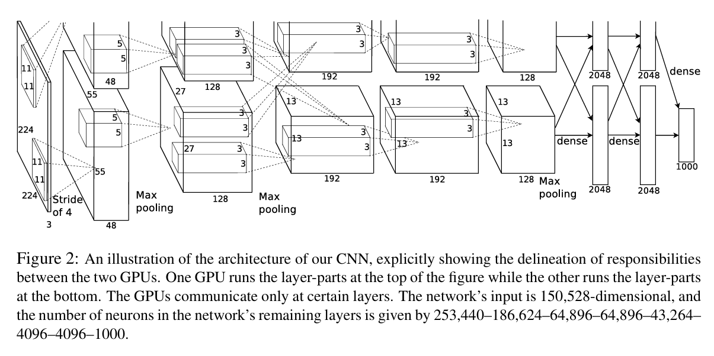
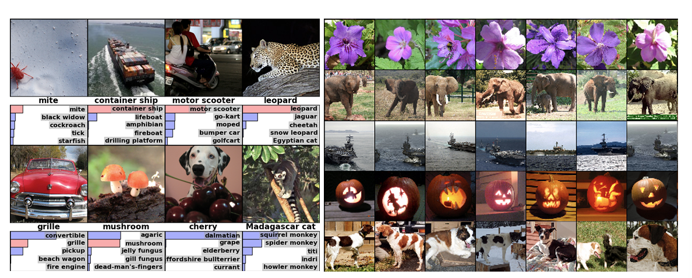

# 1. ImageNet Classification with Deep Convolutional Neural Networks

目标：大型数据集图象分类。To learn about thousands of objects from millions of images, we need a model with a large learning capacity. 

Why CNN: our model should also have lots of prior knowledge to compensate for all the data we don’t have. easier to train

Creative point: Use GPU to do CNN training

overfitting: A big problem at that time, but not for now

ImageNet: a dataset of over 15 million labeled high-resolution images belonging to roughly 22000 categories. resolution of 256 × 256

ILSVRC: ImageNet Large-Scale Visual Recognition Challenge

Neuron's output function: ReLU(nonlinearity). Much faster than tanh.

Training on Multiple GPUs:  Current GPUs are particularly well-suited to cross-GPU parallelization, as they are able to read from and write to one another’s memory directly, without going through host machine memory.

Local Response Normalization: not really used now. Layer Normalization is more popular.

Overlapping Pooling: 

AlexNet Architecture:

对224 * 224 * 3的输入图像分为上下两部分进行卷积，分别使用两个GPU进行并行计算，并在特定层进行通信。前五个部分为卷积层，不断进行滤波，特征层数量变大，后三个部分为全连接层，存放神经元进行深度学习得出分类结果。

overfitting：

Data Augmentation: random cropping、random horizontal flipping

Dropout: 

分类结果：

结果显示分类基本十分准确。

# 2. Attention Is All You Need 

Traditional RNN: 