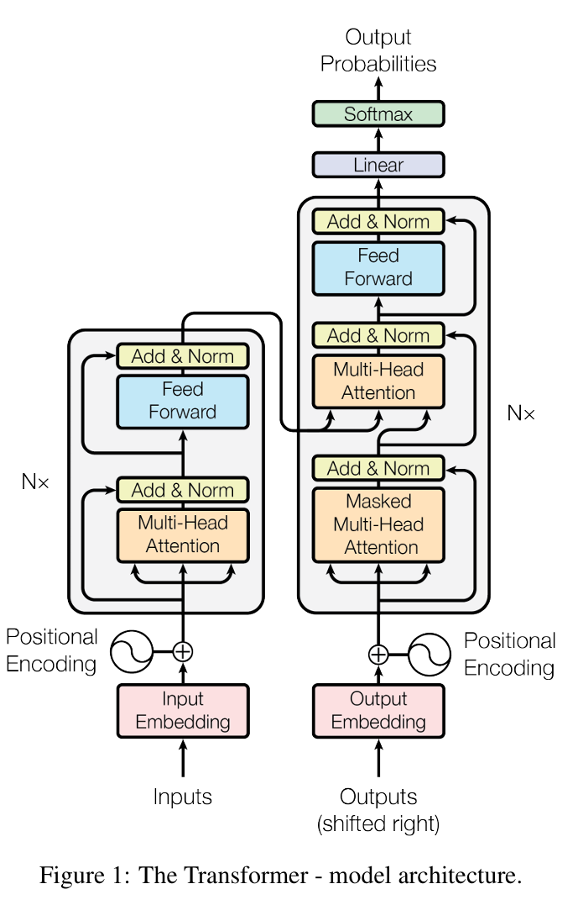
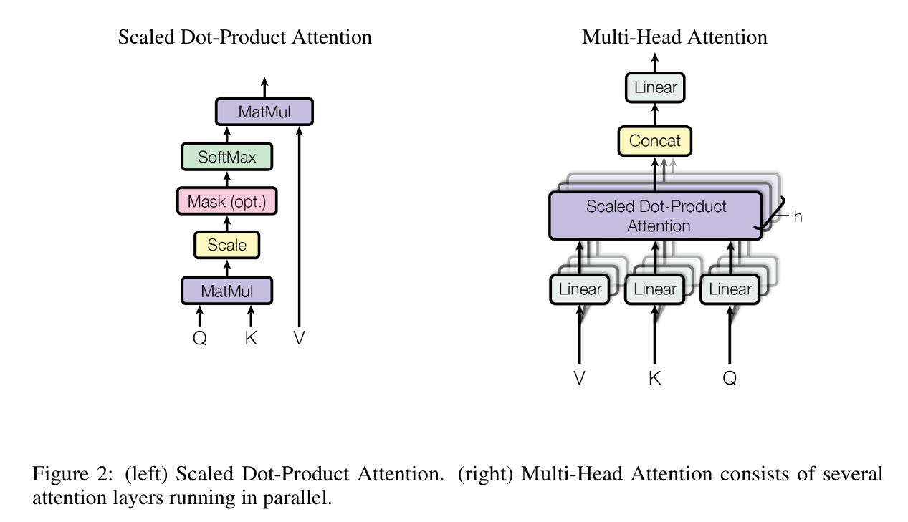
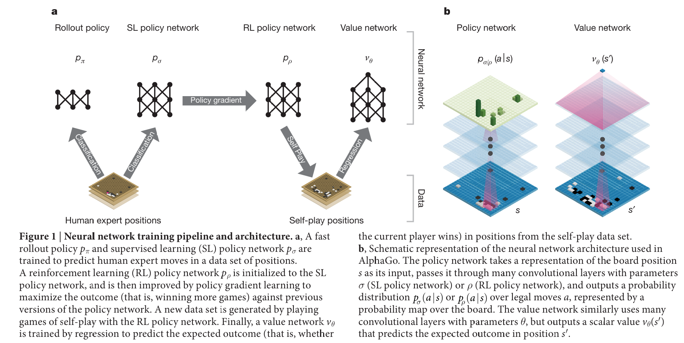
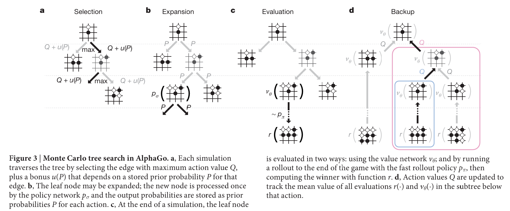

# 深度学习时代的三座里程碑：视觉、语言与决策

## 引言

过去十余年，深度学习之所以能够成为主流范式，一方面源于数据规模、计算资源与工程体系的持续提升，使得端到端学习在真实复杂任务上具有可行性与可复现性；另一方面也源于模型结构与训练方法的关键突破，使得模型能够更有效地表达、优化并泛化。在这一演进过程中，视觉、语言与决策三条路线既各自发展，又在方法上互补：模型不再依赖大量手工规则或特征工程，而是强调学习与可扩展的计算；系统不再仅追求单点性能提升，而更注重泛用性与迭代性。这些变化不仅推动了学术研究的重心转移，也在工业界形成了广泛的应用与生态。

本报告的研究目的在于以三篇 AI 领域的里程碑论文为线索，梳理深度学习的关键思想如何在不同任务中落地，并总结其对现代 AI 技术路线的共同启示。报告将围绕三篇论文展开分析与梳理，从表示学习、计算方式与系统构建等角度总结出当今AI 设计的特点，并结合当前技术发展，讨论这些经典论文如何影响后续的大模型、多模态与智能体等研究方向，形成对现代 AI 发展脉络的整体认识。

## 主题概述

在计算机视觉领域，ImageNet/ILSVRC 提供了大规模、标准化的评测平台，使得不同方法可以在统一任务上可比地衡量进步，并持续推动图像识别模型的演进。在此背景下，AlexNet 在 ILSVRC 2012 上取得显著领先的 top-5 测试错误率，并通过 ReLU、Dropout、数据增强与 GPU 训练等工程与方法创新，促使深度学习在视觉任务中的优势得到广泛认可，从而加速了视觉领域由传统手工特征路线向端到端学习范式的转变。

在序列建模与自然语言处理领域，Transformer 提出“仅用注意力机制（attention）即可完成序列到序列建模”，在架构上摆脱循环与卷积带来的递归计算限制，显著提升并行训练能力，并在机器翻译任务上取得更优质量与更高效率。Transformer 也由此成为后续大语言模型与多模态模型最重要的基础架构之一。

在决策与博弈智能领域，围棋因为其巨大的搜索空间与复杂的局面评估需求而被长期视为 AI 的难点。AlphaGo 通过将策略网络与价值网络同蒙特卡洛树搜索结合，展示了学习与搜索在决策问题中的有效协同，形成了具有代表性的系统化解决思路，为后续通用决策智能的研究提供了重要方法基础。

这三篇论文共同刻画了现代 AI 的一个核心趋势：在标准化大规模任务与数据的推动下，通过可扩展的表示学习与可扩展的计算方式，不断提升模型能力边界，并逐步形成从单一任务性能提升走向通用能力构建的技术路径。

## 文献综述

### ImageNet Classification with Deep Convolutional Neural Networks ^[1]^

该论文主要关注的问题是：给定一张图片，需要从1000个类别中选择该图片属于的正确类别。因此，需要对图片的每个像素的特征进行分析与学习。由于物体识别复杂性高，因此需要大量先验知识来弥补数据上的不足，同时模型需要具有强大的学习能力，而卷积神经网络CNN恰好满足这个需求。因此，通过控制CNN的深度和广度，对图象的分类进行学习。此外，因为GPU强大的算力支持CNN模型的训练，因此使用GPU训练CNN模型，在ILSVRC 2012竞赛中取得了远超第二名的成果，是划时代的模型构建与训练方法。

AlexNet采用5个卷积层+3个全连接层构建八个学习层的CNN架构，采用两个GPU分工进行训练，扩大了训练规模。该结构输入为一张 224×224×3 的彩色图像，首先经过一个 11×11 卷积、步长 4 的大卷积层进行快速下采样并提取低级边缘/纹理特征，随后进行max pooling进一步降分辨率；中间堆叠多层卷积逐级把局部纹理组合成更高层的形状与部件语义，并在若干层之间插入池化以控制特征图尺寸与计算量；最后将高层特征展平，送入两层大规模 dense 层进行全局语义融合，输出 ImageNet 1000 类的预测概率分布。其结构如图所示：

在实现细节上，AlexNet使用了多种方法提升分类的精度与训练效率。在CNN的激活函数上，本文选用了ReLU非饱和非线性函数$max(0,x)$，该选择在实践中带来更快的收敛速度与更稳定的优化过程，从而为更大规模模型的训练提供了可行性基础。随后，论文进一步在结构与训练策略上引入多项关键设计，例如通过多个GPU之间的分工与必要通信实现更大规模的计算与参数承载；引入局部响应归一化以改善模型的泛化表现并增强特征响应的可分性；采用overlapping pooling以在下采样过程中降低信息丢失、提升鲁棒性并减轻过拟合倾向。

为了防止过拟合的发生，本文在数据增强上面做出了很大的优化：对图象进行随机裁剪、水平翻转、颜色扰动，提高了模型的稳定性；在全连接层使用Dropout随机失活部分神经元，大幅缓解了过拟合的影响。上述方法共同构成了一套可复现、可扩展的训练配方，使得大容量网络能够在大规模数据集上获得更强的泛化能力。

在ILSVRC 2012的比赛中，该模型取得了显著领先的top-5测试错误率，证明了CNN在视觉识别上的优势，并推动了以GPU为核心的深度学习训练方式在视觉领域的普及，对计算机视觉领域与AI训练模式都做出了卓越的贡献。

------

### Attention Is All You Need^[2]^

在 Transformer 提出之前，主流的机器翻译系统采用基于循环神经网络（RNN/LSTM）的 encoder–decoder 框架：编码器按时间步依次读入源序列，并将已读信息压缩到隐藏状态中；解码器在生成目标序列时同样以递归方式逐步输出，每一步都依赖上一时刻的隐藏状态与已生成词。典型的 seq2seq 方法会将整句源语言信息汇聚到一个固定长度向量，再据此生成目标句，这种固定长度表示在长句场景下容易成为信息瓶颈，限制模型对长上下文依赖与细粒度对齐关系的表达能力。

为缓解上述问题，Attention 机制被引入到 RNN结构中。其核心作用是在解码器生成每一个目标词时，不再只依赖单一的全局表示，而是对编码器产生的所有中间隐藏状态进行加权汇聚，从而动态地选择当前最相关的源信息。先前的研究表明，固定长度向量会限制基本 encoder–decoder 的性能，而通过对源句不同位置进行软搜索来预测目标词可以改善这个问题；随后研究者们进一步系统化比较了不同形式的注意力，强化了 attention 作为序列到序列建模关键组件的地位。 在此基础上，这篇论文进一步提出：既然最强的 seq2seq 模型已通过 attention 连接编码器与解码器，那么可以直接以注意力机制为核心构建模型，完全摆脱 RNN 的递归计算，从而获得更强的并行训练能力与更有效的长程依赖建模，这也构成了 Transformer 架构的出发点与研究动机。

本文的核心思想都浓缩在这张结构图中：

结合这张结构图，可以把 Transformer 的工作方式概括为：在经典 encoder–decoder 框架下，用注意力机制在序列内部与序列之间建立信息交互，并通过层堆叠获得更强的表示能力，整个过程不再依赖 RNN 的递归计算。图中，输入端将 token 映射为 embedding，并与 positional encoding 相加以注入位置信息；随后进入由$N$个相同层堆叠的 Encoder，每一层由 Multi-Head Self-Attention 与 Position-wise Feed-Forward 两个子层组成，并在每个子层外使用残差连接与 LayerNorm（图中的 Add & Norm部分）以稳定深层训练。Decoder 端同样堆叠$N$层，但在结构上包含三类子层：首先是 Masked Multi-Head Self-Attention，通过掩码防止当前位置关注未来位置；其次是对 Encoder 输出进行注意力读取的 Encoder–Decoder Attention（Cross-Attention），使得解码器在生成每个目标词时能够从源序列表示中动态检索相关信息；最后是前馈网络子层。图中 “Outputs (shifted right)” 与 masked self-attention 的组合保证了预测位置$i$只依赖已知的历史输出，从而满足自回归生成的因果性约束；最顶端的 Linear 与 Softmax 则将解码器隐表示映射为词表上的输出概率分布。

在该结构中，最重要的部分就是 Multi-head Attention 在输入、输出端的多次应用。作者在此给出了注意力函数的运算机制：

Scaled Dot-Product Attention 以 **Query、Key、Value（Q/K/V）**为输入，先通过点积 $QK^\top$计算相似度，再除以$\sqrt{d_k}$进行缩放以避免数值过大导致 softmax 饱和；必要时在 softmax 前对不合法连接施加 mask，随后用 softmax 得到注意力权重，并对 $V$ 做加权求和得到输出表示。Multi-Head Attention 则将输入分别线性投影到$h$个不同子空间，在每个 head 上并行执行一次 scaled dot-product attention，再将各 head 的结果拼接并经线性变换融合，从而使模型能够在不同表示子空间中同时捕捉多种依赖关系与对齐模式。将该算子嵌入Transformer 架构中的 encoder self-attention、decoder masked self-attention 与 cross-attention 三个位置，便构成 Transformer 端到端的主要信息流：编码阶段完成全局上下文建模，解码阶段在因果约束下进行自注意力聚合，并通过跨注意力持续读取源端信息以生成目标序列。

下面结合我的理解给出一个英译中的示例，展示Transformer的工作方式：
						English: “I gave the book to Mary yesterday.”
						$\Rightarrow$      中文：“我昨天把书给了玛丽。”

在该例中，源句的时间状语 *yesterday* 在中文里通常前置，而“give + book + to Mary”则需要重组为把字句。Transformer 在编码阶段会先将每个 token 的表示映射成三组向量：Query（Q）、Key（K）、Value（V）。其中，Q 可理解为“当前位置想要检索的信息需求”，K 是“各位置可供匹配的索引”，V 则是“各位置携带的内容本体”。self-attention通过计算 $ \mathrm{softmax}(QK^\top/\sqrt{d_k}) $ 得到对整句各位置的权重分布，并对 V 做加权求和，从而让某个位置的表示能够直接融合句中其他位置的信息：例如与动词 *gave* 相关的位置会对 *book*、*Mary*、*yesterday* 等位置产生更高的注意力权重，使编码器在并行计算的同时完成全局依赖建模；多头注意力进一步通过多个线性投影子空间并行计算多组 Q/K/V，使模型能同时捕捉“时间修饰”“介词短语”等不同类型的关系，得到更丰富的上下文表征。

在解码阶段，Transformer 仍以自回归方式生成目标序列：解码器首先对已生成的目标端 token 做 masked self-attention，其 Q/K/V 均来自目标端当前层表示，但通过因果掩码保证当前位置只能关注历史位置；随后解码器再进行 encoder–decoder attention，此时 Q 来自解码器当前状态，K/V 来自编码器输出，从而实现对源端信息的动态检索与对齐。具体到本例，模型在生成“昨天”时，cross-attention 往往会对源句中的 *yesterday* 位置赋予更大权重；生成“书”时聚焦 *book*；生成“给/玛丽”时则更多依赖 *gave/to Mary* 等片段。这样的机制使模型能够在生成过程中自然完成跨语言对齐与重排序，而不需要传统 RNN 那样依赖递归隐藏状态去逐步携带长程信息。

在Transformer中，训练与推理采用两种不同方式。训练时将目标序列整体右移一位作为解码器输入，因此在同一次前向传播中可以并行计算所有位置的表示，并对每个位置输出的 softmax 与真实下一个词计算交叉熵损失；而在推理时，模型无法看到真实目标词，只能从起始符开始逐步生成，每一步把自己刚生成的 token 追加回输入，直到输出结束符。由于推理是逐步展开的，工程实现中通常会使用对注意力的 KV cache：前面时间步已经计算过的 K/V 不再重复计算，只为新生成的 token 计算新增的 Q/K/V，从而显著减少重复开销并提升解码速度。这也体现了 Transformer 相较于传统 RNN 的优势：在训练阶段具备高度并行性，而在推理阶段又能通过KV cache实现高效的增量生成，同时保持对长程依赖的直接建模能力。

Transformer 架构将注意力机制从RNN 的辅助模块提升为序列建模的基本算子，由此奠定了后续大语言模型与多模态模型的主流技术路线，并推动了以规模化训练与工程优化为核心的现代 AI 发展范式，是当今大语言模型的基石，对现代 AI 发展起到了关键性的作用。

------

### Mastering the game of Go with deep neural networks and tree search^[3]^

围棋之所以长期被视为 AI 的挑战性项目，核心不在于规则复杂，而在于它同时具备决策链条很长、搜索空间极其庞大、局面优劣难以用简单规则刻画等特征。即便有了蒙特卡洛树搜索（MCTS）这样通用的搜索框架，系统的上限仍高度依赖于策略和局面评估。AlphaGo 把围棋视为典型的困难决策任务与不可处理搜索空间问题，并提出用可学习的策略与价值函数来替代传统启发式评估，从而使系统在少量但高质量的搜索下达到职业水平。

AlphaGo 的整体方法可以概括为：先学会下棋，再学会赢棋，最后把学习结果嵌入搜索。在训练流水线中，作者首先训练两个用于快速生成落子的策略：一个是更强但较慢的监督学习策略网络 **SL policy network** $p_\sigma(a\mid s)$，用于预测人类专家在局面 $s$ 下的落子；另一个是更快但较弱的 **rollout policy** $p_\pi(a\mid s)$，用于在模拟对局中以极低开销快速走子。本文给出了二者在速度与准确率上的对比：rollout policy 用线性 softmax 的小模式特征实现，单步只需微秒级，而策略网络单步是毫秒级，但策略网络准确率显著更高。

在此基础上，作者用强化学习进一步提升为策略网络 **RL policy network** $p_\rho$。该网络结构与 $p_\sigma$ 相同，并以 $\rho=\sigma$作为初始化，然后通过自我博弈进行策略梯度更新：奖励函数在非终局时刻为 0，只在终局给出输赢信号 $z_t=\pm r(s_T)$（从当前执子方视角，赢为 +1 输为 −1），并按 $\Delta\rho \propto \frac{\partial \log p_\rho(a_t\mid s_t)}{\partial\rho}z_t$的方向做随机梯度上升，以最大化期望胜率。与此同时，为避免过拟合到单一对手，训练中会从历史策略池中随机抽取对手版本以稳定学习过程。

价值网络 **value network** $v_\theta(s)$ 的目标是直接对局面做胜负期望的评估。本文先从定义出发：对任意策略 $p$，价值函数 $v^p(s)$ 表示在双方都按 $p$ 走子时，从局面 $s$ 出发最终结果 $z$ 的期望，并指出理想目标是完美博弈下的 $v^*(s)$，但实际用当前最强策略 $p_\rho$ 所诱导的价值 $v^{p_\rho}(s)$ 作为学习对象，并用神经网络近似 $v_\theta(s)\approx v^{p_\rho}(s)$。训练上采用回归：最小化预测值 $v_\theta(s)$ 与真实终局结果 $z$ 的均方误差。 本文特别强调了数据构造的关键点：如果直接用完整对局的所有中间局面配同一个终局标签，会因相邻局面高度相关而导致过拟合，因此作者改用自我对弈生成数据，并在每盘棋中随机采样一个时间步附近的局面作为训练样本以降低相关性；参数更新形式则对应均方误差的梯度下降。

在网络输入与结构上，AlphaGo 将棋盘状态预处理为多通道的 19×19 特征平面：包含棋子颜色、气、提子、合法性、落子历史等直接来自规则的要素，并统一以当前执子方为参照编码；每个离散特征会进一步 one-hot 展开为多张二值平面。 策略网络的具体架构也给得很明确：输入为 $19\times19\times48$ 的特征堆叠，首层使用 5×5 卷积（stride 1）+ ReLU，后续多层使用 3×3 卷积 + ReLU，最后用 1×1 卷积加 softmax 输出对每个棋盘交点的概率分布；价值网络在结构上与策略网络类似，但输出从分布变为单一标量评估值。

当上述策略与价值模型训练完成后，AlphaGo 在推断阶段将其嵌入 MCTS。搜索树的每条边$(s,a)$ 会存储动作价值 $Q(s,a)$、访问次数$N(s,a)$和由策略网络给出的先验概率 $P(s,a)$。 在 **Selection** 阶段，作者采用 PUCT 变体选择使 $Q(s,a)+u(s,a)$ 最大的动作，其中探索项 $u(s,a)$ 显式依赖先验 $P(s,a)$ 与访问次数（用 $c_{\text{puct}}$ 控制探索强度），从而实现“优先探索高先验且访问少的分支，但长期更偏向高价值分支”的搜索控制。 在 **Evaluation** 阶段，叶节点局面 $s_L$ 会交由价值网络计算 $v_\theta(s_L)$，同时从该叶节点用快速 rollout policy 走到终局得到最终结果 $z=\pm r(s_T)$，形成两种互补的评估来源。 在 **Backup** 阶段，本文描述了并行搜索中的“virtual loss”机制来避免多个线程重复探索同一变例，并分别将 rollout 结果与价值网络输出异步回传更新统计量；最终的 $Q(s,a)$ 被定义为 rollout 估计与 value 估计的加权混合，其中 $\lambda$ 控制二者的融合权重。

实验显示，即便只用价值网络也已超过当时其他围棋程序，而混合评估中设置 $\lambda=0.5$效果最好，说明深度价值评估和快速模拟在误差形态上是互补的。

AlphaGo 在 2015 年 10 月与职业选手樊麾进行五番棋正式比赛，并以 5:0 获胜，这被论文明确指出为计算机围棋在不让子的全局比赛中首次击败职业棋手的里程碑事件。 论文还强调，AlphaGo 在该比赛中评估的局面数量远少于深蓝对局时的搜索规模，但通过策略网络更智能地挑选搜索分支、通过价值网络更精确地评估局面，从而以学习的方式弥补了搜索宽度的减少。

## 展望

从 AlexNet、Transformer 到 AlphaGo，这三篇论文不仅分别推动了视觉识别、序列建模与决策智能的范式跃迁，也共同指向了深度学习时代的一条主线：以可扩展的表示学习为核心，在大规模数据与计算资源的支撑下持续提升系统能力边界。

从现在来看，这三篇论文对当今AI领域都产生了巨大的影响，是当今许多技术的基础：

AlexNet 直接奠定了现代视觉模型的基本范式。它用大规模数据与端到端 CNN 表示学习替代手工特征，并形成一整套可复用的训练方法，这不仅推动了后续与它结构相近的VGG、ResNet等视觉网络的研究，也成为今天绝大多数视觉系统的起点。在生成式模型兴起的当下，图像与视频的生成模型仍需要进行AlexNet的这一套训练模式。

Transformer 定义了当代大语言模型的结构基础。当今的多模态大模型、AIGC等技术都基于这种注意力机制进行架构，推理阶段采用的KV cache等方法也成为大模型产品化不可或缺的基础设施，是对当今AI时代影响最为深远的一篇论文。

AlphaGo 战胜世界围棋高手在当时是轰动世界的一件大事，它首次让大众真正感受到AI的强大，并让人们看到未来AI的蓬勃发展的图景。AlphaGo 通过不断学习、自我对弈进行迭代，用习得的策略来进行决策与博弈，这为未来研究更多面对复杂任务情景需要作出决策的人工智能提供了优秀的实践范本。

## 总结

本文围绕“深度学习时代的三座里程碑：视觉、语言与决策”这一主题选取三篇经典论文进行梳理，分别展示了深度学习在大规模视觉分类、序列到序列建模以及复杂博弈决策中的关键突破：AlexNet 以工程化可扩展的 CNN 训练范式确立了端到端视觉表示学习的主流路线；Transformer 以注意力机制重构序列建模的基本算子，奠定了大语言模型与多模态模型的核心架构；AlphaGo 则通过策略/价值网络与 MCTS 的深度融合，证明了学习与搜索协同在高复杂度决策任务中的强大效能。这三篇文章展示了现代基于深度学习的AI研究的快速发展，提供了多种优秀的模型构建与训练思路，奠定了各自领域AI模型的基础框架，是当代人工智能领域重要的硕果。此次阅读过程中，我也深入学习了一些神经网络相关知识，如CNN、DNN等，对深度学习有了更为深刻的认知与理解。

## 参考文献

[1] Krizhevsky A, Sutskever I, Hinton G E. Imagenet classification with deep convolutional neural networks[J]. Advances in neural information processing systems, 2012, 25.

[2] Vaswani A, Shazeer N, Parmar N, et al. Attention is all you need[J]. Advances in neural information processing systems, 2017, 30.

[3] Silver D, Huang A, Maddison C J, et al. Mastering the game of Go with deep neural networks and tree search[J]. nature, 2016, 529(7587): 484-489.