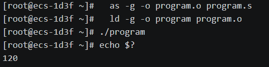

# 基于中间语言与指令模板的多语言联合 DFA 构建及鲲鹏环境验证

## 实验目的

1. 根据中间语言 QTAC 和指令模板 Q2ARM，构建 σ-DFA 用于指导代码生成。
2. 编写程序实现上述 DFA 逻辑，将 QTAC 中间代码转换为 ARM64 汇编代码。
3. 利用 fact 程序（阶乘计算）生成测试用例，验证代码生成器的正确性。
4. 在华为鲲鹏 ARM64 环境下完成汇编、链接并运行，验证生成代码的正确性。

------

## 实验环境

- 开发平台：Windows 11，Python 3.12
- 目标平台：华为鲲鹏服务器（ARM64 架构）
- 汇编器/链接器：`as`、`ld`
- 调试工具：GDB

------

## 实验原理

### 中间语言 QTAC

QTAC 是一种三地址码形式的中间语言，其语法定义如下：

$$\langle\text{QTAC-ins}\rangle \longrightarrow \text{LABEL } l \mid \text{GOTO } l \mid \text{IF } q \langle rop \rangle a \text{ THEN } l \text{ ELSE } l$$

$$q \longrightarrow d \mid \langle temp \rangle, \quad a \longrightarrow q \mid k$$

$$\langle\text{QTAC-ins}\rangle \longrightarrow q = q \langle aop \rangle a \mid q = a \mid q = M[b] \mid M[b] = q$$

其中 $d$ 为普通变量名，$\langle temp \rangle$ 为临时变量（形式为 `ti`），$l$ 为标号（形式为 `li`），$k$ 为立即数。$\langle aop \rangle$ 和 $\langle rop \rangle$ 分别是算术和关系运算符。

### 指令模板 Q2ARM

Q2ARM 定义了 QTAC 指令模板到 ARM64 汇编指令的映射关系。每个模板对应一种 QTAC 指令模式，根据操作数类型的不同生成不同的 ARM64 指令。本实验选取了覆盖 fact 程序所需的模板子集：`T_LABEL`、`T_GOTO`、`T_RETURN`、`T_IF`、`T_IF_LABEL`、`T_AOP`、`T_MOVE`、`T_LDR0`、`T_STR0`、`T_PAR_CALL`。

### σ-DFA 与代码生成

对于正则语言簇 $\mathcal{L}$（由 Q2ARM 左列的各模板构成），如果元素两两不相交，则可构建 σ-DFA($\mathcal{L}$)。DFA 以 QTAC token 流为输入，通过状态转移识别出各模板，同时收集附加信息（操作数、标号等），用于后续 ARM 指令的生成。

本实验采用 4 遍处理架构：

```
QTAC源代码 → [Pass1: 词法分析] → token 流
           → [Pass2: σ-DFA模板匹配] → 模板 token 流
           → [Pass3: ARM代码生成(虚拟寄存器)] → 虚拟寄存器汇编
           → [Pass4: 寄存器分配] → 物理寄存器汇编(最终输出)
```

------

## 实验代码整体框架

### 模块概览

| 文件 | 用途 |
|------|------|
| `src/lexer.py` | Pass1：QTAC 词法分析器 |
| `src/dfa_table.py` | σ-DFA 状态常量与接受状态定义 |
| `src/matcher.py` | Pass2：σ-DFA 模板匹配器 |
| `src/codegen.py` | Pass3：ARM64 代码生成器 |
| `src/regalloc.py` | Pass4：寄存器分配器 |
| `src/main.py` | 主程序入口 |
| `test/fact.qtac` | 测试用例：阶乘程序 |
| `test/test_codegen.py` | 自动化测试 |

### Pass1：QTAC 词法分析器（`src/lexer.py`）

```python
"""Pass1: QTAC 词法分析器 - 将QTAC源代码解析为 token 流"""

import re

KEYWORDS = {'LABEL', 'GOTO', 'IF', 'THEN', 'ELSE', 'PAR', 'CALL', 'RETURN', 'M'}

TOKEN_PATTERNS = [
    ('WHITESPACE', r'\s+'),
    ('ROP', r'<=|>=|==|!=|<|>'),
    ('AOP', r'[+\-*/]'),
    ('ASSIGN', r'='),
    ('SEMI', r';'),
    ('LBRACKET', r'\['),
    ('RBRACKET', r'\]'),
    ('COMMA', r','),
    ('NUMBER', r'[0-9]+'),
    ('IDENT', r'[a-zA-Z_][a-zA-Z0-9_]*'),
]

MASTER_PATTERN = '|'.join(f'(?P<{name}>{pattern})' for name, pattern in TOKEN_PATTERNS)
TOKEN_RE = re.compile(MASTER_PATTERN)


def classify_ident(word):
    if word in KEYWORDS:
        return ('KEY', word)
    if re.match(r'^l\d+$', word) or re.match(r'^L_\d+$', word):
        return ('l', word)
    if re.match(r'^t\d+$', word) or re.match(r'^T_\d+$', word):
        return ('temp', word)
    return ('d', word)


def tokenize(source):
    tokens = []
    for m in TOKEN_RE.finditer(source):
        kind = m.lastgroup
        value = m.group()
        if kind == 'WHITESPACE':
            continue
        elif kind == 'NUMBER':
            tokens.append(('k', value))
        elif kind == 'ROP':
            tokens.append(('rop', value))
        elif kind == 'AOP':
            tokens.append(('aop', value))
        elif kind == 'ASSIGN':
            tokens.append(('=', '_'))
        elif kind == 'SEMI':
            tokens.append((';', '_'))
        elif kind == 'LBRACKET':
            tokens.append(('[', '_'))
        elif kind == 'RBRACKET':
            tokens.append((']', '_'))
        elif kind == 'COMMA':
            tokens.append((',', '_'))
        elif kind == 'IDENT':
            tokens.append(classify_ident(value))
    return tokens
```

词法分析器采用正则表达式驱动的方式，将 QTAC 源代码文本解析为 `(类型, 值)` 形式的 token 流。核心设计如下：

- 使用 `TOKEN_PATTERNS` 定义各 token 的正则模式，按优先级排列。多字符运算符（如 `<=`、`>=`）排在单字符运算符之前，确保最长匹配。
- `classify_ident` 函数对标识符进行二次分类：关键字（`KEY`）、标号（`l` 开头+数字）、临时变量（`t` 开头+数字）、普通变量（`d`）。这一分类是后续 DFA 匹配的基础。
- 输出 token 格式为 `(类型, 值)` 的元组列表，其中赋值符号、分号等固定符号的值统一记为 `_`。

### σ-DFA 状态定义（`src/dfa_table.py`）

```python
"""σ-DFA 状态转移表定义"""

# 状态常量
S0 = 'S0'

# LABEL 路径
S_LABEL = 'S_LABEL'
S_LABEL_L = 'S_LABEL_L'

# GOTO 路径
S_GOTO = 'S_GOTO'
S_GOTO_B = 'S_GOTO_B'

# RETURN 路径
S_RETURN = 'S_RETURN'
S_RETURN_A = 'S_RETURN_A'

# IF 路径
S_IF = 'S_IF'
S_IF_Q = 'S_IF_Q'
S_IF_ROP = 'S_IF_ROP'
S_IF_A = 'S_IF_A'
S_IF_THEN = 'S_IF_THEN'
S_IF_L1 = 'S_IF_L1'
S_IF_ELSE = 'S_IF_ELSE'
S_IF_L2 = 'S_IF_L2'

# 赋值/算术/CALL/内存加载 路径
S_Q = 'S_Q'
S_Q_EQ = 'S_Q_EQ'
S_Q_EQ_A = 'S_Q_EQ_A'
S_Q_EQ_A_AOP = 'S_Q_EQ_A_AOP'
S_Q_EQ_A_AOP_A = 'S_Q_EQ_A_AOP_A'

# CALL / 内存加载 / 内存存储 / PAR 路径 (略，见源码)

# 接受状态到模板名的映射
ACCEPT_TO_TEMPLATE = {
    'ACCEPT_LABEL': 'T_LABEL',    'ACCEPT_GOTO': 'T_GOTO',
    'ACCEPT_RETURN': 'T_RETURN',  'ACCEPT_IF': 'T_IF',
    'ACCEPT_AOP': 'T_AOP',       'ACCEPT_MOVE': 'T_MOVE',
    'ACCEPT_LDR0': 'T_LDR0',     'ACCEPT_STR0': 'T_STR0',
    'ACCEPT_PAR_CALL': 'T_PAR_CALL',
}
```

该模块定义了 σ-DFA 的全部状态常量和接受状态。状态命名遵循路径前缀规则，如 `S_IF_ROP` 表示"已读入 `IF q rop`"。DFA 共有 32 个状态（含初始状态 S0）和 9 个接受状态，每个接受状态对应一种 QTAC 指令模板。

### Pass2：σ-DFA 模板匹配器（`src/matcher.py`）

```python
"""Pass2: σ-DFA 模板匹配器 - 对 token 流进行模板匹配"""

from src.dfa_table import *

def _tok_type(token):
    t, v = token
    if t == 'KEY':
        return f'KEY:{v}'
    return t

def _is_var_or_temp(token):
    return token[0] in ('d', 'temp')

def _is_operand(token):
    return token[0] in ('d', 'temp', 'k')

def match_templates(tokens):
    results = []
    i = 0
    par_args = []

    while i < len(tokens):
        tok = tokens[i]
        sym = _tok_type(tok)

        # LABEL l ;
        if sym == 'KEY:LABEL':
            if (i + 2 < len(tokens) and tokens[i+1][0] == 'l'
                and tokens[i+2] == (';', '_')):
                results.append(('T_LABEL', {'l': tokens[i+1]}))
                i += 3
                continue

        # IF q rop a THEN l1 ELSE l2 ; (+ lookahead for LABEL)
        if sym == 'KEY:IF':
            if (i + 8 < len(tokens)
                and _is_var_or_temp(tokens[i+1])
                and tokens[i+2][0] == 'rop'
                and _is_operand(tokens[i+3])
                and _tok_type(tokens[i+4]) == 'KEY:THEN'
                and tokens[i+5][0] == 'l'
                and _tok_type(tokens[i+6]) == 'KEY:ELSE'
                and tokens[i+7][0] == 'l'
                and tokens[i+8] == (';', '_')):
                q_tok, rop_tok, a_tok = tokens[i+1], tokens[i+2], tokens[i+3]
                l1_tok, l2_tok = tokens[i+5], tokens[i+7]
                # 向前看: LABEL l3 ; 且 l3 == l1 或 l2
                if (i + 11 < len(tokens)
                    and _tok_type(tokens[i+9]) == 'KEY:LABEL'
                    and tokens[i+10][0] == 'l'
                    and tokens[i+11] == (';', '_')):
                    l3_tok = tokens[i+10]
                    if l3_tok[1] == l1_tok[1] or l3_tok[1] == l2_tok[1]:
                        which = 'l1' if l3_tok[1] == l1_tok[1] else 'l2'
                        results.append(('T_IF_LABEL', {
                            'q': q_tok, 'rop': rop_tok, 'a': a_tok,
                            'l1': l1_tok, 'l2': l2_tok, 'l3': l3_tok,
                            'l3_eq': which,
                        }))
                        i += 12
                        continue
                results.append(('T_IF', { ... }))  # 普通 T_IF
                i += 9
                continue

        # q = q2 aop a ; (算术) 或 q = a ; (赋值) 等
        # ... (其余模板匹配逻辑类似，见源码)

        i += 1
    return results
```

模板匹配器是本实验的核心模块，实现了 σ-DFA 的匹配逻辑。其设计要点如下：

1. `_tok_type` 函数将 token 映射为 DFA 的输入符号。对于关键字，映射为 `KEY:LABEL`、`KEY:IF` 等复合符号，使得 DFA 能区分不同关键字。

2. 匹配采用表驱动思想，从初始状态 S0 出发，根据当前 token 类型进行状态转移。每种模板对应一条匹配路径，到达接受状态时输出模板及其附加信息。

3. `T_IF_LABEL` 的处理体现了前最大化原则：先识别出 `IF q rop a THEN l1 ELSE l2 ;`，再执行 1 步 lookahead，检查紧跟的是否为 `LABEL l3 ;` 且 `l3` 等于 `l1` 或 `l2`。若匹配则合并为 `T_IF_LABEL`，消耗额外 3 个 token；否则保持为 `T_IF`。

4. PAR 参数的收集采用累积策略：遇到 `PAR a ;` 时将参数暂存于 `par_args` 列表，直到遇到 `q = CALL d, k ;` 时一并输出为 `T_PAR_CALL` 模板。

### Pass3：ARM64 代码生成器（`src/codegen.py`）

```python
"""Pass3: ARM64 代码生成器 - 将模板 token 流转换为ARM64汇编(虚拟寄存器)"""

ROP_TO_JROP = {
    '<': 'B.LT', '<=': 'B.LE', '>': 'B.GT',
    '>=': 'B.GE', '==': 'B.EQ', '!=': 'B.NE',
}
ROP_TO_JROP_NEG = {
    '<': 'B.GE', '<=': 'B.GT', '>': 'B.LE',
    '>=': 'B.LT', '==': 'B.NE', '!=': 'B.EQ',
}
AOP_TO_XAOP = {'+': 'ADD', '-': 'SUB', '*': 'MUL', '/': 'SDIV'}
AOP_TO_KAOP = {'+': 'ADD', '-': 'SUB'}

def _vreg(token):
    return f'X{token[1]}'

def generate_arm(templates):
    lines = []
    for name, info in templates:
        if name == 'T_LABEL':
            lines.append(f"{info['l'][1]}:")
        elif name == 'T_IF_LABEL':
            q, rop_val, a = info['q'], info['rop'][1], info['a']
            l1, l2 = info['l1'][1], info['l2'][1]
            cmp_operand = f"#{a[1]}" if a[0] == 'k' else _vreg(a)
            if info['l3_eq'] == 'l2':
                jrop = ROP_TO_JROP[rop_val]
                lines.append(f"CMP {_vreg(q)}, {cmp_operand}; {jrop} {l1}; {l2}:")
            else:
                jrop_neg = ROP_TO_JROP_NEG[rop_val]
                lines.append(f"CMP {_vreg(q)}, {cmp_operand}; {jrop_neg} {l2}; {l1}:")
        elif name == 'T_AOP':
            q1, q2, aop_val, a = info['q1'], info['q2'], info['aop'][1], info['a']
            if info['a_kind'] == 'k' and aop_val in AOP_TO_KAOP:
                lines.append(f"{AOP_TO_KAOP[aop_val]} {_vreg(q1)}, {_vreg(q2)}, #{a[1]};")
            else:
                lines.append(f"{AOP_TO_XAOP[aop_val]} {_vreg(q1)}, {_vreg(q2)}, {_vreg(a)};")
        # ... 其余模板处理逻辑类似，见源码
    return lines
```

代码生成器将 Pass2 输出的模板 token 流逐一转换为 ARM64 汇编指令，此阶段使用虚拟寄存器（如 `Xn`、`Xt1`）。核心设计如下：

- 运算符映射表：`ROP_TO_JROP` 将 QTAC 关系运算符映射为 ARM64 条件跳转指令，`ROP_TO_JROP_NEG` 提供取反映射（用于 `T_IF_LABEL` 中 `l3=l1` 的情况）。`AOP_TO_XAOP` 和 `AOP_TO_KAOP` 分别处理寄存器和立即数形式的算术运算。
- `_vreg` 函数将变量名转换为虚拟寄存器名，规则为在变量名前加 `X` 前缀。
- `T_IF_LABEL` 的代码生成根据 `l3` 等于 `l1` 还是 `l2` 选择不同的生成策略：若 `l3=l2`，则生成 `CMP; Jrop l1; l2:`；若 `l3=l1`，则生成 `CMP; Jrop' l2; l1:`（使用取反条件码）。这一优化避免了多余的跳转指令。

### Pass4：寄存器分配器（`src/regalloc.py`）

```python
"""Pass4: 寄存器分配器 - 将虚拟寄存器映射为ARM64物理寄存器"""

import re

PHYS_REGS = [f'X{i}' for i in range(9, 16)]

def allocate_registers(asm_lines):
    vreg_pattern = re.compile(r'\bX([a-zA-Z_]\w*)\b')
    reserved = {'crs'} | {str(i) for i in range(16)}

    # 收集虚拟寄存器，按首次出现顺序
    vreg_order = []
    vreg_set = set()
    for line in asm_lines:
        for m in vreg_pattern.finditer(line):
            name = m.group(1)
            if name not in reserved and name not in vreg_set:
                vreg_order.append(name)
                vreg_set.add(name)

    # 建立映射
    reg_map = {}
    for idx, name in enumerate(vreg_order):
        if idx < len(PHYS_REGS):
            reg_map[f'X{name}'] = PHYS_REGS[idx]
        else:
            reg_map[f'X{name}'] = f'X_SPILL_{name}'

    # 替换（按名称长度降序，避免短名误替换长名）
    result = []
    for line in asm_lines:
        new_line = line
        for vreg in sorted(reg_map.keys(), key=len, reverse=True):
            new_line = new_line.replace(vreg, reg_map[vreg])
        result.append(new_line)

    return result, reg_map
```

寄存器分配器将虚拟寄存器映射为 ARM64 物理寄存器 X9~X15。分配策略为按虚拟寄存器首次出现的顺序依次分配，X0 保留给返回值不参与分配。替换时按虚拟寄存器名长度降序排列，避免短名（如 `Xn`）误替换长名（如 `Xn1`）中的子串。对于 fact 程序，5 个虚拟寄存器的映射结果为：

| 虚拟寄存器 | 物理寄存器 |
|-----------|-----------|
| `Xt1` | X9 |
| `Xn` | X10 |
| `Xa` | X11 |
| `Xt2` | X12 |
| `Xt3` | X13 |

### 主程序入口（`src/main.py`）

```python
"""QTAC-to-ARM64 代码生成器 - 主程序入口"""

import sys, os, argparse

sys.path.insert(0, os.path.dirname(os.path.dirname(os.path.abspath(__file__))))

from src.lexer import tokenize, format_tokens
from src.matcher import match_templates, format_templates
from src.codegen import generate_arm, format_asm
from src.regalloc import allocate_registers, format_reg_map

def main():
    parser = argparse.ArgumentParser(description='QTAC-to-ARM64 Code Generator')
    parser.add_argument('input', nargs='?', help='Input QTAC file (default: stdin)')
    parser.add_argument('-o', '--output', help='Output file (default: stdout)')
    parser.add_argument('--debug', action='store_true', help='Print intermediate results')
    args = parser.parse_args()

    if args.input:
        with open(args.input, 'r', encoding='utf-8') as f:
            source = f.read()
    else:
        source = sys.stdin.read()

    tokens = tokenize(source)              # Pass 1
    templates = match_templates(tokens)     # Pass 2
    asm_lines = generate_arm(templates)     # Pass 3
    final_lines, reg_map = allocate_registers(asm_lines)  # Pass 4

    output = format_asm(final_lines)
    if args.output:
        with open(args.output, 'w', encoding='utf-8') as f:
            f.write(output + '\n')
    else:
        print(output)

if __name__ == '__main__':
    main()
```

主程序按顺序调用 4 个 pass，支持从文件或标准输入读取 QTAC 源代码，输出到文件或标准输出。`--debug` 模式下会打印每个 pass 的中间结果，便于调试和验证。

------

## σ-DFA 设计

### 输入符号集 Σ

DFA 的输入符号为 Pass1 输出的 token 类型，共 20 种：

`KEY:LABEL`、`KEY:GOTO`、`KEY:IF`、`KEY:THEN`、`KEY:ELSE`、`KEY:RETURN`、`KEY:PAR`、`KEY:CALL`、`KEY:M`、`d`、`temp`、`l`、`k`、`rop`、`aop`、`=`、`;`、`[`、`]`、`,`

其中 `d` 和 `temp` 统称为 `q`（变量类操作数），`q` 和 `k` 统称为 `a`（通用操作数）。

### 状态集 Q

DFA 共有 32 个状态，包括 1 个初始状态 S0、22 个中间状态和 9 个接受状态。状态按模板路径组织：

- LABEL 路径：S0 → S_LABEL → S_LABEL_L → ACCEPT_LABEL
- GOTO 路径：S0 → S_GOTO → S_GOTO_B → ACCEPT_GOTO
- RETURN 路径：S0 → S_RETURN → S_RETURN_A → ACCEPT_RETURN
- IF 路径：S0 → S_IF → S_IF_Q → S_IF_ROP → S_IF_A → S_IF_THEN → S_IF_L1 → S_IF_ELSE → S_IF_L2 → ACCEPT_IF
- 赋值路径：S0 → S_Q → S_Q_EQ → S_Q_EQ_A → ACCEPT_MOVE
- 算术路径：S0 → S_Q → S_Q_EQ → S_Q_EQ_A → S_Q_EQ_A_AOP → S_Q_EQ_A_AOP_A → ACCEPT_AOP


### 状态转移表（核心部分）

| 当前状态 | KEY:LABEL | KEY:GOTO | KEY:IF | KEY:RETURN | q(d/temp) | l | k | rop | aop | = | ; |
|----------|-----------|----------|--------|------------|-----------|---|---|-----|-----|---|---|
| S0 | S_LABEL | S_GOTO | S_IF | S_RETURN | S_Q | - | - | - | - | - | - |
| S_LABEL | - | - | - | - | - | S_LABEL_L | - | - | - | - | - |
| S_LABEL_L | - | - | - | - | - | - | - | - | - | - | ACC |
| S_GOTO | - | - | - | - | S_GOTO_B | S_GOTO_B | - | - | - | - | - |
| S_GOTO_B | - | - | - | - | - | - | - | - | - | - | ACC |
| S_IF | - | - | - | - | S_IF_Q | - | - | - | - | - | - |
| S_IF_Q | - | - | - | - | - | - | - | S_IF_ROP | - | - | - |
| S_IF_ROP | - | - | - | - | S_IF_A | - | S_IF_A | - | - | - | - |
| S_Q | - | - | - | - | - | - | - | - | - | S_Q_EQ | - |
| S_Q_EQ | - | - | - | - | S_Q_EQ_A | - | S_Q_EQ_A | - | - | - | - |
| S_Q_EQ_A | - | - | - | - | - | - | - | - | S_Q_EQ_A_AOP | - | ACC_MOVE |
| S_Q_EQ_A_AOP | - | - | - | - | S_Q_EQ_A_AOP_A | - | S_Q_EQ_A_AOP_A | - | - | - | - |
| S_Q_EQ_A_AOP_A | - | - | - | - | - | - | - | - | - | - | ACC_AOP |

### 附加信息管理

DFA 在状态转移过程中收集 σ 信息，用于后续 ARM 指令生成：

| 模板 | 收集的附加信息 |
|------|---------------|
| T_LABEL | 标号名 `l` |
| T_GOTO | 跳转目标 `b` |
| T_RETURN | 返回值 `a`，`a` 的类型（q/k） |
| T_IF / T_IF_LABEL | 比较操作数 `q`、`rop`、`a`，目标标号 `l1`、`l2`（、`l3`） |
| T_AOP | 目标 `q1`，源操作数 `q2`，运算符 `aop`，操作数 `a`，`a` 的类型 |
| T_MOVE | 目标 `q`，源 `a`，`a` 的类型 |

`T_IF_LABEL` 的特殊处理：当 `T_IF` 到达接受状态后，执行 1 步向前看。若下一条是 `LABEL l3 ;` 且 `l3` 等于 `l1` 或 `l2`，则合并为 `T_IF_LABEL`，消耗额外 3 个 token。

------

## 结果展示与分析

### 测试输入

使用 fact 阶乘程序作为测试用例：

```
LABEL l0; t1=2; IF n<t1 THEN l1 ELSE l2; LABEL l1; RETURN a; GOTO l3; LABEL l2; t2=n-1; t3=n*a; n=t2; a=t3; GOTO l0; LABEL l3;
```

### Pass1 词法分析输出

```
(KEY,LABEL) (l,l0) (;,_) (temp,t1) (=,_) (k,2) (;,_) (KEY,IF) (d,n) (rop,<) (temp,t1) (KEY,THEN) (l,l1) (KEY,ELSE) (l,l2) (;,_) (KEY,LABEL) (l,l1) (;,_) (KEY,RETURN) (d,a) (;,_) (KEY,GOTO) (l,l3) (;,_) (KEY,LABEL) (l,l2) (;,_) (temp,t2) (=,_) (d,n) (aop,-) (k,1) (;,_) (temp,t3) (=,_) (d,n) (aop,*) (d,a) (;,_) (d,n) (=,_) (temp,t2) (;,_) (d,a) (=,_) (temp,t3) (;,_) (KEY,GOTO) (l,l0) (;,_) (KEY,LABEL) (l,l3) (;,_)
```

词法分析器正确识别了所有 token 类型。关键字（如 `LABEL`、`IF`）被标记为 `KEY`，变量 `n`、`a` 被标记为 `d`，临时变量 `t1`~`t3` 被标记为 `temp`，标号 `l0`~`l3` 被标记为 `l`，立即数被标记为 `k`。

### Pass2 σ-DFA 模板匹配输出

```
(T_LABEL, (l,l0))
(T_MOVE, a is k, (temp,t1), (k,2))
(T_IF_LABEL, l1=l3, (d,n), (rop,<), (temp,t1), (l,l1), (l,l2))
(T_RETURN, a is q, (d,a))
(T_GOTO, (l,l3))
(T_LABEL, (l,l2))
(T_AOP, a is k, (temp,t2), (d,n), (aop,-), (k,1))
(T_AOP, a is q, (temp,t3), (d,n), (aop,*), (d,a))
(T_MOVE, a is q, (d,n), (temp,t2))
(T_MOVE, a is q, (d,a), (temp,t3))
(T_GOTO, (l,l0))
(T_LABEL, (l,l3))
```

模板匹配器成功识别出 12 个模板实例。值得注意的是第 3 条 `T_IF_LABEL`：原始 QTAC 中 `IF n<t1 THEN l1 ELSE l2; LABEL l1;` 被合并为一个复合模板，其中 `l1=l3` 表示紧跟的 `LABEL l1` 的标号等于 `THEN` 分支的目标标号，这一合并使得后续代码生成可以省去一条跳转指令。

### Pass3 ARM 代码生成输出（虚拟寄存器）

```asm
l0:
MOV Xt1, #2;
CMP Xn, Xt1; B.GE l2; l1:
MOV X0, Xa; RET;
B l3;
l2:
SUB Xt2, Xn, #1;
MUL Xt3, Xn, Xa;
MOV Xn, Xt2;
MOV Xa, Xt3;
B l0;
l3:
```

代码生成器将每个模板转换为对应的 ARM64 指令。`T_IF_LABEL` 生成了 `CMP Xn, Xt1; B.GE l2; l1:` 这一紧凑形式——由于 `l3=l1`（即 `THEN` 分支标号），使用取反条件码 `B.GE`（`<` 的取反）跳转到 `l2`，随后直接放置 `l1:` 标号，避免了额外的 `B l1` 跳转。

### Pass4 寄存器分配输出（最终结果）

```asm
l0:
MOV X9, #2;
CMP X10, X9; B.GE l2; l1:
MOV X0, X11; RET;
B l3;
l2:
SUB X12, X10, #1;
MUL X13, X10, X11;
MOV X10, X12;
MOV X11, X13;
B l0;
l3:
```

寄存器分配器将 5 个虚拟寄存器按首次出现顺序映射为物理寄存器 X9~X13，X0 保留给返回值。

### 自动化测试

```
Pass1 OK
Pass2 OK
Pass3 OK
Pass4 OK

All tests passed!
```

4 个 pass 的输出均通过了与预期结果的自动化对比测试。

------

## 鲲鹏环境验证

### 完整 ARM 汇编程序

在代码生成器输出的基础上，手工添加 `_start` 入口和系统调用退出代码，形成完整的 ARM64 汇编程序 `program.s`：

```asm
.global _start

.section .text

_start:
    MOV X10, #5         // n = 5
    MOV X11, #1         // a = 1
    BL my_func
    MOV X8, #93         // sys_exit
    SVC #0

my_func:
l0:
    MOV X9, #2;
    CMP X10, X9;
    B.GE l2;

l1:
    MOV X0, X11;
    RET;
    B l3;

l2:
    SUB X12, X10, #1;
    MUL X13, X10, X11;
    MOV X10, X12;
    MOV X11, X13;
    B l0;

l3:
    B l3;
```

其中 `_start` 初始化 `X10=5`（n）、`X11=1`（a），通过 `BL` 调用 `my_func`，函数返回后通过 `sys_exit` 系统调用退出，返回值存于 X0。`l3` 处的 `B l3` 是死代码，`RET` 后不会执行到此处。

### 汇编与链接

```bash
# 汇编
as -g -o program.o program.s

# 链接
ld -g -o program program.o
```

### 运行与验证

```bash
# 运行并查看返回码
./program
echo $?
```

预期输出为 `120`（即 5! = 120）。

> 

### GDB 调试过程

使用 GDB 单步跟踪程序执行，观察寄存器变化。预期的寄存器变化过程：

| 循环轮次 | X10 (n) | X11 (a) | X12 (n-1) | X13 (n*a) |
|---------|---------|---------|-----------|-----------|
| 初始 | 5 | 1 | - | - |
| 第 1 轮 | 4 | 5 | 4 | 5 |
| 第 2 轮 | 3 | 20 | 3 | 20 |
| 第 3 轮 | 2 | 60 | 2 | 60 |
| 第 4 轮 | 1 | 120 | 1 | 120 |

当 X10 变为 1 时，`CMP X10, X9`（即 `1 < 2`）条件不满足 `B.GE`，程序跳转到 `l1`，执行 `MOV X0, X11`（X0 = 120）后 `RET` 返回。

以下是 GDB 调试过程，可以看到程序运行的每步阶乘结果，证明程序运行无误：

```bash
(gdb) b my_func
Breakpoint 1 at 0x40008c: file program.s, line 15.
(gdb) r
Starting program: /root/program 

Breakpoint 1, my_func () at program.s:15
15          MOV X9, #2;
(gdb) i r X10 X11
Invalid register `X10'
(gdb) i r x10 x11
x10            0x5                 5
x11            0x1                 1
(gdb) ni
16          CMP X10, X9; B.GE l2; l1:
(gdb) ni
0x0000000000400094      16          CMP X10, X9; B.GE l2; l1:
(gdb) 
l2 () at program.s:20
20          SUB X12, X10, #1;
(gdb) 
21          MUL X13, X10, X11;
(gdb) 
22          MOV X10, X12;
(gdb) 
23          MOV X11, X13;
(gdb) 
24          B l0;
(gdb) i r x10 x11
x10            0x4                 4
x11            0x5                 5
(gdb) ni

Breakpoint 1, my_func () at program.s:15
15          MOV X9, #2;
(gdb) 
16          CMP X10, X9; B.GE l2; l1:
(gdb) 
0x0000000000400094      16          CMP X10, X9; B.GE l2; l1:
(gdb) 
l2 () at program.s:20
20          SUB X12, X10, #1;
(gdb) 
21          MUL X13, X10, X11;
(gdb) 
22          MOV X10, X12;
(gdb) 
23          MOV X11, X13;
(gdb) 
24          B l0;
(gdb) i r x10 x11
x10            0x3                 3
x11            0x14                20
(gdb) ni

Breakpoint 1, my_func () at program.s:15
15          MOV X9, #2;
(gdb) 
16          CMP X10, X9; B.GE l2; l1:
(gdb) 
0x0000000000400094      16          CMP X10, X9; B.GE l2; l1:
(gdb) 
l2 () at program.s:20
20          SUB X12, X10, #1;
(gdb) 
21          MUL X13, X10, X11;
(gdb) 
22          MOV X10, X12;
(gdb) 
23          MOV X11, X13;
(gdb) 
24          B l0;
(gdb) i r x10 x11
x10            0x2                 2
x11            0x3c                60
(gdb) ni

Breakpoint 1, my_func () at program.s:15
15          MOV X9, #2;
(gdb) 
16          CMP X10, X9; B.GE l2; l1:
(gdb) 
0x0000000000400094      16          CMP X10, X9; B.GE l2; l1:
(gdb) 
l2 () at program.s:20
20          SUB X12, X10, #1;
(gdb) 
21          MUL X13, X10, X11;
(gdb) 
22          MOV X10, X12;
(gdb) 
23          MOV X11, X13;
(gdb) 
24          B l0;
(gdb) i r x10 x11
x10            0x1                 1
x11            0x78                120
(gdb) ni

Breakpoint 1, my_func () at program.s:15
15          MOV X9, #2;
(gdb) 
16          CMP X10, X9; B.GE l2; l1:
(gdb) 
0x0000000000400094      16          CMP X10, X9; B.GE l2; l1:
(gdb) 
l1 () at program.s:17
17          MOV X0, X11; RET;
(gdb) 
0x000000000040009c      17          MOV X0, X11; RET;
(gdb) 
_start () at program.s:9
9           MOV X8, #93         // sys_exit
(gdb) 
10          SVC #0
```

------

## 实验总结

本实验基于 QTAC 中间语言和 Q2ARM 指令模板，设计并实现了一个完整的 σ-DFA 驱动的代码生成器。通过 4 遍处理流水线——词法分析、模板匹配、ARM 代码生成、寄存器分配——将 QTAC 中间代码转换为 ARM64 汇编代码。以 fact 阶乘程序为测试用例，各遍输出均与提示文档中的预期结果一致。

通过本次实验，我对从中间语言到目标机器码的映射机制有了更深入的理解，特别是 σ-DFA 在指令选择中的应用：通过将 Q2ARM 模板构造为正则语言簇 $\mathcal{L}$，利用 DFA 的状态转移实现模板匹配，同时借助 σ 信息完成 ARM 指令的参数填充。`T_IF_LABEL` 的前最大化匹配和向前看机制也让我体会到编译器后端优化的实际意义——一次合并就能省去一条跳转指令。

总体而言，本实验将形式语言理论与编译器后端实践相结合，加深了我对指令选择算法和 ARM64 汇编的认识。
