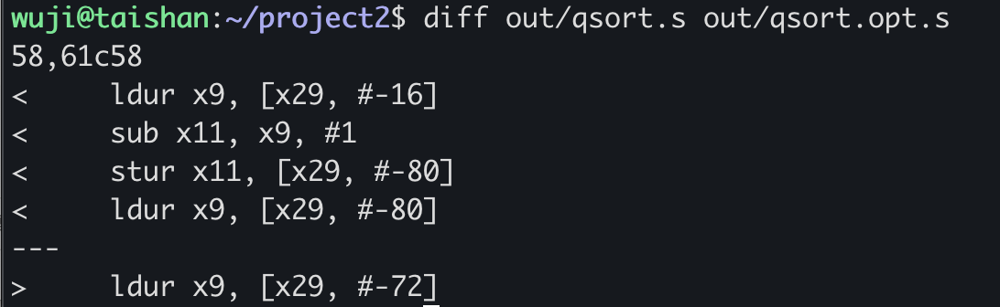
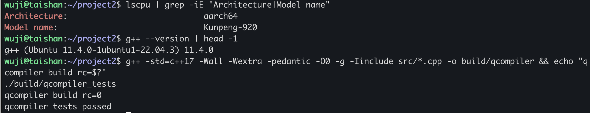
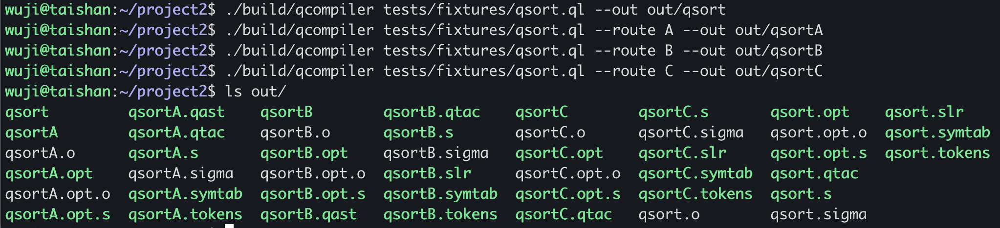
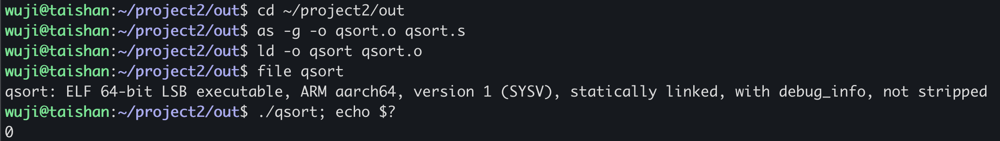
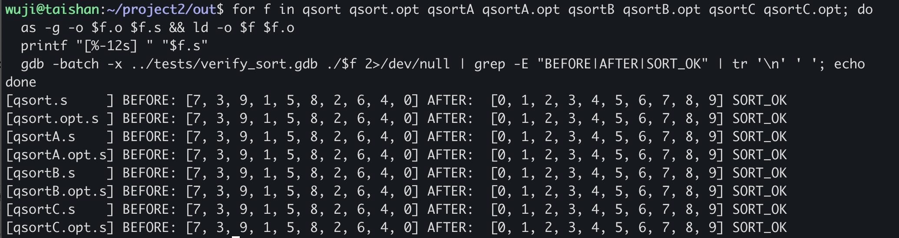

# 基于 SLR(1) 文法分析与 QTAC 中间语言的简易编译器 QCompiler 实现及鲲鹏环境验证

## 实验目的

1. 设计并实现一个面向自定义 QL 子集的简易编译器 QCompiler，覆盖词法分析、语法分析、AST/中间代码生成、目标代码生成与基础优化的完整流水线。
2. 在同一份代码中并行实现 A、B、C 三条不同的前端路线：A 路线采用 LL(1) 递归下降构造 QAST，B 路线采用 SLR(1) 表驱动构造 QAST，C 路线采用 SLR(1) 制导翻译直接生成 QTAC，并验证三者在语义上等价。
3. 设计自有 QTAC 三地址码作为中间表示，所有路线最终汇入同一份 QTAC→ARM64 后端，使前端可以替换而后端保持一致。
4. 以 qsort 快速排序程序为测试用例，在华为鲲鹏 ARM64 服务器上完成汇编、链接、运行与 gdb 调试，验证生成代码的功能正确性。

------

## 实验环境

- 开发与版本控制：Windows 11，C++17 源码，CMake 工程配置文件（CMakeLists.txt），Git。
- 构建/运行/验证平台：华为鲲鹏 TaiShan 服务器，Ubuntu 22.04 LTS，Linux 5.15 aarch64，g++ 11.4.0，GNU as / ld，gdb。

------

## 实验原理

### 编译流水线

QCompiler 的整体结构是：词法预处理、中端 IR、后端均三路线共用，前端则提供 A、B、C 三条可切换的语法分析路线。

```
QL 源代码
   ↓ [词法分析 lexer]        // 三路线共用
token 流
   ├─ [A: 递归下降 parser] → QAST → [QAST 翻译器] → QTAC
   ├─ [B: SLR(1) 表驱动 parser] → QAST → [QAST 翻译器] → QTAC
   └─ [C: SLR(1) 制导翻译]                          → QTAC
QTAC (中间代码) + 符号表
   ↓ [基础优化遍 optimizer]   // 三路线共用
   ↓ [QTAC→ARM64 后端]        // 三路线共用
ARM64 汇编 (.s / .opt.s)
   ↓ [as / ld]               // 鲲鹏服务器
可执行 ELF
```

CLI 通过 `--route A|B|C` 切换路线；任意路线的最终目标代码都能被同一份后端编译为相同形态的 ARM64 汇编。

### QL 源语言要点

QL 是 C 风格的语法子集，支持以下结构：

- 全局变量与全局数组：`int a[10];`
- 函数定义：参数之间以分号分隔且每个参数自带分号，例如 `void swap(int arr[]; int i; int j;)`
- 语句：赋值、`+=`、`if / if-else`、`while`、`return`、复合语句、表达式语句
- 表达式：四则运算、一元负号、函数调用、数组下标读写、括号
- 条件：关系运算 `<,<=,>,>=,==,!=`，逻辑组合 `&&,||,!`

### QTAC 三地址码

QTAC 是本实验自定义的线性 IR，所有路线的语义产出都归一化到这一形式，便于后端共用。核心指令形如：

$$
\langle \text{ins} \rangle ::= \text{LABEL } l \mid \text{GOTO } l \mid \text{IF } q\,rop\,a\,\text{THEN } l_1\,\text{ELSE } l_2
\mid q = q\,aop\,a \mid q = a \mid q = M[b] \mid M[b] = q
$$

加上函数调用三件套 `PAR a;`、`q = CALL f, n;` 和 `RETURN a;`。其中 $q$ 是变量或临时量 `t_i`，$a$ 是 $q$ 或立即数 $k$，$l$ 是标号 `l_i`。

### 三条路线设计要点

A 路线按照 QL 文法的非终结符递归调用，依靠 1-2 个 token 的 look-ahead 区分声明、函数、语句这几种情况，以及赋值与加法表达式的分界。优点是控制流贴近文法，调试方便；缺点是每加一类语法都要改函数。

B 路线把同一份 QL 文法增广为 SLR(1) 文法，离线构造 ACTION/GOTO 表，运行时用表驱动的移进-归约循环吐出 QAST 节点。优点是分析器结构与文法完全解耦，文法改动后只需重跑表生成；缺点是表的大小与状态数随文法膨胀。

C 路线直接在 SLR(1) 归约时机执行语义动作，把抽象语法树这一中间结构去掉，归约时刻就把 IR 指令片段追加到当前函数体。优点是省去 QAST 内存占用，前端到 IR 一遍完成；缺点是语义动作和归约时机绑得很紧，跨越多个归约的全局信息要靠语义栈携带。

三条路线在 QCompiler 中是对等的工程实现，任何一条都能独立完成编译；它们的差异只发生在前端，QTAC 之后完全归一。

------

## 实验代码整体框架

### 模块概览

| 文件 | 用途 | 服务的路线 |
|------|------|-----------|
| `src/lexer.cpp` | 词法分析，输出 `(类型, 值) @行:列` token 流 | A/B/C 共用 |
| `src/slr.cpp` | SLR(1) 文法定义、项目集与 ACTION/GOTO 表构造 | B/C 共用 |
| `src/qast.cpp` | A 的递归下降 parser、B 的 SLR parser、QAST→IR 翻译器 | A/B |
| `src/parser.cpp` | C 的 SLR(1) 制导翻译，归约时直接生成 IR | C |
| `src/ir.cpp` | QTAC 序列化、符号表序列化、基础优化遍 | A/B/C 共用 |
| `src/sigma_dfa.cpp` | σ-DFA：把 QTAC 流扫一遍识别为 Q2ARM 模板序列 | A/B/C 共用 |
| `src/arm64.cpp` | 按 σ-DFA 模板匹配结果生成 ARM64 代码 | A/B/C 共用 |
| `src/main.cpp` | CLI 入口，按 `--route` 调度前端 | 全局 |
| `tests/test_qcompiler.cpp` | assert 风格回归测试 | 全部 |
| `tests/verify_routes.cmake` | 四种 CLI 调用的端到端校验脚本 | 全部 |
| `tests/fixtures/qsort.ql` | qsort 测试程序 | 全部 |

### 词法分析（`src/lexer.cpp`，共用）

词法分析采用有限状态扫描，按字符种类分发到对应处理函数。关键字、标识符、整数、运算符、界符各走一条 token 化路径，行列号在 `advance()` 中维护。

```cpp
std::vector<Token> Lexer::tokenize() {
    while (true) {
        skip_whitespace_and_comments();
        const char c = peek();
        if (c == '\0') { /* push End */ return tokens; }
        if (is_alpha(c)) { tokens.push_back(identifier_or_keyword(...)); continue; }
        if (is_digit(c)) { tokens.push_back(number(...));               continue; }
        advance();
        switch (c) { case '+': /* +/+= */; case '<': /* </<= */; ... }
    }
}
```

`identifier_or_keyword` 内部用 unordered_map 查 6 个关键字 `int/void/if/else/while/return`，命中则返回对应 `TokenType`，否则返回 `Identifier`。多字符运算符如 `==`、`<=`、`>=`、`!=`、`+=`、`&&`、`||` 通过紧跟的 `match(c2)` 做最长匹配。

整个词法分析没有依赖正则库，但词法决策与正则等价，每个字符只读一次，复杂度 $O(n)$。

### SLR(1) 文法与分析表（`src/slr.cpp`，B/C 共用）

`qcompiler_grammar()` 集中定义了 69 条产生式，覆盖程序、声明、函数、参数表、语句、表达式、条件 6 大块。增广产生式为 $S' \to \text{Program}$。表构造分四步：

- `compute_first` 迭代求各非终结符的 FIRST 集，遇到 ε 时把 prefix 的 FIRST 串联起来；
- `compute_follow` 迭代求 FOLLOW，使用 FIRST(后缀) 与左侧的 FOLLOW 进行传播；
- `closure` 对项目集做 ε-闭包，`go_to` 计算转移，BFS 一遍把所有 LR(0) 项目集枚举出来；
- 归约动作按 SLR 规则只在 FOLLOW 中放置：

```cpp
for (const auto &terminal : follow_it->second) {
    set_action(table.actions, table.conflicts, ...,
               state_id, terminal,
               SlrAction{SlrActionKind::Reduce, item.production});
}
```

QL 文法中天然存在两类语言级歧义，必须在表构造阶段做出选择：一个是经典的悬挂 else，在见到 `ELSE` 时既可以把 ELSE shift 进当前 if，也可以按 `Statement -> IF ( Cond ) Statement` 归约；另一个是括号化条件 `(Expr)` 与括号化 cond `(Cond)` 在右括号处的二义。`should_prefer_shift_for_conflict` 把 `ELSE` 与 `RPAREN` 两个终结符标记为冲突时优先 shift，其它任意冲突会被记入 `conflicts` 并在加载表时抛出异常。这一策略让 ELSE 总是绑到最近的 if，让多余的括号总是被当作算术表达式的延伸而不是提前归约，与 C 系语言惯例一致。

最终生成的 SLR 表共 125 个状态、821 条 ACTION、199 条 GOTO、0 个未解决冲突、2 处由 shift 优先规则化解的冲突：

```
states: 125
actions: 821
gotos: 199
unresolved conflicts: 0
resolved conflicts: 2
  resolved: state 95, terminal RPAREN: s70 vs r63 -> s70
  resolved: state 108, terminal ELSE: s119 vs r26 -> s119
```

state 108 + ELSE 即悬挂 else，state 95 + RPAREN 即条件表达式的括号歧义，二者都被一致地选择 shift。

### 路线 A：递归下降构造 QAST（`src/qast.cpp::RecursiveQastParser`）

A 路线的入口是 `parse()`，它逐项处理一组顶层 item。遇到 `int|void` 时先读后面的 ID，再看是否紧跟 `(` 来决定走声明还是函数定义：

```cpp
QastNode parse_item() {
    if (is_type_token(peek().type)) {
        const Token type_token = tokens_[pos_++];
        const Token id = expect(Identifier, "identifier");
        if (match(LParen)) return parse_function_after_header(type_token, id);
        return parse_declaration_after_name(type_token, id);
    }
    return parse_statement();
}
```

表达式部分按运算符优先级拆为 `parse_expression / parse_add / parse_mul / parse_unary / parse_primary` 五层；条件部分再拆 `parse_condition / parse_and_condition / parse_not_condition / parse_relation_condition`，分别对应 `||`、`&&`、`!`、关系运算。

赋值与数组赋值是 A 路线唯一需要 2 个 token 前瞻的地方：`a = ...`、`a[i] = ...`、`a += ...`、`a[i] += ...`。前者直接 look-ahead 一个；后者要在 `[` 之后扫描到对应的 `]`，再看是不是 `=` 或 `+=`，才能确定整体是数组赋值而非数组下标读取。这里实现了一个 `matching_bracket` 辅助函数维护括号深度，避免误判嵌套表达式。

A 路线把所有解析结果封装到 `QastNode`（含 kind、value、op、type、children 五个字段），再由 `QastTranslator` 后序遍历生成 IR。

### 路线 B：SLR(1) 表驱动构造 QAST（`src/qast.cpp::SlrQastParser`）

B 路线复用 `build_qcompiler_slr_table()` 产出的同一张 ACTION/GOTO 表。主循环是标准的状态栈 + 语义栈：

```cpp
while (true) {
    auto action = table_.action(states.back(), lookahead.symbol);
    if (action->kind == Shift)  { states.push_back(action->target); values.push_back(lookahead.value); ...; continue; }
    if (action->kind == Reduce) { /* pop |rhs|, reduce(prod, rhs), push GOTO; */ continue; }
    return values.back().node;  // Accept
}
```

`reduce()` 是一个大 switch 语句，每个产生式对应一个分支，把当前规约产生的 `QastNode` 拼出来。例如声明 `Type ID DeclSuffix SEMI` 的归约：

```cpp
case kDeclaration:
    value.node = make_value_node("Declaration", rhs[1].name);
    value.node.type = rhs[0].type;
    value.node.is_array = rhs[2].is_array;
    value.node.size_bytes = rhs[2].size_bytes;
    break;
```

B 路线最终产出的 QAST 与 A 路线结构完全一致，这是设计上的不变量：QAST 节点种类、name、type、op 等字段都按统一模式填充。

### 路线 C：SLR(1) 制导翻译直接产出 IR（`src/parser.cpp`）

C 路线把语义动作直接挂在归约时刻。语义栈的元素不再是 QAST 节点，而是 `SemanticValue`，这是一种复合结构，携带 token 文本、类型、操作数列表、code 片段、表达式结果（`ExprResult` 含 `code` 和 `place`）以及条件结果（`CondResult` 含 `code`、`lhs`、`op`、`rhs`）。

以算术加法 `Add -> Add PLUS Mul` 为例，C 路线在这条规约里直接组装一条 binary 三地址码：

```cpp
ExprResult reduce_binary_expr(const ExprResult &left, const ExprResult &right, const std::string &op) {
    ExprResult result;
    append_code(result.code, left.code);
    append_code(result.code, right.code);
    result.place = context_.make_temp();
    result.code.push_back(IRInstruction{IROp::Binary, result.place, left.place, right.place, op});
    return result;
}
```

短路布尔被 `materialize_binary_condition` 物化为四块标号 `eval_right / true / false / end`，再把布尔值 0/1 写入临时量；if/while 由 `reduce_if_with_else / reduce_while` 在控制流模板里串好 LABEL/GOTO/IF。函数调用收集 `PAR` 后接 `CALL f, n` 的形式。所有这些工作都在归约动作内完成，最终 `Program -> { Items }` 归约时整个程序的 `main`、各函数 `instructions`、`globals`、`symbols` 已经填满。

### AST→IR 翻译（`src/qast.cpp::QastTranslator`，A/B 共用）

A 和 B 共用一个后序遍历翻译器，把 QAST 折成线性 QTAC。它和 C 的语义动作做的是同样的事，只是触发时机从归约时刻挪到了遍历到对应节点的时刻。A/B 的临时量编号顺序由后序遍历决定，C 的临时量编号顺序由 SLR 推导次序决定，这导致 A/B 和 C 的 QTAC 在临时量名和标号名上有顺序差异（详见结果分析），但产生的指令序列长度和语义完全一致。

### IR 序列化与基础优化（`src/ir.cpp`，共用）

`program_to_qtac` 按全局声明、函数体、main 体的顺序输出文本 QTAC；`program_to_symtab` 输出符号表，含 name/kind/function/size 四列。

IR 生成结束后立刻跑一个规范化遍 `elide_temp_moves`：扫一遍指令流，若发现 `tN = M[...];  X = tN;` 或 `tN = CALL f, k;  X = tN;` 且临时量 `tN` 在整段 IR 里只出现这一次使用，就直接把它合并成 `X = M[...];` 或 `X = CALL f, k;`。这样数组读取与函数返回值都能写到目标位置，不再保留一个只活两条指令的中间临时量。这一步让 .qtac 输出与 QTAC 的标准形态对齐。

优化遍只作用于 `.opt.s`，`.s` 保持未优化形态，由公共子表达式消除和基础清理两步组成。

公共子表达式消除 `eliminate_common_subexpressions` 以基本块为单位工作，`LABEL` 是块入口，`GOTO/IF/RETURN/CALL` 是块出口。块内维护一张可用表达式表，记录每个已算过的算术二元运算 `lhs op rhs` 及其结果临时量；再次遇到同一表达式、且操作数在块内未被重新赋值时，就删掉这条冗余的 `Binary` 指令，把它的目标临时量在后续指令里改名到先前结果。临时量是单赋值的，后端又为每个临时量分配独立栈槽，因此跨块改名是安全的。基础清理 `optimize_basic` 再删掉 `NOP`、`x = x` 的恒等 MOVE，以及位于 GOTO/RETURN 之后、下一条 LABEL 之前的不可达指令。

这里有一个关键的正确性约束，CSE 只对算术运算生效，刻意跳过地址计算（`address_calc` 标记的 `arr + i` 一类）。原因在于后端的 σ-DFA 会把 `t = arr + i; q = M[t]` 与 `t = arr + i; M[t] = q` 分别融合进 `T_LDR2`、`T_STR2` 这种带偏移的单条访存指令，融合时地址临时量 `t` 被内联进寻址、不再落栈槽；一旦把它当作公共子表达式复用，后续以它为基址的访存就会读到未初始化的槽位，算出错误地址。算术临时量则一定由 `T_AOP` 物化到栈槽，复用没有这个问题。

在 qsort 上，CSE 命中了 partition 里 `i = low - 1; j = low - 1;` 中第二次 `low - 1` 的重复计算，优化后 `j` 直接读第一次结果的栈槽。`.s` 为 169 行，`.opt.s` 为 166 行，`diff out/qsort.s out/qsort.opt.s` 正好显示这一段 4 条计算指令被折成 1 条复用。三条路线 A/B/C 的 `.opt.s` 都同样短于各自的 `.s`，说明优化遍与前端解耦、对三路线一致生效。

### σ-DFA 与 Q2ARM 模板匹配（`src/sigma_dfa.cpp`，共用）

后端不是按 IROp 逐条翻译，而是先用一个 σ-DFA 把整段 QTAC 流扫一遍、识别成 Q2ARM 指令模板的序列，再把每个模板按对应规则展开成 ARM。这一层是后端与 Q2ARM 模板定义的直接对应物。

输入字母表 12 个符号，每条 IR 指令归一到一个：`L`（Label）、`G`（Goto）、`R`（Return）、`I`（If）、`M`（Move）、`A`（Binary 普通算术）、`D`（Binary 地址算术，`address_calc=true`）、`LD`（Load）、`ST`（Store）、`P`（Par）、`C`（Call）、`N`（Nop）。

非接受状态 4 个：`S0`（初态）、`S_IF`（已读 I，1 步 lookahead）、`S_ADDR`（已读 D，1 步 lookahead）、`S_PAR_n`（已读 n 条 Par，n∈[1,8]）。接受状态 13 个，对应 Q2ARM 全部 12 个模板加一个 `T_NOP` 兜底。

关键转移如下：

```
S0     --I---> S_IF     ──L(目标=l1或l2)──> ACC_T_IF_LABEL
                         ──其它────────────> ACC_T_IF
S0     --D---> S_ADDR   ──LD(地址==Binary.dst)──> ACC_T_LDR2
                         ──ST(地址==Binary.dst)──> ACC_T_STR2
                         ──其它──────────────────> ACC_T_AOP
S0     --P---> S_PAR_1 --P--> S_PAR_2 --…--> S_PAR_8
S_PAR_n --C---> ACC_T_PAR_CALL
```

`S_IF` / `S_ADDR` 的存在让三个复合模板能成立：

- `T_IF_LABEL`：紧跟 If 的 Label 如果就是 If 的 true 或 false 分支，就把条件跳转加无条件跳转合并成一条反向条件跳转再落入下一段，省一条 `B`。例如 `IF low<high THEN l5 ELSE l6; LABEL l5;` 直接生成 `cmp x9, x10; b.ge l6; l5:`。
- `T_LDR2`：`Binary(addr) dst=t, base, idx; Load(dst, t)` 合并成单条 `ldr x10, [x9, x11, lsl #3]`，省掉 `add+stur+ldur+ldr` 中的中间几步。
- `T_STR2`：同理把地址计算与存数两步合并成单条 `str x10, [x9, x11, lsl #3]`。

`match_templates` 用一个状态变量驱动这套规则，PAR 队列、IF/ADDR 的 1 步 lookahead 都在函数局部维护，匹配过程是 $O(n)$ 一遍扫描。.sigma 文件输出整套 DFA 的描述（字母表、状态、接受态、转移），三路线产出字节完全相同（DFA 是后端的，与前端无关）。

qsort 程序上的模板命中分布（65 条 IR 被识别成 39 个模板）：

| 模板 | 命中次数 | 模板 | 命中次数 |
|---|---|---|---|
| T_LABEL | 7 | T_AOP | 9 |
| T_GOTO | 1 | T_MOVE | 4 |
| T_RETURN | 3 | T_LDR2 | 4 |
| T_IF_LABEL | 3 | T_STR0 | 1 |
| T_PAR_CALL | 6 | T_STR2 | 1 |

注意三个 IF 全部触发了 T_IF_LABEL（qsort 的每个 if/while 都在条件归约后紧跟 then 分支的标号）；4 次 T_LDR2 来自所有数组下标读取；1 次 T_STR0 来自 swap 函数里先算 t4=arr+i、再算 t2=arr+j、最后才用 t4 的情形，t4 与 Store 不相邻所以无法合并。

### QTAC→ARM64 后端（`src/arm64.cpp`，共用）

后端按函数粒度工作，主流程很短：先按当前函数的符号表与所有出现过的临时量分配 8 字节栈帧槽位（16 字节对齐）；输出函数序言 `stp x29, x30, [sp, #-16]!; mov x29, sp; sub sp, sp, #frame`；把入参 x0..x7 `stur` 到对应槽位；接着把函数体的 IR 交给 `match_templates`，对每个 `TemplateMatch` 用一个 13 分支 switch 展开成 ARM；最后输出尾声 `add sp, sp, #frame; ldp x29, x30, [sp], #16; ret`。

每个模板分支大致就是 Q2ARM 模板表的直译。以 T_IF_LABEL 为例：

```cpp
if (match.meta == 2) {                                              // l3 == l_false
    append_line(out, "    " + branch_for(branch.op_symbol) + " " + branch.label_true);
} else {                                                            // l3 == l_true
    append_line(out, "    " + branch_for_negated(branch.op_symbol) + " " + branch.label_false);
}
append_line(out, label.dst + ":");
```

T_LDR2 把两条 IR 压成一条 `ldr Xq3, [Xbase, Xidx, lsl #3]`；当索引是立即数时换成 `ldr Xq3, [Xbase, #(k*8)]`。T_STR2 同理。

`_start` 是后端独立合成的入口，跑 main 体后用 `mov x0, #0; mov x8, #93; svc #0` 触发 Linux sys_exit，整段不依赖 libc，链接时只需 `ld`。

工程上的一个有意取舍：所有变量、临时量、参数都放进栈帧 slot，全部走 `ldur/stur` 间接访问，没有寄存器分配。好处是 σ-DFA 模板逻辑可以非常直接，每条模板只需要从槽位读出操作数、算完、再写回槽位，不必处理寄存器活跃区与溢出；代价是生成代码偏长。qsort 上的 `.s` 文件为 3450 字节。

### CLI 入口（`src/main.cpp`）

主程序解析 `--route` 与 `--out`，按路线调用对应 parser，然后跑优化遍，最后串行写出 `.tokens / .qast / .slr / .qtac / .symtab / .s / .opt.s / .sigma` 几个产物。一个细节：route A 不产 `.slr`、route C 不产 `.qast`，`remove_file_if_exists` 会主动清除上一次同前缀下的过期文件，避免误读旧产物。`.sigma` 是 σ-DFA 的描述文本，三路线字节相同。

------

## 结果展示与分析

### 测试用例

`qsort.ql` 是用于端到端验证的快速排序程序，结构如下：一个全局数组 `int a[10]`，三个函数 `swap / partition / qsort`，最外层 `qsort(a[], 0, 9,);` 一行调用启动排序。`partition` 用 Lomuto 方案，`pivot = arr[high]`，循环条件写成 `(j = j + 1) < high` 形式，正好覆盖 QL 中赋值表达式能参与关系运算的特性。

### 词法分析

服务器上跑出的 `out/qsortC.tokens` 头部如下：

```
({, {) @1:1
(int, int) @2:1
(IDENT, a) @2:5
([, [) @2:6
(NUMBER, 10) @2:7
(], ]) @2:9
(;, ;) @2:10
(void, void) @4:1
(IDENT, swap) @4:6
((, () @4:10
(int, int) @4:11
(IDENT, arr) @4:15
...
```

可以看到关键字 `int / void` 被独立标记为对应类型，数组维度 `10` 作为 `NUMBER`，参数列表内分号 `;` 与函数体大括号 `{` 都正常切出。每个 token 都带行列号，定位错误能精确到行列。三条路线的 `.tokens` 文件字节完全相同，因为它们共用同一份词法分析。

### 三条路线的语法分析输出

**A/B 路线的 QAST**：`out/qsortA.qast` 与 `out/qsortB.qast` 二进制完全相同（diff 输出为空），结构如下：

```
Program
  Declaration name=a type=int array=true size=80
  Function name=swap type=void
    Param name=arr type=int array=true size=8
    Param name=i type=int
    Param name=j type=int
    Block
      Declaration name=temp type=int
      ExprStatement
        Assign name=temp op==
          ArrayLoad name=arr
            Identifier name=i
      ...
```

QAST 节点的 kind 含 `Program / Declaration / Function / Param / Block / If / IfElse / While / Return / ExprStatement / Assign / ArrayAssign / Binary / Unary / Call / ArrayLoad / ArrayRef / Identifier / Number / Rel / Truth / And / Or / Not`，每种节点带相应的 name、type、op、children。两条路线产出完全一致，是因为它们的语义动作都收敛到同一个 `QastNode` 构造函数。

**C 路线**没有 QAST，归约时直接拼 IR，所以 `out/qsortC.qast` 不会被生成（main.cpp 会主动清除旧文件）。

**B/C 路线的 SLR 表**：`out/qsortB.slr` 与 `out/qsortC.slr` 二进制完全相同，是同一份 `build_qcompiler_slr_table()` 的输出。头部统计在前文已展示，详细 ACTION/GOTO 项各上百条不再摘录。

### QTAC 中间代码

三路线的 `.qtac` 文件长度相同，但临时量编号与标号编号顺序略有不同。以 swap 函数体为例：

C 路线（SLR 制导翻译，归约次序决定编号）：
```
LABEL swap;
t0 = arr + i;
temp = M[t0];
t4 = arr + i;
t2 = arr + j;
t3 = M[t2];
M[t4] = t3;
t5 = arr + j;
M[t5] = temp;
RETURN 0;
```

A/B 路线（后序遍历，编号严格按 QAST 出现顺序）：
```
LABEL swap;
t0 = arr + i;
temp = M[t0];
t2 = arr + i;
t3 = arr + j;
t4 = M[t3];
M[t2] = t4;
t5 = arr + j;
M[t5] = temp;
RETURN 0;
```

数组读取 `temp = arr[i]` 的两步形式 `t = arr+i; temp = M[t]` 经赋值消除合并成单条 `temp = M[t0]`，与 QTAC 的标准输出形态完全对齐。剩余差异只在 `arr[i] = arr[j]` 这条数组赋值上：A/B 按后序顺序分配，先算地址再算右边最后 store，对应 t2/t3/t4；C 按 SLR 归约时机先归约右边的 `arr[j]` 得到 t2/t3，再归约整条赋值时地址用更晚分配的 t4。两种顺序产出的指令完全等价，对后端无影响。

partition 中的 while/if 控制流也有类似现象：A/B 路线给条件循环分配 `l0,l1,l2,l3,l4`，C 路线分配 `l2,l3,l4,l0,l1`，编号不同但跳转结构同构。

### 符号表

`.symtab` 的内容三路线完全一致，因为符号是按声明顺序登记的，与解析策略无关：

```
name    kind            function   size
a       global-array    <global>   80
arr     param-array     swap       8
i       param-scalar    swap       8
j       param-scalar    swap       8
temp    local-scalar    swap       8
t0      temp            swap       8
...
```

符号种类区分 global-scalar / global-array / local-scalar / local-array / param-scalar / param-array / temp 七类，后端按此决定取地址方式。

### ARM64 汇编

三路线最终的 `.s` 文件长度都是 3450 字节，结构完全平行。下面摘取几段说明 σ-DFA 后端的处理方式。

函数序言与参数入栈：

```asm
swap:
    stp x29, x30, [sp, #-16]!
    mov x29, sp
    sub sp, sp, #80
    stur x0, [x29, #-8]
    stur x1, [x29, #-16]
    stur x2, [x29, #-24]
```

数组下标读取 `M[arr + i*8]`（T_LDR2 把地址计算与取数合并成单条 `ldr`）：

```asm
    ldur x9, [x29, #-8]              ; arr
    ldur x11, [x29, #-16]            ; i
    ldr x10, [x9, x11, lsl #3]       ; arr[i]
```

if 条件跳转（来自 `IF low < high THEN l5 ELSE l6; LABEL l5;`，T_IF_LABEL 把条件跳转与无条件跳转合并成一条反向条件跳转再落入下一段）：

```asm
    cmp x9, x10
    b.ge l6
l5:
```

`_start` 入口：

```asm
_start:
    stp x29, x30, [sp, #-16]!
    mov x29, sp
    sub sp, sp, #16
    adr x0, a
    mov x1, #0
    mov x2, #9
    bl qsort
    stur x0, [x29, #-8]
.L_start_exit:
    add sp, sp, #16
    ldp x29, x30, [sp], #16
    mov x0, #0
    mov x8, #93
    svc #0
```

入口直接以 `bl qsort` 触发排序，结束后 `svc #0`（x8=93 即 sys_exit）干净退出。整段不依赖 libc，是后端为了能让 `ld` 单独完成链接而设计的。

### 优化前后对比

CSE 在 partition 上命中了一处真实的公共子表达式。`diff out/qsort.s out/qsort.opt.s` 的输出是：

```diff
58,61c58
<     ldur x9, [x29, #-16]      ; 第二次 low - 1：重新载入 low
<     sub x11, x9, #1           ;             重新做减法
<     stur x11, [x29, #-80]     ;             写回 t9 槽
<     ldur x9, [x29, #-80]      ;             再读出 t9
---
>     ldur x9, [x29, #-72]      ; 优化后：直接复用第一次结果 t8 的槽位
```



源程序里 `i = low - 1; j = low - 1;` 把 `low - 1` 算了两次，`i` 与 `j` 之间 `low` 没有被改写，第二次便是冗余计算。CSE 删掉它之后，`j` 的初值直接读第一次结果的栈槽 `#-72`，原本载入 low、做减法、写回 t9、再读出 t9 这 4 条指令收缩成 1 条复用，净减 3 行。`.s` 169 行，`.opt.s` 166 行。

GOTO/RETURN 之后的死代码删除与恒等 MOVE 删除在 qsort 上没有命中（这段控制流本就很紧），但与 CSE 同属优化遍，对更复杂程序仍有意义。优化只作用于 `.opt.s`，`.s` 保持未优化形态，两者对照即可直接看出优化删掉了哪些指令。

### 三路线对等性

`tests/verify_routes.cmake` 强制校验四种 CLI 调用（默认、A、B、C）的产物：

- 每条路线都必须产出 `.tokens / .qtac / .symtab / .s / .opt.s / .sigma`；
- A 不能有 `.slr`、C 不能有 `.qast`、B 必须既有 `.qast` 又有 `.slr`；
- 每个 `.qtac` 必须包含 `i80 a;`、`define partition(arr, low, high)`、`CALL qsort, 3`、`IF`、`M[` 这些片段；
- A/B 的 `.qast` 必须包含 `Function name=swap/partition/qsort`、`ArrayLoad`、`Call name=qsort`、`If`、`While`；
- B/C 的 `.slr` 必须有 `unresolved conflicts: 0`；
- A/B/C 三路线的 `.sigma` 必须字节相同；
- 默认路线与 `--route C` 的 `.qtac/.slr/.s/.opt.s` 必须字节完全相同。

服务器上 `./build/qcompiler_tests` 一次通过：

```
qcompiler tests passed
TESTS_RC=0
```

------

## 鲲鹏环境验证

本节命令都在鲲鹏服务器上真实执行，服务器为 Kunpeng-920、aarch64、Ubuntu 22.04、Linux 5.15、g++ 11.4.0、GNU as/ld 2.38、gdb。整个 project2 工作目录被传到服务器解包到 `~/project2`，所有编译都在这个工作目录内完成。

### 工作目录准备与构建

工程打包后传到服务器解包到 `~/project2`。服务器没有装 cmake，直接用 g++ 在工作目录里编译：`src/*.cpp` 一次编出主程序，去掉 `main.cpp`、换上测试源文件编出回归测试。

```bash
cd ~/project2
mkdir -p build out
g++ -std=c++17 -Wall -Wextra -pedantic -O0 -g -Iinclude src/*.cpp -o build/qcompiler
g++ -std=c++17 -Wall -Wextra -pedantic -O0 -g -Iinclude \
    src/arm64.cpp src/ir.cpp src/lexer.cpp src/parser.cpp \
    src/qast.cpp src/sigma_dfa.cpp src/slr.cpp tests/test_qcompiler.cpp -o build/qcompiler_tests
./build/qcompiler_tests
```



两次构建都返回 0、无 warning，测试一次通过。

### 四路线 CLI 跑通

```bash
./build/qcompiler tests/fixtures/qsort.ql --out out/qsort
./build/qcompiler tests/fixtures/qsort.ql --route A --out out/qsortA
./build/qcompiler tests/fixtures/qsort.ql --route B --out out/qsortB
./build/qcompiler tests/fixtures/qsort.ql --route C --out out/qsortC
ls out/
```

四条命令均返回 0，`out/` 下共 29 个产物文件，前缀对应路线，后缀对应阶段。



### 汇编、链接与排序验证

每条路线的 `.s` 与 `.opt.s` 都用 GNU as/ld 汇编链接成静态 ELF：

```bash
cd ~/project2/out
as -g -o qsort.o qsort.s
ld -o qsort qsort.o
file qsort
./qsort; echo $?  
```



可执行文件自身退出码恒为 0，因为后端给 `_start` 末尾固定写了 `mov x0, #0; mov x8, #93; svc #0`，这只说明程序能干净退出，不能说明排序正确。`_start` 调用 qsort 时只把全局数组 `a` 的地址传过去，`a` 在 `.data` 段被 `.zero 80` 清零。要验证排序，需要在进入 qsort 前给 `a` 预填乱序数据、跑完再读回。`tests/verify_sort.gdb` 用 gdb 批处理做这件事：在 `_start` 入口把 `a` 填成 `7 3 9 1 5 8 2 6 4 0`，反汇编定位 `bl qsort` 的下一条指令作为返回断点，qsort 返回后读回 10 个 8 字节整数比对是否升序。

对四条路线的 `.s` 与 `.opt.s` 各跑一遍：

```bash
cd ~/project2/out
for f in qsort qsort.opt qsortA qsortA.opt qsortB qsortB.opt qsortC qsortC.opt; do
  as -g -o $f.o $f.s && ld -o $f $f.o
  printf "[%-12s] " "$f.s"
  gdb -batch -x ../tests/verify_sort.gdb ./$f 2>/dev/null | grep -E "BEFORE|AFTER|SORT_OK" | tr '\n' ' '; echo
done
```

输出一致：

```
[qsort.s     ] BEFORE: [7,3,9,1,5,8,2,6,4,0]  AFTER: [0,1,2,3,4,5,6,7,8,9]  SORT_OK
[qsort.opt.s ] BEFORE: [7,3,9,1,5,8,2,6,4,0]  AFTER: [0,1,2,3,4,5,6,7,8,9]  SORT_OK
[qsortA.s    ] BEFORE: [7,3,9,1,5,8,2,6,4,0]  AFTER: [0,1,2,3,4,5,6,7,8,9]  SORT_OK
[qsortA.opt.s] BEFORE: [7,3,9,1,5,8,2,6,4,0]  AFTER: [0,1,2,3,4,5,6,7,8,9]  SORT_OK
[qsortB.s    ] BEFORE: [7,3,9,1,5,8,2,6,4,0]  AFTER: [0,1,2,3,4,5,6,7,8,9]  SORT_OK
[qsortB.opt.s] BEFORE: [7,3,9,1,5,8,2,6,4,0]  AFTER: [0,1,2,3,4,5,6,7,8,9]  SORT_OK
[qsortC.s    ] BEFORE: [7,3,9,1,5,8,2,6,4,0]  AFTER: [0,1,2,3,4,5,6,7,8,9]  SORT_OK
[qsortC.opt.s] BEFORE: [7,3,9,1,5,8,2,6,4,0]  AFTER: [0,1,2,3,4,5,6,7,8,9]  SORT_OK
```



输入 `7 3 9 1 5 8 2 6 4 0`，调用 `qsort(a, 0, 9)` 之后内存被改写为升序 `0 1 2 3 4 5 6 7 8 9`。三条路线的未优化与 CSE 优化版本给出完全相同的结果，Lomuto partition 与递归 qsort 的完整逻辑（三个函数、参数传递、数组下标、while/if 控制流）在鲲鹏 ARM64 上全部跑通，CSE 优化在真机上保持了语义不变。

------

## 实验总结

本实验在同一份工程里并行实现了 A、B、C 三条前端路线，串接到统一的 QTAC 中间表示和 ARM64 后端，并在鲲鹏 ARM64 服务器上完成了从 g++ 构建、ctest 回归、四路线 CLI 产物生成到最终 gdb 验证排序结果的完整链路。三路线最终 `.s` 字节数全部一致，QTAC/symtab 也只是临时量编号与归约顺序导致的局部差异，符号表完全相同，这说明前端可以替换、后端保持不变的分层方案在工程上是成立的。

写 SLR(1) 表构造时遇到的真实问题是悬挂 else 和括号歧义两处 shift-reduce 冲突，按优先 shift 的语言级规则化解之后冲突清零；这让我对二义性的语言级消解有了更具体的认识，也理解了为什么主流 LR parser 生成器都允许显式声明 token 的结合性与优先级。后端这边，σ-DFA 在 qsort 上把 65 条 IR 识别成了 39 个模板匹配，其中 T_IF_LABEL / T_LDR2 / T_STR2 三个复合模板分别命中 3、4、1 次，每次都把相邻几条 IR 折成单条窄寻址指令；这让我意识到指令选择在工程上就是把一组 IR pattern 一次性吃掉、生成 ARM 的紧凑形态，DFA 是这种 pattern 匹配的最自然描述工具。

总体而言，把编译器全流程在一个用例上完整跑通一次，能让前端、IR、后端、调用约定、ELF 装载这些原本分散的概念真正粘合到一起。三路线并行实现也让我直观感受到了不同语法分析策略的工程权衡：递归下降好写好调，SLR(1) 解耦文法与代码，SLR(1) 制导翻译省一遍中间表示，每一种在合适的场景下都是对的。
