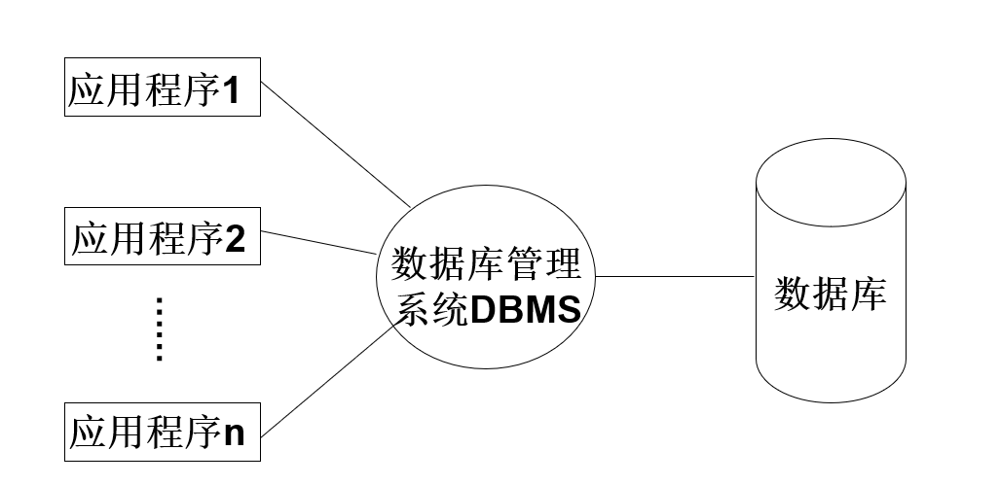
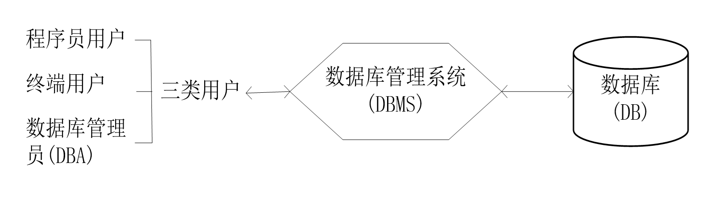
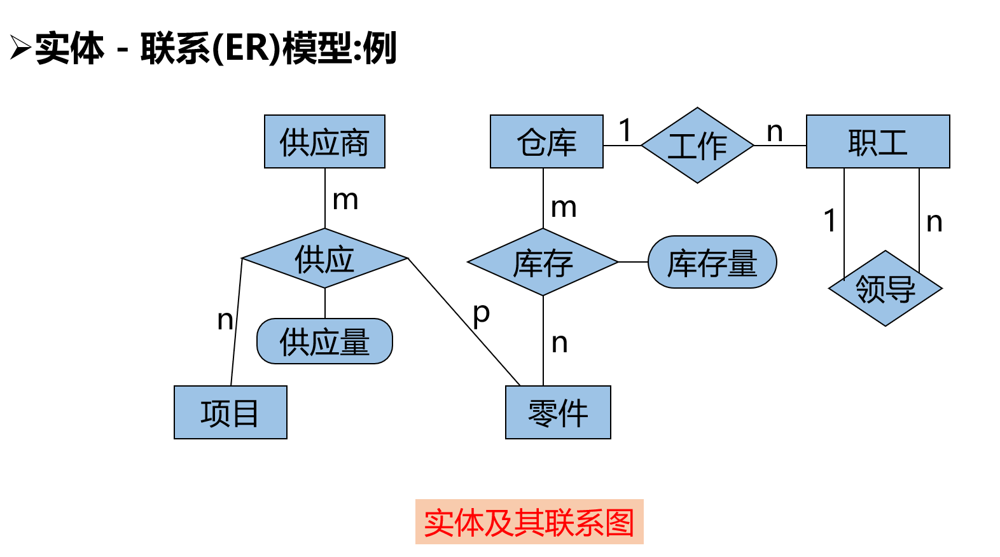
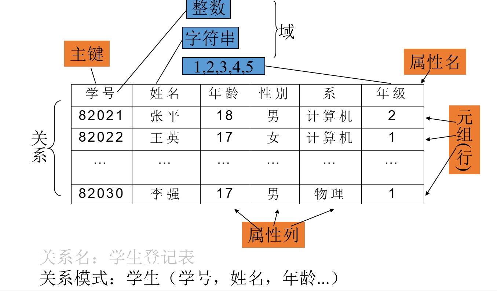
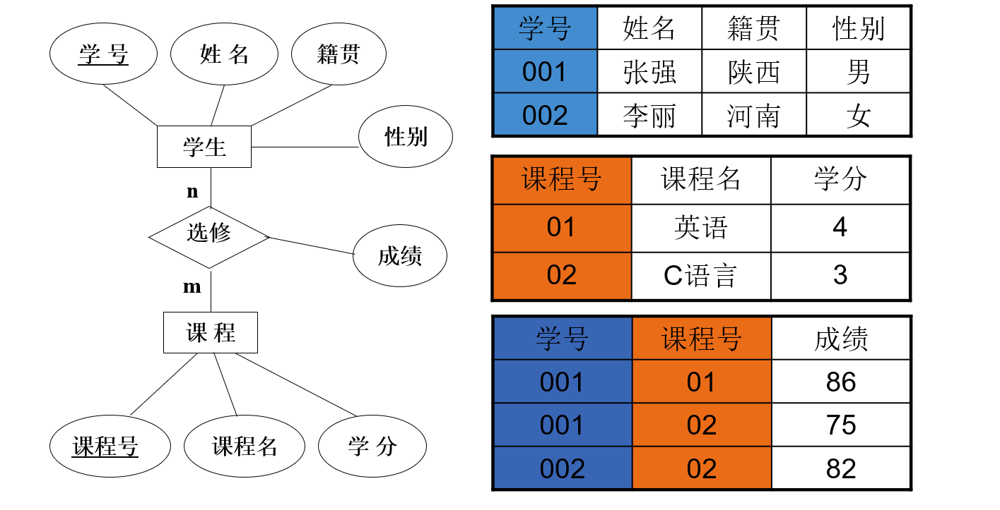
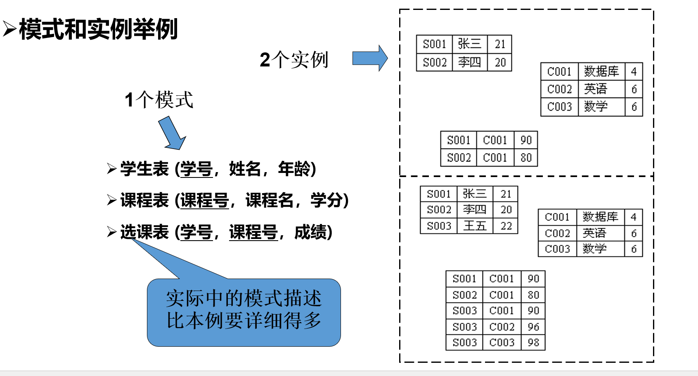
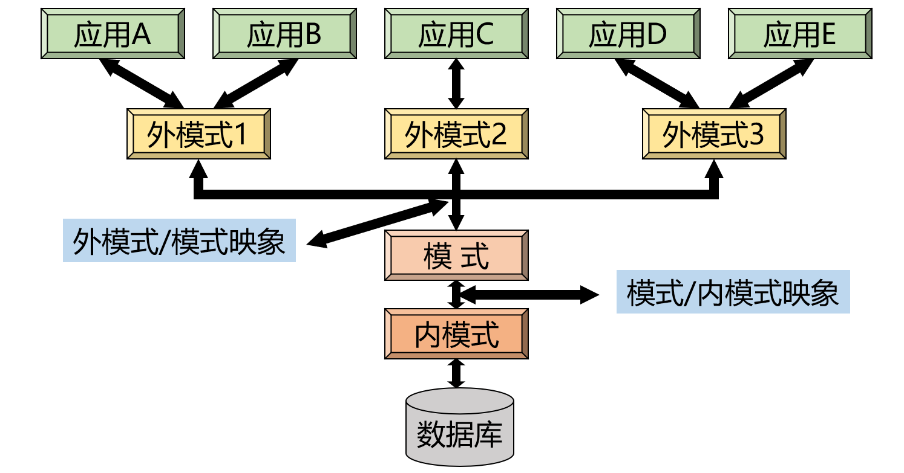

# 第1章 DBS概述

数据库的核心任务：**数据管理**

数据管理发展阶段：**人工管理**、**文件系统**、**数据库系统**

文件系统问题：数据与程序的独立性差，数据的共享性差（面向应用，数据孤立），数据不一致，数据查询困难，完整性难以保证

数据库系统特点：

- **数据共享性好、冗余少**：数据面向整个系统，所有用户同时读取。DBS还描述数据之间的联系
- **数据结构化**：按照数据模型，将各种数据组织到结构化的数据库中
- **数据独立性高**：
  - 逻辑独立性：数据总体逻辑结构改变时，局部逻辑结构不改变，所以不必修改应用程序，保证数据与程序间逻辑独立性
  - 物理独立性：当数据的存储结构改变时，数据的逻辑结构不变
- **统一的数据控制功能，数据共享程度高**：
  - 安全性Security：用户标识与鉴定，存取控制
  - 完整性Integrity：完整性约束条件定义和检查
  - 并发控制Concurrency：对多用户的并发操作加以控制、协调，防止其互相干扰而得到错误的结果并使数据库完整性遭到破坏

**数据库系统DBS：**指数据库和相应的软硬件系统，主要由**数据库**、**数据库管理系统**以及各类**数据库用户**三大部分，组成结构如图：

**数据库：**一个统一管理的持久存储的数据集合。（长期储存在计算机内、有组织的、可共享的大量数据的集合）

**数据库系统用户：**

- 数据库管理员DBA
- 终端用户
- 应用程序员

**数据库管理系统DBMS：**数据库系统中对数据进行管理的软件系统，是数据库系统的核心组成部分。它介于用户和操作系统之间，是一种通用的系统软件。
功能：提供各类用户接口（API），数据目录管理，数据库的运行管理

DBMS的执行方法：解释方法（被淘汰）、预编译方法

预编译方法：在运行前对将要执行的数据库语句进行编译处理，保存生成的可执行代码，需要运行时取出保存的可执行代码加以执行。当数据库中某些成分发生改变，使部分编译结果无效时，再对它们执行一次编译。

DBMS的进程结构：单进程多线程，每一个用户访问就开一个新线程。要求：提供非阻塞IO和异步IO功能，支持公平调度

数据目录（元数据）：关于数据的定义和描述，在逻辑上组织为若干表

数据和信息：数据是信息的符号表示或称为载体，信息则是数据的内涵，是对数据语义的解释

- 语法Syntax：数据的格式规定（如何读懂）
- 语义Semantic：数据本身的含义（怎么读）

**数据模型**：规定现实世界数据特征的抽象，是用来描述数据的**语法**、**语义**和**操作**的一组概念的集合。
三要素：

- **数据结构：**对实体类型和实体间联系的表达和实现
- **数据操作：**指对数据库的检索和更新两类操作
- **数据完整性约束：**给出数据及其联系应具有的制约和依赖规则

数据模型的级别：

- 概念数据模型：面向用户、面向现实世界的数据模型，将数据从现实世界向抽象世界转换的第一步模型
- 逻辑数据模型：用户从数据库系统所看到的数据模型
- 物理数据模型：反映数据存储结构的数据模型

概念数据模型实例：实体-联系模型（E-R）模型：

- 实体：客观世界中可区别的客观对象或抽象概念
- 属性：实体特征的抽象，实体全部属性的集合称为实体型。当实体型全部属性的值确定之后，就得到实体型的一个实例。
- 实体间联系：客观世界中各种对象或抽象概念之间的联系

逻辑数据模型：层次模型（树）、网状模型（图）、关系模型（表）。各种经典逻辑数据模型之间的根本区别在于数据之间的联系表示方式不同

- **层次模型**：只能表示1-N联系，复杂
- **网状模型**：一个以上的结点无父结点；至少有一结点有多于一个的父结点。查询效率高，但复杂
- **关系模型**：二维表。模式schema：关系的record名
  

这个图表示三个关系，学生，课程，和学生的课程情况。以学生学号和课程号为主键，通过这两个量联系学生课程成绩的关系。

- 面向对象模型：基本元素是对象object，主要概念是类class，类由一组变量和一组代码组成，分别定义类的特征和操作。一个class的所有变量都赋值后，得到一个实例instance。

**模式schema：**数据库中全体数据的逻辑结构和特征的描述，仅仅涉及类型的描述，不涉及具体的值。

**实例Instance**：模式的一个具体值

模式的分级：为了提高数据的物理独立性和逻辑独立性，提出三级模式结构：

- **外模式**（子模式/用户模式）：属于视图层抽象，它是数据库用户能够看见和使用的局部数据的逻辑结构和特征的描述。是与某一应用有关的数据逻辑表示，通常是模式的子集，一个数据库可以有**多个外模式**
- **内模式**（存储模式）：属于物理层抽象，一个数据库只有**一个内模式**。是数据物理结构和存储方式的描述，是数据在数据库内部的表示方式（顺序存储/B树/hash等）
- **外模式/模式映象**：模式改变时，该映像做相应改变，可以使外模式保持不变，应用程序不必修改，保证数据的**逻辑独立性**
- **模式/内模式映象**：定义数据逻辑结构与存储结构之间的对应关系，存储结构改变时修改该映象，使模式保持不变，应用程序保持不变，称为数据的**物理独立性**

