## 基本概念

**域domain：**一组值的集合。同一个域中的所有值均应具有相同的数据类型。其实就是关系中的一列允许取值的集合。列首为域名，列数为基数。

**笛卡尔积：** 类似矩阵乘法，构成一张表格（一个集合）。集合中每个元素为一个元组tuple，元组中每一个值称为一个分量component

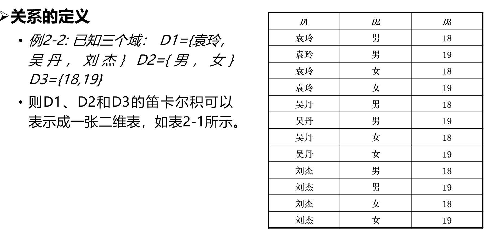

**关系relation：**笛卡尔积得到的任意一个子集均是定义在域上的关系，由n个域构成的关系称为n元关系。

**属性attribute：**为关系每个列起的名字。

**超键super key, SK：**一个关系中的某个属性或属性集能够唯一的确定一个元组

**候选键candidate key，CK：**将超键中的任一属性去掉后剩余的属性集不能唯一标识一个元组，则称该属性集是关系上的候选键。即所有可以当主键的属性

**主键primary key，PK：**候选键中的一个。如序列号，学号这种约束一个关系的属性。

**外键foreign key：**一个关系中的某个属性是另一个关系的CK。通过外键将两个关系关联起来

**模式schema：** $R(U,D,DOM,I,F)$ 。习惯上简记为 $R(A,B,C,D)$

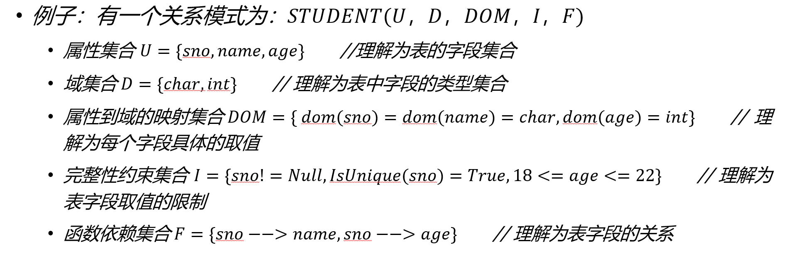

关系模式是静态、稳定的（即表格中的属性），关系是动态、变化的（整个表格）

关系的特性：

- 元组不重复：不能有两行完全一样的
- 属性不重复：名字不能一样
- 元组间无序：行顺序无关紧要
- 属性间无序：属性的顺序任意交换。习惯上把重要属性放前面（如CK）
- 同一属性名下的各个值必须来自同一个域，类型相同（每列的类型一样）
- 属性值是原子的，是确定值（如年月日不能放在一格）。属性可以为空值（CK不行）

关系类型：

- **基本表**：实际存在的表，对应实际存储数据的逻辑表示
- **查询表**：对基本表查询得到的结果表
- **视图**view：从基本表或其他视图导出的表

关系数据库的**型**：关系数据库模式，对关系数据库的描述，包括：

- 若干域的定义
- 在这些域上定义的若干关系模式

关系数据库的**值**：关系模式在某一时刻对应的关系的集合，简称为关系数据库

关系完整性：保证数据正确性和相容性

- **域完整性约束**：元组分量在某个属性上的取值应在其值域之内；元组是否能在某个属性上取空值null，由该属性的语义决定
- **实体完整性约束**：元组在键上的取值不可重复不可为空，否则无法区分两个元组
- **参考完整性约束**：外键引用候选键，可以在不同或相同的关系间。外键取值必须等于关系中某个元组在候选键上的值
- **用户定义的完整性约束**：某一应用所涉及的数据必须满足的语义要求。关系模型提供定义和检测这类完整性的机制。

**关系模型：**由关系数据结构、关系操作集合、关系完整性约束三部分组成：
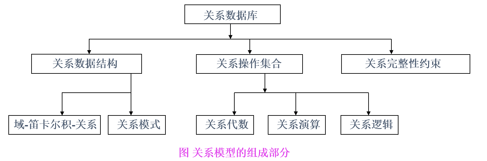

关系操作集合：关系模型提供的一组完备的高级关系运算

## 关系代数

设有两关系，m元关系R、n元关系S

**并union**：$R\cup S=\{t|t\in R \or t \in S\}$

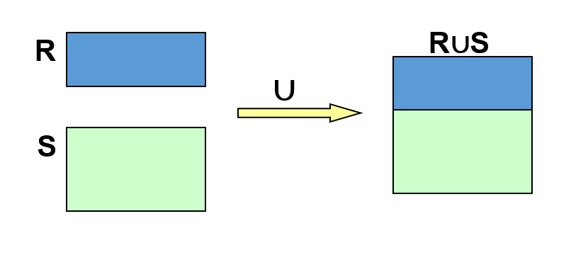

**差difference：**$R-S=\{t\in R \or t \notin S\}$

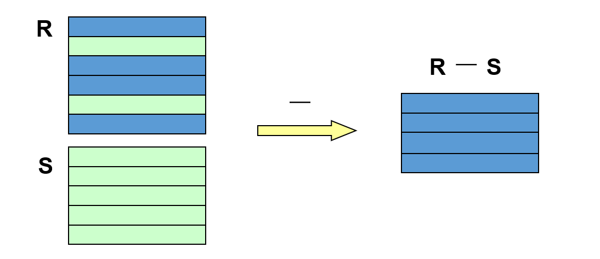

**交intersection：**$R\cap S = \{t|t\in R \and t\in S\}$

**笛卡尔积product：**$R\times S = \{t(m+n)|t(m)\in R \and t(n)\in S\}$

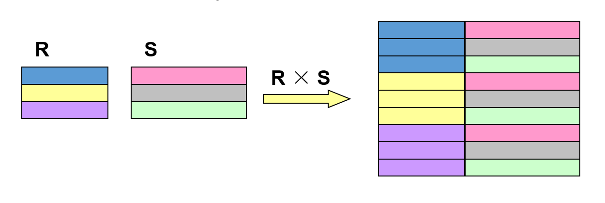

**选择select**：$\sigma _F(R)=\{t|t\in R\and F(t)=true\}$ （找行，对应WHERE）
SQL例:  `SELECT * FROM R WHERE a_id = 'a2'`

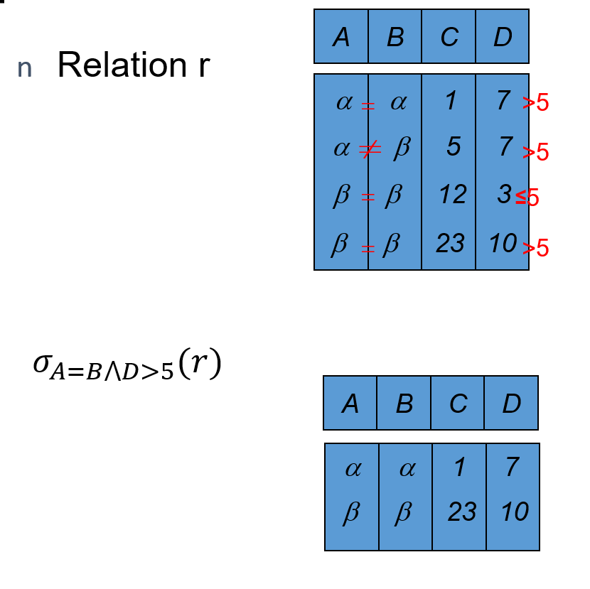

**投影projection：**$\prod_{x}(R)=\{t[x]\mid t\in R\}$ （找列，对应SELECT）

SQL：`SELECT b_id-100, a_id FROM R WHERE a_id = 'a2'`

投影后需要将重复元组合并

**连接join：**$R⋈_{AθB} S={rs│r∈R ⋀s∈S⋀r[A]θS[B] }=σ_{AθB} (R×S)$

等值连接：θ为等于比较

自然连接：消除重复属性的等值连接

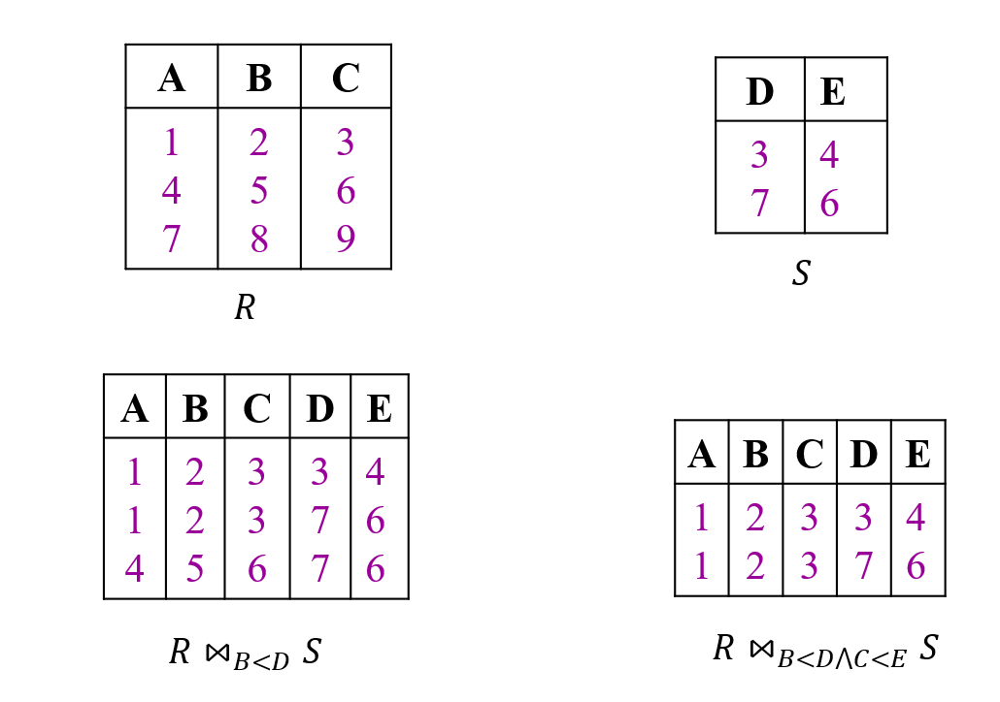

先求两个关系的笛卡尔积，然后再根据条件删除行

外连接：将不满足连接条件的元组保留在结果关系中，在缺失属性上取null，分为左、右、全外连接（LEFT JOIN）

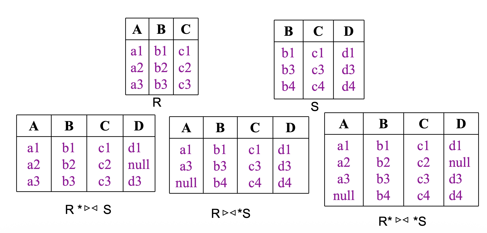

半连接：将R、S自然连接的结果在R的属性集上投影，不具有交换律

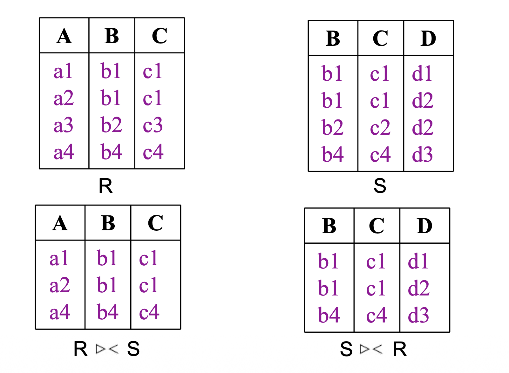

SQL：`SELECT * FROM R JOIN S USING (ATTRIBUTE1, ATTRIBUTE2...)`

**除division：**

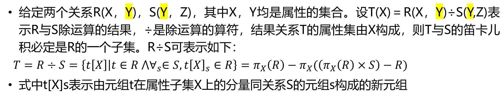

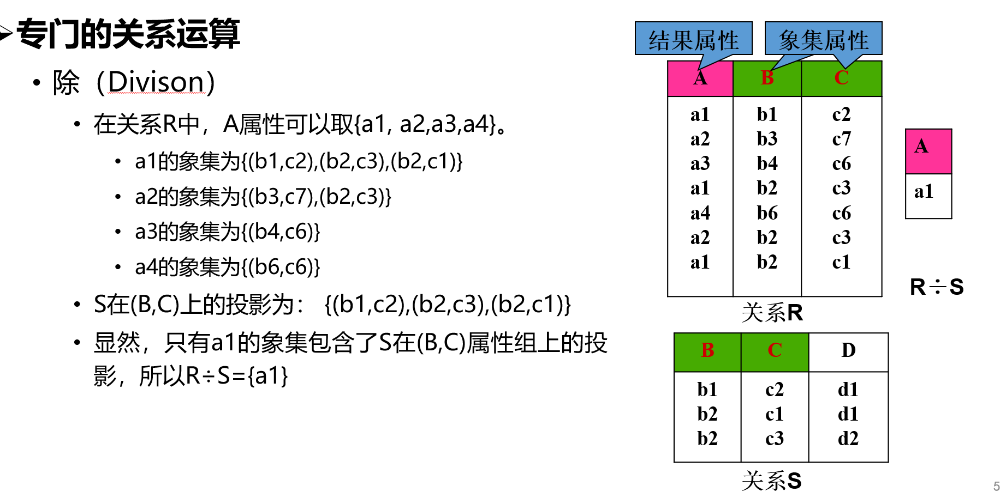

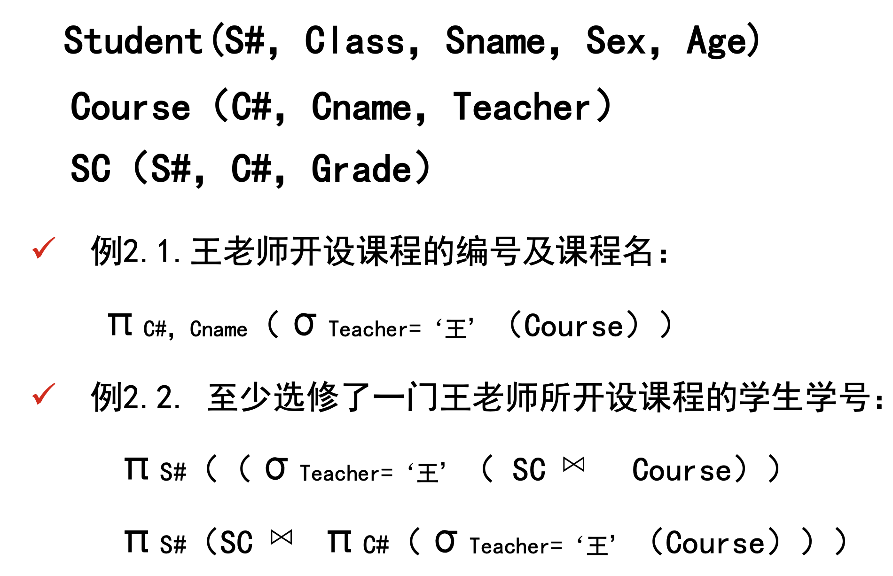

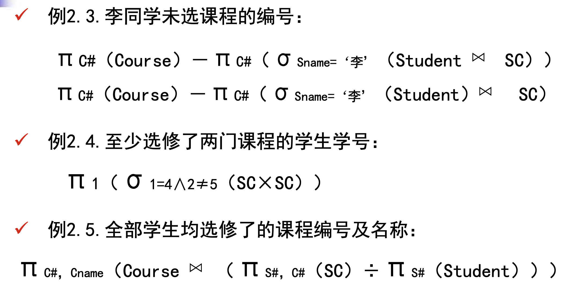

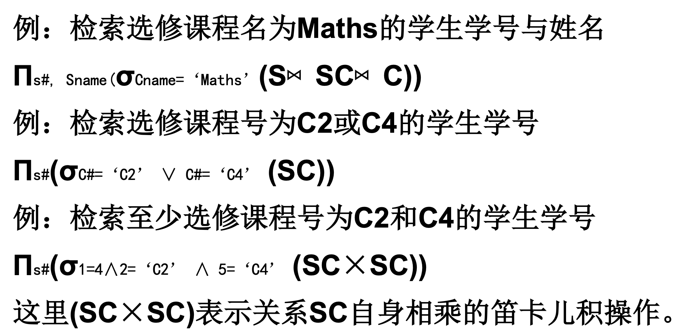

### 关系演算

关系演算：以数理逻辑中的谓词演算为基础。按谓词变元不同进行分类：

- 元组关系演算：以元组变量作为谓词变元的基本对象
- 域关系演算：以域变量做爲謂詞變元的基本對象

元組關係演算表達式的一般形式是：$\{t\mid P(t)\}$，其中t是元組變量，P(t)是元組關係演算公式，一般由原子公式構成

原子公式：

- R(t)：t是元組變量，R是關係，R(t)表示 $t\in R$ ，即t是R的一個元組
- $s[i]\theta t[j]$：s和t都是元組變量，s[i]表示元組s的第i個分量，t[j]表示t的第j個分量，$\theta$是算術比較運算符。它表示s的第i個分量和t的第j個分量滿足 $\theta$ 比較關係
- $s[i]\theta c$或$c\theta s[i]$：c是常量，表示元組s的第i個分量和常量c滿足 $\theta $ 這樣的比較關係

元组关系演算公式：∧、∨、¬、∃、∀
优先级：
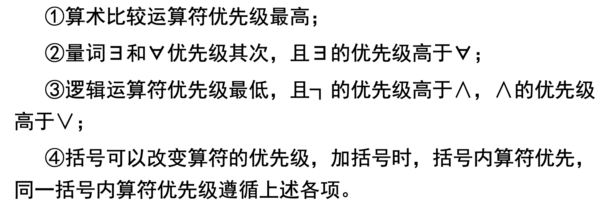

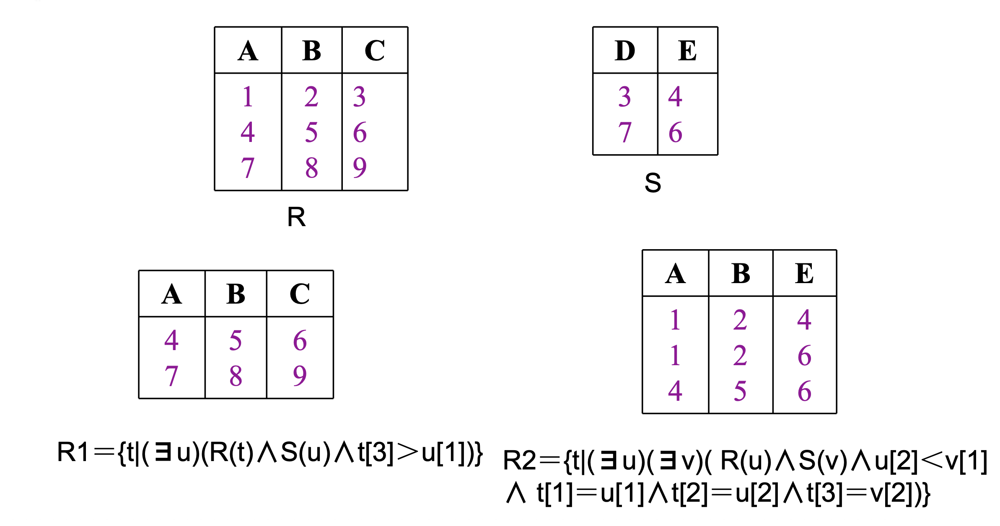

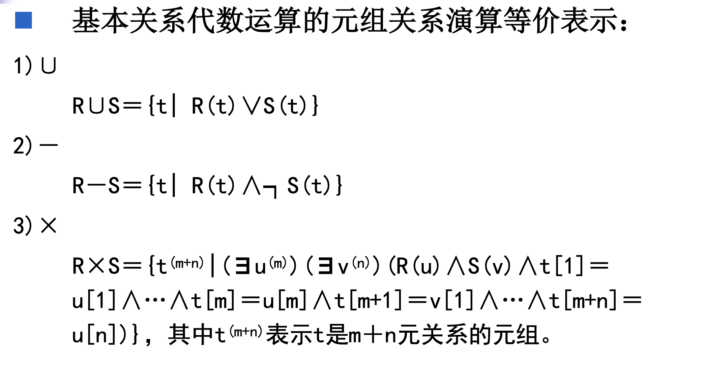

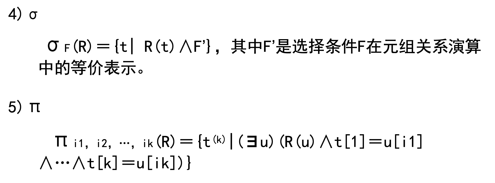

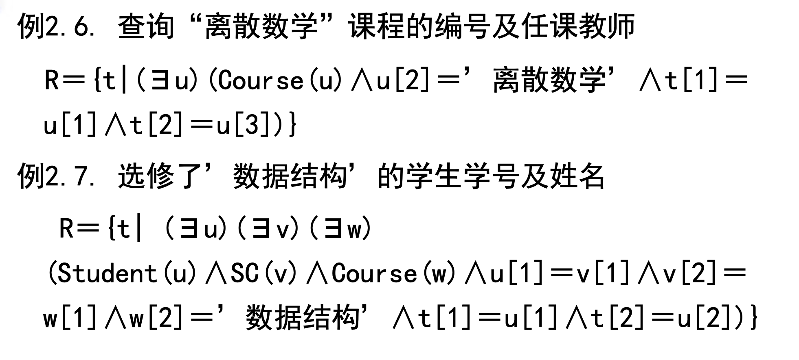

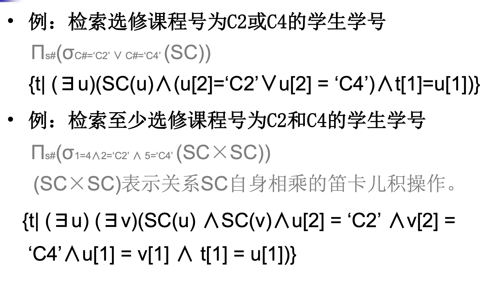

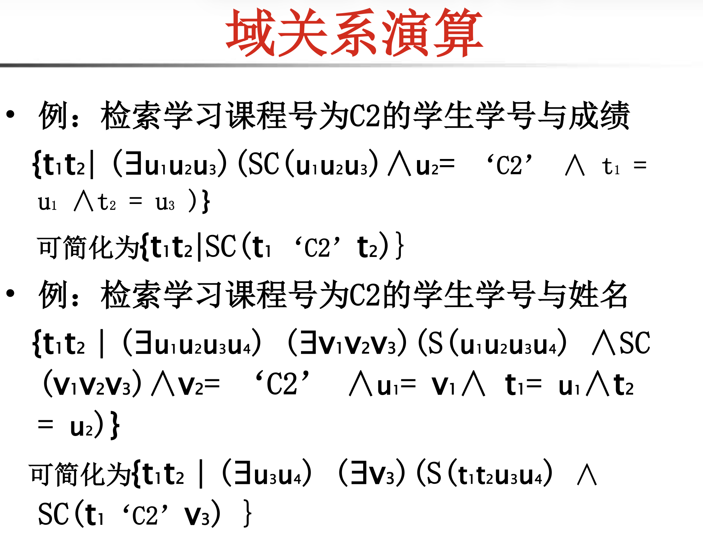
