# 查询处理与查询优化

## 引言

查询处理：从数据库中查询数据的一个处理过程，包括将用户的查询语句转变为数据库的查询计划，并且执行计划获得查询结果

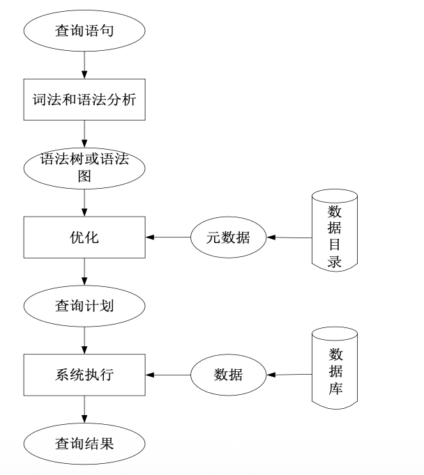

查询处理的实现方式：

- 解释：对接收的查询语句创建相应的事务，解释执行查询语句，在事务完成后返回查询结果，一般不保留可执行代码
- 编译：应用程序经预编译处理，将嵌入的查询语句分出，进行语法、词法分析和查询优化，生成一个可执行的访问模块AM存于磁盘中

查询优化：（原则：先选择，再连接）

- **规则优化**：根据启发式规则选择能提高查询效率的策略
- **代数优化**：先把查询语句转换成某种内部表示（语法树），然后应用**等价变换规则**进行优化。只涉及查询语句本身，不涉及存取路径，称为独立于存取路径的优化
- **物理优化**：合理选择各种操作的**存取路径**，以取得显著优化效果，称为依赖于存取路径的优化
- **代价估算优化**：根据可供选择的执行策略进行**代价估算**，并从中选择代价最小的执行策略
- **语义优化**：通过应用数据库的语义信息对查询进行优化

## 代数优化

原则：尽量减小查询处理的中间结果大小。变换查询时先执行投影、选择，后进行连接、笛卡尔积

关系代数等价变换：（等价：E1≡E2）

- 选择的串接：对同一关系代数表达式的多个选择可以合并为一个用AND连接的复合选择操作
  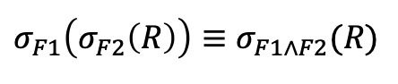
- 选择的交换：对同一关系代数表达式的选择条件可以进行交换
  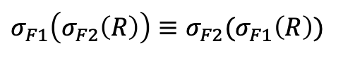
- 投影的串接：如果满足条件，对同一关系代数表达式的多次投影可以转换为仅含最后一个投影的操作
  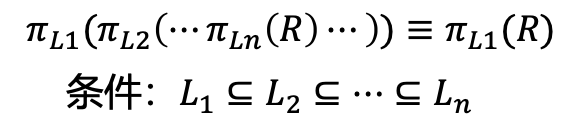
- 选择与投影的交换：如果满足F的属性是L的子集，投影操作后的选择操作可以转换为选择操作后的投影操作。
  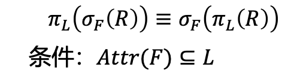
- 连接/笛卡尔积的交换律：
  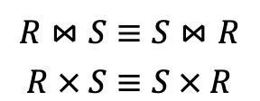
- 选择对连接/笛卡尔积的分配率：
  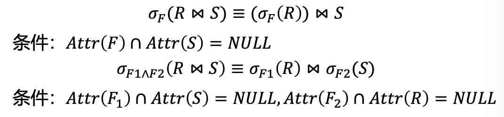
- 投影对连接/笛卡尔积的分配率：
  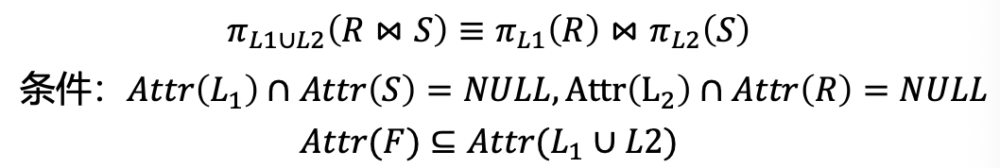
- 选择对交、并、差的分配率：
  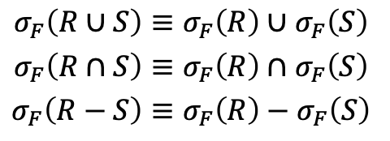
- 投影对并的分配率：
  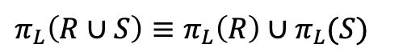
- 连接、笛卡尔积、交、并的结合率：
  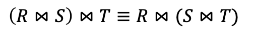

策略：

- 尽可能早地执行选择操作
- 投影和选择操作同时进行
- 选择和其前执行的笛卡尔积合并成一个连接操作
- 找出表达式中的公共子表达式
- 投影和其前后的二元运算结合起来
- 适当的预处理

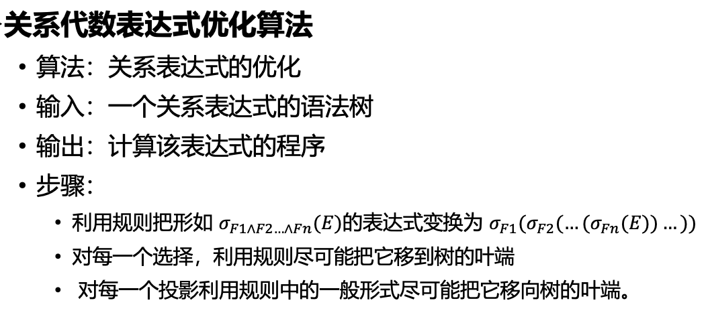

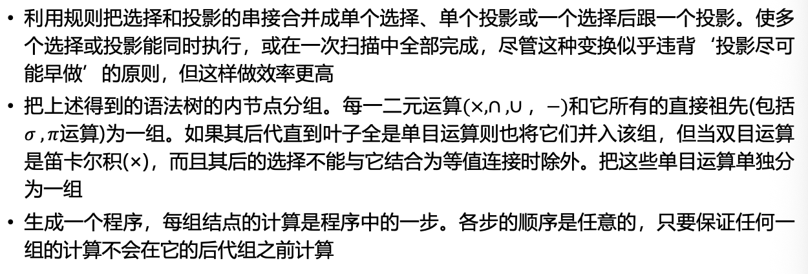

即：先把大选择拆成小选择，然后把选择下推到能达到的最下面（需要用到哪个表就放哪个上面），然后把投影下推（投影在选择上面，在笛卡尔积下面，需要哪个属性就放哪个上面），最后把笛卡尔积和其上的选择一块变成连接。

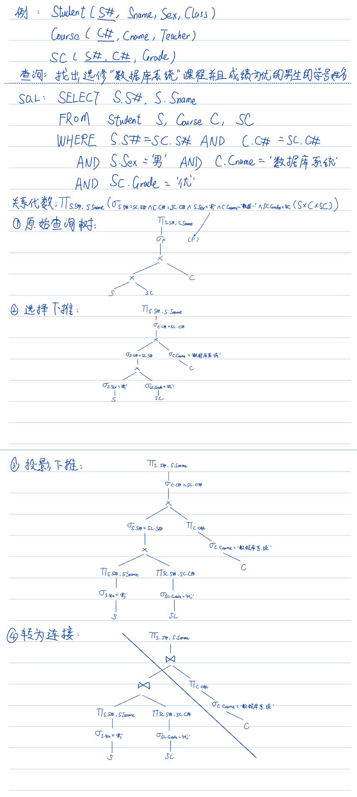

## 物理优化

### 选择

选择操作：从关系中选择满足给定条件的元组，从水平方向减小关系的大小，选择尽量先做。
执行策略与选择条件、可用的存取路径、选取的元组数在整个关系中所占的比例有关。

选择条件：等值、范围、集合等，复合选择条件由简单选择条件通过NOT、AND、OR连接而成。

选择操作的实现方法：顺序扫描（小关系）、索引、动态散列

选择操作的规则：

- 对于小关系，不必考虑其他存取路径，直接用**顺序扫描**
- 如果无索引或散列等存取路径可用，或估计中选的元组数在关系中占有较大的比例（>15%），且有关属性上无索引，用**顺序扫描**
- 对于**主键的等值条件查询**，最多只有一个元组可以满足此条件，优先采用**主键的索引或散列**
- 对于**非主键的等值条件查询**，要估计中选的元组数在关系中所占的比例，如果比例较小（<15%），可用**无序索引**，否则只能用**聚簇索引或顺序扫描**
- 对于**范围**条件，一般先通过**索引**找到范围的边界，再通过**索引的顺序集**沿相应方向搜索，一般用**B+树索引**。若范围超过一半元组，则用**顺序扫描**更好
- 对于用**AND**连接的合取选择条件，若有相应的多属性索引，则优先采用**多属性索引**
- 对于用**OR**连接的析取选择条件，只能按其中各个条件分别选出一个元组集，再求这些元组集的并，需要用**顺序扫描**，应尽量避免析取选择
- 有些操作只要访问索引即可得到结果，例如查询索引属性的最大值、最小值、平均值等，在此情况下应优先利用**索引**

### 连接

连接操作：从两个关系的笛卡尔积中选择满足连接条件的元组

1. 嵌套循环法：两层循环，外层循环为外关系，内层循环为内关系。顺序扫描外关系的每一个元组，然后与内关系的每一个元组进行匹配。**选择占用物理块少的关系作为外关系。**
   

   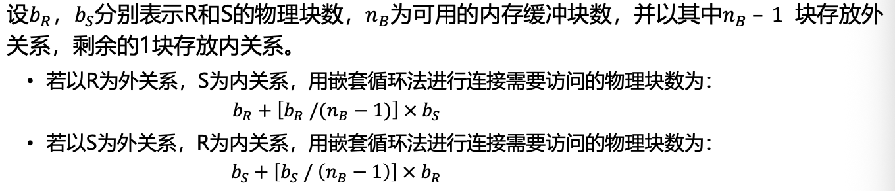

2. 利用索引或散列寻找匹配元组法：如果内关系有合适的存取路径（索引/散列），可以考虑使用这些存取路径代替顺序扫描，减少IO次数。

3. 排序归并法：按连接属性对关系排序，然后进行归并连接

4. 散列连接法：用散列函数将连接属性hash至文件中，然后对hash到同一个桶中的元组进行匹配。

连接操作的启发式规则：

- 如果两个关系都已**按连接属性排序**，则优先用**排序归并法**。如果两个关系中已有一个关系按连接属性排序，另一个关系**很小**，可考虑对此关系按连接属性排序，再用**排序归并法**连接。
- 如果两个关系中有一个关系在连接属性上有索引（特别是顺序索引）或散列，则可**令另一关系为外关系**，顺序扫描，并利用**内关系上的索引或散列寻找其匹配元组**，以代替多遍扫描
- 如果应用上述两规则的条件都不具备，且两个关系比较**小**，可用**嵌套循环法**
- 如果都不适用，用**散列连接法**。（适用于等值连接）

### 其他

投影操作：选取关系的某些列，从垂直方向减小关系大小。需要消除重复元组（排序、散列）

集合操作：笛卡尔积——嵌套循环法，交、并、差等操作——发现共同元组