[TOC]

# 事务管理

## 事务

事务Transaction：数据库环境下由一组数据库操作序列组成的逻辑工作单元。这些操作是一个不可分割的整体（要么全做要么全不做）

事务的执行保证数据库在一致状态，如果有些执行有些不执行就会让数据库在不一致状态。

符号：

- 开始：BEGIN TRANSACTION
- COMMIT提交：提交事务的所有操作，将所有对数据库的更新写回磁盘上的物理数据库，事务正常结束
- ROLLBACK回滚：在事务运行过程中发生某种故障，系统将事务中对数据库的所有已完成操作全部撤销，滚回到事务开始时的状态。

特性：ACID

- **Atomicity**原子性：事务是数据库的逻辑工作单位，事务中包括的诸操作要么都做要么都不做
- **Consistency**一致性：事务执行结果必须使数据库从一个一致性状态变到另一个一致性状态。当数据库只包含成功提交结果时就处于一致性状态，如果运行中发生故障，就需要回滚到开始时的一致性状态
- **Isolation**隔离型：一个事务的执行不能被其他事务干扰。
- **Durability**持续性：一个事务一旦提交，对数据库中数据的改变应该是永久性的，接下来其他操作或故障不应对其执行结果有任何影响。

恢复技术：保证事务在故障发生时满足ACID性质的措施

并发控制技术：保证多个事务在并行执行时满足ACID性质的措施

事务管理：恢复和并发控制是保证事务正确运行的两项基本技术

事务操作：

- read(X)：从数据库中将对象X读入执行read操作的事务的局部缓冲区中
- write(X)：从执行write的事务的局部缓冲区把对象X写入数据库。write的结果可以暂存在内存中，DBMS和OS协同决定写回磁盘时机。

事务的状态：

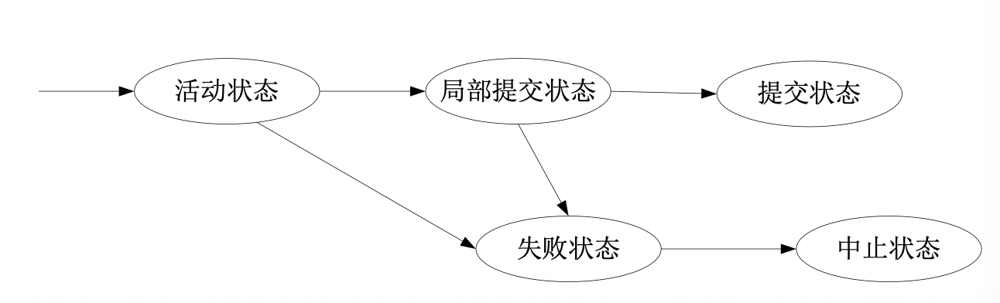

- 活动状态：事务开始执行后处于的状态，可以读写
- 部分提交状态：事务结束
- 失败状态：事务执行时检查出故障或在活动状态期间被撤销
- 提交状态：在事务进入提交状态后，事务已经成功结束
- 中止状态：数据库被恢复到事务开始执行前的状态

SQL事务管理：

- COMMIT[WORK]：提交当前事务
- ROLLBACK[WORK]：中止当前事务，撤销事务影响
- SET TRANSACTION[{READ WRITE | READ ONLY}] […]

## 故障分类

1. **事务故障**：影响单个事务正常运行的任何事件。
   逻辑错误：事务由于内部逻辑上的问题而无法继续正常执行
   系统错误：系统进入非正常状态，中断事务执行
   非预期故障：不能由事务程序自身处理，如运算溢出、死锁等
   恢复方式：**事务撤销UNDO**，回滚该事务
2. **系统故障**：造成系统停止运转的任何事件，使系统要重新启动，如特定类型硬件错误、OS故障、DBMS故障、停电等。不破坏数据库，但是主存内容（数据库缓冲区内容）丢失，运行事务非正常终止
   恢复方式：让非正常终止事务回滚，撤销所有未完成事务（**UNDO**），重做所有已提交事务（**REDO**）
3. **介质故障**：外存故障，如磁盘损坏、磁头碰撞、瞬时强磁场干扰等，破坏性大
   恢复方式：利用备份进行重构，利用事务日志log对最近副本以后提交的所有事务进行重做**REDO**
4. 计算机病毒

## 数据库恢复技术

数据库恢复：数据库管理系统（恢复子系统）具有把数据库从错误状态恢复到某一已知的正确状态（一致状态、完整状态）的功能

故障对数据库的影响：

- 数据库本身被破坏
- 数据库数据不正确（事务运行非正常终止）

原理：**冗余**。常用技术：数据备份、事务日志文件

### 数据库备份

数据库备份：DBA定期将整个数据库复制到磁带或另一个磁盘上保存起来，备用的数据称为后备副本。数据库遭到破坏后可以将后备副本重新装入，但只能将数据库恢复到备份时的状态，需要重新运行自备份以后的所有更新事务

- 脱机备份（静态备份）：在备份过程中不能接受应用程序访问
- 联机备份（动态备份）：备份过程中可以接受应用程序的访问
- 增量备份：每次只备份上次备份后更新过的数据
- 海量备份：每次备份全部数据

### 数据库日志

日志文件作用：把已完成的事务进行重做，对故障发生时未完成的事务进行撤销。
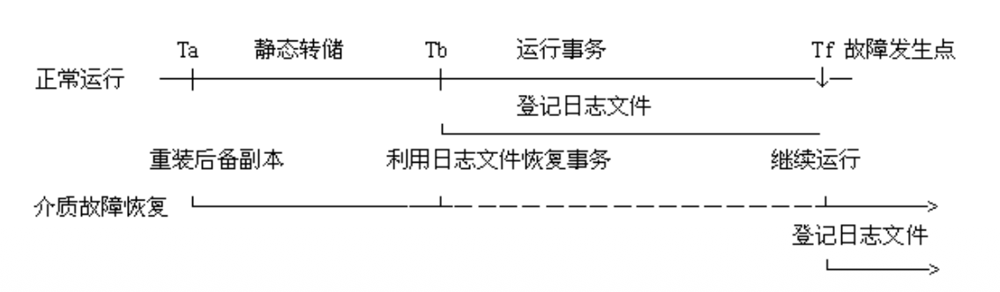

日志文件的格式：

- 以**记录**为单位
- 以**数据块**为单位

对于以记录为单位的日志文件需要登记：

- 事务开始：BEGIN TRANSACTION
- 事务结束：COMMIT / ROLLBACK
- 各事务的所有更新操作

记录内容：

- 事务标识TID
- 操作类型（插入、删除、修改）
- 操作对象（数据对象内部标识）
- 更新前数据的旧值
- 更新后数据的新值

登记日志文件：登记次序按**并发事务执行的时间次序**；**先写日志文件，后写数据库**

### 恢复策略

事务故障恢复：利用**UNDO**

1. 反向扫描文件日志，查找事务更新操作
2. 对事务更新操作执行逆操作
3. 反复以上步骤，直到事务开始标记

系统故障恢复：**UNDO+REDO**

1. 正向扫描日志文件，找出在故障发生前已提交的事务，标记REDO队列
2. 找出故障发生时未完成的事务，计入UNDO队列
3. 对撤销队列进行UNDO处理
4. 对重做队列进行REDO处理

介质故障恢复：重装数据库，**REDO**

1. 装入最新数据库后备副本。（对于联机备份副本，还需装入备份开始时刻的日志文件副本，利用恢复系统故障的方法恢复到一致状态）
2. 装入相应的日志文件副本，重做已完成事务。

事务故障和系统故障DBMS可以自动完成，介质故障需要DBA重装数据库，之后也由DBMS完成

### 采用检查点的恢复技术

检查点技术：增加检查点记录（checkpoint），增加重新开始文件，让恢复子系统在登录日志文件期间动态地维护日志

检查点记录内容：建立检查点时刻所有正在执行的事务清单，以及这些事务最近一个日志记录的地址。

重新开始文件：记录各个检查点记录在日志文件中的地址

动态维护日志：

1. 将当前日志缓冲中的所有日志记录写入磁盘的日志文件
2. 在日志文件中写入一个检查点记录
3. 将当前数据缓冲的所有数据记录写入磁盘的数据库中
4. 把检查点记录在日志文件中的地址写入一个重新开始文件

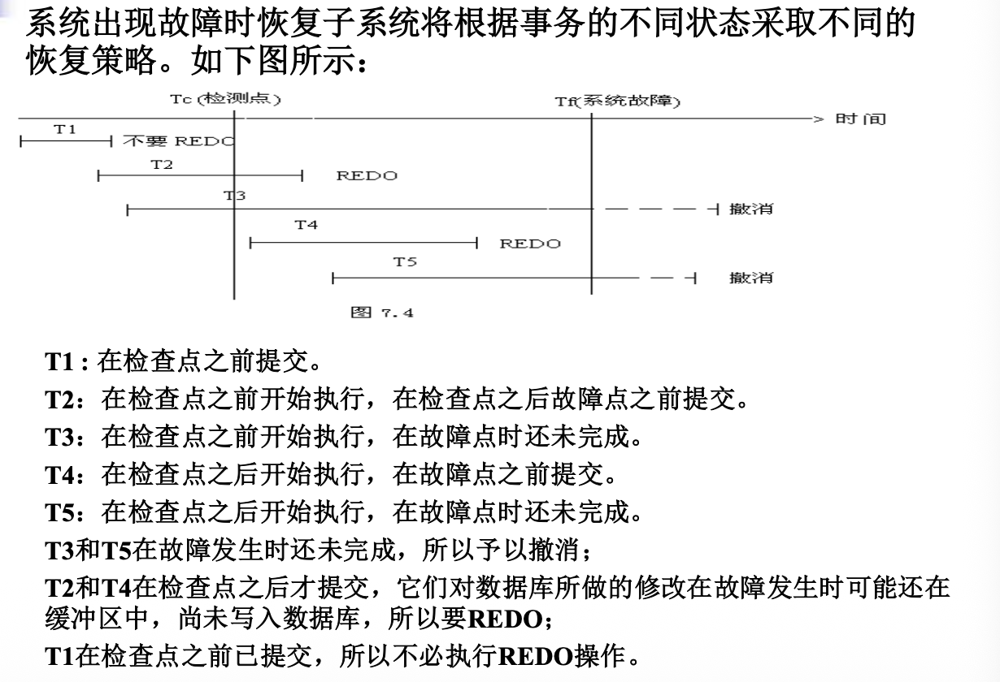

恢复步骤：

1. 从重新开始文件中找到最后一个检查点记录在日志文件中的地址，由该地址在日志文件中找到最后一个检查点记录

2. 由该检查点记录得到检查点建立时刻所有正在执行的事务清单 ACTIVE-LIST

3. 建立两个事务队列：

   - UNDO-LIST
   - REDO-LIST

   把ACTIVE-LIST放入UNDO-LIST，REDO-LIST暂时为空

4. 从检查点开始正向扫描日志文件：

   - 如有新开始的事务Ti，放入UNDO-LIST
   - 如有提交的事务Tj，把Tj从UNDO-LIST移到REDO-LIST

5. 对UNDO-LIST的每个事务执行UNDO，对REDO-LIST的每个事务执行REDO

## 数据库并发控制

**串行访问**：事务顺序执行，一个事务完全结束后另一个才开始

**并发访问**：事务在时间上重叠执行

交叉并发（并发）：在单CPU系统中，同一时间只能有一个事务占用CPU，即各个事务需要交叉使用CPU

同时并发（并行）：多个事务同时占用CPU

并发导致的问题：（破坏**隔离性**）

- **丢失修改**：两个事务读入同一数据并修改，一个事务提交的结果破坏了另一个提交的结果，导致其修改丢失
  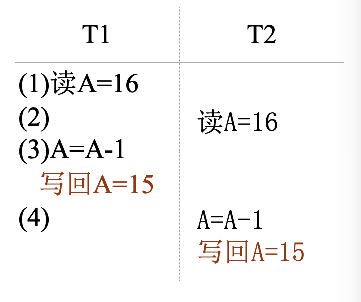

- **读脏数据**（与回滚有关）：事务T1修改某一数据并将其写回磁盘，T2读取同一数据后T1被撤销（ROLLBACK），该数据应该恢复原值，但是T2读到的数据是改过的，不一致，是脏数据
  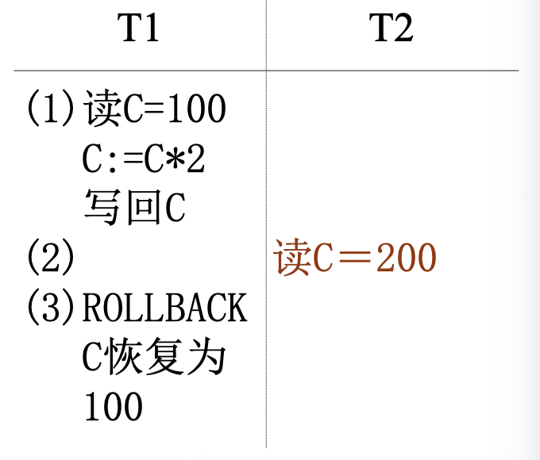

- **不可重复读**（同一事务读两次）：T1读取数据后，T2更新，使T1无法再现前一次读取结果

  - T1读取某一数据，T2修改，T1再读值不一样
  - T1读取，T2删除，T1读不到了
  - T1读取，T2插入，T1发现多出记录

  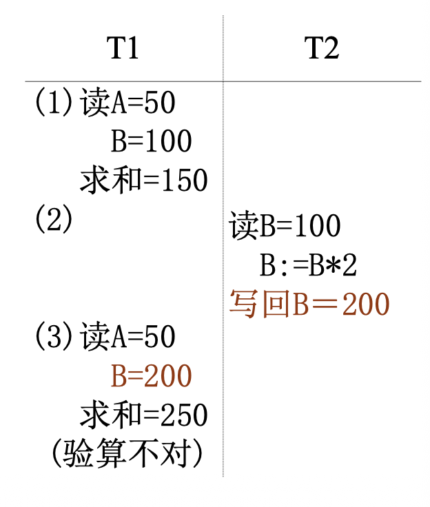

**调度**：n个事务所有操作执行次序的一个安排。不同事务可以交叉执行

**目标等价**：两个调度的结果一样

**冲突**：两个事务写同一个数据。包括读-写和写-写冲突

**冲突等价**：调换调度中不冲突的操作得到新的调度

**可串行化调度**：多个事务的并发执行是正确的，当且仅当其结果与按某一次序串行地执行他们时的结果相同。

冲突可串行/目标可串行：一个调度与另一个冲突/目标等价

并发控制的正确性准则：**可串行性**

判断调度是否可串行：**前驱图**

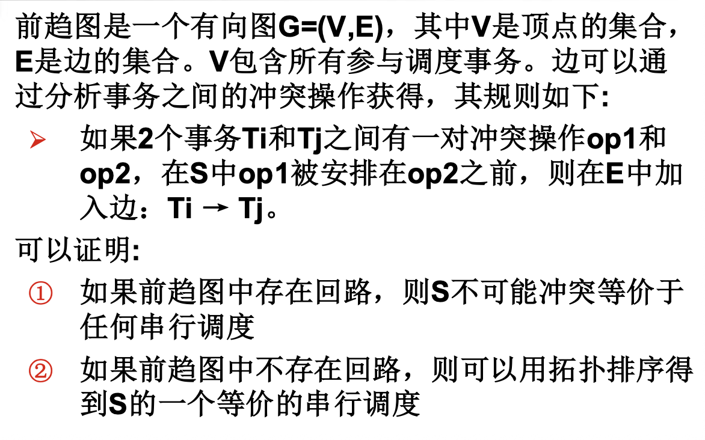

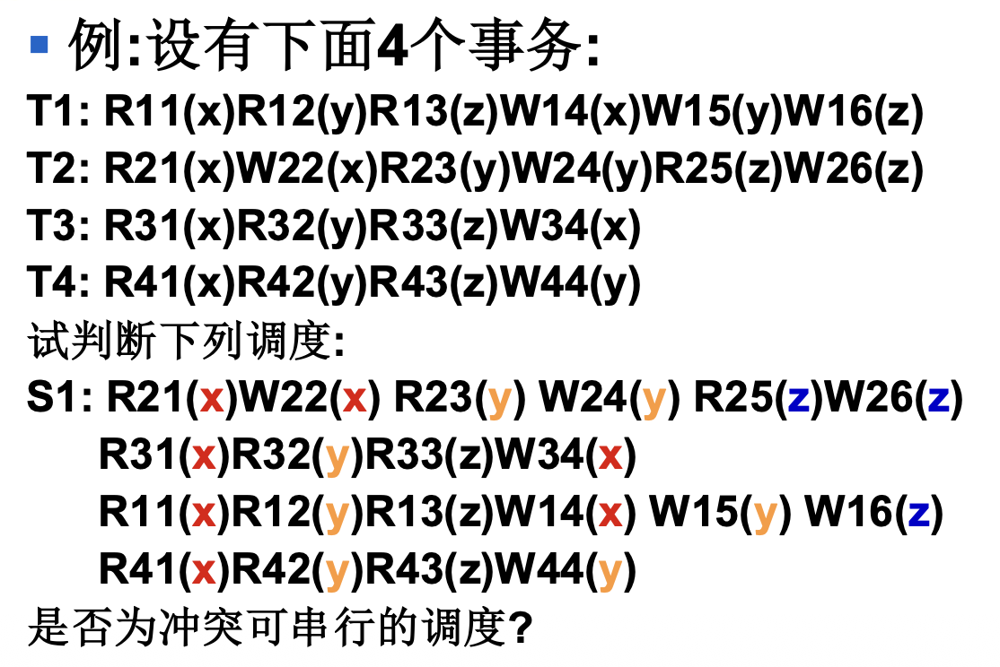

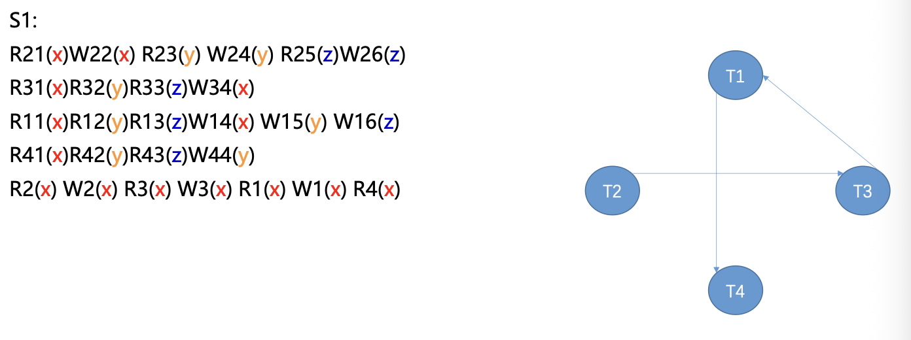

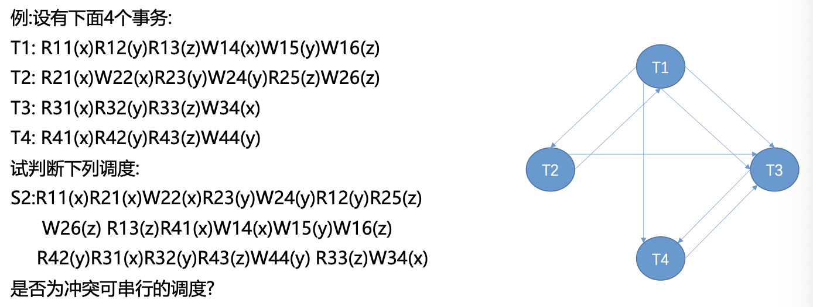

可串行性实现方法：两段锁（2PL）——保证并发调度可串行性的加锁协议

### 基于锁的并发控制

**排它锁（X锁）**：写锁。事务T对数据A加X锁，则**只允许T读和写A**，其他事务不能给A加任何锁，直到T释放锁

**共享锁（S锁）**：读锁。事务T对数据A加S锁，**事务T可读A不能写A**，**其他事务只能对A加S锁，不能加X锁**，直到T释放锁。

**U锁**：事务在需要更新一个数据时，申请对它的U锁，加了U锁后仍允许其他事务加S锁。写入时将U锁升级为X锁，不必在全过程中加S锁。

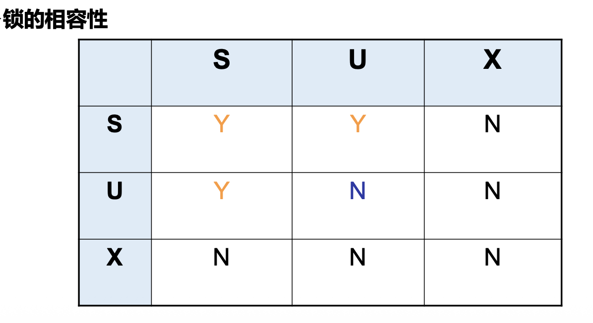

加锁协议：

- **1级加锁协议**——防止**丢失修改**：事务T在修改数据R前必须先加**X锁**，直到**事务结束**才释放，包含COMMIT和ROLLBACK
- **2级加锁协议**——防止**读脏数据**：1级加锁协议基础上，事务T读取数据A前必须加**S锁**，**读完后释放**
- **3级加锁协议**——防止**不可重复读**：1级加锁协议基础上，事务T读取数据A前必须加**S锁**，**事务结束**后释放

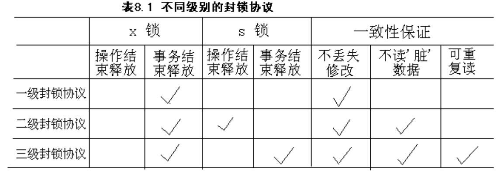

**两段锁协议2PL**：

- 第一阶段：获得封锁（扩展阶段）。事务可以申请获得任何数据项上的任何类型的锁，但是不能释放任何锁
- 第二阶段：释放封锁（收缩阶段）。事务可以释放任何数据项上的任何类型的锁，但是不能申请任何锁。

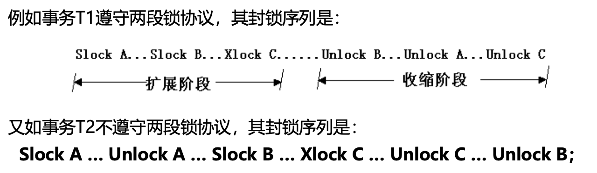

若遵守2PL，则事务的并发调度是可串行化的，但可能发生死锁

**活锁**（即饥饿）：某个事务永远等待分配锁。采用先来先服务FCFS策略

**死锁的检测和预防**：

- **一次封锁法**：每个事务必须一次将所有要使用的数据全部加锁，否则不能继续执行。降低系统并发度
- **顺序封锁法**：预先对数据对象规定一个封锁顺序，所有事务按这个顺序封锁。难以确定顺序
- **事务重执**（retry）：事务申请锁未获批准时，让某些事务回滚，以免循环等待
  ts：timestamp。ts（T1）< ts（T2），则T1早于T2，T1比T2年老。
  - 等待-死亡策略（wait-die）：年老事务等待年轻事务
    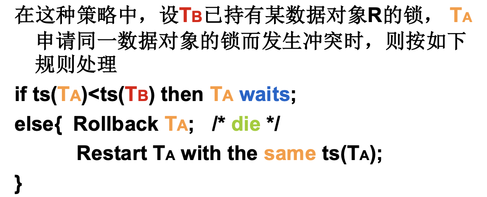
  - 击伤-等待策略（wound-wait）：年轻事务等待年老事务
    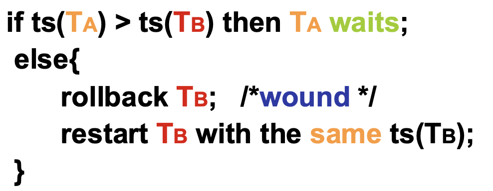

**死锁的检测与解除**：

- **超时法**：如果事务等待时间超过规定时限，就认为发生死锁。缺点是可能误判死锁，且若时限设置太长则不能及时发现死锁
- **等待图法**：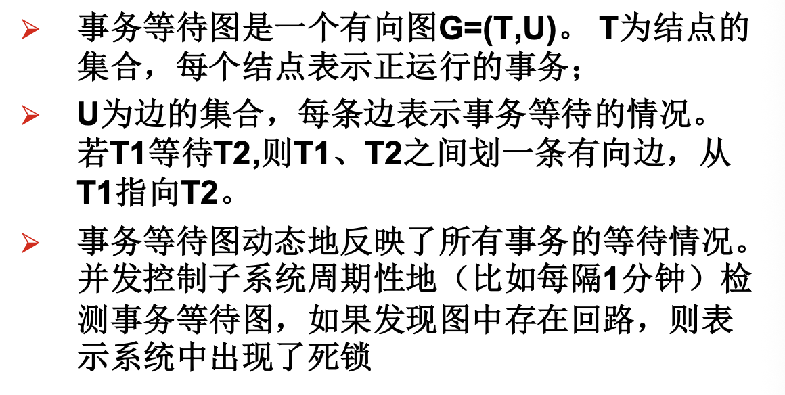
- 死锁的解除：选择一个处理死锁代价最小的事务，将其撤销，释放该事务持有的所有锁，恢复撤销事务锁执行的所有数据修改操作

**多粒度封锁**：

1. 多粒度锁：允许多粒度树中的每个节点被独立加锁，对一个节点加锁意味着这个节点的所有后裔节点也被加同样类型的锁。
   在多粒度封锁中一个数据对象可能以两种方式封锁：显式封锁和隐式封锁

2. 意向锁：如果对一个结点加意向锁，说明该节点的下层结点将被加锁；对任一节点加锁时，必须先对它的所有上层节点加意向锁。
   例：对任意元组加锁，必须先对它所在的数据库和关系加意向锁。

   - 意向共享锁（IS锁）：对一个数据对象加IS锁，表示其后裔节点意向加S锁
   - 意向排它锁（IX锁）：对一个数据对象加IX锁，表示其后裔节点意向加X锁
   - 共享意向排它锁（SIX锁）：先加S锁，再加IX锁。例：对某个表加SIX锁，表示该事务要读整个表，同时更新个别元组

   锁的强度：对其他锁的排斥程度。事务在申请封锁时以强锁代替弱锁是安全的。

   具有意向锁的多粒度封锁方法中，任意事务T对一个数据对象加锁，必须先对其上层节点加意向锁

   申请封锁时自上而下，释放封锁时自下而上

   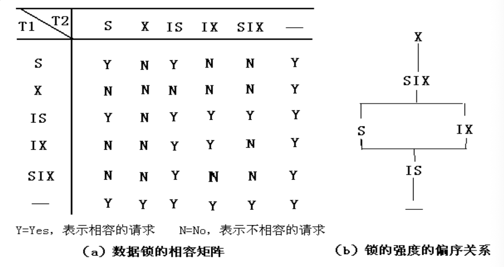

## 其他并发控制技术

1. 基于时间标记的并发控制：按事务时间标记顺序串行执行
   tr(X)：读时间标记，所有成功执行read(X)事务的时间标记中最年轻的
   tw(X)：写时间标记，所有成功执行write(X)事务的时间标记中最年轻的
   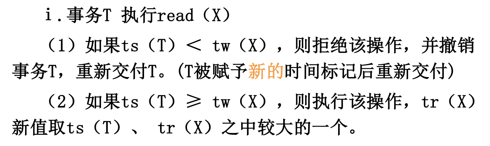
   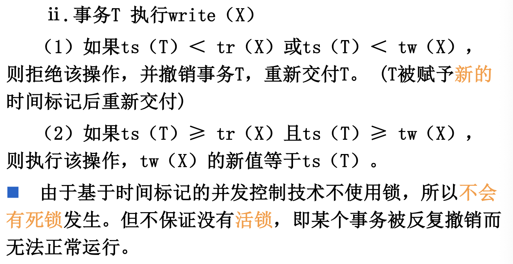
   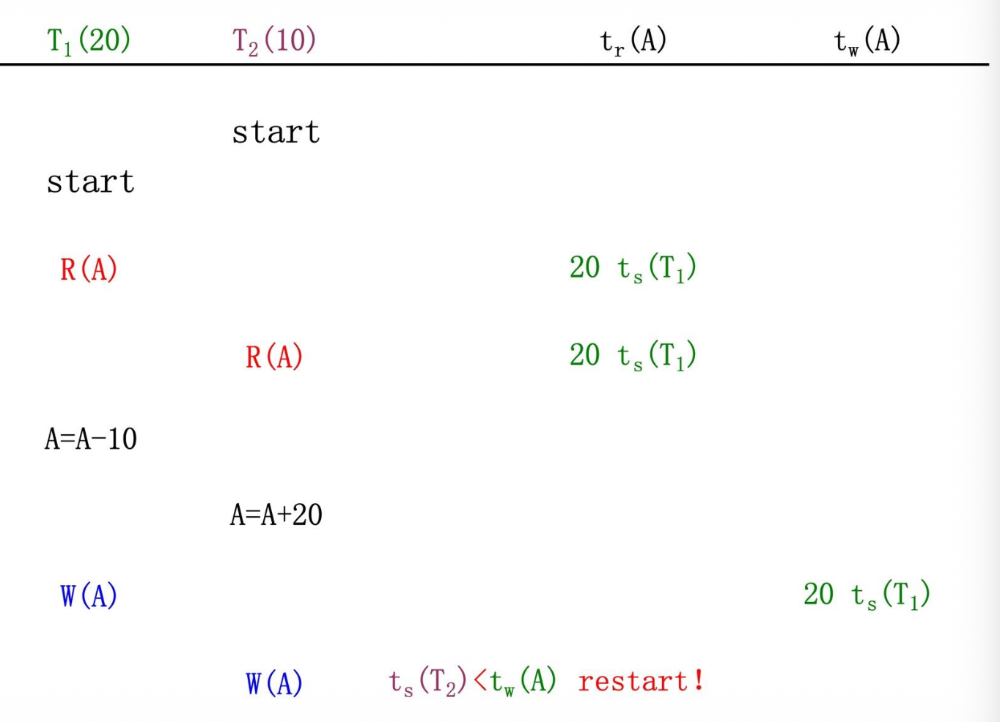

2. 乐观并发控制：不做任何检查，直到事务执行结束才检查某个事务的修改操作是否违反了可串行性。事务对数据对象的修改不直接写入数据库，而是在内存中保存修改的副本。事务修改若不违反可串行性，则将内存中修改副本写入数据库并提交事务，否则撤销事务并重新交付。
   三阶段：

   - 读阶段：事务可以从数据库中读取已提交数据对象的值，保存在自己私有的执行空间中
   - 检验阶段：对事务执行有效性检查，确认将更新操作应用于数据库，不会违反可串行性
   - 写阶段：根据检查结果，决定是否将更新写入数据库

   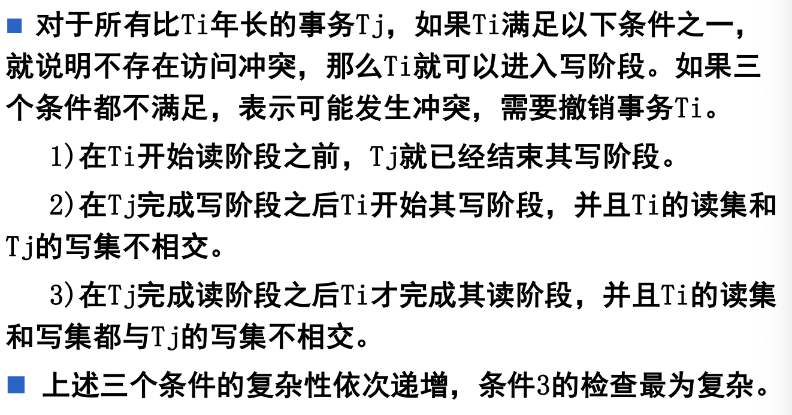

