# 数据库完整性和安全性

## 数据库完整性

完整性：数据的正确性、有效性和相容性。

完整性控制机制的核心：**完整性约束条件**

完整性约束条件作用对象：关系、元组、列。

- 静态约束：数据库每一确定状态时的数据对象所应满足的约束条件，是反映数据库状态合理性的约束
- 动态约束：数据库从一种状态转变为另一种状态时，新旧值之间所应满足的约束条件，反映数据库状态变迁的约束

完整性约束条件分类：

- **静态列级约束**：对一个列的取值域的说明。包括：
  - 对数据类型的约束（类型、长度、单位等）
  - 对数据格式的约束
  - 对取值范围或取值集合的约束
  - 对空值NULL的约束
  - 其他约束
- **静态元组约束**：规定元组的各个列之间的约束关系
- **静态关系约束**：在一个关系的各个元组之间或者若干关系之间常常存在各种联系或约束。常见有：
  - **实体完整性约束**
    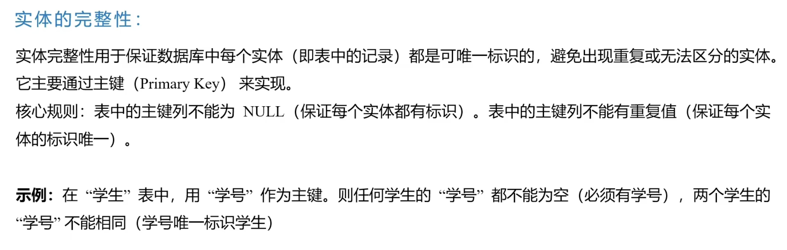
  - **参照完整性约束**
    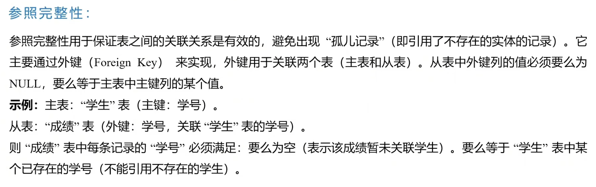
  - **函数依赖约束**
  - **统计约束**：字段值与关系中多个元组的统计值之间的约束关系
- **动态列级约束**：修改列定义或列值时应满足的约束条件，包括：
  - 修改列定义时的约束：例：将允许空值的列改为不允许空值时，若已存在空值则拒绝这种修改
  - 修改列值时的约束：例：工资调整不得低于原来工资，年龄只能增长
- **动态元组约束**：修改元组的值时元组中的各个字段间药满足某种约束条件
- **动态关系约束**：加在关系变化前后上的限制条件，如事务一致性、原子性等约束

完整性控制机制具有三个功能：

- 定义功能：提供定义完整性约束条件的机制
- 检查功能：检查用户发出的操作请求是否违背了完整性约束条件
- 如果违背完整性约束条件，采取一定的动作来保证数据的完整性

立即执行约束：检查是否违背完整性约束的时机时在一条语句执行完后立即检查

延迟执行约束：完整性检查延迟到整个事务执行结束后再进行，检查正确方可提交

最重要：实体完整性、参照完整性

实现参照完整性的几个问题：

1. 外键能否接受空值
2. 在被引用关系中删除元组：
   - 级联删除**CASCADE**
   - 受限删除**RESTRICT**：当引用关系中没有任何元组的外键值与被引用关系中要删除元组的主键值相同时才删除，否则拒绝
   - 置空值删除**SET NULL**：删除被引用关系的元组，并将引用关系中相应元组的外键置空值
3. 在引用关系中插入元组：受限插入、递归插入
4. 修改关系中主键：
   - 不允许修改
   - 允许修改（必须保证主键唯一、非空）

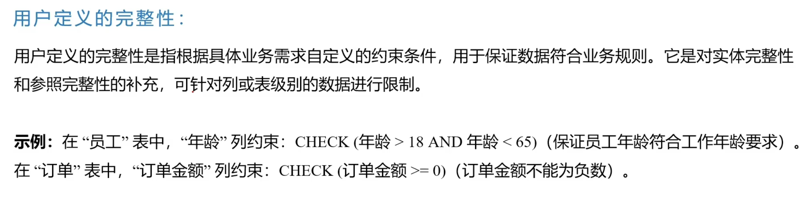

完整性约束的说明：

- **隐含约束**：实现域完整性约束、实体完整性约束、参照完整性约束等，DBMS自动检查，最基本、最普遍

- **显式约束：**

  - **CHECK**子句

  - **断言**：ASSERTION
    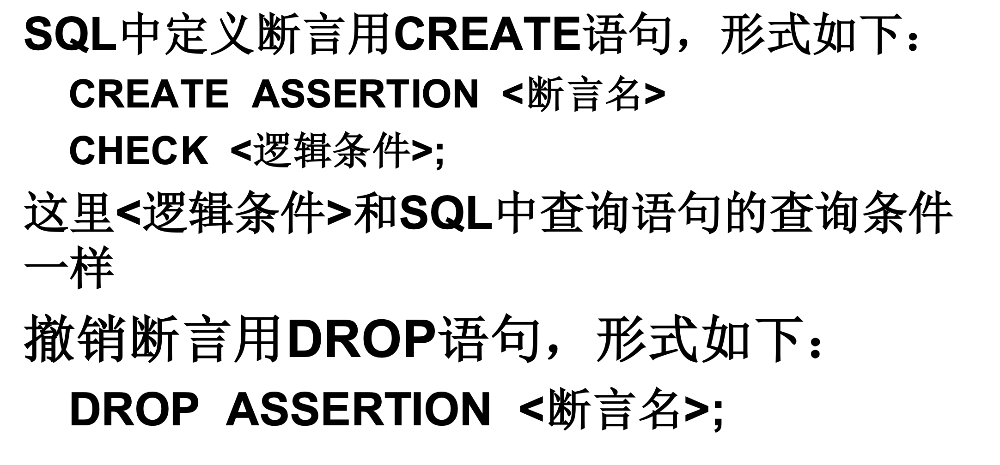

    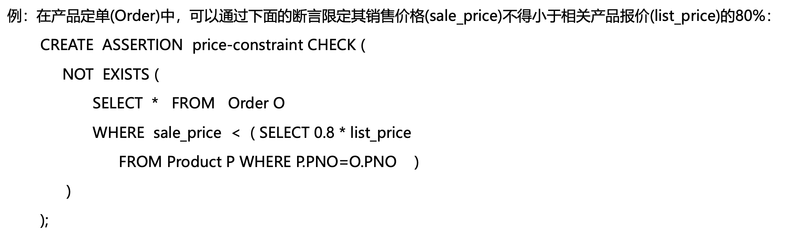

  - **存储过程**：将常用的访问数据库的程序作为一个过程进行编译，然后存储在数据库中供用户调用
    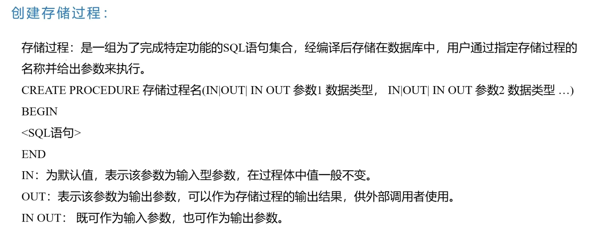
  
  - **触发器**：在对数据库执行更新操作时系统自动执行的语句，称为主动规则或ECA规则。以某种更新数据库的操作为事件，以违反约束作为条件，以违反约束的处理作为动作。
    只能用在插入、删除、修改（INSERT、DELETE、UPDATE）
    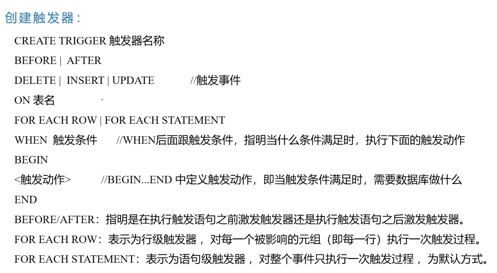
    
    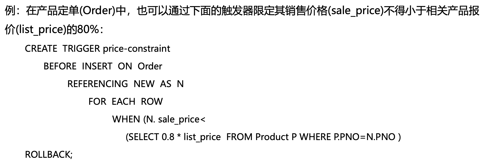

## 数据库系统安全性 

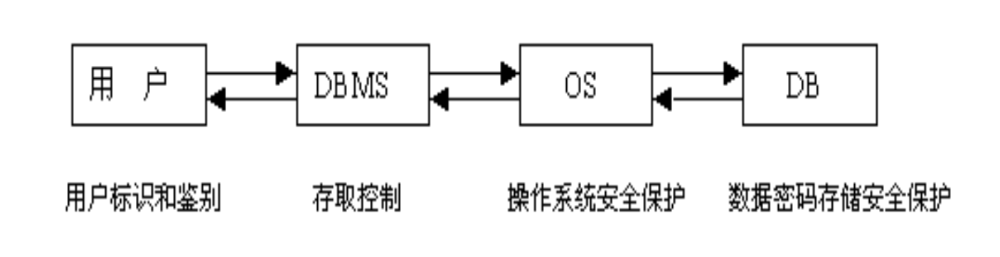

用户标识和鉴别：最外层安全保护措施，系统提供一定方式让用户标识自己的名字或身份，用户登录时核对（用户名等）

存取控制机制：定义用户权限、合法权限检查

自主存取控制（DAC）：GRANT、REVOKE语句。授权方式：DBA授予和收回特权；把自身拥有的权限转授给其他用户

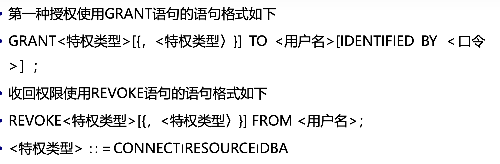

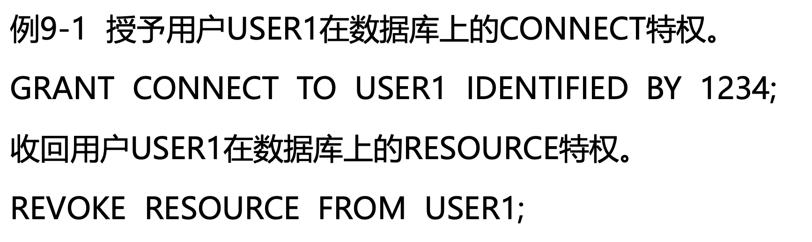

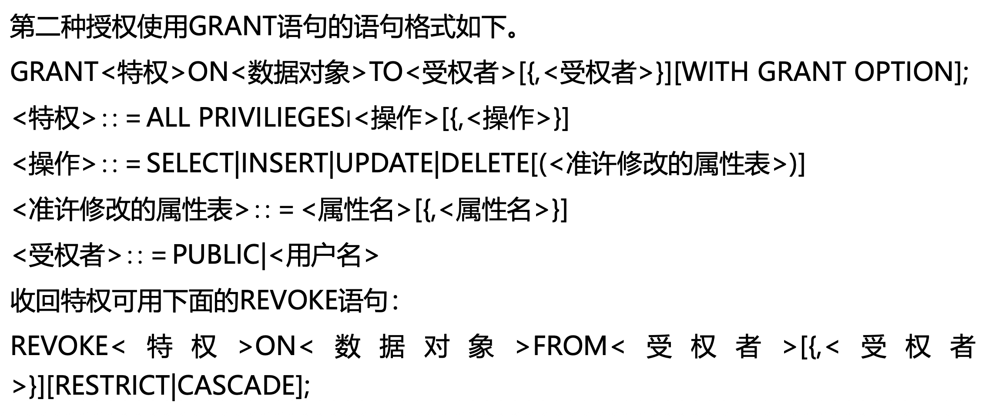

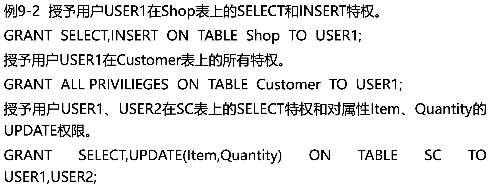

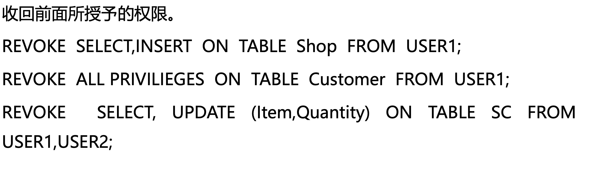

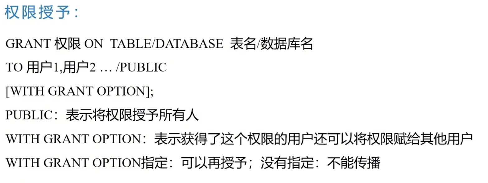

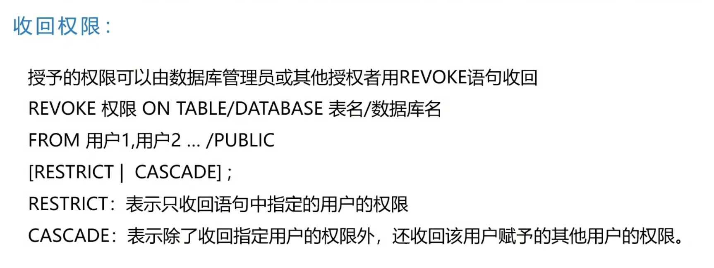

强制存取控制（MAC）：适用于对数据有严格而固定密级分类的部门

- 主体：系统中的活动实体，包括用户和进程
- 客体：系统中的被动实体，如文件、表、索引、视图等
- 对于主体和课题，为每个实例指派一个敏感度标记label
- label级别：绝密、机密、可信、公开
- 主体标记：许可证级别。客体标记：密级
- MAC机制：对比主体、客体label，确定主体能否存取客体
- 规则：
  仅当主体的许可证级别≥客体的密级时，该主体才能读取相应的客体
  仅当主体的许可证级别等于客体的密级时，该主体才能写相应的客体

视图机制：为不同用户定义不同视图，把要保密的数据对无权存取的用户隐藏

审计：把所有用户操作记录进审计日志，DBA根据审计信息找出非法内容

数据加密：替换方法（密钥，明文，密文）、置换方法（明文重排）

