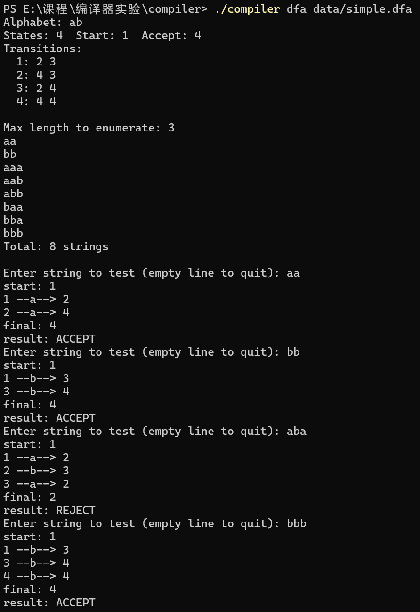
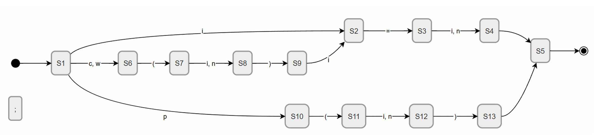
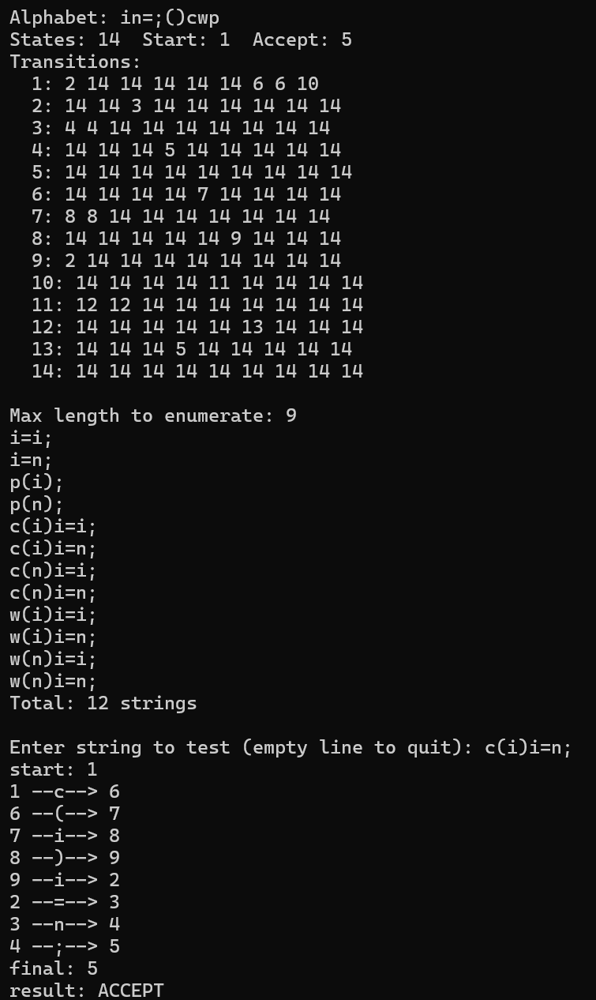
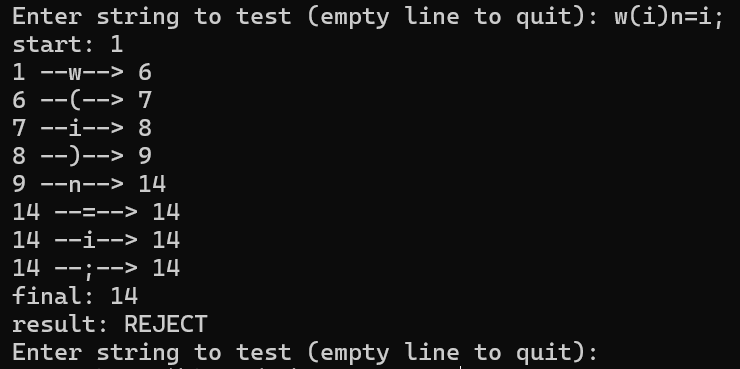
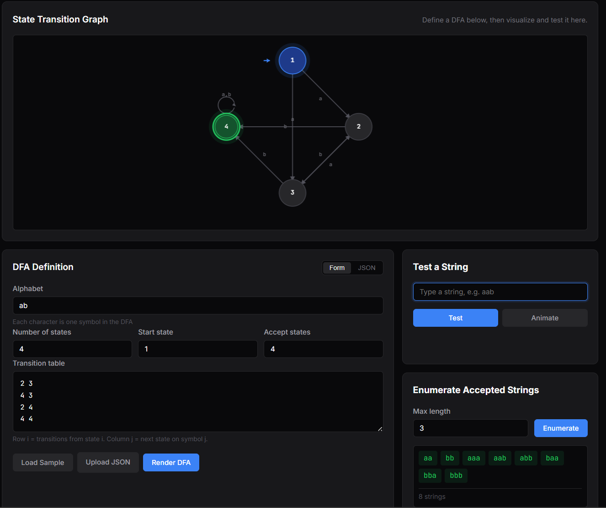
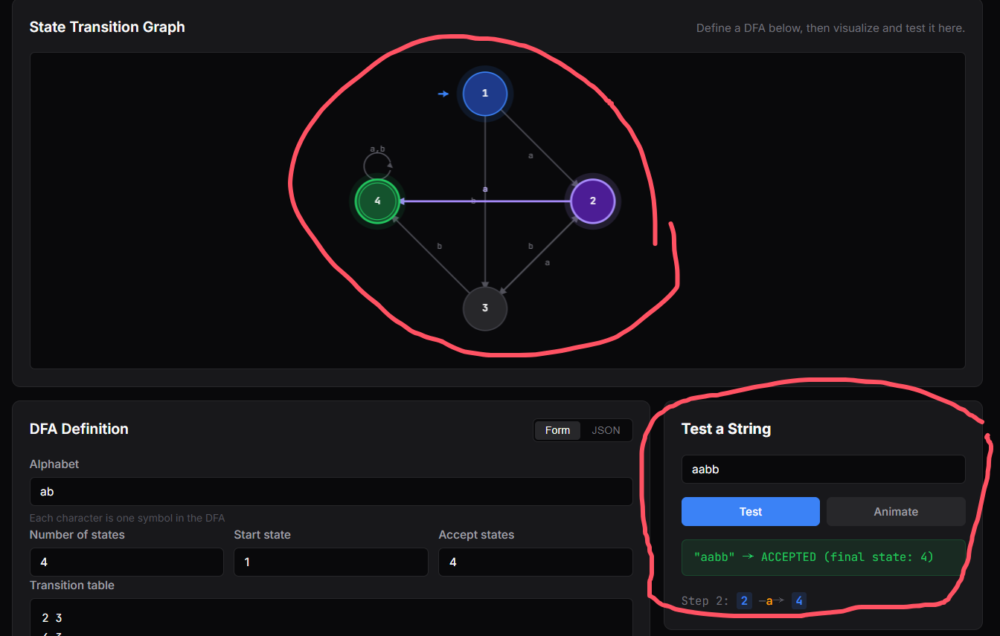
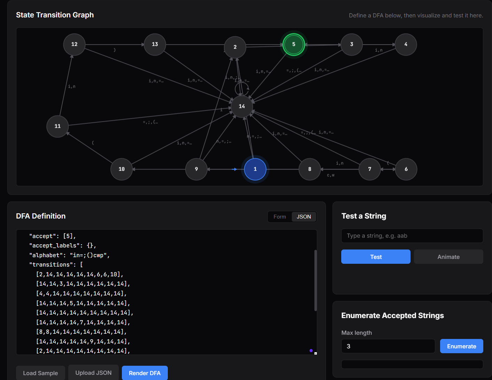

# 实验1：DFA 模拟实现

[TOC]


## 实验内容（必做）

编写一个 DFA 模拟程序，完成自动机五元组的读入、内部构建、合法性检查、规则字符串枚举和字符串识别。程序读入文本形式的 DFA 后，先检查状态集合、字符集、起始状态、接受状态和状态转移是否满足确定有限自动机的定义，再根据读入的状态转移表执行枚举和识别。

### 设计思路

我将 DFA 的五元组直接映射到程序中的数据结构。字母表保存为一个字符数组，状态用整数编号表示，起始状态保存为一个单独的整数，接受状态保存为数组，状态转移函数保存为二维表。二维表的行对应当前状态，列对应输入字符在字符集中的下标，表项对应下一状态。以该输入为例：

```tex
ab
4
1
4
2 3
4 3
2 4
4 4
```

第一行代表字母表为 `{a, b}`，第二行代表有 `4` 个状态，第三行代表起始状态为 `1`，第四行代表接受状态为 `4`，剩下四行构建状态转移表，第一行代表从状态 `1` 出发，遇到字母表中的第一种字母（`a`）则转移到状态 `2`，遇到第二种字母（`b`）则转移到状态 `3`，其他行类似。由于DFA的状态转移是确定的，所以有几种状态就应该有几行状态转移表。

识别过程只依赖当前状态和当前输入字符。程序从起始状态出发，每读入一个字符，就在字符集中查找该字符对应的列，再通过状态转移表得到下一状态。输入串读完后，如果当前状态属于接受状态集合，则该字符串被接受，否则该字符串被拒绝。

枚举规则字符串时，程序从空串开始，对长度不超过给定上限的字符串进行递归生成。每生成一个完整字符串，就调用同一 DFA 转移逻辑判断其是否被接受。这样枚举和识别共用同一个自动机核心，避免两个功能对状态转移规则产生不同理解。

### 实现过程

我把本实验分为几个阶段完成：先定数据结构，再依次做文件读取、合法性检查、枚举和识别。

**数据结构设计**

DFA 的核心就是一张二维转移表。我用 `transitions[state][symbol]` 存储，行号是状态编号，列号是字符在字母表中的位置，表项的值是下一状态。字母表用字符数组保存，起始状态用一个整数，接受状态用整型数组。五元组的每个分量都有对应的程序表示。

**文件读取与 DFA 构建**

DFA 定义文件是纯文本，每行一个信息。程序按行读取：第一行是字母表字符串，第二行是状态数量，第三行是起始状态编号，第四行是接受状态编号，之后每行对应一个状态的转移目标。读入字母表后，程序建立字符到列号的映射，这样后续识别时根据输入字符就能直接定位转移表的列。转移表每一行包含与字母表等长的整数序列，依次填入数组。

**合法性检查**

读入完成后，程序检查几项约束：状态数量和字符集不能为空，起始状态必须在状态集合范围内，每个接受状态也要属于状态集合，转移表中每个目标状态不能越界。任何一项不满足，程序就报错并停止。

**规则字符串枚举**

枚举的目标是找出所有长度不超过给定上限且被 DFA 接受的字符串。做法是按长度分层递归：外层循环从长度 0 到上限值，内层递归在每个目标长度上从起始状态出发，依次尝试字母表中的每个字符。递归深度等于目标长度时，看当前状态是不是接受状态，是就输出。

**字符串识别与 trace 展示**

识别函数从起始状态开始，逐字符查转移表。字符不在字母表中或转移无效就直接判拒绝，全部处理完后看最终状态是否属于接受状态集合。我在此基础上加了 trace 模式：输出起始状态，每一步读入什么字符、转移到哪个状态，最后给出终止状态和判定结果。

程序的交互模式把枚举和识别整合在一起。启动后先打印 DFA 摘要，提示输入枚举长度上限，枚举完进入字符串测试循环，每输入一个串就用 trace 展示识别过程，空行退出。

### 测试用 DFA

测试用 DFA 的字符集为 `a b`，状态集合为 `1,2,3,4`，起始状态为 `1`，接受状态为 `4`。状态转移为：状态 `1` 读入 `a` 到状态 `2`，读入 `b` 到状态 `3`；状态 `2` 读入 `a` 到状态 `4`，读入 `b` 到状态 `3`；状态 `3` 读入 `a` 到状态 `2`，读入 `b` 到状态 `4`；状态 `4` 读入 `a` 或 `b` 都保持在状态 `4`。

**该 DFA 接受所有包含连续 `aa` 或连续 `bb` 的字符串。**它既能测试接受路径，也能测试不接受路径，并且状态数量较少，适合用来验证枚举和 trace 输出是否正确。

## 实验结果（必做）

> 

枚举结果为 8 个串，按长度排列：长度 2 的 `aa`、`bb`，长度 3 的 `aaa`、`aab`、`abb`、`baa`、`bba`、`bbb`。没有长度 0 和 1 的接受串，因为至少需要连续两个相同字符才能到达接受状态 4。

对于 4 个测试字符串：

- `aa`：路径 1→2→4，两个连续 `a` 使 DFA 从状态 2 转移到接受状态 4，结果为 ACCEPT。
- `bb`：路径 1→3→4，两个连续 `b` 使 DFA 从状态 3 转移到接受状态 4，结果为 ACCEPT。
- `aba`：路径 1→2→3→2，三个字符交替出现，最终停在状态 2，结果为 REJECT。
- `bbb`：路径 1→3→4→4，第二个 `b` 即到达接受状态 4，之后无论输入什么都保持在 4，结果为 ACCEPT。

## 实验内容（选做）

选做部分完成两项工作：一是结合教材主文法概念设计一个面向简化语句结构的 DFA，二是搭建前端可视化页面展示 DFA 的状态转移图和模拟过程。

### 设计思路

#### 语句模式 DFA

教材主文法描述了命令式语言的核心语法结构。我选择对四种基本语句建模：赋值、条件、循环和输出。由于标识符和整数是无限集合，我采用 token 化的思路，将词法单元映射为单个符号：

| 符号 | 含义 |
|------|------|
| `i` | 标识符 |
| `n` | 整数字面量 |
| `c` | if 关键字 |
| `w` | while 关键字 |
| `p` | print 关键字 |
| `= ; ( )` | 原样保留 |

在字符集 `{i, n, =, ;, (, ), c, w, p}` 上，四种语句的 token 模式为：

- 赋值 `i=i;` `i=n;`

- 条件 `c(i)i=i;`

- 循环 `w(i)i=n;`

- 输出 `p(i);` `p(n);`。

  我设计了 14 状态的 DFA，状态 5 为唯一接受状态，状态 14 为死状态。以下是其状态转移图：

  

#### 前端可视化

DFA 的状态转移关系用纯文本描述不够直观，状态一多，光看数字很难理清各条路径的走向。我将编译器输出的 DFA 画成交互式的图，同时能在线测试字符串、枚举规则串，这样验证设计对不对会方便很多。

页面部署在 GitHub Pages 上，链接：https://astralartisan.github.io/XJTU-Compiler/。后续实验会同步更新页面内容。

DFA Explorer 是本次实验的内容，它分为三块：顶部是 Canvas 画的状态转移图，左下是 DFA 定义输入，右下是测试和枚举面板。

前端和 C 编译器通过 JSON 格式打通：编译器的 `--format=json` 选项把 DFA 导出为 JSON，包含状态数、起始状态、接受状态、字母表和转移表。前端解析这个 JSON 渲染状态图，测试和枚举逻辑与后端一致。页面还集成了 API 调用，可以请求服务器上的编译器后端做词法分析，服务器不可用时自动降级到本地模式。

### 实现过程

#### 语句模式 DFA

这部分复用了必做部分的 DFA 引擎，只需要编写一个新的 `.dfa` 定义文件 `stmt.dfa`。我把 14 个状态按语句类型划分为三条路径：赋值语句走 1→2→3→4→5，其中状态 2 对应标识符、状态 3 对应等号、状态 4 对应右值、状态 5 是接受状态（分号之后）。条件语句和循环语句共享前缀路径 6→7→8→9，分别由 `c` 和 `w` 从状态 1 进入状态 6，经过左括号、条件表达式、右括号后到达状态 9，再汇入赋值路径的状态 2。输出语句走独立路径 10→11→12→13→5，由 `p` 进入，经过括号和参数后到达接受状态。状态 14 是死状态，所有非法输入都转移到这里，确保 DFA 的完备性。

#### 前端页面

页面用 HTML、CSS、JS 写。状态转移图基于 Canvas 2D API 绘制：节点按圆形排列在画布上，半径随视口大小自适应。起始状态蓝色带箭头，接受状态绿色双圈，普通状态灰色。转移边是带箭头的直线，自环用弧线，边上标转移字符。

测试字符串有两种方式：Test 按钮直接出结果，Animate 按钮逐步动画。动画每 500ms 走一步，当前状态和边高亮成紫色，看 DFA 怎么跑的一目了然。

DFA 输入也有两种模式。表单模式手动填字母表、状态数这些；JSON 模式直接粘贴编译器 `--format=json` 的输出。两种模式可以随时切换，数据自动同步。

页面用深色主题，桌面端双栏，移动端自动变单栏。

#### Git 仓库

项目托管在 GitHub，提交历史记录了从 DFA 引擎搭建到前端可视化的完整开发过程。仓库地址：https://github.com/AstralArtisan/XJTU-Compiler

### 测试用例说明

语句模式 DFA 的验证：设定 N=9 枚举全部规则句型，应覆盖赋值、条件、循环、输出四种类型共 12 个串。对合法串 `c(i)i=n;` 和非法串 `w(i)n=i;` 分别测试。

## 实验结果（选做）

### 语句模式 DFA

> 
>
> 

程序枚举出全部 12 个规则句型，覆盖赋值（`i=i;` `i=n;`）、输出（`p(i);` `p(n);`）、条件（`c(i)i=i;` `c(i)i=n;` `c(n)i=i;` `c(n)i=n;`）、循环（`w(i)i=i;` `w(i)i=n;` `w(n)i=i;` `w(n)i=n;`）四种语句类型，与设计预期一致。

对于两个测试字符串：

- `c(i)i=n;`：路径 1→6→7→8→9→2→3→4→5，DFA 依次经过条件前缀和赋值体，最终到达接受状态 5，结果为 ACCEPT。
- `w(i)n=i;`：路径 1→6→7→8→9→14→14→14→14，DFA 在状态 9 读入 `n` 时转入死状态 14，说明 DFA 正确约束了语句体必须以标识符开头，结果为 REJECT。

### 前端页面

> 

前端页面展示了 `simple.dfa` 的状态转移图，4 个节点按圆形排列，起始状态 1 为蓝色并带有指向箭头，接受状态 4 为绿色双圈。边上标注了转移字符，可以清楚看到状态之间的转移关系。

> 

动画逐步展示状态转移过程：状态 1 读入 `a` 转移到状态 2，状态 2 读入 `a` 转移到状态 4（接受状态），最终判定 ACCEPTED。当前高亮的节点和边以紫色显示，直观展示了 DFA 的运行轨迹。

> 

前端渲染了 14 状态的语句模式 DFA 图，可以直观看到赋值、条件/循环、输出三条路径的拓扑结构。

## 个人总结

本实验围绕 DFA 的定义、验证和模拟识别展开，从文件读入五元组到逐步模拟识别，搭建了一个完整的自动机引擎。

编程上收获最大的是数据结构选型。DFA 的转移函数在数学上是 $\delta: Q \times \Sigma \to Q$，用二维数组一对一实现后，每次转移就是一次下标访问。枚举算法也练习了递归回溯，按长度分层保证输出有序。文件解析逻辑不复杂，但边界情况不少：接受状态可能有多个，转移表行数必须和状态数对齐，这些细节让我养成了写完就加检查的习惯。

本次实验让五元组从课本上的抽象符号变成了具体的程序对象。字母表是字符数组，状态集合是整数范围，转移函数是二维表。写完代码回头再看知识，我感觉比之前理解得更加透彻。

选做部分也有不少收获。语句模式 DFA 让我体会到 token 化的作用：标识符和整数是无限集合，但映射成单个符号后就回到了正则语言的范畴。当然 DFA 也有明显的局限，它处理不了嵌套结构，这也是词法分析和语法分析要分层的原因。前端可视化则从另一个角度加深了理解，可视化的效果比看文本输出高效得多。

> 问题：本实验需要完成一个能配合教材主文法的编译器，目标是ARM64，大家对于ai代码工具掌握情况怎样，预计花多少时间可以完成此项实验？
>
> 回答：掌握较好，但使用AI也需要我来进行大量的结构设计，项目搭建等，AI可以负责一些小模块和前端页面的相关设计，因此想要做的好也需要花费较多时间，我大概是用了两天来做。