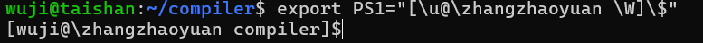
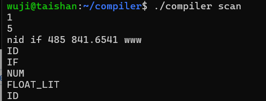
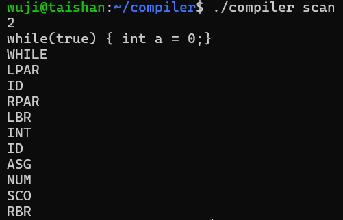
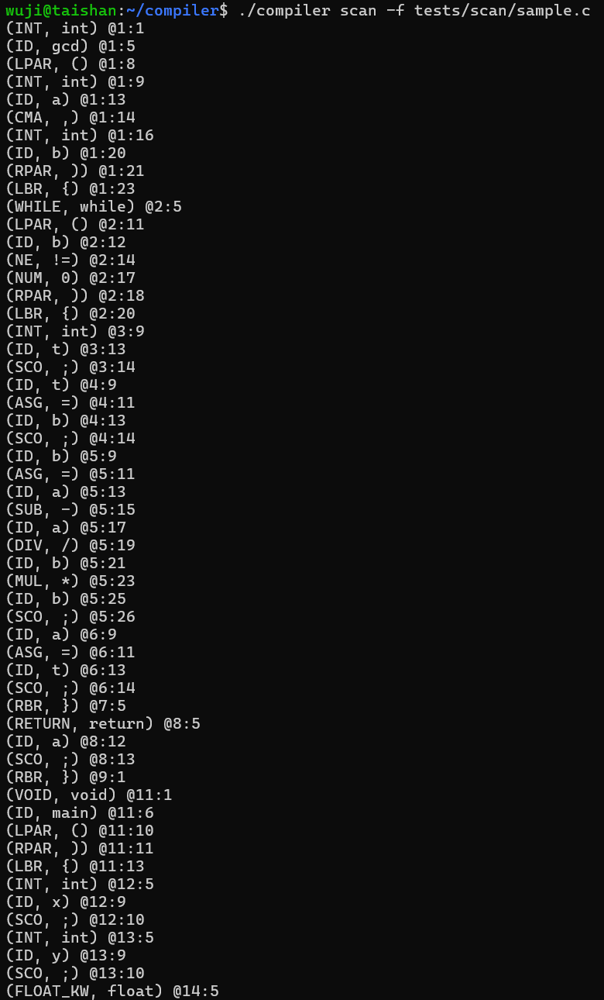
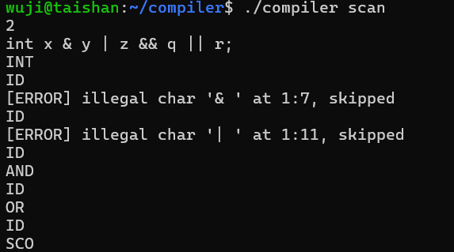
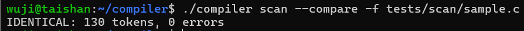
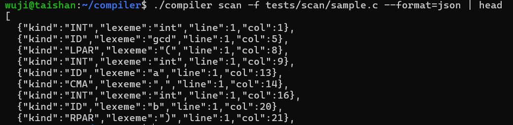
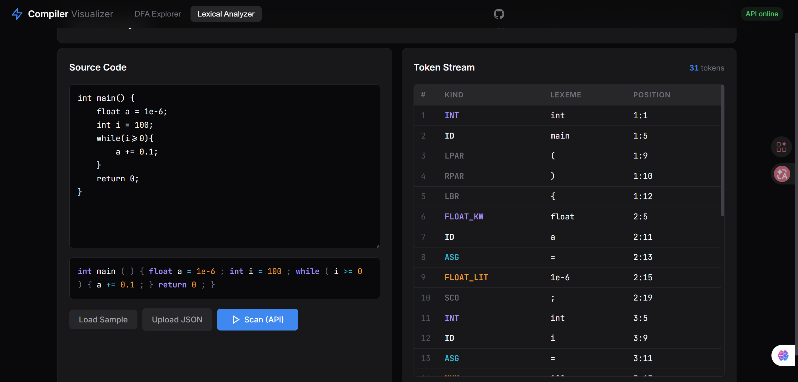

# 实验2：词法分析器 scanner 实现

[TOC]

## 实验内容（必做）

编写一个词法分析扫描程序，能够识别主文法中的 token，识别范围包括关键字、标识符、整数、浮点数、运算符和界符六类。程序支持两种交互模式：模式一逐个判断符号串类型，模式二对一行语句进行词法切分；同时支持从源码文件读入并输出完整 token 流。

必做部分采用表驱动 scanner。词法规则集中描述为一份扩展的 DFA 文件，扫描程序加载这个 DFA 后，逐字符调用实验 1 的转移接口完成识别。这样实验 2 的核心识别逻辑就直接落在了实验 1 的 DFA 引擎上。

### 设计思路

表驱动 scanner 的关键是把规则和引擎分开。规则文件描述字符类、接受状态和状态转移，扫描代码只负责输入推进、最长匹配和 token 输出。规则改了不会牵动扫描代码，新增一个 token 类型也不必动扫描器。

关键字的处理我没有写进状态机，而是放在扫描结束之后做一次提升：扫描器先按标识符规则识别词素，得到一个 ID 后再查关键字表，命中关键字就把这个 token 重写为对应的关键字 token。关键字和标识符在词法层本来就同形：都以字母开头，由字母和数字组成。如果硬要把九个关键字加进状态机，状态数会膨胀好几倍，每加一个关键字都得改状态机。提升的做法只需要在规则文件里多维护一张关键字表。

复合运算符的识别完全交给最长匹配。`+` 单独是一个接受态，`++` 和 `+=` 在 `+` 状态上再走一步就能进入更长的接受态；扫描器不需要为这些 prefix 关系写任何专门的分支。比较与逻辑运算符 `<=`、`>=`、`==`、`!=`、`&&`、`||` 同理。

### 实现过程

整个实现可以分成三层：词法规则文件、扫描器主循环、关键字与错误这两类细节处理。下面按这个顺序展开。

**扩展 DFA 文件**

词法分析需要把字符按类别归并、给每个接受状态贴上 token 名，还得带一张关键字表。实验 1 的 DFA 文件只描述五元组，对实验 2 来说太过简单。我在原有格式上扩展了几个段落：第一段重新定义字符分类，把上百个 ASCII 字符压成有限的字符类；状态数和起始状态沿用实验 1 的写法。接下来一段把每个接受状态绑定到对应的 token 名；再一段以“状态-字符类-下一状态”的形式列出转移；最末一段单独放关键字到 token 的映射。词法规则因此全部集中在这一个文件里，扫描代码本身不再保存任何规则。

**最长匹配主循环**

扫描器从起始状态出发，每读一个字符就把状态向前推一步，过程中记录最近一次到达的接受态以及它在源串中的结束位置。一旦无法继续推进，就把扫描位置回退到最近接受态对应的位置，截取这一段子串作为 lexeme，按接受态绑定的 token 名输出，再从回退后的位置继续读下一个 token。这种走法就是最长匹配：贪心地往前走，走不动了就退回到上一次能接受的位置。它一并处理了 `++` 与 `+`、`+=` 与 `=`、`<=` 与 `<` 等所有 prefix 关系，扫描代码不需要为某一个具体的运算符写专门分支。

**关键字提升**

按上面的 DFA 走完一个 token 后，如果它的类型是 ID，就再查一次关键字表。lexeme 命中关键字时把 token 重写成对应的关键字 token，否则保留为 ID。整套关键字规则集中在 DFA 文件的关键字段里，扫描代码里没有任何关键字硬编码。以后再加关键字，只要在文件里加一行映射。

**错误恢复**

合法的扫描总能在某个接受态结束。如果扫描器读到一个字符既不属于任何字符类，又没有可回退的接受态，这个字符就是非法输入。我让扫描器跳过它，把出错位置写进错误流，再从下一个字符接着扫。这样一次运行可以得到尽量完整的 token 流，单个非法字符不会让后续 token 全部丢失。

**与实验 1 的衔接**

表驱动扫描器没有自己保存任何状态转移规则，状态推进全部走实验 1 的 DFA 引擎。为此我在引擎那一侧补了几个查询接口：单步转移、判断当前是不是接受态、读出接受态对应的 token 名、查关键字表。扫描器把这几个接口串起来就能跑。这套桥接让两次实验的代码没有任何重复。换一份词法规则只要重写 DFA 文件，扫描器不必修改。

**命令行入口**

无参数时从标准输入读首行 `1` 或 `2` 选择模式一或模式二；指定输入文件就走文件模式，扫描结果可以输出到标准输出，也可以写到指定文件。

### 词法类别覆盖

以下把实现里支持的全部 token 按教材主文法的几大类整理一遍，每类附上典型词素示例。

| token class | token 名 | 示例 |
|------------------|---------|---------|
| 标识符 ID | ID | `foo`、`_x`、`a1` |
| 关键字 KEY | INT, FLOAT_KW, VOID, IF, ELSE,  WHILE, RETURN, INPUT, PRINT | `int`、`if`、`while` |
| 整数 NUM | NUM | `0`、`485` |
| 浮点数 FLO | FLOAT_LIT | `3.14`、`.5`、`1e-3`、`12.3E+4` |
| 算术运算符 AOP | ADD, SUB, MUL, DIV | `+`、`-`、`*`、`/` |
| 关系运算符 ROP | LT, LE, EQ, GT, GE, NE | `<`、`<=`、`==`、`>`、`>=`、`!=` |
| 逻辑运算符 BOP | AND, OR, NOT | `&&`、`\|\|`、`!` |
| 赋值 / 复合赋值 / 自增 | ASG, AAS, AAA | `=`、`+=`、`++` |
| 界符 DLI | LPAR, RPAR, LBK, RBK,  LBR, RBR, CMA, COL, SCO | `(`、`)`、`[`、`]`、`{`、`}`、`,`、`:`、`;` |

### 测试用例说明

模式一使用 `id if 485 841.6541 www`，预期输出 `ID IF NUM FLOAT ID`。

模式二使用 `while(true){int a=0;}`，预期输出 `WHILE LPAR ID RPAR LBR INT ID ASG NUM SCO RBR`。

文件模式使用一份覆盖函数定义、循环、条件、复合运算符、比较与逻辑运算以及三种浮点数的 C 源码，作为长输入下的回归测试。

## 实验结果（必做）

老师，报告写完后实验三说要加这个，我在这里补一下。当时分配服务器我给的用户名是 wuji，实验内容都是我在服务器上完成的。

> 

分析：`id` 和 `www` 被识别为标识符，`if` 在 ID 阶段被关键字表提升为 `IF`，`485` 走数字路径识别为 `NUM`，`841.6541` 经过整数、小数点、小数尾部三段状态序列后落在浮点数接受态，输出与预期一致。

> 

分析：整行输入，扫描器通过 DFA 转移边界完成切分。`while`、`int` 经关键字提升后分别输出 `WHILE`、`INT`，`true` 不在关键字表中保留为 `ID`，等号、整数、括号、花括号和分号各自命中独立的接受状态。

> 

分析：文件模式输出每个 token 的类型、词素和行列位置。样例覆盖函数定义、循环、条件、复合运算符 `+=`/`++`、比较与逻辑运算 `<=`/`>=`/`!=`/`&&`/`||` 以及小数、小数点开头和科学计数法三种浮点数，能验证主文法词法类别列表中的主要项目。

> 

分析：单独的 `&` 和 `|` 没有匹配的接受态，扫描器报告非法字符并跳过该位置，紧接着的 `&&` 与 `||` 仍能正常识别为逻辑运算符。一个非法字符不会中断后续扫描，与设计目标一致。

## 实验内容（选做）

选做部分完成这些工作：

1. 保留一份手写 scanner 作为对照实现，加入一致性检查
2. 提供 API 服务给前端调用，扩展前端页面展示 token 流。

### 设计思路

选做部分我想做两件事。一件是换一种思路再实现一遍扫描器，对照表驱动版本验证规则；另一件是把扫描器接进可视化页面，让 token 流可以在网页上直接看到，也为后续语法分析阶段留一个 JSON 输入。

为此我又写了一份用分支结构的扫描器，它走的代码路径和表驱动版本完全不同，但遵循同一份词法规则。再配上一个对比模式：两套扫描器读同一份输入、逐字段比较输出，只要它们对得上，就同时说明词法规则正确，两条独立的映射也等价。

API 服务和前端页面则把扫描器从命令行工具扩展到了网页上。服务端把前端提交的源码交给必做部分制作的 scanner，结果以 JSON 形式返回；前端把 token 流可视化为表格并对源码做颜色高亮。

### 实现过程

**手写 scanner**

表驱动版本依靠规则文件描述行为，调试时要在文本编辑器和扫描代码之间来回看；为了让自己更直观地理解词法规则与扫描流程，我又用纯分支结构写了一遍扫描器。这一版根据当前字符直接走标识符路径、数字路径或运算符路径，复合运算符通过往后看一个字符判断，遇到关键字时也是先按 ID 识别再查表提升。两个实现遵循同一份词法规则，但走的是完全不同的代码路径，可以做交叉验证。

**一致性检查**

对比模式让两套扫描器读同一份输入，每输出一个 token 就比较一次类型、词素、行号和列号，扫描结束后再核对两套扫描器的错误计数。任何一个字段不一致都会立即停下并报告位置；全部一致才输出 `IDENTICAL`。这个部分让我在改任何一边时都能很快确定有没有引入语义差异。

**API 服务**

为了让前端能用上必做实现的 scanner，而不是浏览器里的简化版，我用 Python 写了一个轻量 HTTP 服务来跑编译器作为后端。前端把源码 POST 过来，服务端先写到一个临时文件，再以子进程方式调用编译器，把扫描结果作为 JSON 数组返回。除了扫描接口外，服务还提供 DFA 模拟、规则串枚举、DFA 导出三个动作以及一个健康检查接口，后者用于让前端在服务不可用时自动降级。DFA 文件名走一份白名单，防止前端构造任意路径读到敏感文件。

**前端页面**

前端把扫描器的输入输出可视化：左侧是源码输入框，右侧是按 token 类型、词素、行列位置排版的表格，源码上不同类型的 token 用不同颜色高亮。提交时优先调后端服务；服务不可用时切换到浏览器里的简化扫描器，保证 GitHub Pages 静态托管下页面也能用。开发目录和上传目录通过构建脚本同步，仓库里只保留上传目录，避免重复内容。

### 测试用例说明

一致性测试使用一份覆盖关键字、复合运算符和三种浮点数的 C 源码，是手写和表驱动两条路径在同一份输入上的交叉验证。错误恢复测试使用单独的 `&` 和 `|` 验证扫描器在遇到非法字符后能否继续。前端测试放一段代码，观察词法分析结果和前端展示效果。

## 实验结果（选做）

> 

分析：输出 `IDENTICAL` 表明手写 scanner 和表驱动 scanner 在同一份输入上产生了完全一致的 token 流。这个测试从另一个实现角度验证了词法规则的正确性，也保证了后续以表驱动为默认路径不会带来语义差异。

> 

分析：JSON 输出包含每个 token 的类型、词素和行列位置，可以直接作为前端页面和后续语法分析模块的输入，避免重复扫描。

> 

分析：前端页面展示，放一段代码上去，可以看到能够正确地解析 token stream 并显示结果。

## 个人总结

这次实验做下来，最直接的体会是规则文件和扫描代码确实可以彻底分开。词法规则集中放在一份扩展 DFA 文件里，扫描代码只做状态推进和最长匹配，token 的定义从规则文件一路传到结果输出，不再有第二份描述。表驱动版本写完之后，我又写了一份分支结构的对照实现，再用对比模式跑了一份覆盖各种 token 类型的源码。`++` 与 `+`、`+=` 与 `=` 这些 prefix 边界、单字符错误恢复，正是在两套实现互相比对的时候才暴露并改正的。

把实验 1 和实验 2 串起来看，规则的描述能力也确实是分层抬升的：先用字符类把一大堆 ASCII 字符压成几个集合，再用接受状态把状态机的终止位置贴上 token 名，最后用关键字表对标识符做一次二次提升。词法层用 DFA、语法层用上下文无关文法的分层，到这里才在我自己的代码里落到实处。前端把 token 流以表格的形式呈现出来，调试时看着比命令行直观不少，也能更好地对词法分析进行展示。
