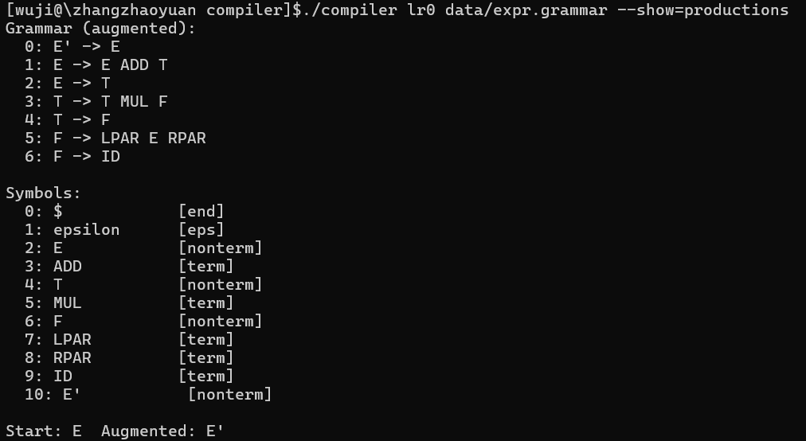
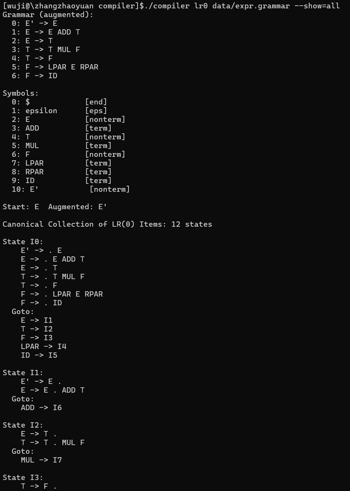
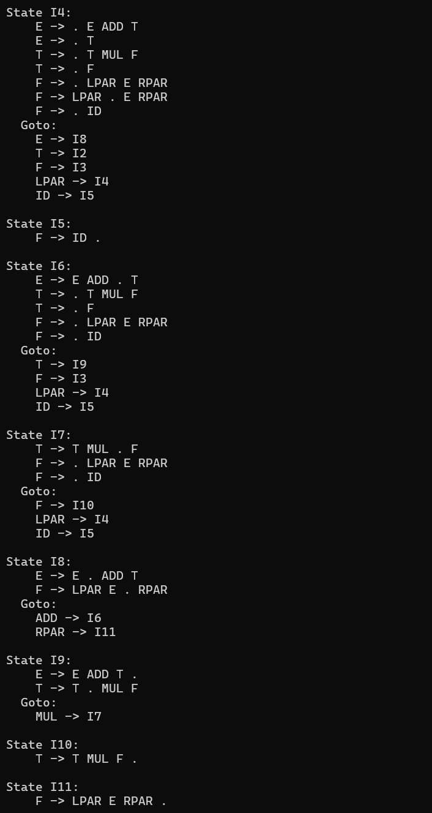
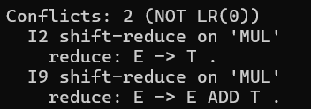
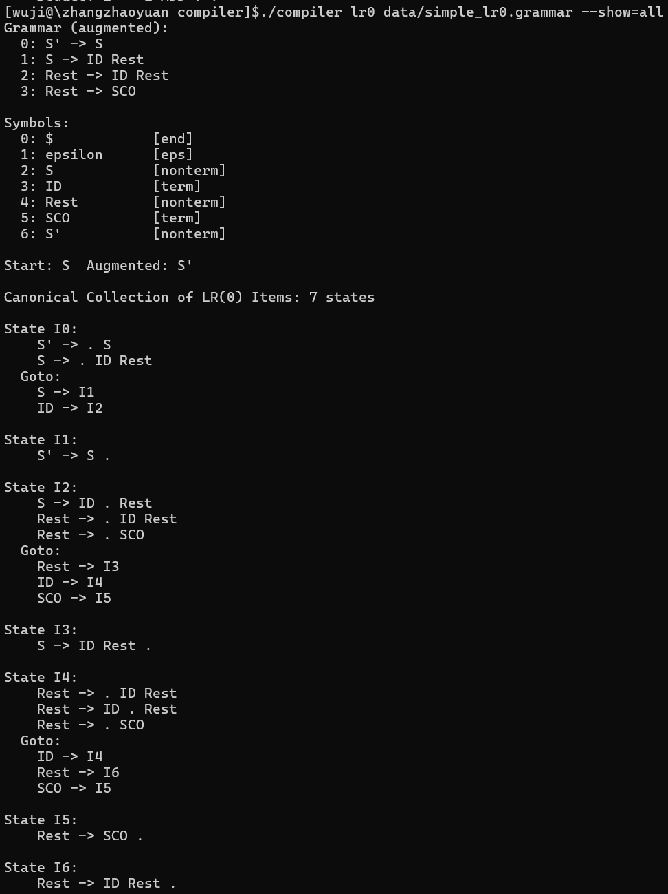
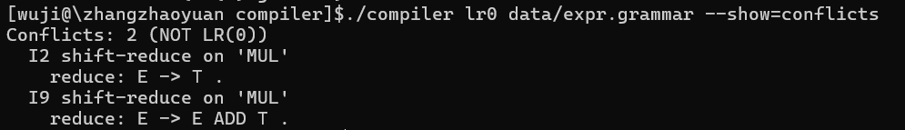
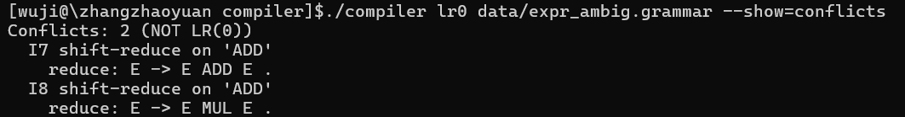
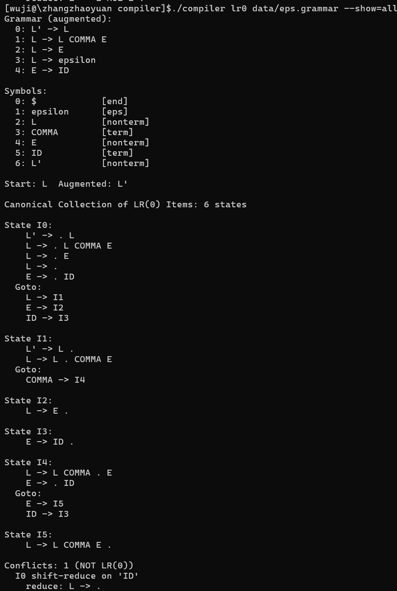
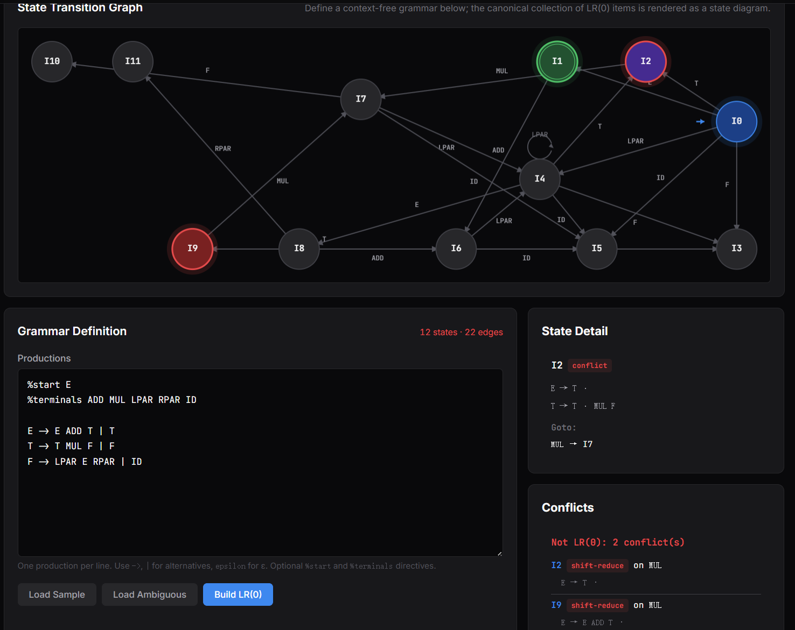
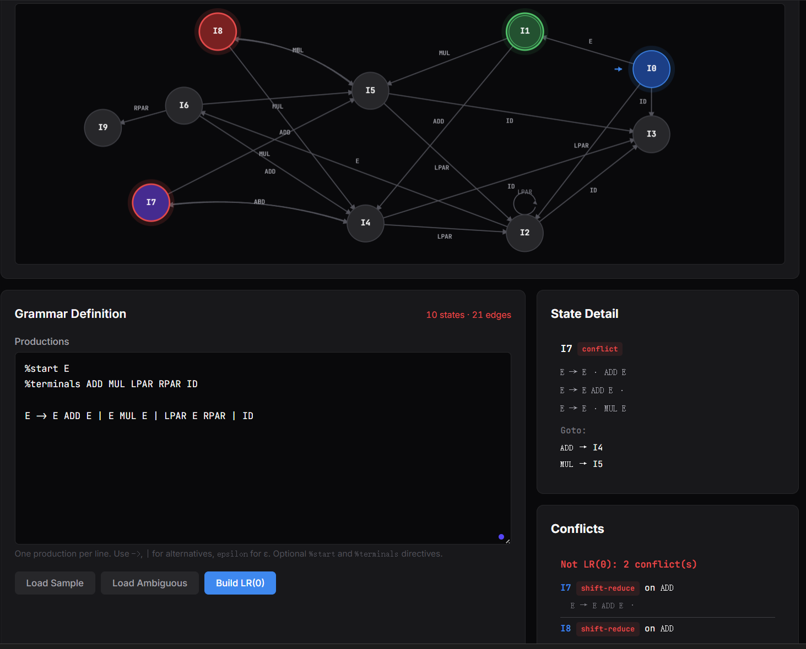

# 实验3：LR(0) 项目集规范族构造

[TOC]

## 实验内容（必做）

构建给定文法的 LR(0) 项目集规范族，为后续生成 SLR(1) 分析表打基础。程序读入一份类 BNF 写法的文法（例如 `E -> E + T | T`），自动完成增广（添加 `S' -> S`），从 `S' -> · S` 起步逐步计算闭包与 Goto，输出全部项目集和它们之间的转移关系，并判定该文法是否属于 LR(0)。

### 设计思路

规范族的构造可以拆成几个相对独立的部分：文法的表示与加载、Closure 和 Goto 这两个单步算子、worklist 驱动的状态扩展、最后进行冲突检测。

文法的表示我没有沿用字符串处理，而是先把所有符号 intern 到一张符号表里，每个符号有自己的编号和类别（终结符、非终结符、ε、$）。产生式只保存符号编号数组，左部和右部都用 id 引用。后续比较项目、计算闭包、判等状态时都只需要比整数，省掉字符串比较。

LR(0) 项目我用 `(prod, dot)` 二元组表示，`prod` 是产生式编号，`dot` 是点的位置。一个项目集就是若干项目的集合，规范族就是若干项目集的集合。Closure 的语义在这种表示下也很简洁：遍历集合里点后是非终结符 B 的项目，把所有以 B 为左部的产生式以 `(p, 0)` 形式加进集合，直到没有新增。Goto(I, X) 则是把 I 里点恰好在 X 前的项目向前推一格，再求一次闭包。

规范族的构造走 worklist。起点是 `closure({(S' -> · S 对应的 prod, 0)})`，每次从队列里取一个状态，收集它点后出现的全部符号去重，依次调用 Goto。产生的新项目集如果不等价于任何已有状态，就加成新状态并入队，否则复用旧状态。每一条 Goto 都记成一条 `(from, on_symbol, to)` 边。worklist 为空就结束。

LR(0) 性的判定在规范族完成之后再扫一遍：同一状态里既有归约项又有以终结符往下推的移进项，就是一个 shift-reduce 冲突；同一状态里有两个及以上归约项，就是 reduce-reduce 冲突。`S' -> S ·` 这种增广归约其实是 accept 动作，不应该算冲突，判定时单独跳过。

### 实现过程

**文法文件格式**

文法文件用一种轻量的语法描述：`%start` 指定起始符号，`%terminals` 列出所有终结符，剩下的每一行写 `LHS -> RHS1 | RHS2 | ...`。箭头支持 `->`、`::=`、`→` 三种写法，空产生式写 `epsilon`、`EPSILON` 或 `ε`，井号开头的行视为注释。这样既能照搬教材的 `E → E + T | T`，又方便和 lab2 token 名对接（终结符直接写 `ADD`、`MUL`、`LPAR` 等）。

**符号表与文法加载**

`grammar_intern` 是核心：第一次见到一个名字就分配编号、按调用方传入的类别登记；后续再遇到同名符号直接返回旧编号。这里有一处细节，文法读取按行进行，一个符号可能先以右部的身份出现（默认登记为 TERM），后面才作为左部出现，此时需要把它升级为 NONTERM。加载过程的第二遍专门做这件事：扫一遍所有产生式的左部，确保它们都是 NONTERM。

`%terminals` 给了一份明确的终结符清单，加载右部时直接查这份清单决定符号类别，遇到不在清单里的名字就当成非终结符。文法如果没写 `%terminals`，就回退到按首字母大写判非终结符的弱推断，再靠左部出现的事实补正。

**增广**

`grammar_augment` 在 `productions[0]` 位置插入 `S' -> S`，把原本的产生式整体后移一位。放在 0 号位是为了让规范族构造直接从 `productions[0]` 起步，不必再去搜以增广起始符号为左部的产生式。

**闭包**

`lr0_closure` 用固定点迭代实现。外层循环 `while (changed)`，内层遍历当前项目集的每一项，对点后是非终结符 B 的情形把所有 `B -> · γ` 加进集合，新增则把 `changed` 置为 true。循环内 `item_count` 会随添加而变化，每次进入内层前要重新读一下当前长度，避免遗漏新加进来的项目。固定点稳定之后再对项目按 `(prod, dot)` 字典序排序，两个项目集之间的相等性判断就退化为顺序比较。

**Goto**

`lr0_goto(I, X)` 先扫一遍 I，所有 `(p, d)` 满足 `productions[p].rhs[d] == X` 的项目变成 `(p, d+1)` 放进输出集合，再对输出集合调用 Closure。若移进结果是空集就直接返回，不必走闭包。

**规范族构造**

`lr0_build` 内部维护两个数组：`states[]` 存所有项目集，`edges[]` 存所有转移边。worklist 用一个简单的整数 FIFO 实现，初值为 0。每轮从队头取一个状态编号，先扫一遍这个状态收集点后出现的全部符号并去重，再逐个符号调用 Goto。若结果非空就和已有状态比对，等价则取已有编号，否则追加新状态并入队。不论复用还是新增，都记一条 `(from, sym, to)` 边。状态等价用 `itemset_equal` 比较，前提是两个集合都已经排序过。

**冲突检测**

`lr0_detect_conflicts` 在规范族完成后跑一次。对每个状态扫一遍项目，分别记录归约项与点后是终结符的移进情况。归约项数加上移进存在性给出三种情形：无冲突、shift-reduce、reduce-reduce。`S' -> S ·` 算 accept 不算 reduce，单独跳过。所有冲突状态都进 `conflicts[]` 数组，CLI 与 JSON 输出从同一份数据出。

**CLI 入口**

`compiler lr0 <grammar_file>` 作为新增子命令接入 main.c 的子命令分发。`--show=` 支持 `closure`、`goto`、`conflicts`、`productions`、`all` 五档输出，`--format=json` 走结构化输出，`-o` 把结果写入文件。默认 `--show=all` 给出完整的人读形式：先打印增广后的产生式表，再按 `Iₙ` 顺序列出每个状态的项目集和它的 Goto 表，末尾追加冲突报告。

### 测试用例说明

主测试用例是经典表达式文法。为了直接和实验二的词法层贯通，终结符名设为实验二已经定义的 token 名：

```
%start E
%terminals ADD MUL LPAR RPAR ID

E -> E ADD T | T
T -> T MUL F | F
F -> LPAR E RPAR | ID
```

预期增广后产生式数为 7（含 `E' -> E`），规范族应为 12 个状态。需要注意的是，这份分层表达式文法虽然已经用 `T`、`F` 表达了优先级和结合性，但它仍然不是 LR(0) 文法。LR(0) 分析不看后继 token，所以在某些状态里会同时看到可归约项目和按 `MUL` 移进的项目，程序应能把这种 shift-reduce 冲突检测出来。

## 实验结果（必做）

> 

`--show=productions` 输出增广后的全部产生式与符号表。第 0 号产生式 `E' -> E` 是增广的产物，后续 1–6 号为原文法的六条规则。符号表里 `E`、`T`、`F`、`E'` 标记为 NONTERM，`ADD`、`MUL`、`LPAR`、`RPAR`、`ID` 标记为 TERM，`$` 和 `epsilon` 作为特殊符号预先登记，与设计一致。

> 
>
> 
>
> 

`--show=all` 列出全部 12 个状态。`I0` 是 `closure({E' -> · E})`，闭包过程把 `E -> · E ADD T`、`E -> · T`、`T -> · T MUL F`、`T -> · F`、`F -> · LPAR E RPAR`、`F -> · ID` 这些项目逐层引进来。Goto 表给出从 `I0` 出发分别经 `E`、`T`、`F`、`LPAR`、`ID` 到达后续状态的转移。末尾的冲突报告显示该文法有 2 个 shift-reduce 冲突，冲突都发生在 `MUL` 上。这表明规范族构造本身正确完成，同时 LR(0) 的冲突检测也能指出文法不满足 LR(0) 条件。

状态 `I1` 同时包含 `E' -> E ·` 与 `E -> E · ADD T`：前者是 accept，后者是按 `ADD` 移进。冲突检测专门跳过了 `E' -> S ·` 这种 accept 项，所以这里不会被误判为 shift-reduce 冲突。

## 实验内容（选做）

选做部分分为两部分：一是围绕 LR(0) 的特点做文法对照实验，另一部分把规范族结果接入前端页面展示。

### 设计思路

选用一个非空 ID 序列文法作为成功案例：

```
S -> ID Rest
Rest -> ID Rest | SCO
```

这个文法的右递归部分把继续读 ID 和读到分号结束分开。规范族中含移进项的状态没有同时出现归约项，归约状态也都是单纯的 reduce 或 accept，因此可以作为 LR(0) 成功样例。

表达式文法分成两类对照。`expr.grammar` 通过 `E`、`T`、`F` 表达优先级，但它仍然会在 `MUL` 上触发 shift-reduce 冲突。这说明文法不二义和文法是 LR(0) 不是同一件事。`expr_ambig.grammar` 则去掉了 `T`、`F` 分层，直接写成 `E -> E ADD E | E MUL E | ...`，冲突来自优先级和结合性没有在文法结构里体现。两者放在一起，可以看出 LR(0) 对文法形式的限制很强。

ε 文法考虑的是空产生式下 Closure 的边界情形。我选了一个小列表文法 `L -> L COMMA E | E | ε`，其中 `L -> ε` 的右部长度为 0。在 `(prod, dot)` 表示下，这个项目从生成那一刻起就是 `(prod, 0)`，但它本身的 `rhs_len == 0`，也就是说 dot 已经到末尾，应该被识别为归约项。这个归约项和 `E -> · ID` 同时出现在 `I0` 中，就会形成 `ID` 上的 shift-reduce 冲突。

前端页面的设计沿用实验一的状态图思路，把 LR(0) 规范族看成一个有向图：每个项目集是一个状态节点，Goto 关系是带符号标注的边。起始状态、accept 状态、冲突状态分别用不同颜色区分。点击某个状态时，右侧面板显示该状态的完整项目集和出边；冲突面板单独列出冲突类型和涉及的归约项。这样既能看整体结构，也能追到某个冲突状态内部。

后端接口复用已有的 `server.py`。前端优先请求 `/api/lr0`，由 C 端 `compiler lr0 ... --format=json` 生成规范族数据；如果 API 不可用，就使用浏览器内置的 JS 实现作为降级路径。这样页面既能展示真实后端输出，也能在离线状态下保留基本演示能力。

### 实现过程

**成功文法**

新增 `data/simple_lr0.grammar` 作为成功样例。终结符沿用 lab2 的 token 名，`ID` 表示标识符，`SCO` 表示分号。命令 `compiler lr0 data/simple_lr0.grammar --show=all` 会输出完整规范族，最后应显示 `Conflicts: none (LR(0) grammar)`。

**分层表达式文法**

`data/expr.grammar` 保留 `E`、`T`、`F` 三层结构。命令 `compiler lr0 data/expr.grammar --show=conflicts` 会输出两个 `MUL` 上的 shift-reduce 冲突，涉及的归约项分别是 `E -> T .` 和 `E -> E ADD T .`。这组结果用于说明 LR(0) 不看输入符号，只凭状态本身决定动作，因此对表达式文法不够精细。

**二义表达式文法**

`data/expr_ambig.grammar` 只有一行核心规则：`E -> E ADD E | E MUL E | LPAR E RPAR | ID`，终结符列表与 `expr.grammar` 保持一致。CLI 跑 `compiler lr0 data/expr_ambig.grammar --show=conflicts` 直接列冲突，跑 `--show=all` 能在相关状态里看到完成项目 `E -> E ADD E .` 或 `E -> E MUL E .` 与继续移进运算符的项目并存。

**ε 文法的验证**

`data/eps.grammar` 内容是 `L -> L COMMA E | E | epsilon`、`E -> ID`。CLI 输出里 `L -> .` 这条归约项会出现在 `I0` 的闭包结果中，因为 `L -> · L COMMA E` 与 `L -> · E` 把 L 引到了项目集里，而 L 的可选展开包括空产生式，所以 `L -> ·`（rhs_len=0，dot=0）也被并进来。`L -> · E` 又把 `E -> · ID` 引入，最终 `I0` 同时包含空归约项和按 `ID` 移进的项目。

**前端 Canvas 可视化**

在 `web/index.html` 中增加 `LR(0) Builder` tab，页面包含文法输入框、示例文法加载按钮、构建按钮、Canvas 状态图区域和结果详情面板。`web/app.js` 负责把 JSON 数据转换成节点和边：节点按圆形布局初始摆放，自环用弧线绘制，普通边带箭头和转移符号。冲突状态在图上突出标记，和右侧 conflicts 面板中的记录对应。

**API 后端与降级路径**

`server.py` 新增 `/api/lr0` 端点，支持传入文法文本或预设文法文件。后端调用 `compiler lr0` 并返回 JSON，前端拿到后直接渲染。如果 API 不在线，`app.js` 中的 `lr0BuildLocal` 会在浏览器侧复刻 Closure、Goto、worklist 和冲突检测流程，保证页面仍能完成演示。开发目录 `web/` 完成后通过 `make deploy-web` 同步到 `docs/`。

### 测试用例说明

四份文法的预期结果如下：`simple_lr0.grammar` 应无冲突；`expr.grammar` 应在 `MUL` 上出现两处 shift-reduce 冲突；`expr_ambig.grammar` 应出现表达式运算符相关冲突；`eps.grammar` 的 `I0` 应包含 `L -> .`，并在 `ID` 上出现 shift-reduce 冲突。这样既能覆盖成功路径，也能覆盖普通冲突、二义冲突和 ε 边界。前端页面使用表达式文法和二义表达式文法进行展示：前者用于观察完整 12 状态规范族，后者用于观察冲突状态高亮和冲突面板。

## 实验结果（选做）

> 

简单 ID 序列文法生成 7 个状态，末尾显示 `Conflicts: none (LR(0) grammar)`。其中 `I2` 和 `I4` 是继续读序列的状态，只包含移进项和由 Closure 加入的待展开项目；`I3`、`I5`、`I6` 则是单纯的归约状态。移进状态和归约状态没有混在一起，因此这份文法能被 LR(0) 直接处理。

> 

分层表达式文法输出 2 个 shift-reduce 冲突，冲突都在 `MUL` 上。以 `E -> T .` 为例，当前状态已经可以把 `T` 归约成 `E`，但同一状态里还存在继续按 `MUL` 扩展 `T` 的可能。LR(0) 没有向前看符号，不能只在合适的后继 token 上归约，所以会报告冲突。

> 

二义文法的冲突出现在完成 `E ADD E` 或 `E MUL E` 之后的状态中。此时分析器既可以把整个表达式归约成 `E`，也可以继续读下一个运算符构造更长表达式。由于文法没有把优先级和结合性写进非终结符层次，规范族无法单靠 LR(0) 状态作出唯一动作。

> 

ε 文法的 `I0` 中可以看到 `L -> .`，这说明空右部产生式在项目集中被正确表示为 dot 已经到达末尾的归约项。同一个状态里还包含 `E -> . ID`，因此在 `ID` 上既可能归约空 `L`，也可能移进形成 `E`。这个例子展示了 ε 产生式对 LR(0) 判定的影响。

> 

前端加载分层表达式文法后，Canvas 会画出 12 个 LR(0) 状态以及它们之间的 Goto 边。起始状态、accept 状态和普通状态在图上有不同的视觉标记，右侧 detail 面板可以查看选中状态的项目集。页面把命令行中的规范族结果转成图结构，调试时可以直接观察状态之间的转移关系。

> 

前端加载二义表达式文法后，冲突状态会在 Canvas 上高亮，conflicts 面板列出 shift-reduce 类型以及涉及的归约项。点击对应状态可以看到项目集中已经完成的 `E -> E ADD E .` 或 `E -> E MUL E .`，也能看到继续移进运算符的路径。

## 个人总结

本实验把 LR(0) 项目集规范族从教材的抽象描述落成了一份能跑、能查、能展示的实现。项目具体表示为 `(prod, dot)` 二元组，状态表示为排好序的项目集，规范族表示为带 `(from, sym, to)` 边的有向图。这样一来，Closure 和 Goto 都能转化为普通的集合运算，规范族构造也能用 worklist 稳定完成。

写代码的过程让我对 LR 类语法分析的几个概念有了更具体的认识。增广产生式 `S' -> S` 在教材里只被解释为凑一个唯一起始的约定，到了实现层它的作用其实是把 accept 动作和普通归约区分开，避免冲突误报。Closure 的固定点本质上是把当前能展开的所有非终结符全部展平到项目集里，对应下推自动机里看到非终结符就允许展开的非确定性选择；Goto 则把这种非确定性收回到一次确定的状态转移。规范族里同时出现归约项和移进项就是 shift-reduce 冲突，这一条判定让我理解了为什么实际语言的文法都要在写法上消除二义性，而不是让分析器去猜。

通过成功文法、分层表达式文法、二义表达式文法和 ε 文法的对照，我也更清楚地认识到 LR(0) 的能力边界。它并不等同于文法不二义，而是要求每个状态本身就能唯一决定移进或归约动作。前端页面把这些状态和冲突关系画出来之后，很多原本只能在文本里查找的细节变得更直观。总体而言，本次实验让我把项目、闭包、状态、规范族、冲突这一套概念变成了可操作的程序对象，也为后续继续实现 SLR(1) 分析表打下了基础。

> 问题：当采用第一个 DFA 作为词法规则时，分析 `test.src` 报错，请分析报错原因。
>
> 回答：报错的根本原因是 `dfa_in.dfa` 和 `test.src` 中实际出现的字符不匹配。图片中的 DFA 只把 `a`、`0`、`+`、`-`、`*`、`/` 放进了转移表，其中状态 1 接受 ID，状态 2 接受 NUM，状态 3 接受 OPERATOR。它可以说明 ID、NUM 和 OPERATOR 三类 token 的基本状态结构，但在程序里这些符号仍然是字面字符，不会自动扩展成所有字母、所有数字或所有运算符。
>
> `test.src` 的内容是 `x =42 +y`，其中 `x`、`y` 不在该 DFA 的字母表里，`4`、`2` 也不是 DFA 中定义的数字字符 `0`，空格没有对应的跳过逻辑，`=` 也没有被定义成合法运算符。因此扫描器从第一个字符开始就无法按照 DFA 转移，连续报告 invalid character。只有 `+` 能命中状态 3 并输出 OPERATOR。由此可见，实验一的 DFA 如果直接拿来做实验二的词法规则，必须先扩展字符类别、空白处理、数字范围、标识符范围和运算符集合，否则它只能识别很小的一组示例串，不能处理真实源程序。
