# 实验4：SLR(1) 分析表生成

[TOC]

## 实验内容（必做）

基于实验三构造好的 LR(0) 项目集规范族，引入 FOLLOW 集生成 SLR(1) 分析表，再以分析表为依据检测冲突。程序读入与实验三同一份文法描述，自动完成增广与项目集构造之后，进一步计算每个非终结符的 FIRST 与 FOLLOW，按规则填出 ACTION/GOTO 两张表，并对无法被 FOLLOW 消解的冲突单独报告。

### 设计思路

SLR(1) 的核心是把 LR(0) 状态里多个候选动作通过向前看一个符号筛掉一部分。这意味着规范族本身可以直接复用，无需重新构造一遍状态机，只要补上 FIRST/FOLLOW 计算和分析表填表两件事。我把这两部分新做成一个独立的 `slr` 模块，输入是 `Grammar` 和 `Lr0Collection`，输出是 ACTION 表、GOTO 表和冲突列表。

FIRST 与 FOLLOW 都用经典的固定点迭代实现。每一轮扫一遍全部产生式，按规则把新增的终结符加入对应集合，记录是否有变化，没有变化就停止。FIRST 还要单独记录每个非终结符是否可空，因为空串的传播会影响 FOLLOW 中 `β` 可空时把 FOLLOW(A) 传给 FOLLOW(B) 的那条规则。FOLLOW 的初值是 `FOLLOW(S') = { $ }`，再通过固定点迭代把 FOLLOW(S) 等扩散开。

ACTION 表的填法对每个状态、每个项目分情况：点后是终结符 `a` 时按 LR(0) 边查 GOTO 目标，填 shift；点后是非终结符则填到 GOTO 表；点已经到右部末尾就根据左部决定，左部是 `S'` 填 accept，否则取 FOLLOW(左部) 中的每个终结符填 reduce。同一个 `(state, terminal)` 格被多次写入且动作不一致时，记一条冲突，保留先写入的动作，丢弃后到的，方便后续从冲突列表中追踪冲突的两条来源。

冲突的判定不再靠扫项目集，而是直接落在表格层面。这样一来，LR(0) 阶段无法消解的 shift-reduce 在 SLR(1) 阶段如果新的输入符号不在 FOLLOW 中就会被自动避开，真正的冲突只会留在格子里。是否为 SLR(1) 文法的判断退化为冲突列表是否为空。

### 实现过程

**模块边界**

`slr.h` 定义 `SlrAction`、`SlrSets`、`SlrConflict`、`SlrTable` 四个结构。`SlrAction` 是单元格的核心：一个动作种类（shift/reduce/accept/error）加一个目标（移进的目标状态、归约的产生式编号，或者 -1）。`SlrSets` 按非终结符 id 索引，FIRST 与 FOLLOW 都用 `bool` 数组表示，方便取并集；`nullable` 单独记可空性。`SlrTable` 持有指向 `Grammar` 与 `Lr0Collection` 的指针，加上 ACTION/GOTO 两张二维表和冲突数组。

**FIRST 计算**

`slr_compute_first` 沿用 `while changed` 的固定点循环。对每条产生式 `A -> X1 X2 ... Xn`，扫一遍右部：碰到终结符就加入 FIRST(A) 并停止；碰到非终结符就并入它的 FIRST，再视其可空性决定是否继续看下一个符号。整条产生式右部全部可空时，A 也被标记为可空。空产生式 `A -> ε` 在程序里以 `rhs_len == 0` 表示，对应分支直接把 A 标记为可空。

**FOLLOW 计算**

`slr_compute_follow` 在 FIRST 完成之后调用。先把 `$` 放进增广起始符的 FOLLOW，再用固定点迭代展开。对每条产生式 `A -> α B β`，先求 `FIRST(β)`，把它加入 FOLLOW(B)；若 `β` 可空，再把 FOLLOW(A) 也并入 FOLLOW(B)。`FIRST(β)` 的计算抽成一个小工具函数 `first_of_sequence`，沿着序列逐符号累加，遇到不可空的符号就停止，并把整段是否可空一并返回。

**ACTION/GOTO 构造**

`slr_build` 的主循环遍历 LR(0) 全部状态。对状态中的每个项目区分点的位置：点后是终结符就按已有边查到的目标状态填 `shift`；点后是非终结符就把目标状态写入 GOTO；点已经在末尾且左部是增广符号就在 `$` 列填 `accept`，左部是普通非终结符则取 FOLLOW(左部) 的每个终结符填 `reduce`。`try_set_action` 负责实际写入：若单元格此前为空就直接写，相同动作幂等，否则记一条冲突并保留先到的动作。

**冲突表示**

`SlrConflict` 同时记录被保留的动作和被丢弃的动作，分别带种类和目标。这样既能定位冲突所在的状态和符号，也能看出是 shift-reduce 还是 reduce-reduce。`slr_print_conflicts` 与 `slr_to_json` 都从同一份冲突数组出，文本输出和 JSON 输出严格一致。

**CLI 入口**

`compiler slr <grammar_file>` 作为新的子命令接入 `main.c` 的分发，参数与实验三的 `lr0` 子命令对齐。`--show=` 支持 `first`、`follow`、`action`、`goto`、`conflicts`、`all` 几档；`--format=json` 走 JSON 输出，给前端可视化使用；`-o` 把结果写入文件。`SlrTable` 与 `Lr0Collection` 体积较大，子命令内部都改成 `calloc` 在堆上分配。

### 测试用例说明

主测试用例继续使用实验三的 `expr.grammar`：

```
%start E
%terminals ADD MUL LPAR RPAR ID

E -> E ADD T | T
T -> T MUL F | F
F -> LPAR E RPAR | ID
```

文法在 LR(0) 阶段有两处 `MUL` 上的 shift-reduce 冲突，但 FOLLOW(E)={\$, ADD, RPAR} 中并没有 `MUL`，所以 SLR(1) 表中归约动作只会落在 `$`、`ADD`、`RPAR` 三列，`MUL` 列只填 shift，冲突在表面层被自然避开。预期 ACTION 表：12 个状态、6 个终结符列（含 `$`）、3 个非终结符列，无冲突。

## 实验结果（必做）

> 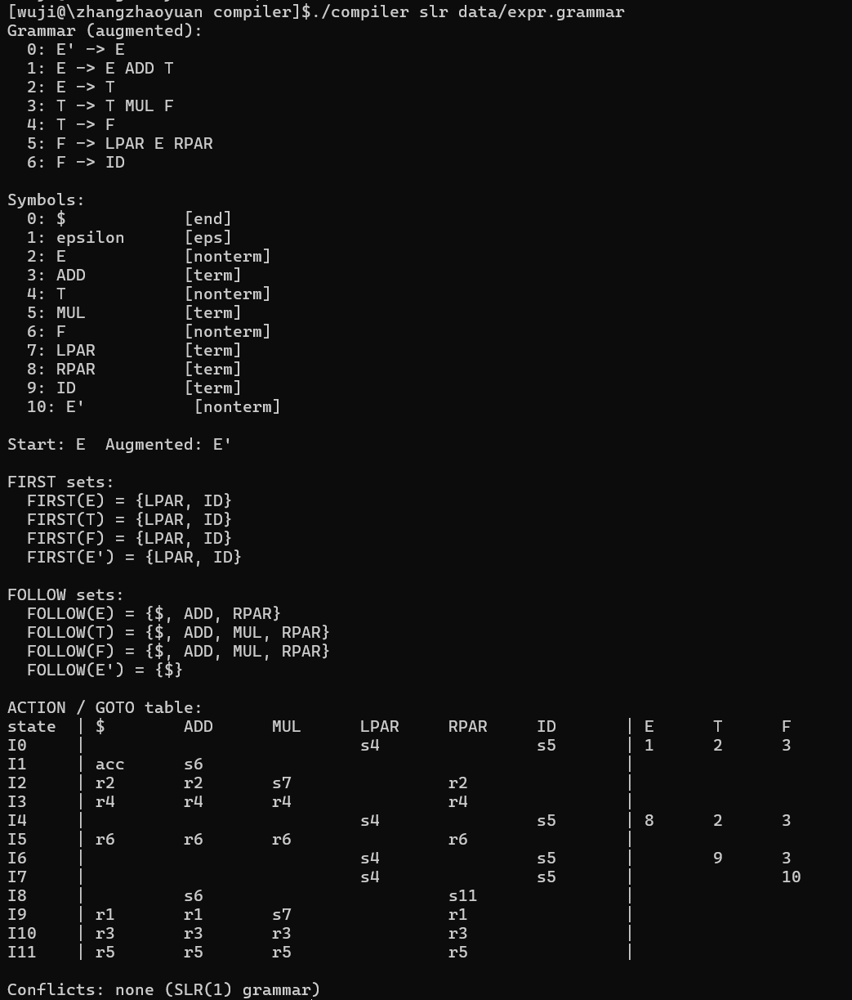

输出分四段。前半段是增广文法和符号表，与实验三完全一致，编号 0 的 `E' -> E` 仍由增广得到；FIRST 与 FOLLOW 给出每个非终结符的对应集合，例如 FIRST(E) = {LPAR, ID}、FOLLOW(E) = {\$, ADD, RPAR}。ACTION/GOTO 表的 `I2` 行能直观体现 SLR(1) 的消解逻辑：在 `$`、`ADD`、`RPAR` 上是 `r2`（按 `E -> T` 归约），在 `MUL` 上是 `s7`（移进），归约动作没有出现在 `MUL` 列，原来的 LR(0) 冲突被 FOLLOW 集消解。最后的冲突段输出 `Conflicts: none (SLR(1) grammar)`，证明这份文法属于 SLR(1)。

> 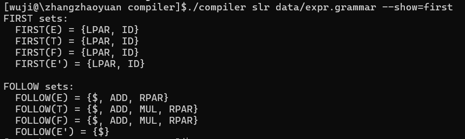

FIRST 与 FOLLOW 单独展示时更易核对。`E`、`T`、`F` 三个非终结符的 FIRST 都是 `{LPAR, ID}`，原因在于这份文法所有以这些符号开头的产生式最终都要靠最左端的 `F` 来产生终结符，而 `F` 的两条产生式分别以 `LPAR` 和 `ID` 起头。FOLLOW(F) 比 FOLLOW(E) 多了 `MUL`，这一项决定了 `F -> ID` 归约可以在 `MUL` 上发生，于是 `I5` 行的 `MUL` 列上填的是 `r6`。

## 实验内容（选做）

选做围绕四件事展开：用一份对照文法直观演示 SLR(1) 相对 LR(0) 的消解能力，用悬挂 else 文法展示 SLR(1) 仍然无法处理的经典冲突，把分析表搬进前端做交互式可视化，用 flex + bison 写一份等价的自动化实现作为旁证。

### 对照文法演示 SLR(1) 消解

`data/slr_demo.grammar` 选了一份只有四条产生式的小文法 `S -> A a | B b`、`A -> c`、`B -> c`。两条产生式都能把单个 `c` 归约成不同的非终结符，在 LR(0) 状态机里它们落入同一个状态，构成 reduce-reduce 冲突。SLR(1) 计算出 FOLLOW(A) = {a}、FOLLOW(B) = {b} 之后，两条归约的有效输入完全不相交，冲突自然消解。这个例子比表达式文法更直接，因为冲突状态里只剩两项，FOLLOW 集的作用一眼看清。

实现上不需要新增任何代码，只把文法文件放进 `compiler/data/` 即可，`compiler lr0` 和 `compiler slr` 子命令都能直接消费。预期 `lr0` 子命令在 `I4` 上报告 reduce-reduce 冲突，`slr` 子命令则判定为 SLR(1)，ACTION 表 `I4` 行的 `a` 列填 `r3`、`b` 列填 `r4`。

### 悬挂 else 的能力边界

`data/dangling_if.grammar` 用经典形式 `S -> IF E THEN S | IF E THEN S ELSE S | a`。`I7` 中既有 `S -> IF E THEN S ·` 这条归约项，又有按 `ELSE` 继续移进的项目。FOLLOW(S) 里包含 `ELSE`，因为 `S` 既可以归约后接到外层 `IF ... ELSE` 里，也可以作为整个程序的最后一句。这意味着 SLR(1) 看一个符号的能力仍不足以决定到底应该按内层 `IF ... THEN S` 归约还是继续等待 `ELSE`，冲突依旧存在。

这份文法的目的就是反例：演示 SLR(1) 不是万能的，仍有一类经典情形需要更强的分析方法或在文法里显式破除二义。预期 `compiler slr data/dangling_if.grammar` 在 `I7` 的 `ELSE` 上仍然报告 shift-reduce 冲突。

### 前端 SLR(1) Builder 可视化

前端可视化的思路是把分析表本身作为主视图，而不是状态图。FIRST/FOLLOW 用卡片网格展示，每张卡片对应一个非终结符；ACTION 和 GOTO 各做一张二维表，行是状态、列是终结符或非终结符。单元格根据动作种类用不同颜色编码：shift 蓝、reduce 绿、accept 金、冲突红色虚线高亮。这种布局让用户在切换不同文法时直接看到冲突落在哪几格，无需再去状态图里翻找。

API 集成沿用实验三的方式，`server.py` 把原来 `_handle_lr0` 抽成通用的 `_handle_grammar_cmd(body, subcommand)`，`/api/lr0` 和 `/api/slr` 共用同一条路径，只是子命令名不同。`slr_to_json` 在 LR(0) JSON 基础上扩展，新增 `is_slr1`、`first`、`follow`、`terminals`、`nonterminals`、`action`、`goto`、`conflicts` 八个字段，其中 `terminals` 与 `nonterminals` 是已经整理好的列顺序，方便前端按列直接渲染。

前端在文法变更时优先请求 API，API 不可用时降级到浏览器内置的 JS 实现 `slrBuildLocal`。本地实现复用了实验三已经写好的 `lr0ParseGrammar`、`lr0Closure`、`lr0GotoLocal` 等函数，在它们之上补 FIRST/FOLLOW 的固定点迭代和填表逻辑，输出对象的字段名严格对齐 C 端 JSON，前端渲染逻辑可以不区分数据来源。Tab 中四个预设按钮分别加载 `expr.grammar`、对照文法、悬挂 else、二义表达式文法，预期前两份判为 SLR(1)，后两份分别带 1 个和 4 个红色高亮冲突。

### flex + bison 等价实现

`lexer.l` 用 flex 写词法，匹配规则与 `expr.grammar` 的终结符完全对齐：`+` 返回 `ADD`，`*` 返回 `MUL`，`(` `)` 返回 `LPAR` `RPAR`，标识符返回 `ID`，空白跳过，其他字符报错。`parser.y` 把 `expr.grammar` 直译成 bison 语法：

```
S : E ;
E : E ADD T | T ;
T : T MUL F | F ;
F : LPAR E RPAR | ID ;
```

两套实现的输入文法严格等价。Makefile 调用 `bison -d -v` 同时产生头文件 `parser.tab.h` 和分析表导出文件 `parser.output`，再调用 `flex` 生成 `lex.yy.c`，最后 `gcc` 链接成 `expr_parser`。可执行文件从 stdin 读一行表达式，accept 时打印 `ACCEPT`，否则打印 `REJECT`。`make test` 跑三条样例：`a + b * c` 与 `(a + b) * c` 应当 accept，残缺的 `a +` 应当 reject。`parser.output` 中的状态编号与项目集顺序与手写 SLR 实现可能不同，但对每个状态闭包内的项目做配对后，ACTION 单元格的动作应当一致。对于这份分层表达式文法 LALR(1) 与 SLR(1) 一致，所以两份表的动作能逐格匹配，这条等价性正好是手写实现正确性的旁证。

## 实验结果（选做）

### 对照文法

> 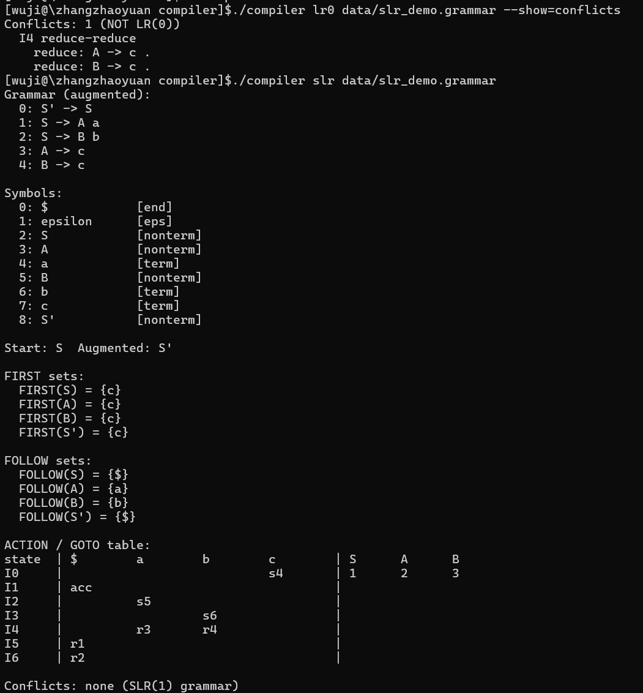

对照文法在 LR(0) 阶段确实卡在 `I4`：项目集里同时有 `A -> c ·` 与 `B -> c ·`，无法只凭状态本身决定按哪条产生式归约。SLR(1) 输出显示 FOLLOW(A) = {a} 与 FOLLOW(B) = {b} 互不相交，ACTION 表 `I4` 行的 `a` 列填 `r3`、`b` 列填 `r4`，两条归约自然分到不同列上，冲突彻底消解。这组对照验证了 SLR(1) 相对 LR(0) 的能力提升。

### 悬挂 else

> 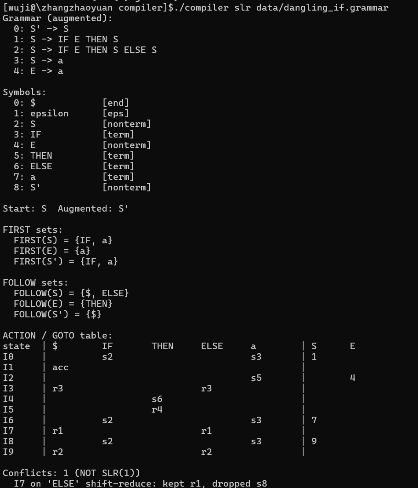

悬挂 else 文法的输出仍然有一条冲突。`I7` 的 `ELSE` 列既应该按 `S -> IF E THEN S` 归约，也应该继续移进进入处理 `ELSE` 分支的状态。FOLLOW(S) 里包含 `ELSE`，所以归约动作被填入这一格，与 shift 撞车。这个例子说明只看一个符号的能力存在边界，向前看更多符号或在文法里写明结合性才能彻底解决。

### 前端可视化

> 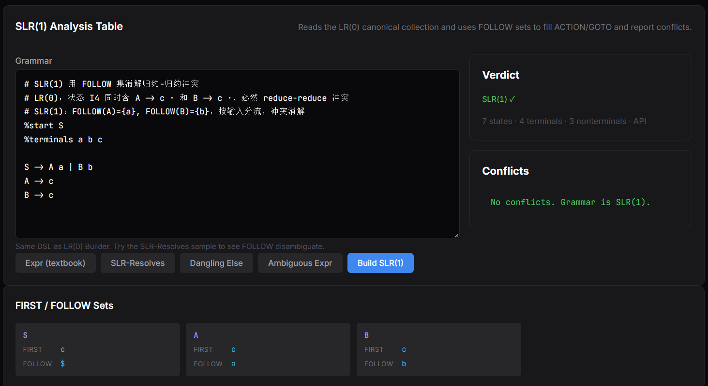
>
> 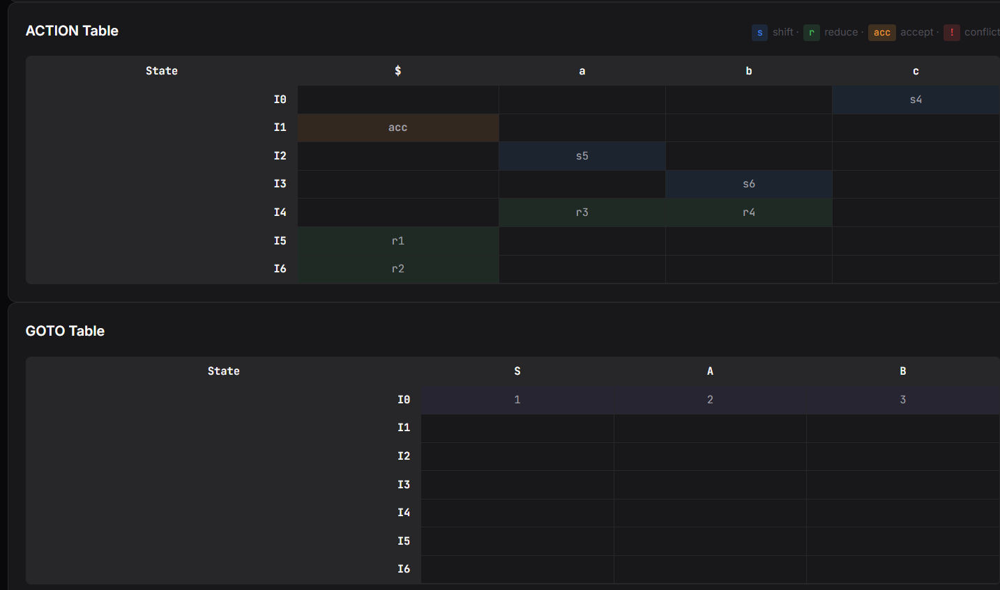

前端把对照文法的结果完整呈现出来。FIRST 与 FOLLOW 卡片显示 A 和 B 的 FOLLOW 集分别只含 `a` 与 `b`，ACTION 表里两条归约整齐落在不同列上。状态徽章是绿色 SLR(1) ✓，右侧冲突面板报 `No conflicts. Grammar is SLR(1).`。整个页面只看表格就能解释 LR(0) 到 SLR(1) 的能力差距。

> 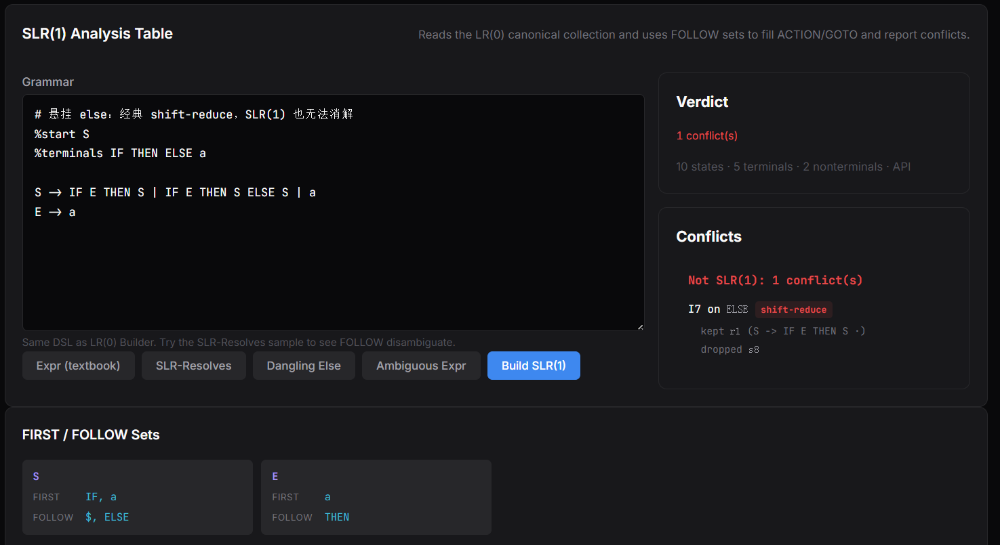
>
> 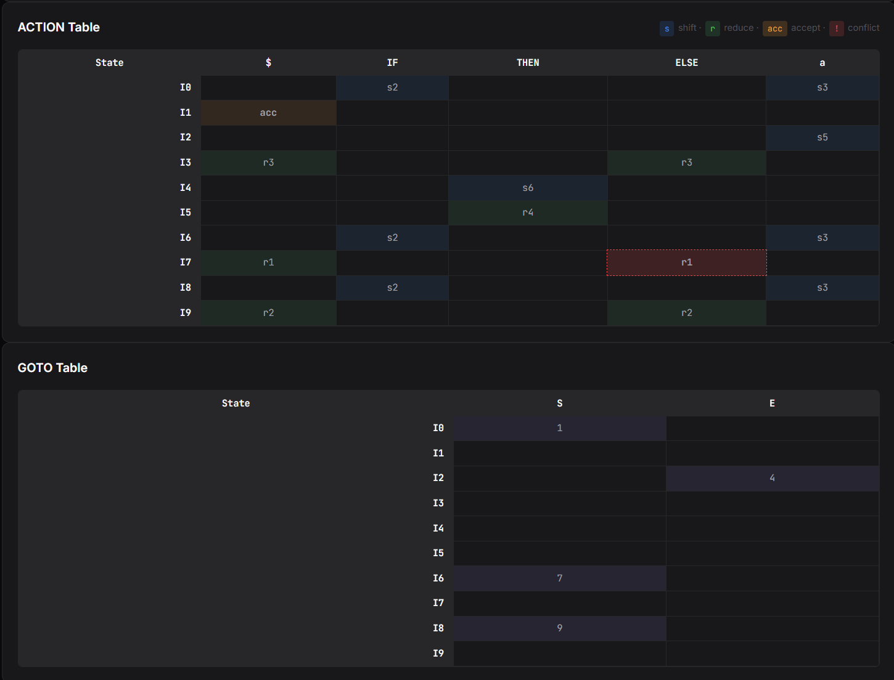

切到悬挂 else 之后表格中只有一个红色高亮单元格，落在 `I7` 的 `ELSE` 列。冲突面板说明保留下来的动作是 `r1`，被丢弃的是 `s8`，两条来源都列在条目里。状态徽章变成红色 1 conflict(s)。表格驱动的展示让冲突所在位置一眼可见，比逐项扫项目集要直接得多。

> 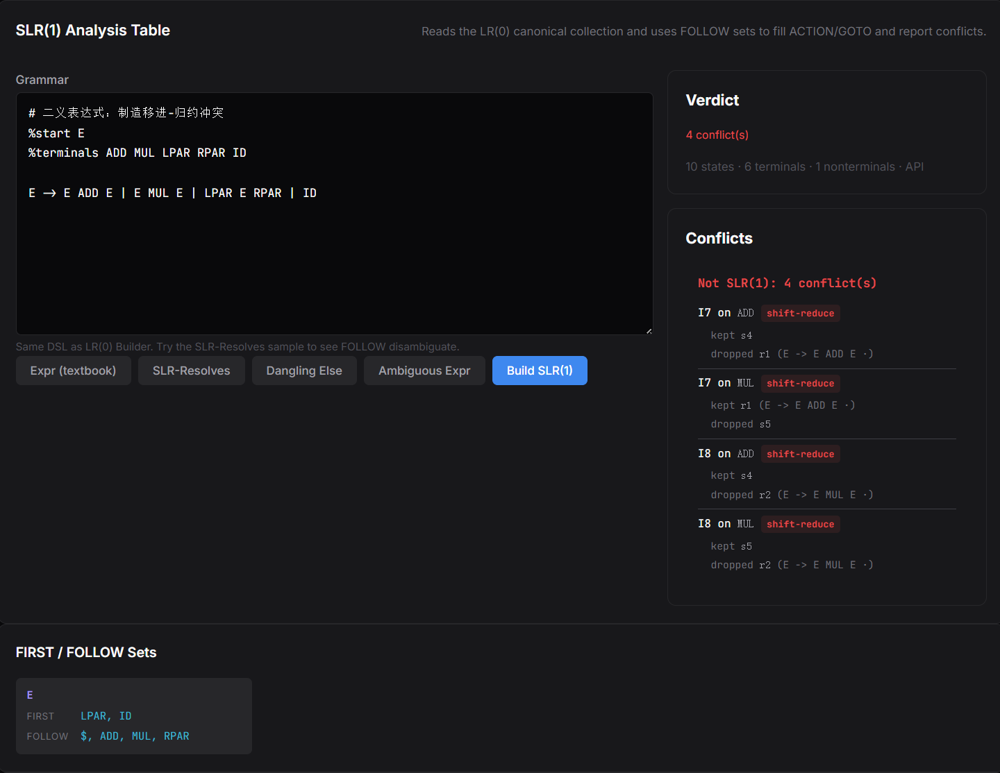
>
> 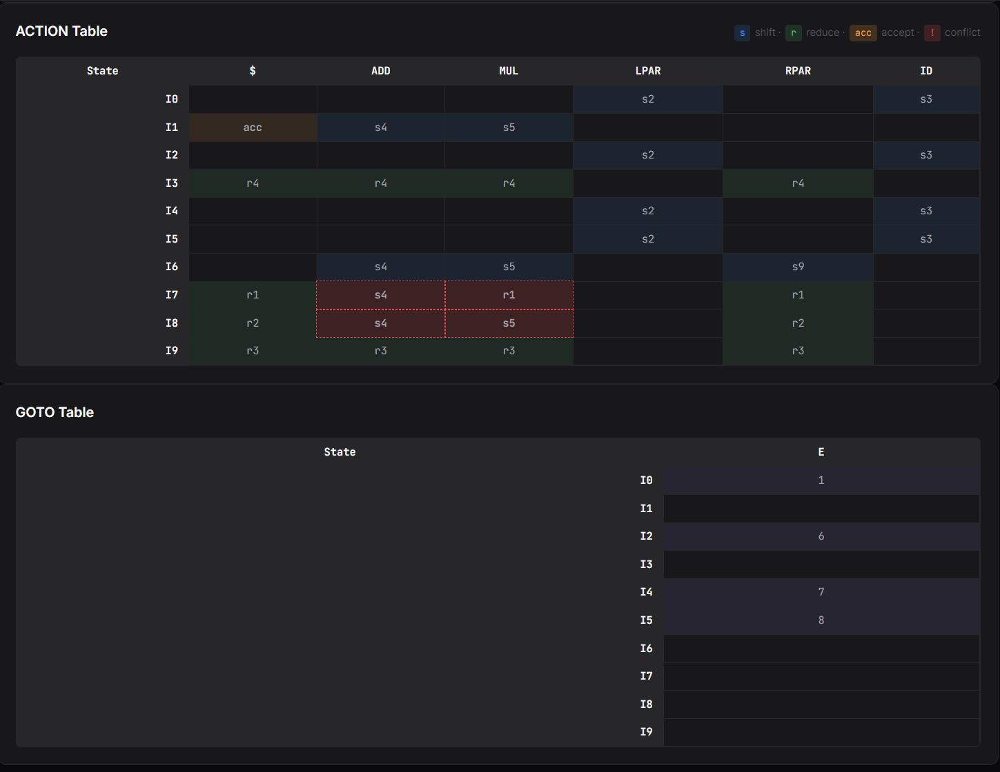

二义表达式文法在 SLR(1) 下仍然失败，且失败得更彻底。多个状态都同时含有完成项目和继续移进运算符的项目，FOLLOW(E) 既包含 `ADD` 也包含 `MUL`，归约动作没有任何符号能避开移进。表格里出现四个红色单元格，与 LR(0) 时的四处 shift-reduce 一一对应。这组对照说明 SLR(1) 的提升不能弥补文法本身的二义性，能写好优先级和结合性仍然是文法层应该承担的事情。

### flex + bison 工具链

> 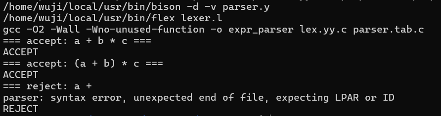

flex 与 bison 顺利生成中间 C 文件和分析表导出 `parser.output`，gcc 链接通过得到 `expr_parser`。三条样例覆盖了正常表达式、带括号的优先级覆盖以及残缺输入：`a + b * c` 与 `(a + b) * c` 在自动机走到终态后返回 accept，残缺的 `a +` 在 `+` 之后期待 `ID` 时遇到 EOF，bison 抛出 syntax error 并返回非零。这表明手写实现与自动化工具在同一份文法上的行为一致，也印证了手写 SLR 表的正确性。

> 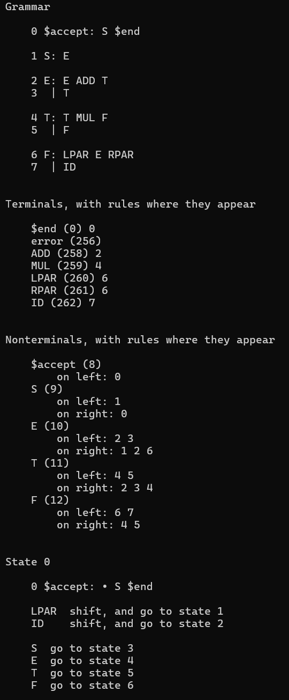

`parser.output` 是 bison `-v` 选项的副产品，它把内部 LALR(1) 状态机和 ACTION/GOTO 表导出成可读文本。它和 `compiler slr data/expr.grammar` 的输出表的状态条目能逐一对应，bison 中 `Shift`、`Reduce by rule N` 与手写实现里 `s7`、`r2` 这类条目意义完全一致。

## 个人总结

本次实验把 SLR(1) 分析表落成实现，认识到分析表是 LR(0) 状态机加上 FIRST/FOLLOW 之后自然得到的产物，没有必要重新构造状态机。从工程角度看，实验三留下的 `Lr0Collection` 直接被 `slr` 模块当作只读数据消费，新模块只负责 FIRST/FOLLOW 与填表两件事，模块的边界清晰。

写代码过程中加深了对几个概念的理解。FIRST 的可空性是一个看似细节但影响全局的设定，它决定了 FOLLOW 中传递规则的触发条件，FOLLOW 又决定了 ACTION 表里归约动作能落在哪些列上。冲突的判定从扫项目集变成扫表格之后，shift-reduce 与 reduce-reduce 的边界变得很清楚，但表格驱动也让那些被 FOLLOW 自动消解的潜在冲突彻底从视野里消失，反过来更能体会到 LR(0) 与 SLR(1) 能力差距的来源。对照文法 `S -> A a | B b` 是这次比较有收获的设计：用三条产生式就能演示 FOLLOW 集如何把 reduce-reduce 拆开，比表达式文法更利于一眼看清。

总体而言，这次实验让我把 ACTION/GOTO 这一对抽象表格变成了具体的二维数组、把冲突变成了带详细出处的记录，也通过前端表格视图把这些数据呈现得更直观，为后续实验里以分析表驱动的语法分析器实现做好了准备。
