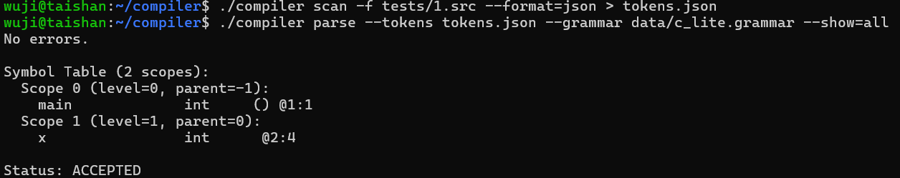
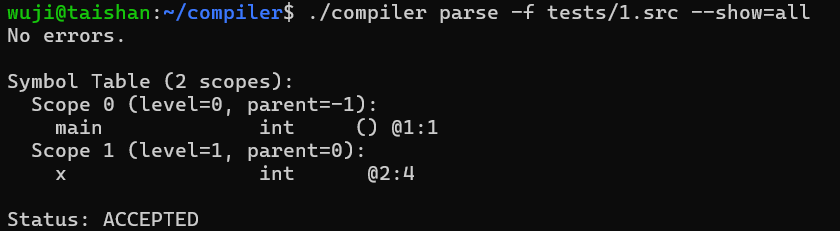
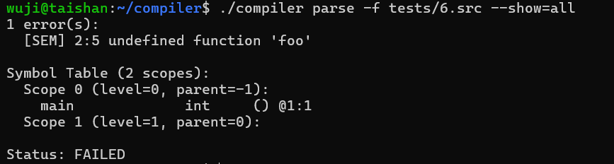
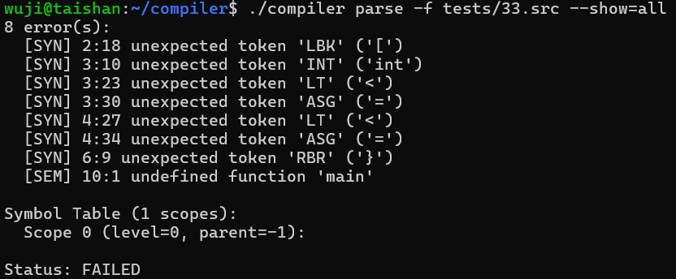
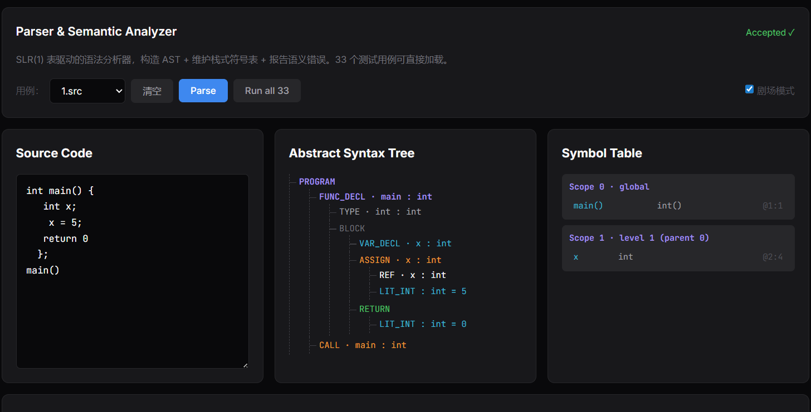
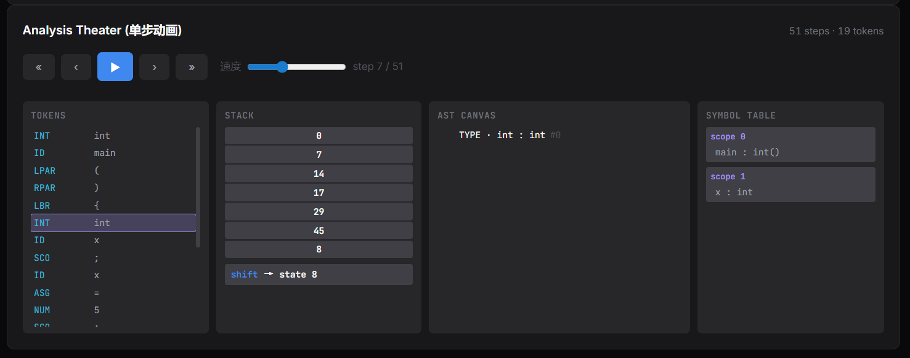
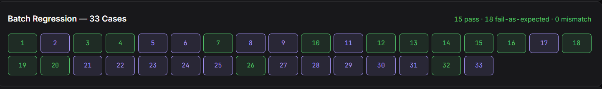
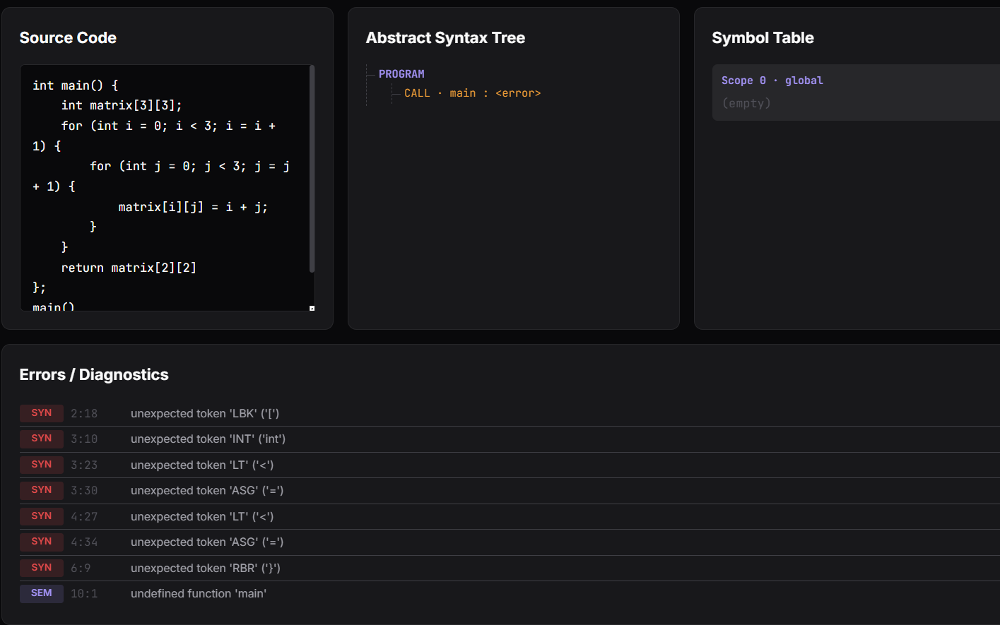
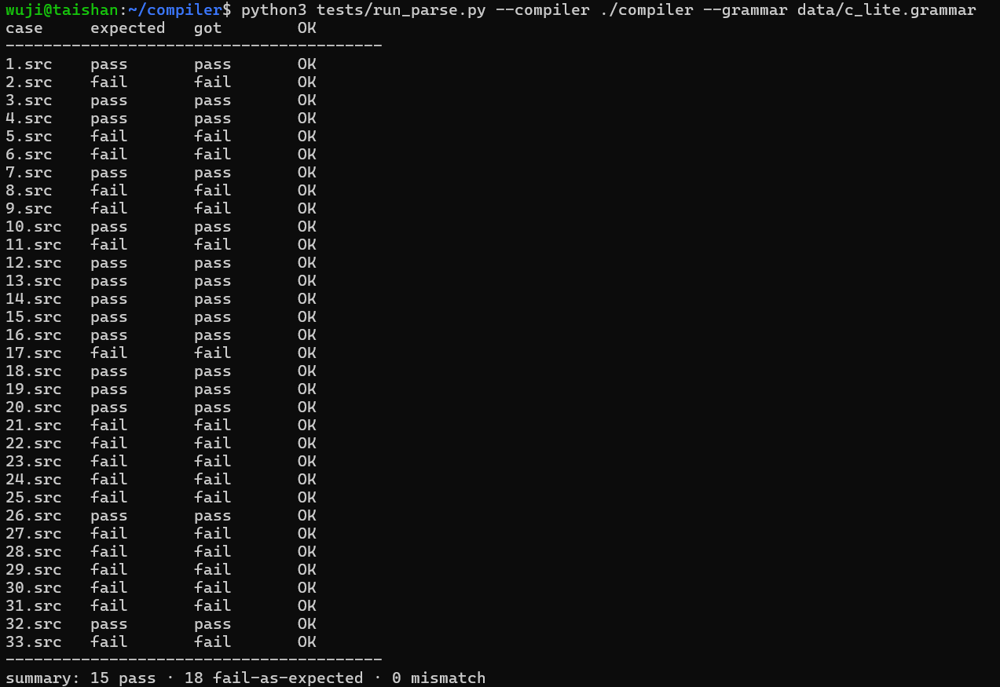

# 实验5：SLR 驱动的语义分析框架

[TOC]

## 实验内容（必做）

实验五在实验四 SLR(1) 分析表的基础上集成语义动作，构建抽象语法树 AST，维护栈式作用域符号表，完成初步的类型检查与语义验证。输入有三件：SLR(1) 分析表来自实验四的输出，嵌入语义动作的文法规则写在 `data/c_lite.grammar`，token 流由实验二 `compiler scan --format=json` 产出。输出是 AST 的可视化表示、含变量名与类型与作用域的符号表、以及语义错误报告。

### 设计思路

整体把工作切成四层可独立验证的部分：AST 节点、栈式符号表、SLR 表驱动分析器、语义检查遍历。前两层是数据结构，后两层是算法与策略。清晰的模块边界让分析器只关心语法层的栈与归约动作，语义检查独立遍历已经成型的 AST，避免 LR 主循环里混进太多与作用域、类型相关的细节。

AST 节点按主文法的非终结符聚合，但不是一一对应。相邻的列表非终结符如 `Decls`、`StmtList`、`ParamList`、`ArgList` 共用一个 `AST_LIST` 容器，避免每条产生式都引入新节点种类。算术与关系表达式分别对应 `AST_BIN_OP` 与 `AST_REL_OP`，IF、WHILE、RETURN、CALL 各自独立成节点种类。每个节点带 `kind`、`type`、源位置、子节点定长数组与标识名字段，整棵 AST 由一个 arena 一次性分配再统一释放。

符号表沿用经典 scope 栈。每个 `Scope` 是一个 `Symbol` 数组加上指向父 scope 的索引，`SymTab` 持有所有历史 scope 以及当前活跃 scope 的栈。push 时把新 scope 接到当前栈顶，pop 时只把栈顶位置后移，scope 数据本身不丢，这样前端可视化在解析完成后仍读得到每个 scope 里的变量。

SLR 表驱动分析器复刻教材标准的 LR 驱动循环。维护一个状态栈与一个属性栈，按 lookahead 查 ACTION 决定 shift、reduce、accept 或报错，按 GOTO 在 reduce 后切到下一个状态。属性栈每一格放一个 `AstNode *`，shift 时把当前 token 包装成对应的终结节点入栈，reduce 时弹出归约长度的属性，按产生式编号选构造函数生成新节点入栈。错误恢复用最简单的 panic-mode，碰到非法 lookahead 就跳到下一个分号，状态栈重置回起点继续。

语义检查独立成一遍后续遍历，不和 LR 主循环耦合。这是因为 scope 的进入与退出时机如果用 marker 非终结符表达，会让文法显著变复杂，还会引入更多 SLR 冲突；推到 AST 完整后再做就只需要一个递归 walker：进入函数定义时 push 函数 scope 并把形参插入，进入块语句时 push 一层匿名 scope，离开时 pop。walker 一边走一边带着 `FuncCtx` 维护当前函数的返回类型，给 `return` 语句做类型一致性检查，同时检查未声明引用、重复声明、函数调用的实参数与类型、数组下标必须是 int 类型。

### 实现过程

分析器初始化时把每个 `TokenKind` 通过 `token_name` 映射到 grammar 的符号 id，避免主循环里反复做字符串比较；reduce 阶段调 `dispatch_reduce` 按 lhs 名字与 rhs 长度选构造分支。

语义检查入口 `semantic_check` 先做一遍预扫描把所有顶层函数注册到全局 scope 以支持前向引用，再对每个声明体走深度优先 `visit`。函数声明推一层新 scope 并插入形参，块语句同样推一层；变量声明在当前 scope 查重后插入；引用、数组下标、函数调用沿 scope 栈查找声明并补全节点上的类型；赋值按 lhs 与 rhs 推断类型做兼容性检查，int 与 float 之间允许隐式提升。所有错误按发生顺序收集到 `ErrList`。

主文法用 Matched/Unmatched 拆分削减悬挂 else 的二义，但 SLR(1) 在 dangling else 上仍会保留一处 shift-reduce 冲突，这是算法本身的能力边界。我在 `slr.c` 的填表函数里加了 prefer-shift 规则，shift 与 reduce 撞同一格时优先保留 shift，对应到悬挂 else 的标准语义就是 else 与最近的未匹配 if 绑定。冲突仍然被记录下来，便于调试时确认是哪一处发生了消解。

`compiler parse` 在 `-f IN.src` 之外加了 `--tokens FILE.json` 入参，跳过内部 lexer 直接读 lab2 输出的 token JSON 还原 `Token[]`。两种入参互斥，其它步骤完全共用。CLI 入口为：

```
./compiler parse [-f IN | --tokens FILE.json] [-o OUT]
                 [--grammar PATH] [--show=ast|symtab|errors|all]
                 [--format=json] [--trace=json]
```

`--format=json` 输出含 `accepted`、`tokens`、`ast`、`symtab`、`errors`；`--trace=json` 追加 `productions[]` 与 `steps[]`。

### 测试用例说明

主测试输入选用 `1.src`，内容是一份最小可工作示例：函数定义、变量声明、赋值、返回值、入口调用。验证按三件入参的形式串成两步，在服务器目录下依次执行：

```bash
./compiler scan -f tests/1.src --format=json > tokens.json
./compiler parse --tokens tokens.json --grammar data/c_lite.grammar --show=all
```

再用 `./compiler parse -f tests/1.src --show=all` 跑内部 lexer 直连模式做等价性比对，两份输出的 AST、符号表、错误列表逐项一致。错误用例直接复用现有的 `tests/6.src`（函数体内调用未声明的 `foo()`）与 `tests/33.src`（混入 `for` 关键字与二维下标等文法不支持的特性），分别检验 SEM 类报告与 SYN 类报告加 panic-mode 恢复的行为。

## 实验结果（必做）

> 
>
> 

第一条 `scan` 把源代码翻译成 token JSON，每条 token 给出 kind、lexeme、行列。第二条 `parse --tokens` 以这份 JSON 为唯一输入跑分析，输出无错误，符号表分两层：全局 scope 注册函数 `main`，函数体 scope 注册变量 `x`，状态为 ACCEPTED。第三条走源代码入参的等价路径产出相同结果，说明 token 流入参与内置词法直连两条路径完全对齐。

> 

被测程序 `tests/6.src` 在 `main` 函数体内调用了一个未声明的函数 `foo()`。错误列表精确指向 `foo` 出现的行列并标记为 SEM 类，符号表显示当前函数已注册而 `foo` 找不到，符号表自身的结构没有被错误打乱。这一用例说明语义检查能在符号表查询失败时给出语义层错误，与词法、语法层错误用 LEX、SYN 标签做出明确区分。

> 

`tests/33.src` 故意混入了文法不支持的特性，包括 `for` 关键字、二维下标 `matrix[3][3]`、声明同时赋值等。分析器在第一次遇到这些构造时报 `[SYN]` 语法错误，panic-mode 跳到下一个分号继续，因此后续仍能识别出更多错误位置。这个用例也演示了错误恢复机制，一处错误不至于让整个文件的诊断全部中断。

## 实验内容（选做）

选做围绕“把 SLR 表驱动语义分析的全过程做成可单步、可回放的可视化剧场”展开。落到工程上需要两件事：后端在 `--trace=json` 模式下把每一步分析的快照写进 JSON；前端把这些快照拼成一个可控的时间轴，让 token 流、状态栈、AST 增量与符号表四件事在同一画面里同步推进。除剧场之外，为后续从源程序走到中间代码与目标代码的验收阶段准备一份端到端能力：把 33 份 `.src` 一次性灌入跑批量回归，看板形式给出预期通过、预期失败、不一致三类汇总，给下游实验提供一份现成的回归基线。

### 设计思路

剧场后端不只输出最终的 AST 与符号表，而是把每一步分析决策做成 `TraceStep` 加进数组，记录步骤号、当前 lookahead 在 token 流里的位置、动作类型、动作目标、状态栈快照，以及本步骤新生成的 AST 节点 id。前端把所有快照缓存到内存，时间轴上前进或后退就退化为纯重放，按当前 step 索引去读对应快照，决定渲染哪些 token 是当前 lookahead、状态栈的形状、AST 中哪些节点已经诞生。

前端布局分四列：最左是 token 流，按当前 step 高亮 lookahead；中左是状态栈与当前动作标签；中右是 AST 画布，根据累计 reduce 出的节点 id 集合渲染相应子树；最右是符号表的最终态盒子。控制条上是用例下拉、暂停、播放、单步前后、起点终点按钮、速度滑块。这种只看快照的设计让前端不必复刻 LR 分析逻辑。

批量回归看板的形态是 33 个色块，每个对应一个用例。绿色表示预期通过且实际通过，紫色表示预期失败且实际失败，红色表示不一致，橙色表示 API 调用本身出错。

### 实现过程

`parser.c` 内部增加 `TraceStep` 与 `ParseTrace` 结构，每步固定字段，状态栈用上限 64 的定长数组截断，整个 trace 上限 4096 步。`parser_run` 主循环在每次决策点调用 `trace_push` 追加一条快照。`main.c` 在 `--trace=json` 模式下额外输出 `productions[]` 与 `symbols[]`，让前端能从产生式编号还原出可读的 `lhs → β` 文本。

`web/js/parse.js` 增加一个 `theater` 对象保存 `data`、`index`、`timer`、`speed` 四个字段。播放时 `setInterval` 把 `index` 单调递增到末尾自动停，每次 `index` 变化都调 `theaterRender` 重画四列内容。AST 的逐步浮现由后端给每个 reduce 步骤记一个 `new_ast_id`、前端只渲染累计集合里的节点这一组合实现，效果由 arena 顺序分配的整数 id 与 reduce 时机自然得到，不需要在后端写 diff 算法。

批量回归脚本 `tests/run_parse.py` 提取每份 `.src` 末尾注释里的关键词判断预期，跑 `./compiler parse --format=json` 收集实际结果按四象限统计。前端 Run all 33 按钮直接调 `/api/parse` 跑全部用例，结果用色块矩阵呈现，鼠标悬停可看到 `expected=... got=...` 的 tooltip。剧场用例首选 `1.src`，token 流够长能看到 reduce 增量但又不至于步骤过多；回归看板覆盖全部 33 个 `.src`。

## 实验结果（选做）

### 剧场模式

> 
>
> 

剧场把分析过程的四件事并列在同一视图。token 流里当前 lookahead 用紫色边框标注，状态栈自上而下显示状态编号，当前动作区域用蓝色 shift、绿色 reduce、金色 accept 区分。AST 画布逐步浮现节点，每条标注节点 id 与种类。前进按钮直接推进 step，回退按钮回到上一帧，播放按钮交给 `setInterval` 周期性推进。这样的可视化把 SLR 表怎样消费 token、怎样生成 AST 节点这两件事直观地呈现出来。

### 批量回归看板

> 

看板把 33 个用例的预期与实际并排呈现。绿色单元代表预期通过且实际通过，紫色单元代表预期失败且实际失败，结果说明实现能稳定区分合法程序与非法程序。

> 

`tests/33.src` 单独跑能看到错误列表里多个语法错误位置，每条都有行列号与错误类别。panic-mode 在每个分号处恢复，从一个文件里映射出多个真实问题点。AST 区因为大部分声明都失败，只构造出零散的子树，符号表的全局 scope 也缺少 `main` 函数符号。这种失败但完整诊断的行为正是 panic-mode 错误恢复的目的。

### CLI 批量回归脚本

> 

`tests/run_parse.py` 是与前端看板等价的 CLI 工具，便于把回归整合进 Makefile 或 CI。脚本按文件名顺序跑全部 33 个，对每份给出 case、expected、got、OK 一行，最后汇总。脚本与前端看板共享同一份 `compiler parse --format=json` 输出，结果可以互相对照。

## 个人总结

本次实验把语义分析这件事从嵌入语义动作的抽象描述落到了一份可跑、可看、可调试的实现。结构上把工作切成 AST 节点、栈式符号表、SLR 表驱动分析器、独立的语义遍历四层，每一层都能单独测试和迭代。把语义检查独立成一遍 AST walker，而不是与 LR 主循环耦合做 marker 非终结符，是这次比较关键的设计选择，它把作用域管理从语法层剥出来，让 parser 保持单一职责。

写代码的过程中加深了对几个概念的理解。`AST_LIST` 容器节点让列表型非终结符的归约动作统一了形式，符号表的 scope 也能在每个块语句节点上自然对齐。SLR(1) 在 dangling else 上的天然冲突无法靠文法分层完全消除，prefer-shift 是 yacc 与 bison 一脉的标准消解策略，把这一行为放进 SLR 填表函数里、保留冲突记录但默认选择 shift，是工程上常见的做法。错误恢复用 panic-mode 跳到分号虽然朴素，但在 33 个测试用例上已能把一份满是错误的源程序映射成一份带行列号的错误列表。

剧场可视化是比较有设计的部分。把分析过程变成 token 流高亮、状态栈起落、AST 节点逐个浮现的同步动画，让 SLR 表驱动的归约动作不再停留在伪码层面。总体而言，通过本次实验，我对语义分析框架的具体形态有了更清晰的认识，也为后续的中间代码生成与目标代码翻译打下了基础。
