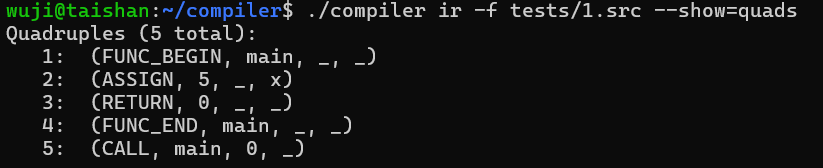
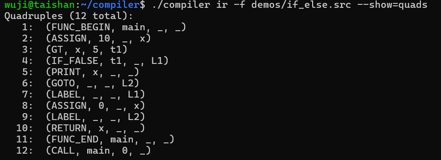
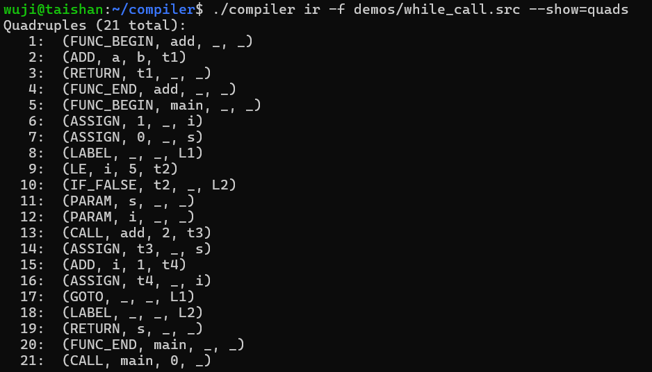
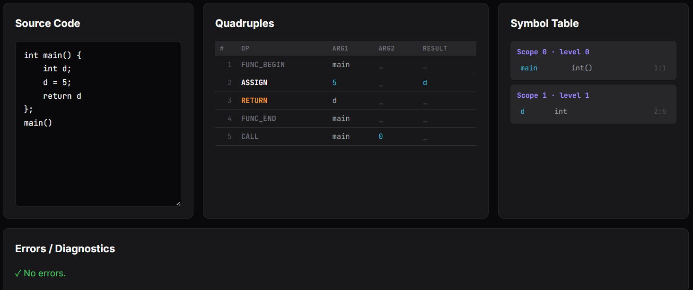
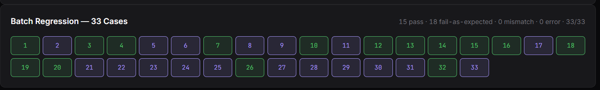

# 实验6：AST 到四元式中间代码生成

[TOC]

## 实验内容（必做）

实验六在实验五构建的 AST 与符号表基础上，集成中间代码生成模块。输入是实验五输出的合法 AST 与符号表，输出是逐条编号的四元式 `(op, arg1, arg2, result)` 序列，覆盖算术运算、关系比较、控制流、函数调用、数组读写与简单 IO。

### 设计思路

整体沿用实验五的模式，把翻译做成一个独立的 pass，与语法分析、语义检查解耦。语义阶段已经把未声明引用、类型不一致这类错误拦在前面，IR 阶段只关心翻译规则，不重复做检查；遇到 `AST_ERROR` 子树直接跳过，一处错误不会影响其它部分的代码生成。

四元式选取四字段形式 `(op, arg1, arg2, result)`。每个字段是字符串，可同时表示变量名、字面常量、临时变量（`t1, t2, …`）、标签（`L1, L2, …`），或者用 `_` 表示空槽。统一字符串带来两个直接好处：JSON 输出零类型转换，前端表格直接渲染。op 划分为算术、关系、控制流、函数、数组、IO 六类，每一类在前端各取一种颜色作为类别标识。

控制流采用 emit-and-fix 而非回填表。回填的用途在于处理 `&&`、`||` 这种短路求值的真出口与假出口的延迟绑定，而主文法不支持布尔短路运算，关系运算符直接产出一个布尔临时变量喂给 `IF_FALSE`，一次走完即可。翻译 `if (B) S` 这种结构时，先 `gen_label()` 分配 `Lend`，再发射 `IF_FALSE t _ Lend`，最后用 `LABEL _ _ Lend` 把目标位置固化；`while` 类似，多一个 `Lstart` 标签放在循环顶部。

函数翻译用一对 `FUNC_BEGIN name` 与 `FUNC_END name` 包住函数体。形参在符号表里已经登记，IR 阶段不再额外发四元式；函数调用按 `PARAM x` 序列加 `CALL f n t` 翻译，作为表达式时把返回值落到临时变量上，作为语句时直接丢弃。

### 实现过程

`Quad` 是四字段加上来源行列号的纯数据结构，`QuadList` 是一个自动增长的动态数组，附带 `next_temp` 与 `next_label` 两个计数器，`ir_generate` 从 AST 根节点开始递归。

walker 内部把节点分两类处理。表达式类节点（`AST_LIT_INT`、`AST_LIT_FLOAT`、`AST_REF`、`AST_BIN_OP`、`AST_REL_OP`、`AST_INDEX`、`AST_CALL`）走 `expr` 路径，把翻译结果的地址写入调用方提供的缓冲，可能是临时变量名、变量名或字面常量字符串。语句类节点（`AST_BLOCK`、`AST_ASSIGN`、`AST_IF`、`AST_WHILE`、`AST_RETURN`、`AST_PRINT`、`AST_INPUT`）走 `stmt` 路径，不返回值，仅向四元式列表发射相应指令。`AST_FUNC_DECL` 由 `stmt` 处理：发射 `FUNC_BEGIN`，递归翻译 body，对 void 函数补一条无值 `RETURN`，再发射 `FUNC_END`。`AST_PROGRAM` 与 `AST_LIST` 作为顺序遍历的容器。

翻译表达式与翻译语句之间的桥梁是 `t = visit(E)`。以 `x = a + b * c` 这种赋值为例，`stmt` 先调 `expr` 把 `a + b * c` 翻译完得到临时变量 `t2`，再发射 `(ASSIGN, t2, _, x)`。`a + b * c` 的子树由两次 `expr` 递归处理：内层 `b * c` 产生 `(MUL, b, c, t1)`，外层 `a + t1` 产生 `(ADD, a, t1, t2)`，向上返回字符串 `"t2"` 作为结果地址。

数组的读写形态不对称。取值 `a[i]` 是表达式，走 `expr`，发射 `(IDX_R, a, ti, t)`，把读到的元素写入临时变量 `t`。赋值 `a[i] = E` 是语句，走 `stmt`，先把右值翻译为 `te`，再发射 `(IDX_W, te, ti, a)`，把 `te` 写回 `a` 的第 `ti` 个槽。两条 op 在四字段里 result 槽的含义不同：IDX_R 的 result 是临时变量，IDX_W 的 result 是数组本体。把读与写拆成独立的两类让每条四元式的左值与右值在表格上一眼可辨，避免阅读者再对照源代码判断同一个 `a[i]` 表达式究竟在被取值还是被赋值。

CLI 入口 `compiler ir` 的参数与 `compiler parse` 保持一致：`-f IN.src` 走内部 lexer，`--tokens FILE.json` 直接读实验二输出的 token 流，两者互斥。`--show=quads|symtab|errors|all` 控制文本输出，`--format=json` 把所有字段一并打成 JSON 给前端调用。

### 测试用例说明

主验证用例是 `tests/1.src`，覆盖函数定义、变量声明、字面量赋值、`return`、入口调用五件事，预期产出 5 条四元式正好对应这五件事。其它用例与一组手写程序补充验证控制流与数组的翻译规则：`if-else` 应当产生 `IF_FALSE / GOTO / LABEL / LABEL` 四条加两个临时变量，`while` 应当产生起始 `LABEL`、条件比较、`IF_FALSE`、循环体、`GOTO Lstart`、结束 `LABEL` 这一整组，数组用例应当出现 `IDX_W` 与 `IDX_R` 配对。函数调用用例验证 `PARAM` 与 `CALL` 的顺序约定，包括返回值落到临时变量的形式。

## 实验结果（必做）

> 

输出 5 条四元式按预期顺序排列。函数边界由 `FUNC_BEGIN main` 与 `FUNC_END main` 标出，中间是把字面量 5 赋给 x 的 `ASSIGN` 与无值 `RETURN`，最末一条 `CALL main 0 _` 是顶层的入口调用，0 表示无实参。整段没有临时变量与标签，这一段函数体的形态决定了它们没有出现的必要。从 token 流走过 SLR 表驱动归约、AST 构造、语义遍历，再到四元式翻译这一整条管线无遗漏。

> 

`if-else` 的翻译结构清晰可辨。先把 `x > 5` 翻成 `GT x 5 t1` 产生布尔临时变量，再用 `IF_FALSE t1 _ L1` 把 0 值跳到 else 分支起点，then 分支结束发一条 `GOTO _ _ L2` 跳到整条 if 语句末尾，紧跟着的 `LABEL _ _ L1` 是 else 入口，最末 `LABEL _ _ L2` 固化整条 if 语句的终点。两个标签按 `gen_label()` 顺序分配为 L1 与 L2，符合 emit-and-fix 不需要回填的设计前提。

> 

`while` 循环体的入口与出口各有一个标签。条件求值发生在每一轮的开头，循环体结束发 `GOTO` 跳回头部。函数调用按先逐个 PARAM 把实参送入、再 CALL f n t的顺序翻译，结果落到 `CALL` 的 result 字段对应的临时变量上，赋值给左值变量时再补一条 `ASSIGN`。

## 实验内容（选做）

选做完成：把 IR 生成接入前端做交互式可视化，构建一个 33 用例的批量回归看板。

### IR Generator 前端可视化

前端可视化的核心思路是把四元式当成一种表格语言。每条指令对应表中的一行，op 类别决定颜色，控制流目标可点击联动。这种布局让阅读翻译产物的过程接近于浏览一份结构化的指令清单，源代码、四元式、符号表三者并排，逐条对照即可看清翻译规则。

视图分三栏：左侧是源代码编辑器，中央是四元式表，右侧是符号表盒子。中央表用 `<table>` 静态渲染，每一行带 `data-i` 与 `data-line` 两个属性，op 按 6 类着色，临时变量 `t1` 紫、字面量 cyan、标签 `L1` 配橙色虚线下划线。鼠标移到任意 `IF_FALSE` 或 `GOTO` 的标签上，对应的 `LABEL` 整行金色高亮。

### 33 用例批量回归看板

IR tab 加一个 Generate all 33 按钮，按 1 到 33 顺序依次调 `/api/ir`，把每份用例的结果分四类色块呈现：预期通过且实际通过为绿色，预期失败且实际失败为紫色，预期与实际不一致为红色，API 调用失败为橙色。预期表 `IR_EXPECTED_FAIL` 与实验五的 Parse tab 共享同一份判断，含 18 份按主文法判定确有真实瑕疵的用例。

预期判断来源分两类。自带 `// 错误：…` 注释的 7 份覆盖 `&&` 不支持、未声明引用、字符串、负号、返回类型不一致、`for` 等典型反例。其余 11 份未带注释但经反复核对源码确认有隐含瑕疵：含全角分号、多写分号、形参缺末尾分号、数组聚合初始化、笔误等。这一份名单是 Parse tab、IR tab、CLI 脚本 `tests/run_parse.py` 三处共用的，三套视图给出一致的结论。

## 实验结果（选做）

### 前端三栏与跳转联动

> 

整体视图把输出中间代码表示做成一张可读性强的表。左边源代码与中间四元式列表行列号对得上，右边符号表显示当前已注册的函数与变量。op 颜色按类别分配：函数边界灰、赋值常规、算术蓝、关系绿、控制流橙、IO 紫、数组青。基于类别着色比直接显示 op 名更利于辨认当前段落在做什么。

### 批量回归看板

> 

33 个色块按用例编号排列。15 个绿色对应预期通过且实际通过，18 个紫色对应预期失败且实际正确报错，没有红色或橙色，所有预期与实际完全对齐。这一结果说明 IR 生成器对主文法认可的合法程序都能产出完整的四元式列表，对所有违反规则的 src 都能让前置阶段把错误拦下来而不是错误地翻译。

## 个人总结

本次实验把 AST 到中间代码的翻译落到了一份可跑、可验证的实现上。延续实验五的独立遍 walker 模式让 IR 模块边界保持极简：只读 AST 与符号表，只写四元式列表，不引入任何反向依赖。emit-and-fix 控制流处理避开了回填表的复杂度，是主文法没有短路运算符这一约束带来的自然简化。

写代码过程中加深了对几个概念的理解。四元式这种中间表示的设计巧思在于把源代码的所有结构归并到”读什么、算什么、写什么”三件事上：每条指令读两个槽、算一种运算、写一个槽，语义边界整齐统一。把数组读写区分为 `IDX_R` 与 `IDX_W` 两条独立的 op 是这一轮比较关键的设计决策，让左值与右值在表格上一眼可辨。前端把四元式表呈现成可着色、可联动的形态，让阅读翻译产物时能直接对照源代码与符号表，避免在文本里翻找标签的对应关系。

总体而言，通过本次实验，我对四元式这种中间表示的形态与生成规则建立了完整认识，对从 AST 到指令序列翻译这一过程有了切身的实现经验。
