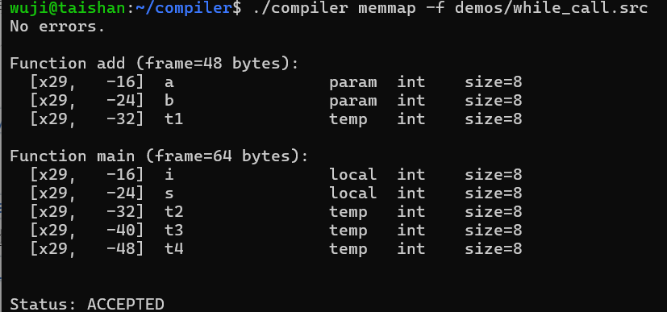
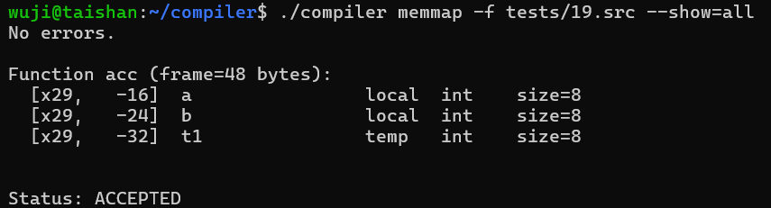
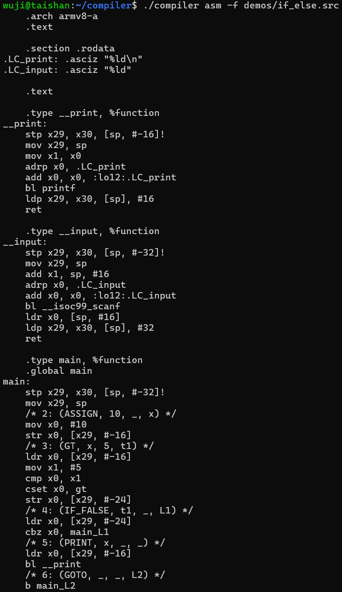
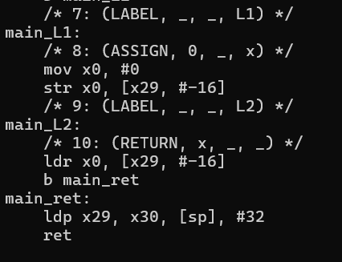
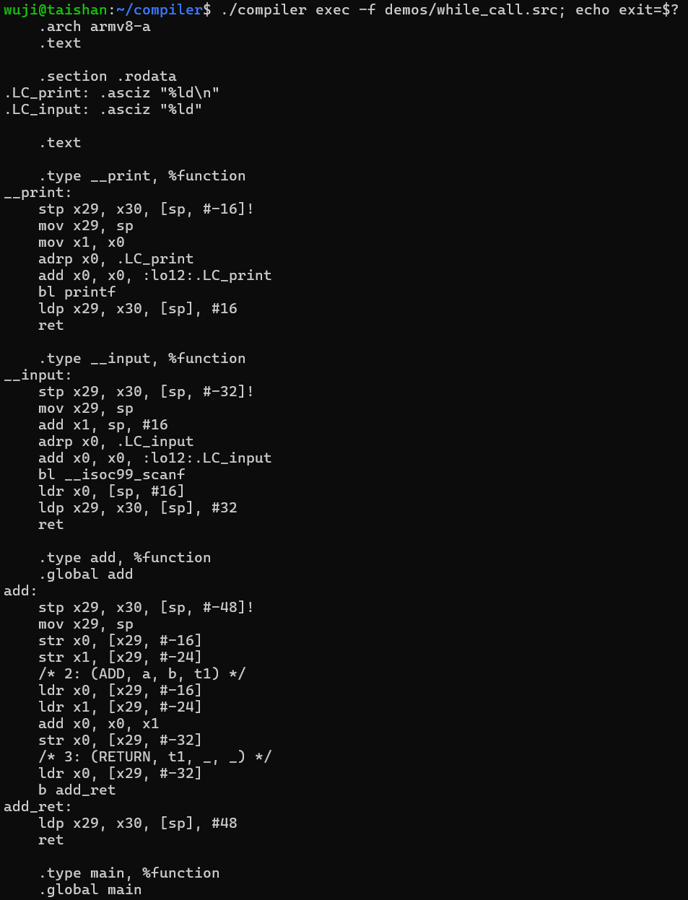
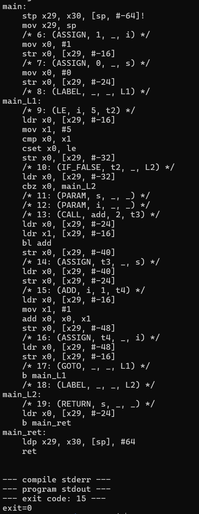
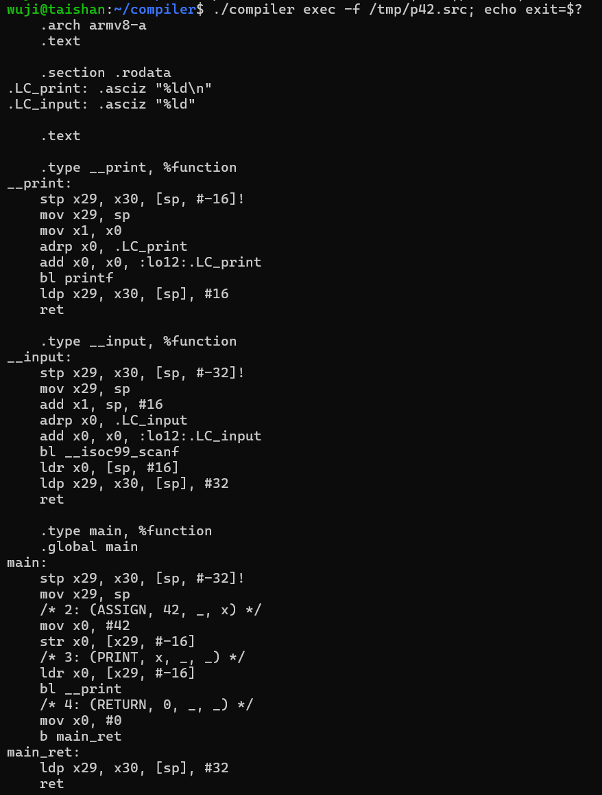
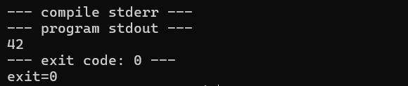
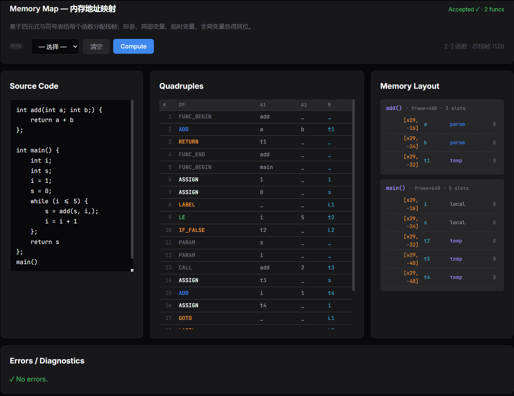
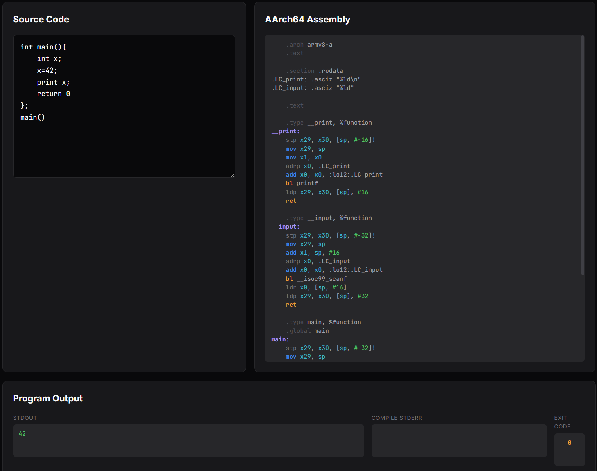

# 实验7 + 实验8：内存映像与可执行代码生成

[TOC]

## 实验内容（必做）

实验七基于实验六输出的符号表与四元式，把每个变量、形参、临时变量、全局变量映射到 AArch64 栈帧或 `.bss` 段中的具体地址。实验八以四元式与内存映像为输入，逐条翻译为 AArch64 GAS 汇编，并在 aarch64 服务器上由 `gcc` 编译为可执行文件，跑出真实的 stdout 与退出码。

### 实验七：基于符号表与四元式的内存映像

#### 设计思路

内存映像本身是一份纯翻译数据：输入是 SymTab 与 QuadList，输出是每个函数的栈帧布局加一份全局段。模型有意做得极简，把所有变量按 8 字节长整型存放，这样 IR 字段里的字符串 `x`、`a`、`t1` 都对应一个统一大小的栈槽，后续汇编翻译时不需要按类型分支。浮点字面量在装入栈槽时截断为整数，对当前文法允许的程序而言够用。

栈帧布局沿 AArch64 调用约定铺开。函数入口先用 `stp x29, x30, [sp, -frame]!` 把帧指针与返回地址保护到栈顶 16 字节，紧接着 `mov x29, sp` 把 `x29` 固定为本帧的基准。从 `[x29, -16]` 起向下连续分配槽位：先放形参，再放局部变量，再处理嵌套块作用域里出现的局部变量，最后是按首次出现序收集到的临时变量 `t1, t2, …`。每个槽 8 字节，数组按 `array_len * 8` 占用连续空间。函数体用到多少就分配多少，frame_size 加上 16 字节保护区后向上对齐到 16，满足 ABI 对栈对齐的硬约束。

形参在函数入口立即 spill。前 8 个实参经 `x0..x7` 寄存器传入，函数序言里逐条 `str x_, [x29, #offset]` 把它们写到自己的栈槽，此后访问形参与访问局部变量走同一条路径，对汇编翻译器来说两者无差。全局变量来自 SymTab 根作用域中所有非函数符号，以 `.bss` 段 `.zero <size>` 形式预留空间，按符号名直接寻址。

`memmap_addr_for` 是模块对外的核心 API，把 IR 字符串字段翻译为 AArch64 寻址表达式。整数与浮点字面量直接返回 `#N`；函数级变量在当前 `FuncFrame` 找到槽返回 `[x29, #offset]`；剩余变量按全局段查表返回 `[name]`。汇编层只调这一个函数就能拿到合法的源/目的地址。

#### 实现过程

`MemMap` 是 `funcs[]` 与 `globals[]` 两段数组的容器，每个 `FuncFrame` 含函数名、frame_size 与槽位数组，每个 `VarSlot` 是 `{name, kind, offset, size, array_len, type}` 六字段的纯数据。`SlotKind` 区分 `SLOT_PARAM`、`SLOT_LOCAL`、`SLOT_TEMP`、`SLOT_GLOBAL`，前端可以按这一字段着色。

`memmap_build` 是构建主入口。先调 `collect_globals` 扫 SymTab 根作用域里所有 `is_func == false` 的符号收为全局变量；接着遍历四元式找到每对 `FUNC_BEGIN..FUNC_END` 区间，从 SymTab 中取对应 `level == 1` 的函数 scope，按符号注册顺序识别形参（数量取自 `Symbol.param_count`）与局部变量。一个偏移指针 `neg_off` 从 -16 开始，每分配一个槽位就减去其 `size`，依次落到形参、局部变量、嵌套块局部变量。临时变量由 `collect_temps` 完成：扫该函数体范围内所有四元式的 `arg1` / `arg2` / `result` 三字段，按首次出现序去重收集形如 `t1`、`t2` 的名字，再依次追加到栈帧末尾。函数构建完毕后用 `align_up(used + 16, 16)` 算最终 frame_size。

`memmap_print` 把每个函数打成一段表格：标题行写函数名与 frame_size，下面每行一个槽位 `[x29, +/-N] | name | kind | size`，全局段单独成段。`memmap_to_json` 输出供前端调用的等价结构。CLI 子命令 `compiler memmap [-f IN.src] [--format=json]` 复用与 `compiler ir` 同一条 parse → semantic → ir 的共用管线，只在末尾追加一次 `memmap_build` 与打印。

#### 测试用例说明

主验证用例是 `1.src`：单 main 函数 + 一个局部变量 `x` + 入口调用，预期 main 的栈帧含 `[x29, -16] x` 一个槽，frame_size = 16 + 8 = 24，向上对齐到 32。`while_call.src` 验证形参 spill 与多临时变量的连续分配，`add(a, b)` 的 a/b 应当各占一槽，`main` 的 i/s 占两槽，循环体里关系运算与函数调用产生的临时变量按出现顺序顺序追加。`19.src` 用一段数组操作验证 array_len > 0 时一个槽占用 `array_len * 8` 字节、整段连续无空隙。

### 实验八：四元式到 AArch64 汇编与可执行代码

#### 设计思路

选择 AArch64 GAS 语法，考虑到服务器是 aarch64 Linux + GCC 11，gcc 直接用 .s 文件，不需要额外汇编器与链接器；System V AArch64 ABI 调用约定标准化，函数入口与跨函数寄存器使用规则清晰；每条四元式可以稳定翻译为 2 到 5 条汇编，便于阅读与调试。

翻译策略保持单调直白，不做窥孔优化与寄存器分配，每条四元式都走“载入 → 计算 → 存回”三段式。算术与关系运算把两个源都 `ldr` 到 `x0` 与 `x1`，算完再 `str` 到目的；控制流用 `cmp` + `cset` 把布尔值物化为整型槽再交给 `cbz`，与 IR 阶段 `IF_FALSE` 的语义直接对接。这一形态的好处是逐行汇编与逐条四元式可一一对照阅读，调试用例时定位错误所在的四元式只看一眼汇编就够。

调用约定层面，前 8 个实参经 `x0..x7` 传入，被调函数序言里立刻 spill 到自己栈帧的形参槽，让形参与局部变量在汇编里走同一条 `[x29, #N]` 路径。返回值落 `x0`，函数返回时 `b <fname>_ret` 跳到尾声，由统一的 `ldp x29, x30, [sp], #frame; ret` 完成栈帧拆除。控制流标签前缀 `<func>_<L>`，避免不同函数都用 L1、L2 时产生重复定义。

IO 运行时不写独立运行时文件，直接在汇编顶部 emit 一段 `__print` 与 `__input` 包装。`__print` 把传入的 `x0` 移到 `x1` 后调 libc `printf("%ld\n", v)`；`__input` 在栈上分配 16 字节缓冲调 libc `__isoc99_scanf("%ld", &buf)`，再 `ldr x0, [sp, #16]` 取回结果。PRINT 与 INPUT 四元式因此各只需一条 `bl __print` / `bl __input` 加少量寄存器交接。

入口处理分两路。用户写了 `main` 函数时直接以 `.global main` 暴露给 glibc 启动；用户用 `test()`、`acc()` 之类的命名作入口（顶层 CALL 决定）时，生成器在末尾合成一段 `main:` 调用顶层 CALL 指向的函数，让 glibc 仍然可以正常启动整个程序。

#### 实现过程

`asm_arm64_emit(QuadList*, MemMap*, FILE*)` 是模块单一入口。`emit_prologue` 写文件头：`.arch armv8-a` 指定指令集，`.rodata` 放 `%ld\n` 与 `%ld` 两段格式串，`.bss` 段按 `MemMap.globals` 顺序铺开 `.zero <size>`，`.text` 段写 `__print` 与 `__input` 包装。

`emit_function` 处理每个 `FUNC_BEGIN..FUNC_END` 区间。函数标题用 `.type X, %function` 与 `.global X` 标记，紧跟函数序言；遍历到 `SLOT_PARAM` 类型的槽位时按声明序生成 `str x0, [x29, #N]`、`str x1, ...` 把寄存器实参写入栈槽。函数体翻译走一个大 `switch (qd->op)`，对每条四元式调用 `load_into` / `store_from` / `array_base` 三个寻址辅助。`load_into` 把字面量 `mov` 进寄存器，把变量按 `memmap_addr_for` 的结果生成 `ldr x_, [x29, #N]`、或 `adrp/add/ldr` 的全局加载序列；`store_from` 反向；`array_base` 算出数组首地址放进指定寄存器，IDX_R/IDX_W 再用 `lsl x1, x1, #3` 把元素索引乘 8 拼出字节偏移。

控制流的 LABEL 写成 `<fname>_<L>:`，GOTO 写 `b <fname>_<L>`，IF_FALSE 用 `cbz x0, <fname>_<L>`。CALL 把缓存的 PARAM 序列依次 `ldr` 到 `x0..xN-1` 再 `bl callee`，若结果不为 `_` 把 `x0` 存到结果槽。RETURN 把返回值搬进 `x0`（无值时置 0），跳到 `<fname>_ret` 让统一尾声拆栈。

CLI 端有两个子命令：`compiler asm [-f IN.src] [-o OUT.s] [--format=text|json]` 出汇编文本，可重定向到文件交给 gcc；`compiler exec [-f IN.src] [--stdin STR]` 在 Linux 上一口气走完 `mkstemps(.s)` → `popen("gcc -O0 ... 2>&1")` → `popen("timeout 5 ./out 2>&1")`，把 compile_stderr、program_stdout、exit_code 三段输出回填给调用方。

#### 测试用例说明

`1.src` 验证序言、空函数体与尾声的最简形态，main 进出栈干净，`exit=0`。`if_else.src` 覆盖关系运算与分支跳转：`x > 5` 翻成 `cmp x0, x1; cset x0, gt`，`IF_FALSE t1 _ L1` 翻成 `cbz x0, main_L1`，验证 emit-and-fix 控制流在汇编层的对应。`while_call.src` 把求和 1 到 5 跑出 `exit=15`，验证函数调用、循环跳转与多临时变量栈帧的协同。自定义程序 `int main(){int x;x=42;print x;return 0};main()` 验证 `__print` 真实调通 libc，stdout 应为 `42`。

## 实验结果（必做）

### 实验七：内存映像 CLI 输出

> 

输出两份函数栈帧。`add` 函数 frame=32，含两个 `SLOT_PARAM` a 与 b 在 `[x29, -16]` 与 `[x29, -24]`，加一个临时变量 `t1` 落在 `[x29, -32]`，恰好等于 a+b 的中间结果。`main` 函数 frame 较大，含两个 `SLOT_LOCAL` i、s 与若干临时变量，循环里关系比较 `i <= 5` 与函数调用 `add(s, i)` 的返回值都各占一槽，按出现顺序连续向负方向铺开。frame_size 含 16 字节保护区后向上对齐到 16 字节，符合 AArch64 ABI 的栈对齐要求。

> 

含数组的栈帧布局可以直接看出来。数组符号 `arr` 的 `array_len` 字段非零，`size` 等于 `array_len * 8`，在栈上占据连续 `array_len` 个槽位且地址递减。后续标量变量与临时变量按设计紧跟在数组之后，没有空隙。这一布局让 IDX_R / IDX_W 在汇编层能直接用 `array_base + index * 8` 寻址。

### 实验八：汇编生成与服务器真实运行

> 
>
> 

输出的 .s 中可以逐条对照四元式：`(GT, x, 5, t1)` 对应 `ldr x0, [x29, ...]; mov x1, #5; cmp x0, x1; cset x0, gt; str x0, [x29, ...]`；`(IF_FALSE, t1, _, L1)` 对应 `ldr x0, ...; cbz x0, main_L1`；`(GOTO, _, _, L2)` 对应 `b main_L2`；`LABEL` 翻成函数前缀过的本地标签 `main_L1:` 与 `main_L2:`。函数序言、形参 spill、尾声三段都在预期位置。

> 
>
> 

整条流程在服务器上跑完 parse、semantic、ir、memmap、asm、gcc 编译、可执行运行七步，最终返回 `exit_code = 15`。这正是 1+2+3+4+5 的累加结果，说明函数调用约定、循环控制流、临时变量复用、栈帧拆装这一整组逻辑在真实 CPU 上正确成立。compile_stderr 为空，program_stdout 为空。

> 
>
> 

程序在服务器上通过 `bl __print` 调用 libc `printf("%ld\n", 42)`，stdout 实测为 `42\n`，exit_code 为 0。这一例验证了 IO 运行时包装与 libc 链接路径全部走通，编译器从源代码到可执行文件的链路在视觉与功能上闭合。

## 实验内容（选做）

选做围绕三件事：把内存映像接入前端做交互式可视化，把汇编生成与服务器编译运行做成一键式可视化，再把服务器端真实编译运行的链路工程化为公开可用的 API。

### Memory Map 前端可视化

Memory Map 是导航条上紧跟 IR 的第六个 tab，整体延续中央数据 + 左右两侧上下文的三栏布局。左栏是源代码编辑器与 33 用例下拉，中央栏是该程序的紧凑四元式表，右栏是按函数分卡的栈帧表格。每张栈帧卡片标题写函数名加 `frame=NB · K slots`，下方表格逐行列 `[x29, +/-N] | name | kind | size`，kind 字段决定着色：param 蓝、local 中性、temp 紫、global 青。全局段单独成一张 `Globals · .bss` 卡片放在最上方。状态徽章在调用 `/api/memmap` 期间显示 `Computing…`，成功后切换为 `Accepted ✓ · N funcs`，失败则显示具体错误数。

视觉设计的关键考虑是让形参 spill 这件事在卡片上一眼可见。栈帧从上到下按 `[x29, -16]` 起的负偏移连续排列，形参成片地占据卡片最上几行，下方依次是局部变量与临时变量。这一布局直接对应汇编输出里函数序言的 `str x0, [x29, -16]` 序列，把抽象的"调用约定"具象成表格上一段连续区域。

### Assembly & Run 前端一键可视化

Assembly & Run 是导航条最右侧的 tab，承担端到端展示。页面顶部有源代码、用例下拉、stdin 输入框、Generate Asm 与 Compile & Run 两个动作按钮。中央是高亮过的汇编正文区，按 op 类别着色：标签紫、`bl/cmp/b.*` 等控制流橙、`ldr/str/ldp/stp/adrp` 等访存灰、`add/sub/mul/sdiv` 等算术蓝、寄存器 `x?/w?/sp/x29/x30` 青、`#imm` 立即数绿。底部并排四块面板：编译器 stderr、程序 stdout、退出码、汇编行数与四元式条数概要。

Compile & Run 按钮的实际链路是浏览器调 `/api/run`：把源代码、stdin 一起 POST 到服务器；服务器走完 parse、semantic、ir、memmap、asm 五段后落 .s 到临时文件，调 gcc 编译，再用 `timeout 5` 跑出真实的 stdout 与退出码，把汇编、stdout、stderr、exit_code 一并回传。前端拿到响应后把汇编渲染到中央区，把 stdout、stderr、exit 各自填到底部面板。状态徽章按场景切换 `Compiling & running…` / `Ran ✓ exit=0` / `Compile failed`，让人一眼知道当前停在管线哪一段。

### 服务器端真实编译与运行链路

让汇编生成不只是文本演示是这一轮选做的核心。C 端 `cmd_exec` 在 Linux 上用 `mkstemps(.s)` 拿到带 `.s` 后缀的临时文件让 gcc 识别为汇编源，配 `popen("gcc -O0 ... 2>&1")` 编译并把 stderr 与 stdout 合并捕获，再用 `popen("timeout 5 ./out 2>&1")` 限时跑，stdin 通过 popen 写入。

Python 端 `_handle_codegen` 用 subprocess 包 `compiler asm` 与 `compiler exec`，整体超时 20 秒，stdout 与 stderr 各截断到 8KB 防止大输出阻塞。遇到全角字符等无法 UTF-8 解码的字节用 `errors='replace'` 兜底，避免 `json.loads` 因为单字节解码失败崩在中间。`/api/memmap`、`/api/asm`、`/api/run` 三端点共享这一段沙箱包装，仅在最终输出字段上各自补 memmap、asm、program_stdout 三个增量。

## 实验结果（选做）

### Memory Map tab 三栏视图

> 

三栏并排呈现：左侧源代码、中间紧凑四元式表、右侧每个函数一张栈帧卡片。卡片头里 frame_size 显式写出，槽位表里 param/local/temp 三类着色明显可辨。把鼠标停在某条四元式上时左侧源代码对应行高亮，右侧栈帧里被使用的槽位淡灰，让四元式访问哪个变量、那个变量在栈上哪个偏移这一对应关系可视化。

### Assembly & Run tab 端到端

> 

整页同屏展示三件事：左上的源代码、中央的着色汇编、右下的程序 stdout 与退出码。汇编行按 op 类别着色后段落感清晰，函数序言的 `stp/mov`、形参 spill 的 `str`、控制流的 `cmp/cset/cbz/b`、调用的 `bl`、尾声的 `ldp/ret` 各成可识别的色块。底部四面板里 Compile stderr 为空、Program stdout 是真实程序的输出、Exit code 显示进程返回值。点一下 Compile & Run，浏览器看到的是服务器上真实编译并运行后产生的输出，编译器在视觉与功能上闭合。

## 个人总结

本实验把实验六生成的四元式真正落到 AArch64 这一具体指令集上。先用 `MemMap` 把符号表与四元式里的字符串字段映射到栈帧偏移与全局段地址，再把每条四元式按 ABI 翻译为 GAS 汇编，最后在 aarch64 服务器上由 gcc 编译并真实运行，拿到 stdout 与退出码。

写代码过程中加深了对几个概念的认识。AArch64 ABI 不再是文本上的术语，`stp x29, x30, [sp, -frame]!` 一条指令同时完成栈分配与帧指针保存，回头读符号表才意识到形参寄存器、栈槽、变量名其实是同一份信息的三种形态。把每条四元式当独立翻译单元、不做寄存器分配，换来的好处是逐行汇编可对照逐条四元式定位错误。立即数范围、栈对齐、libc 调用约定这些只在真实 CPU 上才暴露的细节也都因此一一摸清。

总体而言，通过本次实验，我对从源代码到可执行文件这条管线建立了切身的实现经验，对内存映像、调用约定、汇编翻译规则与运行时支撑这组概念有了具体而非抽象的理解。我将编译器实验的全部工作以工程的形式作为架构，完成了从源码到可执行程序的全过程，代码仓库位于：https://github.com/AstralArtisan/XJTU-Compiler，请老师查验代码。

