# 指令系统

## 概述

指令系统是指一台计算机所拥有的全部机器指令的集合，反应该机基本功能

指令系统是计算机硬件语言系统，被称为机器语言

指令系统是软件和硬件的主要交界面

指令系统决定了机器硬件所具有的能力，也决定指令的格式和机器的硬件结构

指令系统也影响软件

## 发展

简单到复杂，复杂到简单

复杂指令系统计算机CISC：

- 软件硬化：用一条功能复杂的新指令来取代原先需一串指令完成的功能
- 支持高级语言程序：增加新的复杂指令以及复杂的寻址方式
- 软件兼容：系统不断扩大
- 问题：大量指令不被使用

精简指令系统计算机RISC：

- 优先选取使用频率较高的简单指令
- 指令长度固定，格式种类少，寻址方式种类少
- 只有load and store访问存储器
- CPU中通用寄存器数量多
- 采用流水线结构，大部分指令在一个时钟周期完成
- CU以硬布线控制逻辑为主
- 采用编译优化技术，减少程序执行时间

## 功能

完备性（功能需求）、规整性（设计需求）、高效性（性能需求）、兼容性（通用性需求）

数据类型：面向应用或者软件系统所处理的各种数据结构（整数、实数等）

数据表示：机器硬件能直接识别、指令能直接操作的数据结构（定点数、浮点数等）

操作数：机器指令中的数据，即硬件可以直接识别和处理的数据

- 地址
- 数字
- 字符
- 逻辑数

计算机中数据存储设备：通用寄存器、主存储器、I/O设备，他们都包含多个可编址的数据访问单元，可以统一编址或者单独编址

**编址方式**：主存单元的地址编排方式，决定主存最小访问单位。

- 按字编址：主存最小编址单位是一个存储字（机器字长），访问以字为单位。
  **主存容量=存储字数×存储子长** 。例：128M×32位
- 按字节编址：主存最小编址单位是一个字节，以字节为单位。既能以字节为单位访问（字节地址），也能以字为单位访问（字地址）。字节地址连续，字地址不连续。
  编址顺序：小端（低字节低地址）、大端（高字节低地址）；边界：对齐/不对齐

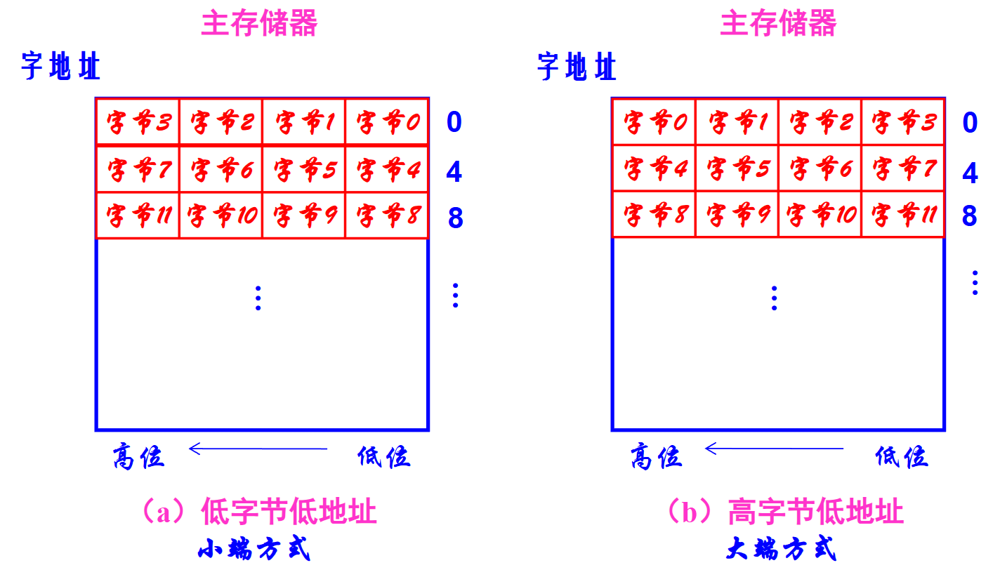

大端：看数据最左边，从左往右把数据塞进内存

小端：看数据最右边，从右边低位开始推入内存

操作类型：

- 数据传送指令：mov，lw、sw
- 数据运算指令：and，or，shl
- 程序控制指令：j，call，ret
- I/O指令
- 其他指令

## 指令格式

指令由**操作码**和**地址码**组成。操作码指出指令操作性质，地址码指出操作数地址或下一条指令地址

指令字长：一条指令中包含的二进制码位数。选取原则：尽可能短，信息利用率尽可能高

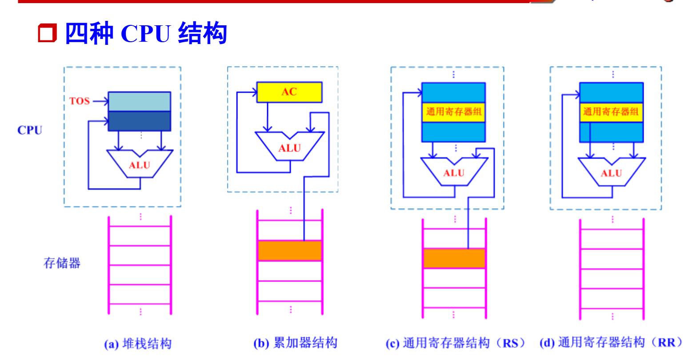

地址码：

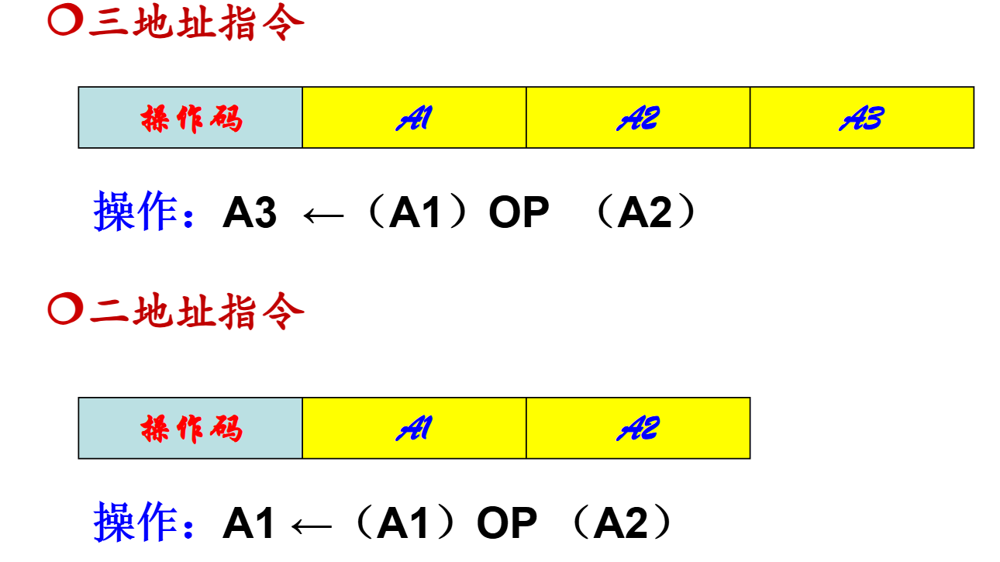

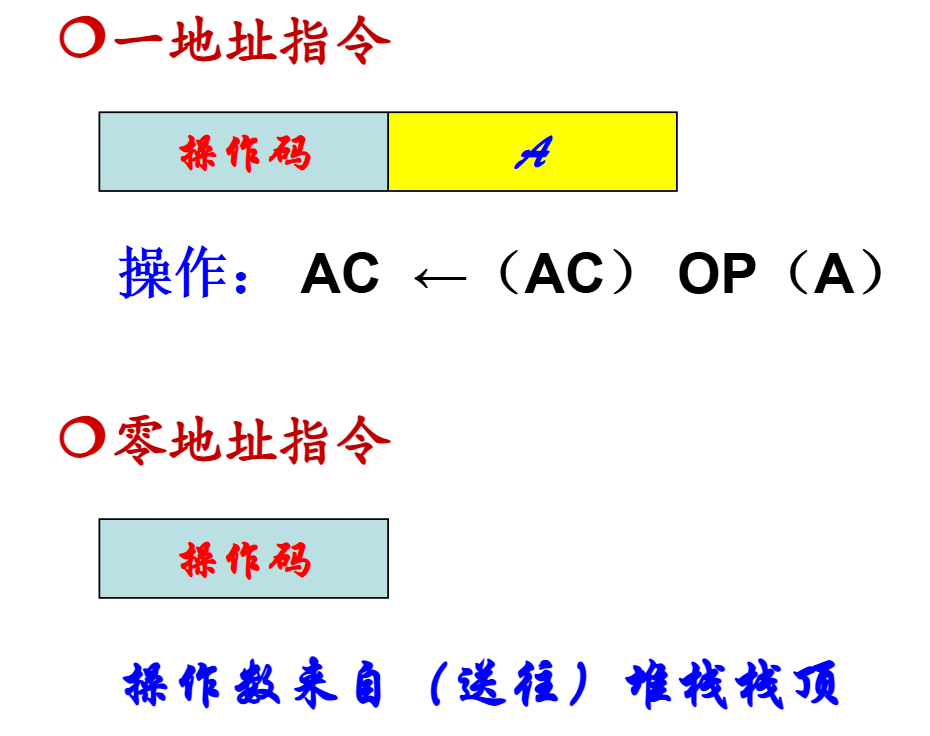

操作码：指令功能。位数选取：能够表示全部指令

- 定长操作码：所有指令操作码位数相同，安排在指令字的固定字段中
- 变长操作码：各种指令的操作码位数不一致，可以分散在指令字的不同字段中

操作码扩展：采用定长指令字，多种地址码结构混合使用时，利用地址码个数较少的指令空出的地址码字段增加操作码位数。

- 等长扩展法：4-8-12/3-6-9
- 不等长扩展法

重点：

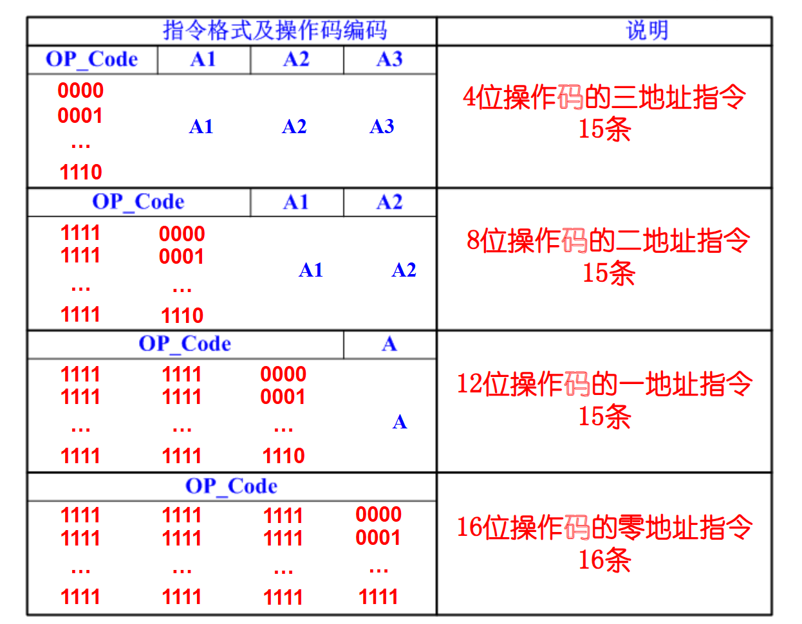

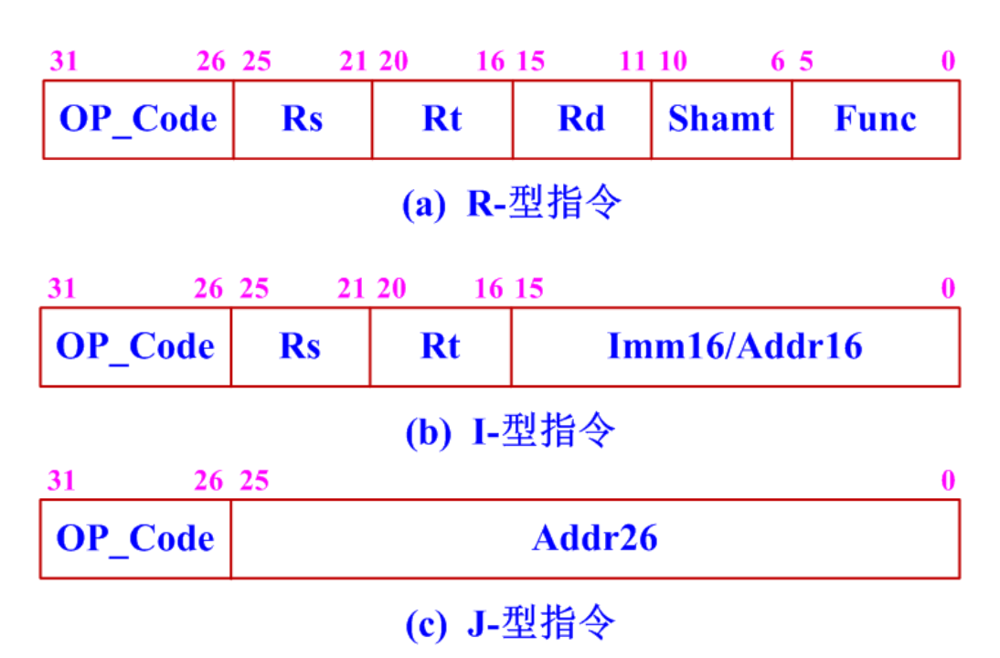

## 寻址方式

地址:

- 形式地址（符号地址）：指令中显式给出

- 有效地址（逻辑地址）：通过形式地址变换得到，由寻址方式和形式地址共同决定

寻址方式：计算源操作数、目的操作数以及下一条指令所在存储设备具体位置的方法

- 指令寻址方式：确定下一条指令所在主存地址，为PC设定新值

  - 顺序指令寻址：PC=(PC)+1
  - 跳跃指令寻址：转移类指令给出地址

- 数据寻址方式：确定操作数在存储设备中地址。在指令中安排几位标志位表示所用的寻址方式，称为寻址方式码

  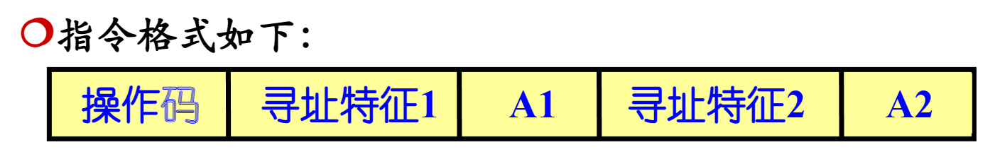

  

数据寻址方式可分为基本寻址和复合寻址，基本地址又能分四类：

- 立即寻址：地址码直接给出立即数
  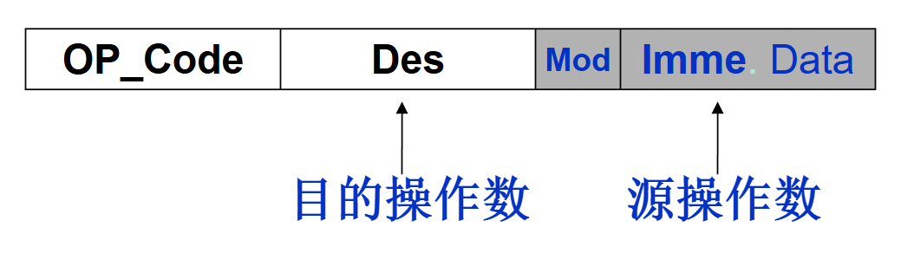

- 寄存器寻址：操作数在寄存器中，地址给出寄存器编号
  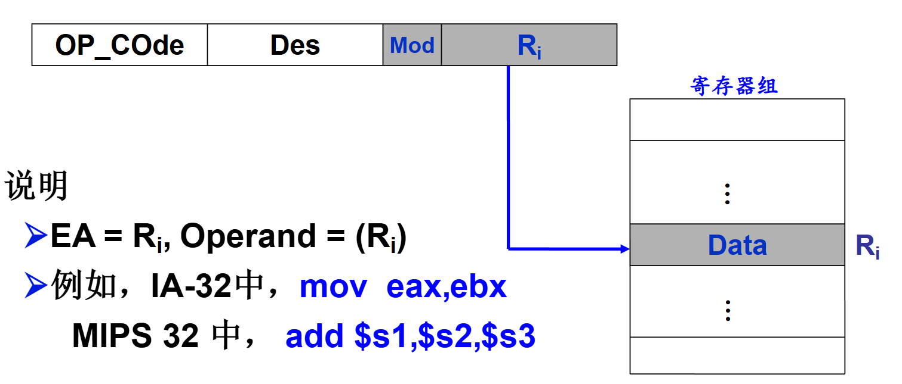

- 存储器寻址：

  - **直接寻址**：地址字段直接给出操作数在存储器中地址
    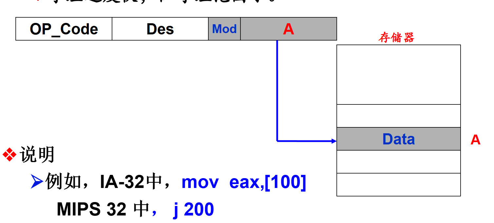

  - **存储器间接寻址**：给出操作数地址的地址
    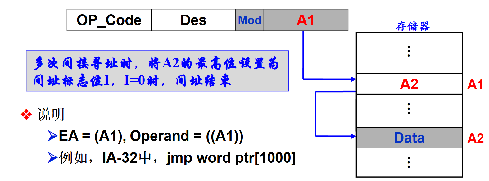

  - **寄存器间接寻址**：地址码给出寄存器编号，寄存器存放操作数在主存中地址
    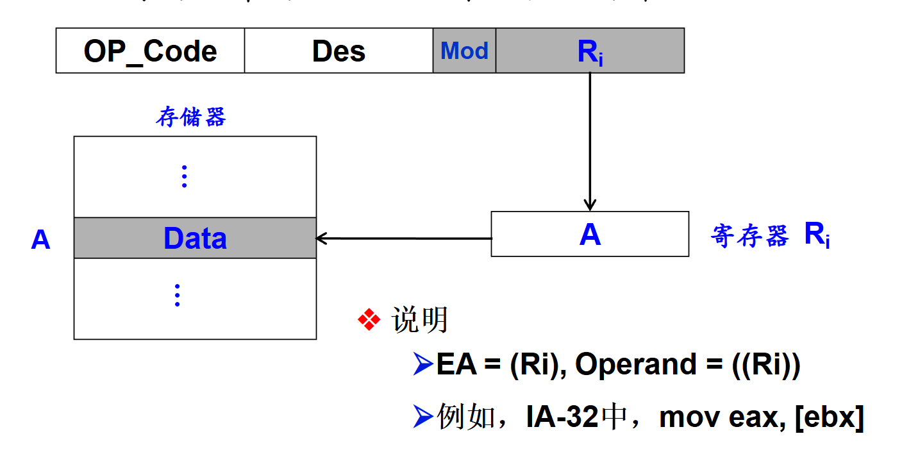

  - 偏移寻址以及段寻址：直接寻址+寄存器间接寻址
    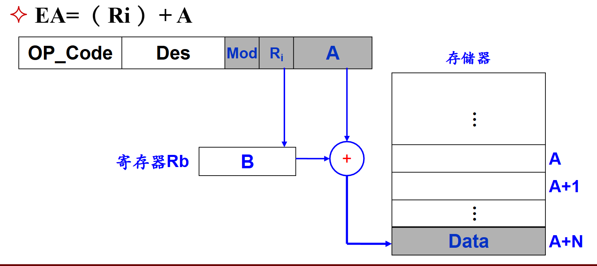

    - **相对寻址**：给出偏移量A，直接加到PC上
    - **变址寻址**：引用变址寄存器，EA=(Rx)+A
    - **基址寻址**：引用基址寄存器，EA=(Rb)+A

    基址寄存器不能变，变址可以用户设置

    - **段寻址**：地址长度超过机器字长，与机器字长相等的段地址和段内位移量错位相加获得更长地址
      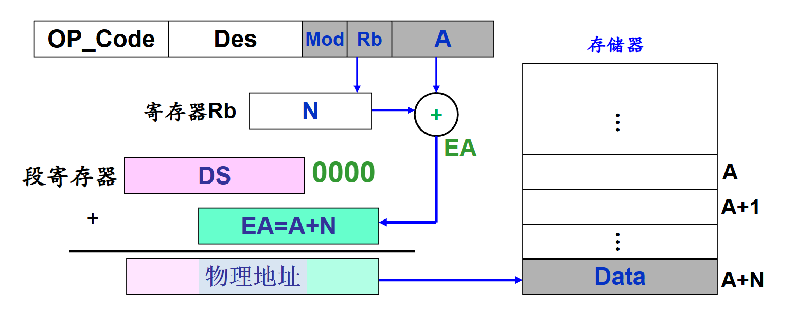

- **堆栈寻址**：SP指向栈顶

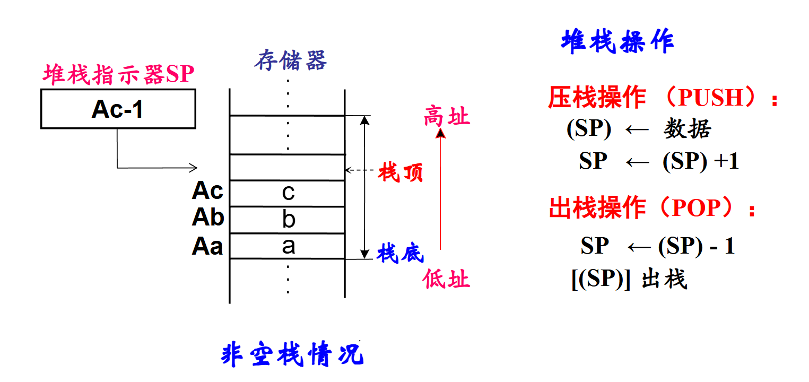

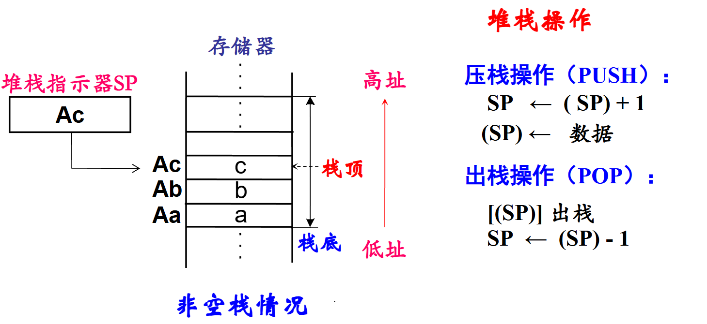

- 复合寻址：两种以上寻址方式联合使用
  - 变址间接寻址
  - 间接变址寻址
  
  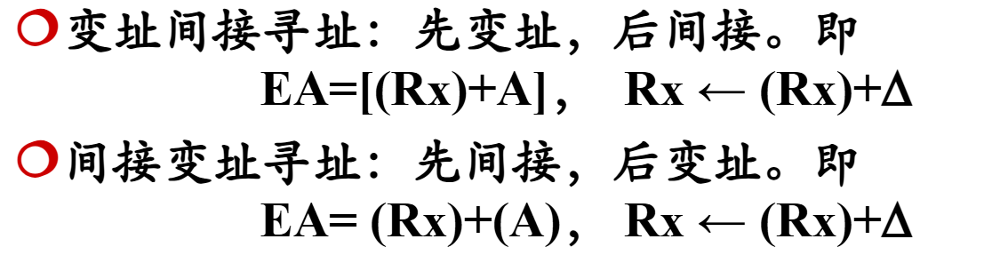

程序定位方式：程序中指令和数据的逻辑地址到物理地址的变换时间和实现方式

- 直接定位：直接用主存物理地址
- 静态定位：程序加载load到主存时，为指令和数据分配物理地址，loader完成
- 动态定位：程序执行时进行转换，采用基址寻址方式实现。虚存，分页这些