# 总线与输入输出系统

## 总线的分类

总线是连接多个部件之间的信息传输通路，是各部件间共享的传输介质

总线的主要组成：逻辑电路。一个部件发信息，一群部件都能收到

- 片内总线：连接芯片内部各部件的总线
  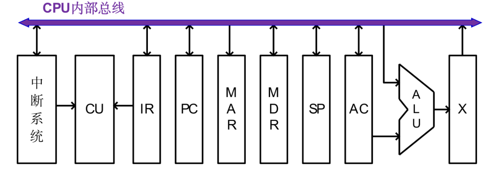

- **系统总线**：计算机单机系统内部各大部件间信息传输的公共通路
- 通信总线：计算机系统间或计算机与其他系统间的信息通路

按物理位置分：

- 板级总线：板内片间连线
- 板间总线：板间连线

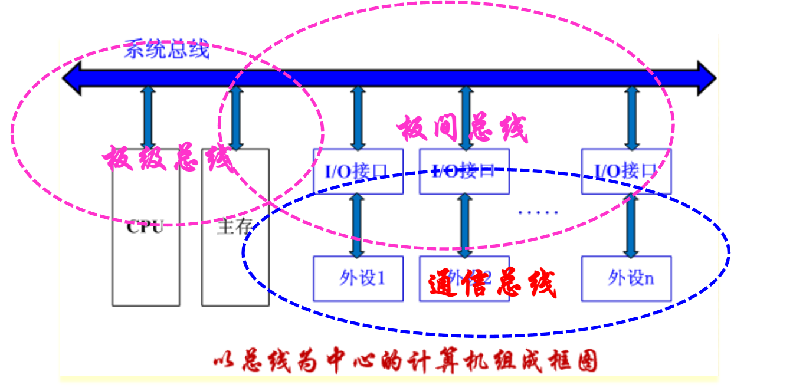

按传输信息分：

- **数据总线**：传输数据，双向传输线。数据总线宽度=机器字长
- **地址总线**：传输地址，单向传输线。地址总线宽度与存储单元数量有关
- **控制总线**：传输CPU发出的控制信号与其他部件发给CPU的状态反馈信号。控制总线给出的控制信号类型决定了系统总线所支持的控制方式以及通信方式

按传输方式分：

- **串行通信总线**：数据从低位开始按位传送。传输线少，适合远距离且速度要求不高场合
- **并行通信总线**：数据按字节或字同时传送。传输线多，适合近距离高速传送

## 总线管理和控制

部件通过三态控制逻辑与总线相连：控制一个时刻只有一个部件向总线上发送信息，同时减轻总线的负载。

总线控制方式：

- **集中式总线控制**：控制所需逻辑电路集中在一起
- 分布式总线控制：逻辑电路分散在与总线连接的各个功能部件或设备接口中

部件划分：

- **总线主模块**：具有申请、启动总线操作的部件，申请成功时主模块享有总线控制权。如CPU、DMA控制器、IO接口
- **总线从模块**：被动响应主模块发来的总线操作命令的部件，配合主模块完成一次总线传送操作。如主存。
  注：IO接口既可以是主模块也可以是从模块。一次总线操作只能由一个主模块，但可以有多个从模块

**总线仲裁机制**：

- 目的：当有多个主模块同时申请总线时，解决总线**控制权分配**问题
- 仲裁思路：为每个主模块按照其**工作速度**及**操作紧要程度**设置**优先级别**，同时总线控制器中设置仲裁机构。当多个主模块同时要求使用总线时，总线仲裁机构根据其优先级高低确定谁先获得总线控制权

判优方法：链式查询、计数器定时查询、独立请求

**链式查询**：通过一条判优链路（优先链）对每个主模块逐一串行查询，离总线控制器**物理连接最近**的部件优先权最高，反之最低。从最近的主模块开始查，如果有请求，通过相应信号卡断判优链路，结束后释放。

- **信号线**：BR（总线请求），BG（总线同意），BS（总线忙）。想用总线发BR，BG从最近的开始查，查询到了卡断BG，发BS。
- 优点：信号线少，结构简单，易于扩充
- 缺点：查询速度慢，对故障敏感，优先级不变灵活性差，优先级低的模块starvation

**计数器定时查询**：总线控制器中设一个计数器用作查询，由计数器决定优先级。查询开始，计数器计数，每计一次数，就将计数值作为模块地址发往各个主模块，申请总线的主模块对地址进行识别，地址符合的模块获得总线控制权。从0开始，从上一次查询终止点计数，优先级可循环可改变

- 优点：优先级设置灵活，故障不那么敏感
- 缺点：控制线增加模块地址线，复杂，开销大

**独立请求**：每个主模块专门有一根BR和BG，各自通过独立请求线向总线控制器发请求。总线控制器设并行排队电路，接收请求排队判优，通过各自独立的回答线发出同意信号BG。

- 特点：响应速度快，开销最大

**总线通信方式**（定时方式）：一次总线传输操作涉及多个部件，由于各部件的处理速度不同，所以需要进行时间上的协调，所采用的协调方式称为总线定时方式或总线通信方式。

- **申请分配阶段**：主模块申请，控制器判优，分配总线控制权
- **寻址阶段**：主模块获得总线控制权，通过总线向从模块发地址，发命令，启动从模块工作
- **传送阶段**：主从模块通过总线进行数据交换
- **结束阶段**：主模块撤除发在总线上的信号，让出总线使用权

**总线周期**：一次完整的总线传送操作所需时间。基本类型：内存读、内存写、外设读、外设写

- 正常总线周期：一次地址传送时间+一次数据传送时间
- BURST猝发总线周期：一次地址传送时间+多次数据传送时间

总线的等待状态：正常总线周期中，若由于被读写的部件速度慢，一次数据时间内不能完成读写操作，就要增加一个或多个数据时间，增加的时间被称为总线的等待状态

读操作：从模块发送，主模块接收。从主模块角度看是读入。（CPU读写主存，叫主存读写）

写操作：主模块发送，从模块接收，即从主模块的角度看是向对方写。（CPU对IO读写，叫外设读写）

通信方式：

**同步通信**：通信双方使用统一的时钟信号控制数据的传送过程。按最慢模块、最长距离安排时钟周期时间。
特点：控制简单，灵活性差，适用于短距离、各部件速度接近场合

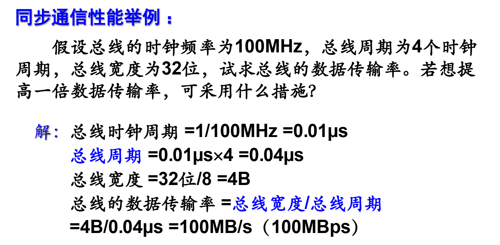

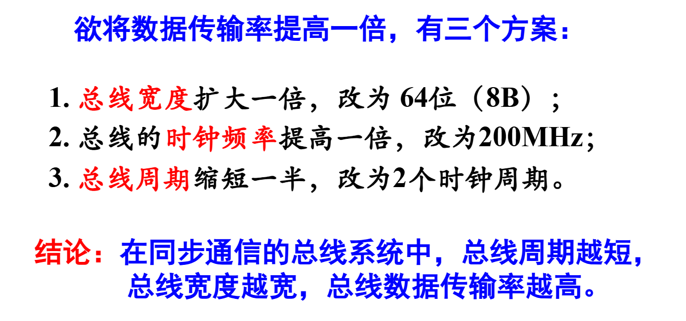

**异步通信**：与同步通信完全对立的通信方式，通信双方无统一时钟标准控制数据传送，各部件按各自所需实际时间使用总线。主从部件用**应答**方式建立联系，主从模块间**增加两条应答信号线**。
特点：总线周期长短可随主从模块的实际工作时间变化，效率高，但控制复杂
根据**应答信号配合的完善程度**分为三类：（其实类似TCP三次握手）

- **不互锁方式**：应答方式不完善。主模块向从模块发出请求，不等待从模块回答，一段时间后默认从模块已收到请求，并自动撤销请求。从模块接到请求后，条件允许时向主模块发出回答信号，但不要求主模块在收到回答信号后发出确认信号，而是经过一段时间后自动撤销回答信号。（client发syn）
  问题：单方面应答，无相互制约机制，可靠性差
- **半互锁方式**：主模块发出请求后等到接收从模块应答才撤销请求信号，从模块和不互锁一样。（client发syn，server发ack）
- **全互锁方式**：最完善。主模块发出请求后等到从模块回答才撤销请求，从模块向主模块发出回答后等到请求撤销才撤销回答。（完整的三次握手）

**半同步通信**：以同步通信为基础，设立系统时钟对总线操作进行控制。对少数慢速部件根据需要插入若干等待时钟，延长总线周期。
增加一条**“等待”状态信号线WAIT**，控制是否进入等待时钟周期。
特点：实用性强，工作效率没异步高，适用于工作速度不高，部件速度差异较大的简单系统

**分离式通信**：将一个总线周期分为两个子周期。
第一个子周期：主模块获得总线使用权，给从模块发地址、命令、读写信息，并发自己的地址。从模块接收后主模块立刻释放。从模块接到信息后进行传送准备工作。
第二个子周期：从模块准备完成后申请总线，获得总线使用权后通过总线向主模块发地址、数据以及自己的地址，释放总线。

## 总线结构和标准

总线结构分为单总线结构和多总线结构。

**单总线结构**：一条总线包含数据、地址、控制总线。
优点：结构简单、成本低、易于扩充
缺点：各部件只能分时使用总线，运行效率低

**双总线结构**：

- 以CPU为中心：CPU与主存间可快速交换信息，但IO设备与主存不能直接交换信息

  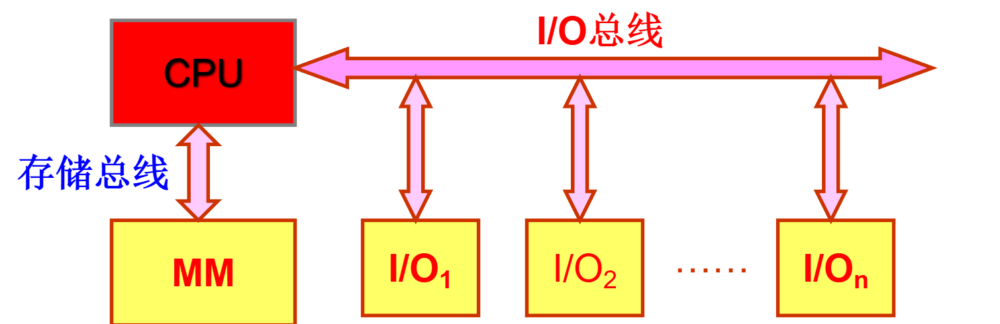

- 以存储器为中心：CPU和IO都能跟主存交换信息，但不能同时访存

  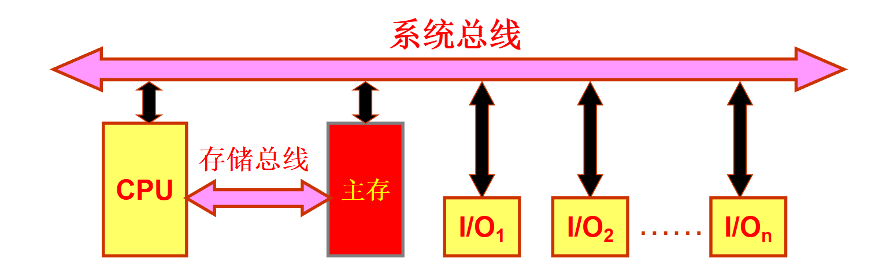

**三总线结构**：以CPU为中心的双总线结构基础上加一条DMA总线：

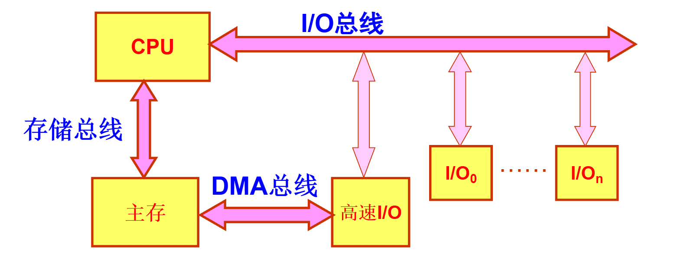

总线结构对性能的影响：总线越多，系统并行性越好，效率越高，但结构复杂造价高；总线越少，越强调分时调用总线，效率低，但结构简单成本低

总线标准：使不同产品有良好的兼容性和互换性

总线特性：

- 机械特性
- 电器特性
- 功能特性
- 时间特性：时序关系图

总线性能指标：

- 总线宽度：数据总线的位数，以bit为单位
- 总线工作频率：时钟频率，MHz
- 总线带宽：单位时间内在总线上可以传输的数据量，单位MBps。总线带宽=总线工作频率×总线宽度
- 控制方式：集中式/分散式
- 通信方式：同步/异步
- 信号线数：总线中各类信号线的总根数，总线复用可以减少信号线数
- 负载能力：可扩增电路板的数量
- 扩展能力：总线宽度是否可扩展

## 输入输出系统

输入输出系统（I/O系统）：计算机系统中完成输入/输出功能的子系统

由IO硬件和IO软件组成。

- IO硬件：所有IO设备及其接口电路组成
- IO软件：用IO指令编制的、对IO接口及设备进行管理和访问的程序，称为IO驱动程序

IO地址：CPU访问IO设备是给每台设备分配特定编号来识别的

编址方式：

- IO与内存统一编址（Memory-mapped IO）：IO地址采用与主存单元地址完全一样的格式，IO设备的地址叫总线空间。
- IO独立编址（Port-mapped IO）：为IO设备安排一套设备码，与主存独立，需要通过专门的IO指令来访问

IO指令：

- 隐式IO指令：在Memory-mapped IO中，所有具有访存功能的指令都可以访问IO，不设置专门IO指令
- 显式IO指令：Port-mapped IO中专门的指令，如汇编in，out指令

IO寻址过程：由IO指令给出要访问的IO地址，通过地址总线发往IO接口，接口中设备选择电路进行识别，若地址符合即选中

## IO设备

外设的基本组成：

- 设备控制器controller：用来控制设备的具体动作，由电子线路实现（连接device driver）
- 设备物理结构

外设的分类：

- 人机交互设备：键盘鼠标打印机显示器
- 信息驻留设备：磁盘磁带光盘
- 机-机通信设备：实现计算机系统间通信的设备，如调制解调器，D/A，A/D转换设备等

键盘：

- 盘面
- 键开关（有触点式、无触点式）：将按键动作转变为电信号
- 内部结构：
  - 矩阵排列：n×m矩阵，行列交叉点放置键开关
  - 扫描方式：无编码键盘通过软件对键盘定期扫描，由程序查表编码；编码键盘由硬件确认并自动产生相应编码

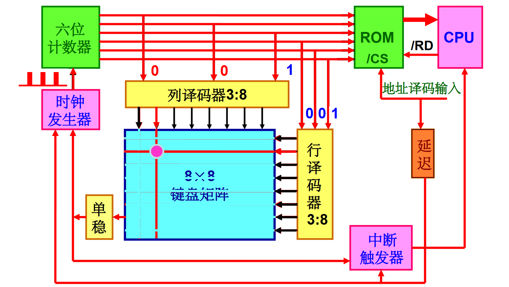

显示器：以可见光形式处理和输出信息，信息无法永久保存，称为软拷贝输出设备

分类：

- 按显示器件：阴极射线管CRT显示器、液晶LCD显示器、等离子PDP显示器
- 按显示内容：字符显示器、图形显示器、图像显示器
- 按显示功能：普通显示器、显示终端
- 按扫描方式：光栅扫描、随机扫描
- 按分辨率：高分辨率、低分辨率

CRT显示器：

技术指标：

- **分辨率**：显示器所能表示的像素个数
- **像素**：显示的亮点，越密分辨率越高。
  分辨率=行像素数×列像素数
- 灰度级：黑白显示器显示像素点的亮暗级差，彩色显示器显示像素点的颜色种类

扫描方式：

- 随机扫描：不必扫描全屏幕，图像清晰，速度快，复杂，有闪烁感
- 光栅扫描：周期扫描全屏，CRT和电视采用，质量不高

光栅扫描的技术支持：

- 刷新：为了使人眼能够看到稳定的图像，电子束必须在屏幕上的图像消失前周期性地对屏幕重复进行扫描，大于30Hz
- 刷新存储器VRAM：把瞬时变化的图像信号保存在一个存储器中

**CRT字符显示器**：由监视器和显示控制器组成。

- 显示原理：点阵法显示，M×N点阵组成一个字符

- **显示存储器VRAM**：存放一屏字符的ASCII码信息，最小容量等于一屏字符个数。每个单元地址与屏幕上字符窗口的位置一一对应

  VRAM地址=字符所在行号×一行字符数+列号（就是二维数组）
  高位地址：行号；低位地址：列号

- **字符发生器ROM**：把字符点阵用二进制编码矩阵表示存入ROM中，显示时读出。
  高位地址：VRAM读出字符ASCII码；低位地址：行号

- 显示定时控制：提供CRT屏幕刷新过程中的定时信号

  - 点振荡器：产生点时钟，控制视频信号输出
  - 点计数器：产生字符时钟，控制移位寄存器加载
  - 字计数器：产生行时钟，控制水平消隐和水平同步
  - 行计数器：产生排时钟，计数值做ROM低位地址（行号），控制字符行间隔消隐
  - 排计数器：计数值做VRAM高位（行号），并控制垂直回扫和垂直同步

抽象小题目：

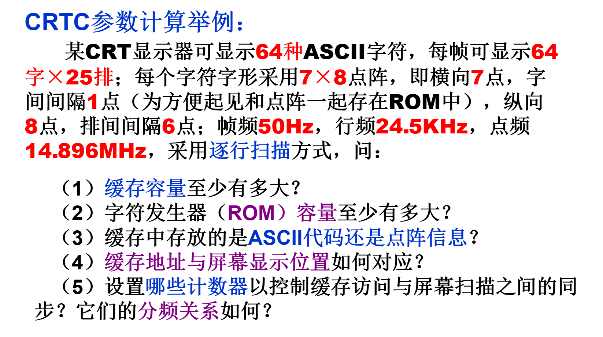

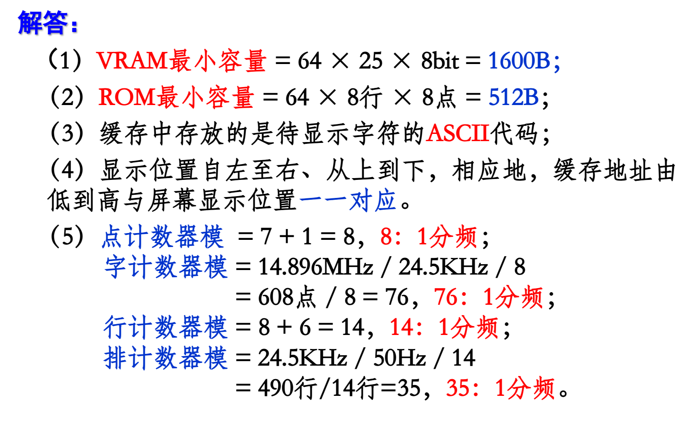

打印机：永久性记忆，硬拷贝

点阵针式：结构与显示控制器相似，包括打印缓存RAM、字符发生器ROM、定时控制与接口等

## IO接口

IO接口：CPU与IO设备间的连接部件

接口的作用：

- 设置数据缓冲实现CPU与IO间的速度匹配
- 通过转换电路实现CPU与IO间的数据格式转换
- 通过点评匹配实现CPU与IO间的电气转换
- 通过接收与传达控制命令实现CPU对IO的查询
- 通过保存与传送IO状态实现CPU对IO的查询
- 通过设备选择电路向CPU提供IO寻址功能

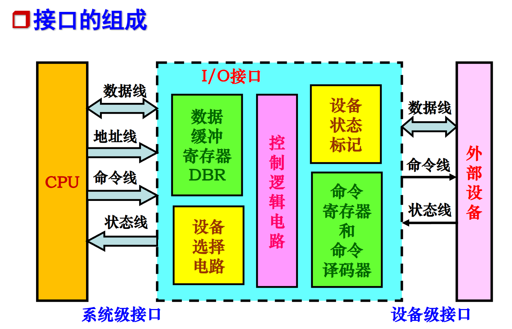

接口的通信方式：

- 与主机通过总线连接
- 数据传送：并行/串行
- 通信方式：同步/异步

## IO数据传送控制方式

**程序查询方式（polling）**：再现性程序中加入一段由IO指令编制的程序来完成IO数据交换，交换结束后继续执行现行程序

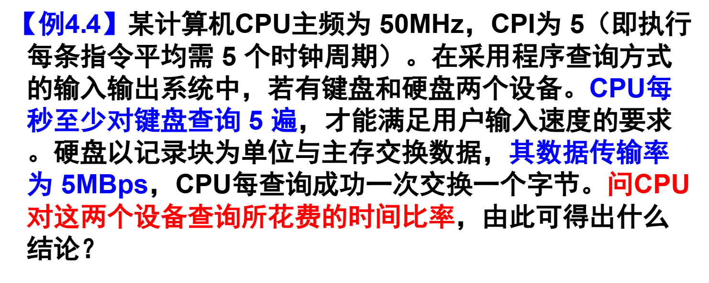

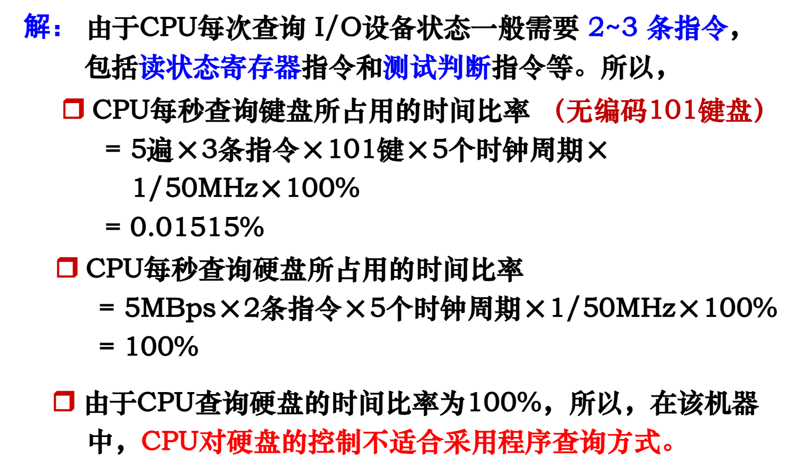

**程序中断方式（interrupt-driven）**：

**中断**：计算机在执行程序的过程中出现某种**非预期的紧急事件**，引起CPU**暂停**现行程序的执行，转去处理此事件，处理完后又返回现行程序执行的过程。

中断技术：软硬件结合

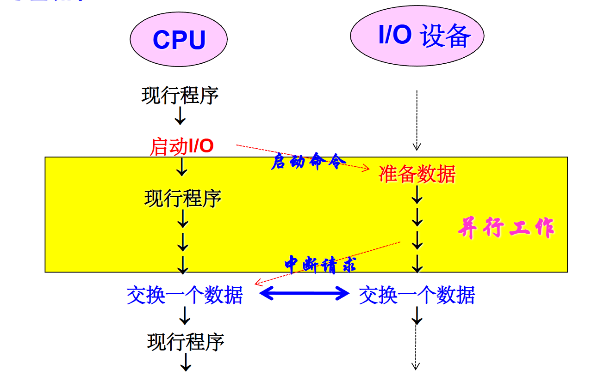

过程：中断请求-中断判优-中断响应-中断服务-中断返回

- 中断请求：中断请求触发器INTR（向CPU提供持续稳定的请求信号）。中断屏蔽触发器MASK（使CPU根据情况来决定是否理睬某请求）
- 中断判优：当多个中断源同时请求时，按照优先级响应。可用硬件也可用软件，排队方法有串行排队、并行排队
- 中断响应：中断允许触发器EINT（使CPU具有响应或不响应中断的选择）。
  响应时刻：每条指令的执行末。
  操作：关中断，保护程序断点和PSW，获得中断服务程序入口地址（软件查询法、硬件向量法）
- 中断服务：保护现场、中断处理、恢复现场
- 中断返回：现行程序断点和PSW出栈，开中断

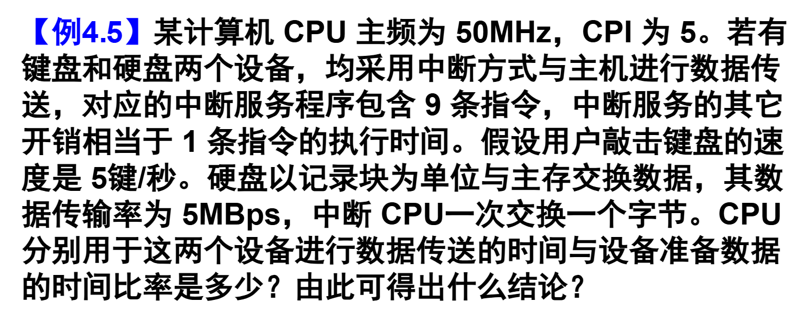

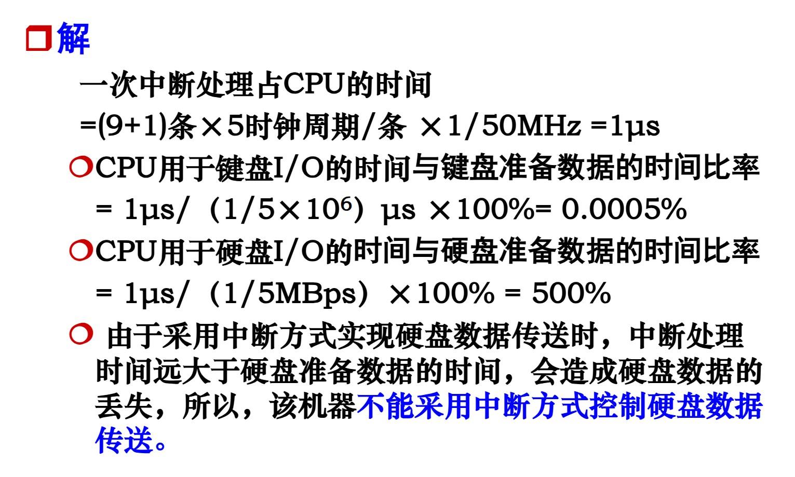

多重中断：

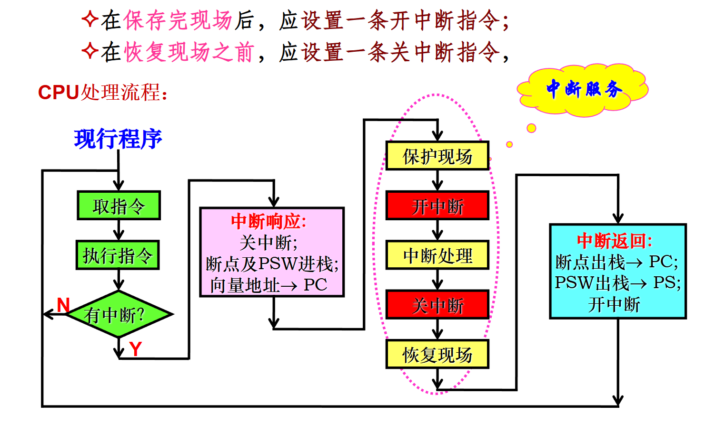

中断嵌套：只允许优先级别低的中断嵌套优先级别高的中断

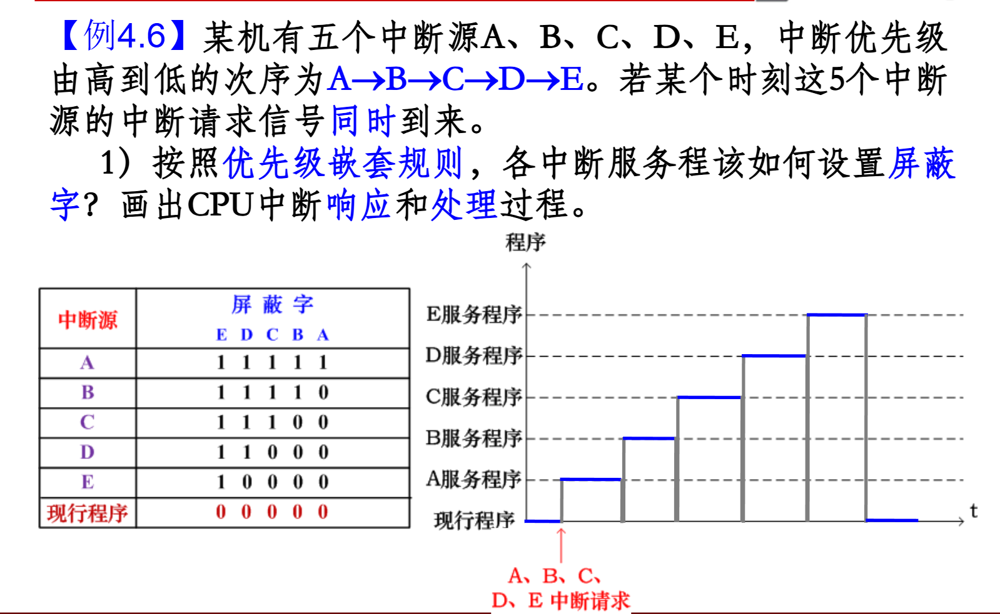

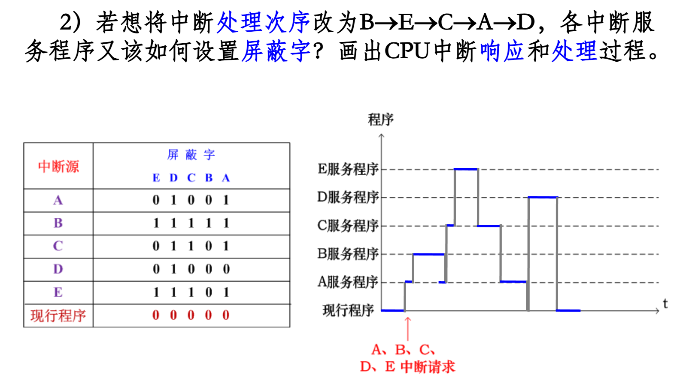

**DMA方式（Direct Memory Access）**：直接存储器访问，在IO设备和主存间进行直接、自动、成批数据传送，减少CPU干预的IO控制方式，由DMA控制器完成IO控制和管理

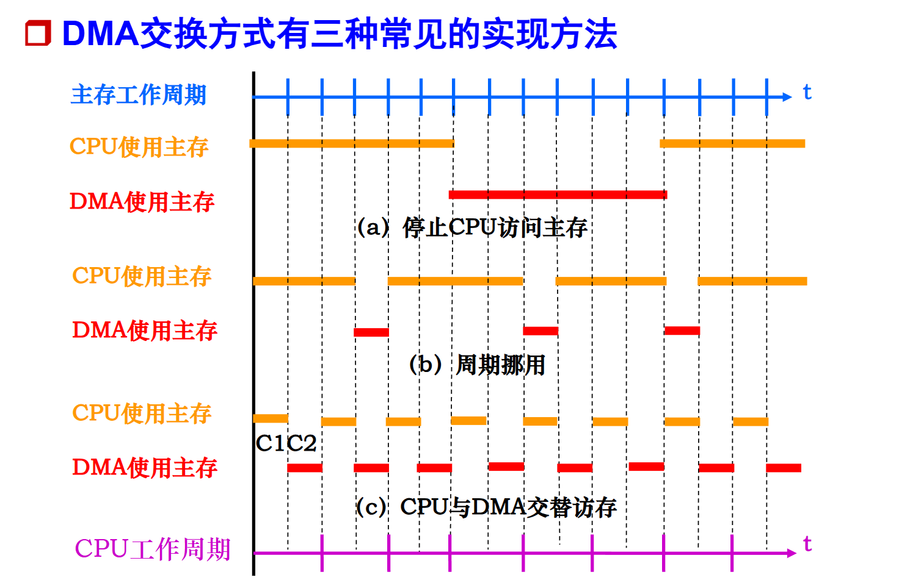

DMA工作流程：一次完整的DMA传送过程分为**预处理、传送、后处理**三个阶段，分别由**程序控制、周期窃取、程序中断**三种技术完成。

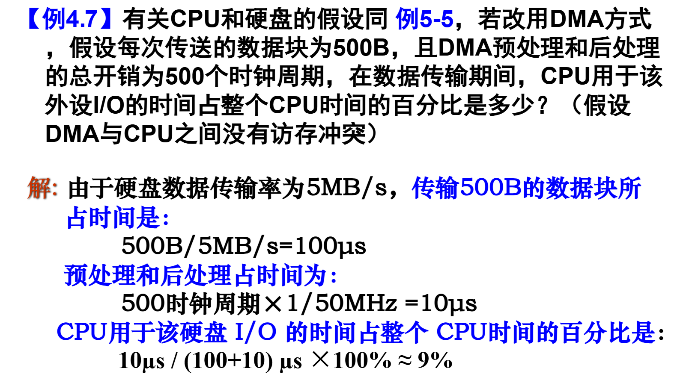

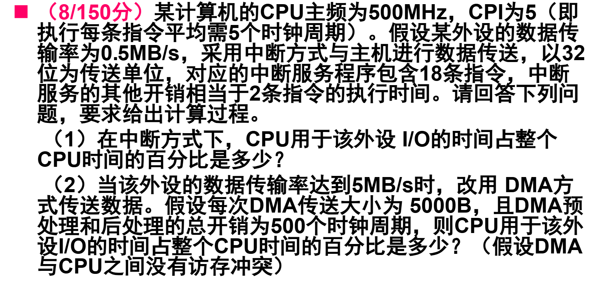

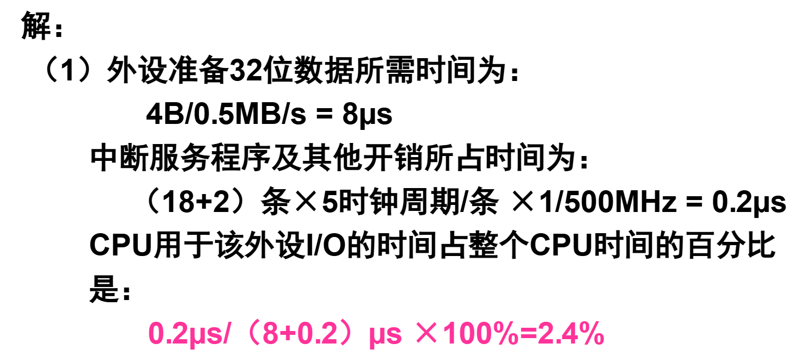

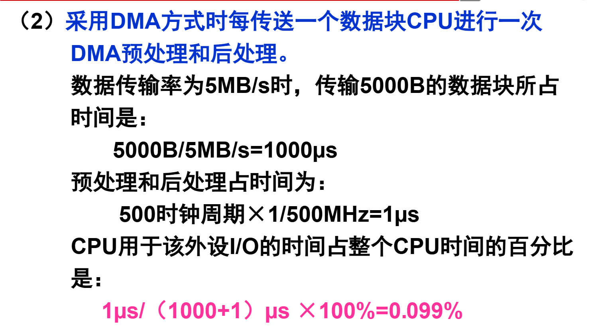