# 中央处理器（CPU）

[TOC]

## CPU的功能和组成

CPU是计算机中执行程序的部件，功能：顺序控制、操作控制、时间控制、数据加工、中断控制

CPU由运算器和控制器组成，基本功能部件：ALU、寄存器组、内部总线、终端系统、控制单元CU

CPU分为两个互相关联的部分：数据通路和控制单元
**数据通路**：CPU中全部执行部件的组合，包含了寄存器、ALU和中断处理子系统、存储器等，是指令执行的基础
**控制单元**：计算机的指挥系统，产生计算机运行所需要的全部控制命令

微操作：计算机中最基本的不可再分解的操作，如逻辑线路的开关，寄存器数据存入，ALU基本运算等
	微命令：执行微操作所需要的控制信号。微命令控制微操作的进行。

## CPU的设计方法

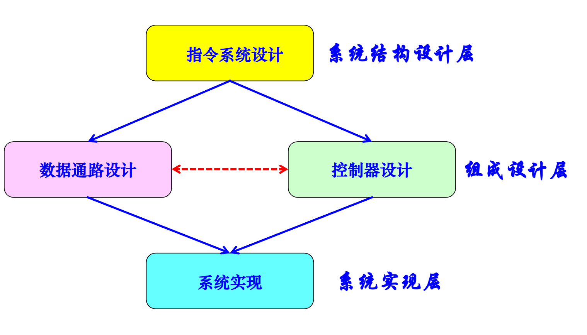

寄存器传输语言RTL：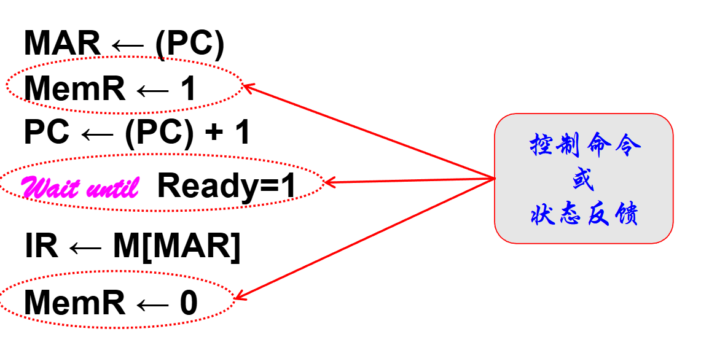

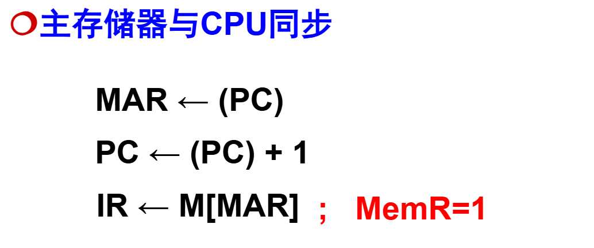

将微操作需要的微命令信号列在微操作后，用分号隔开。

## CPU数据通路的结构和组成

指令周期：

- 取指令：将一条指令从主存取出送到CPU。将程序计数器PC的内容作为地址读取主存内容，将取出的指令存入指令寄存器IR，修正PC使其指向下一条指令
- 指令译码：分析指令的操作码与寻址特征，以确定指令在干什么
- 读取数据：将指令要处理的源操作数读到CPU。RR指令源操作数在通用寄存器，RS指令源操作数在通用寄存器或存储器中，存储器地址寄存器MAR放存储器地址，存储器数据寄存器MDR放存储器数据。
- 执行操作：完成指令的具体功能（通过ALU、移位寄存器、PC等）
- 存放结果：保存处理后的数据（目的操作数）。RR型放在通用寄存器，RS型放在通用寄存器或存储器中

基本部件：

- 寄存器：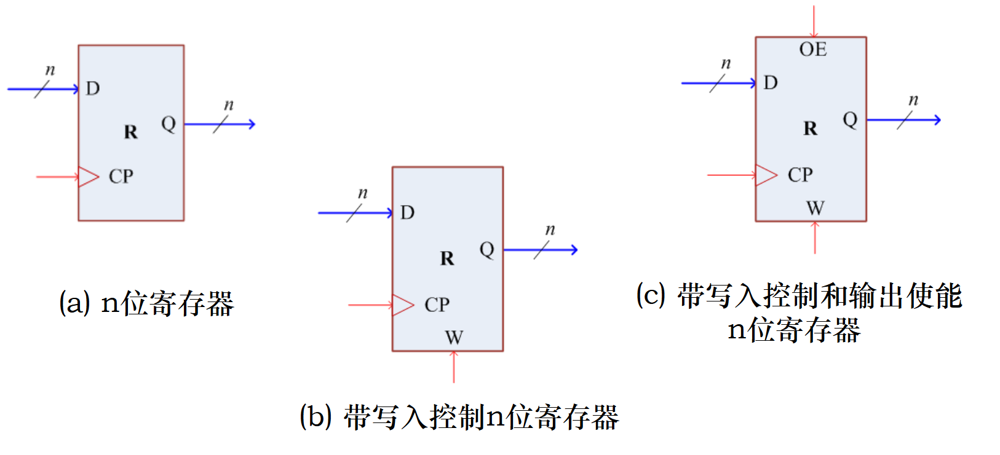
- 通用寄存器组（RF）：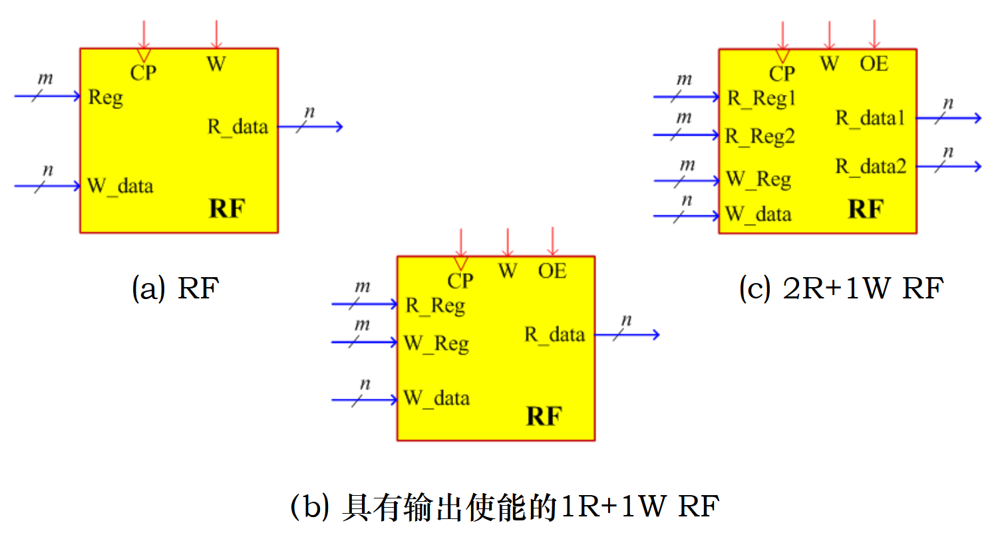
- ALU：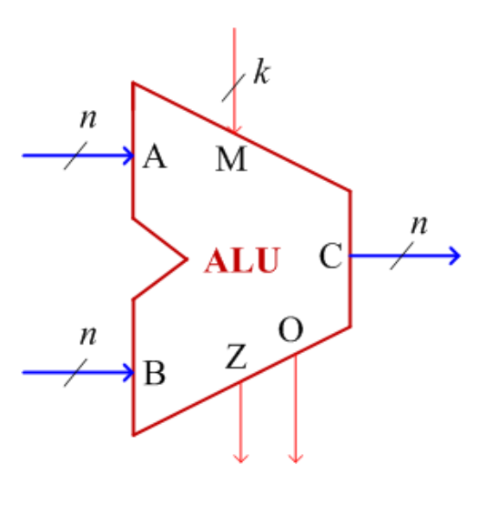
- 多路选择器（MUX）：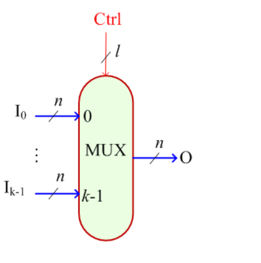
- 三态控制器：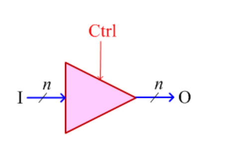

CPU结构分类：

- 单周期CPU：指令周期仅包含一个时钟周期
- 多周期CPU：一个指令周期包含多个较短的时钟周期
- 流水线CPU：数据通路类似单周期，时序控制类似多周期，多条指令在数据通路上重叠执行

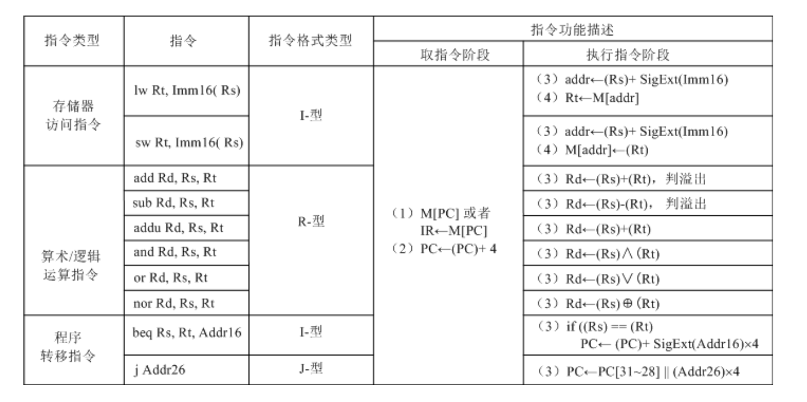

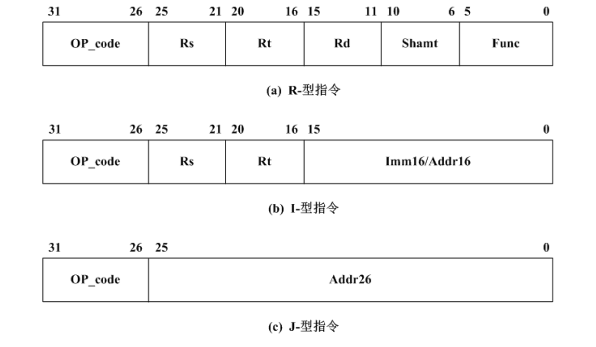

## 中断系统

中断源：人为设置的中断、程序性异常、IO设备、硬件故障

中断系统由中断软件、中断硬件构成

响应中断的条件：CPU允许中断EINT=1、有中断请求INTR

响应中断的时间：指令周期结束后（CPU现行程序现场最简单、最稳定）

识别中断源：外部由中断控制器完成，内部通过不同条件判断逻辑实现

中断判优：软件法（CPU执行一段程序进行查询）、硬件法（并行判优逻辑）

中断响应：关中断；保护程序断点；获得中断服务程序入口地址，为PC赋予新的值

MIPS中的异常：异常程序计数器EPC，保存出错指令地址；原因寄存器Cause，记录中断原因；异常后转移OS

## 单周期CPU数据通路

**特点：部件冗余**

基本组成：

- 指令存储器IM：存放指令，执行读操作
- 数据存储器DM：存放数据，执行读写操作
- 程序计数器PC：存放即将执行指令的地址
- 寄存器组RF：临时存放数据或地址
- 算术逻辑单元ALU：执行数据或地址运算
- 加法器：对PC值进行修正

 控制单元采用分散式设计方案，组成：
主控制单元MCU: 发出各部件所需的控制信号，包括ALU操作类型
ALU控制单元ALUCU：根据ALU操作类型控制信号发出ALU具体操作控制信号

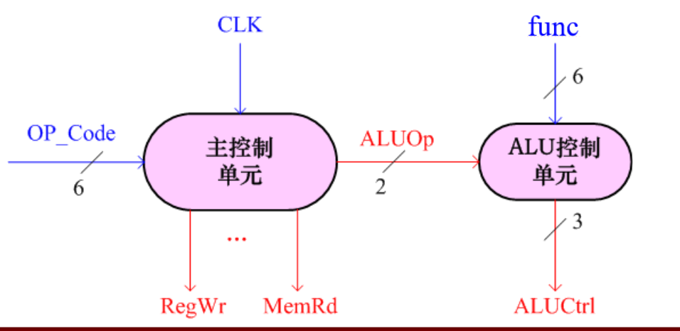

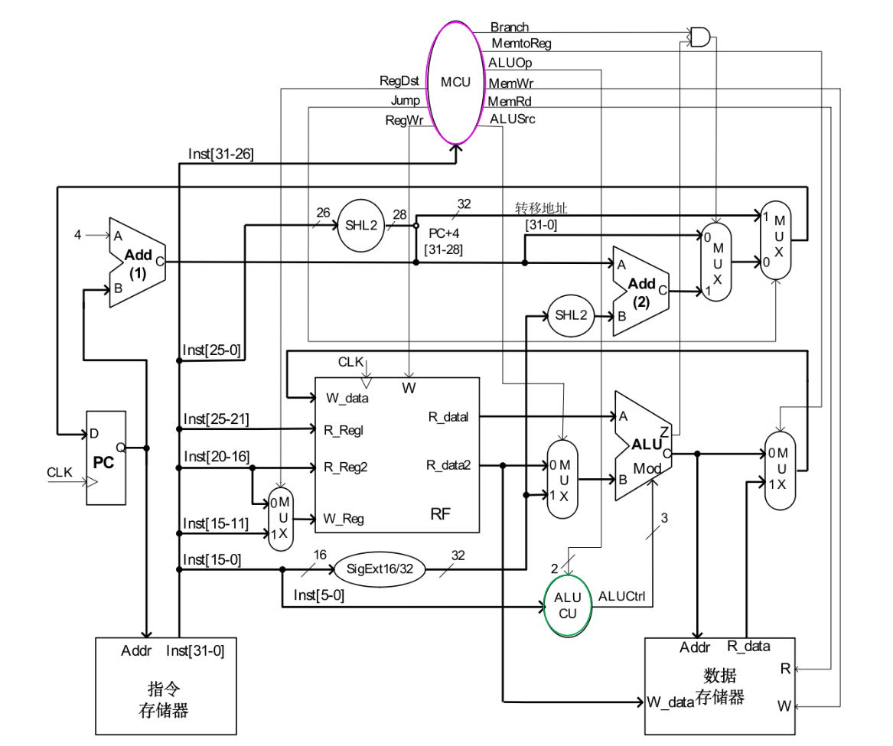

RTL相关部分看课本

指令周期：采用定长指令周期，由最长的指令执行时间决定，通常为load指令

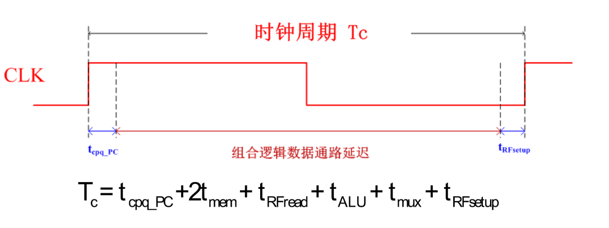

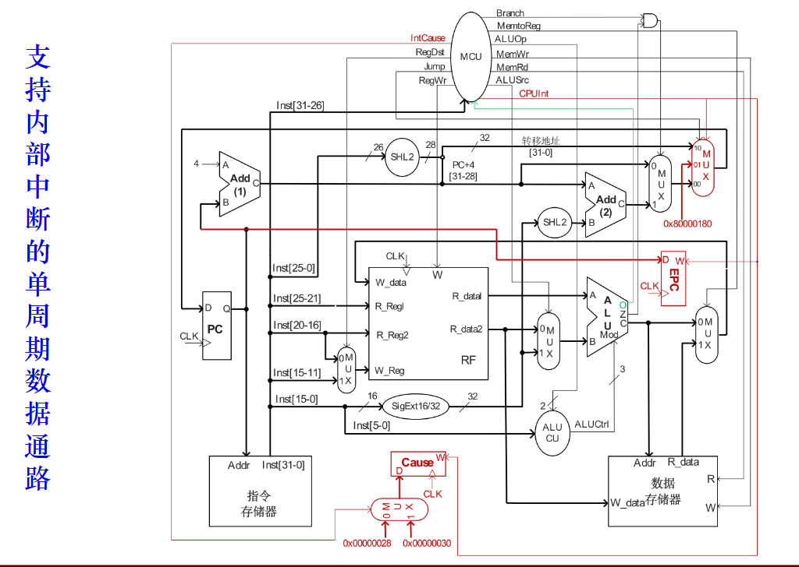

## 多周期数据通路

思想：把每条指令的执行过程划分成多个时间间隔大致相等的阶段，把每个阶段的微操作序列安排在一个时钟周期内完成，一个时钟周期内最多完成一次访存或者一次寄存器读写或者一次ALU操作。前一个时钟周期执行结果由下一个时钟信号的上升沿打入到相应的状态单元，时钟周期的宽度以最复杂操作阶段所用时间为基准，通常取一次存储器读写的时间，即**时钟周期等于主存读写周期**。

分类：

- **分散互连结构**：在单周期基础上，合并冗余处理单元，增加处理单元之间的临时寄存器
  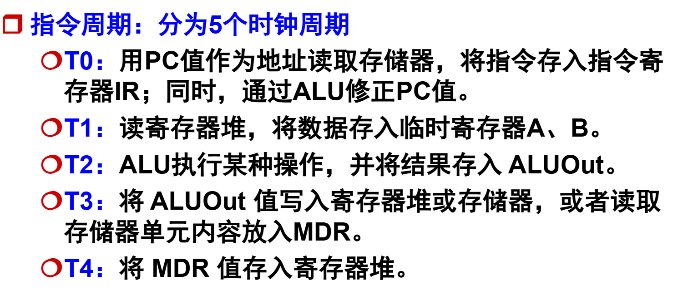
  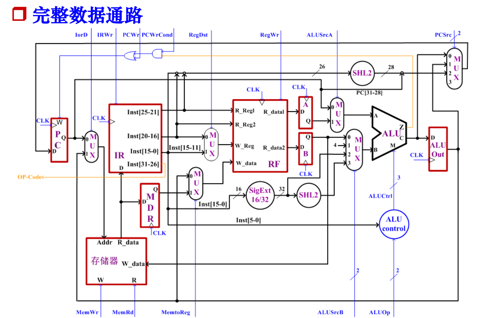
- **单总线互连结构：**用总线作为公共通路，并行性低，指令周期延长
  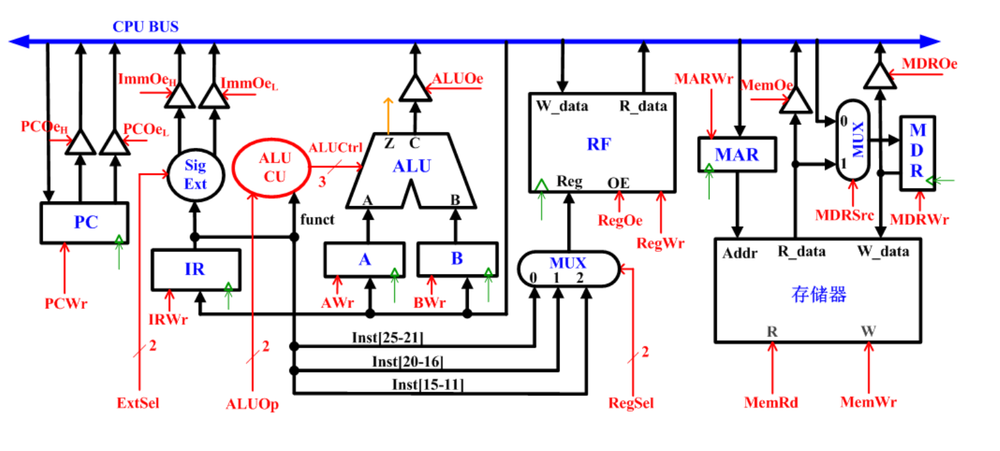
- **双/三总线结构：**构造并行总线，提高并行性
  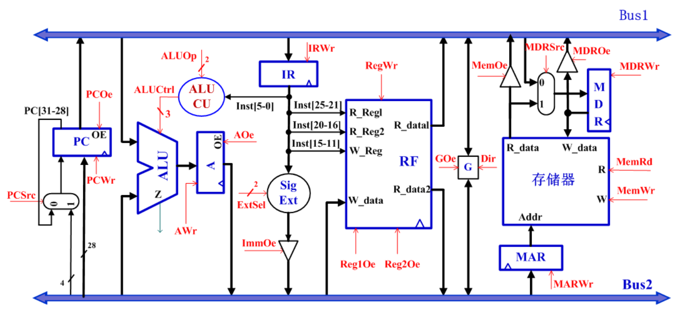

性能衡量标准：**CPI：指令周期中所包含的时钟周期数**。计算公式：
$$
\text{CPI}=\frac{\text{CPU时钟周期数}}{指令数}=\frac{\sum(指令数_i\times CPI_i)}{指令数}=\sum(\frac{指令数_i}{指令数}\times CPI_i)
$$
$指令数_i$：第i类指令在程序中出现的总条数

$指令数_i \over指令数$：第i类指令在程序中出现的频度

$CPI_i$：第i类指令的CPI

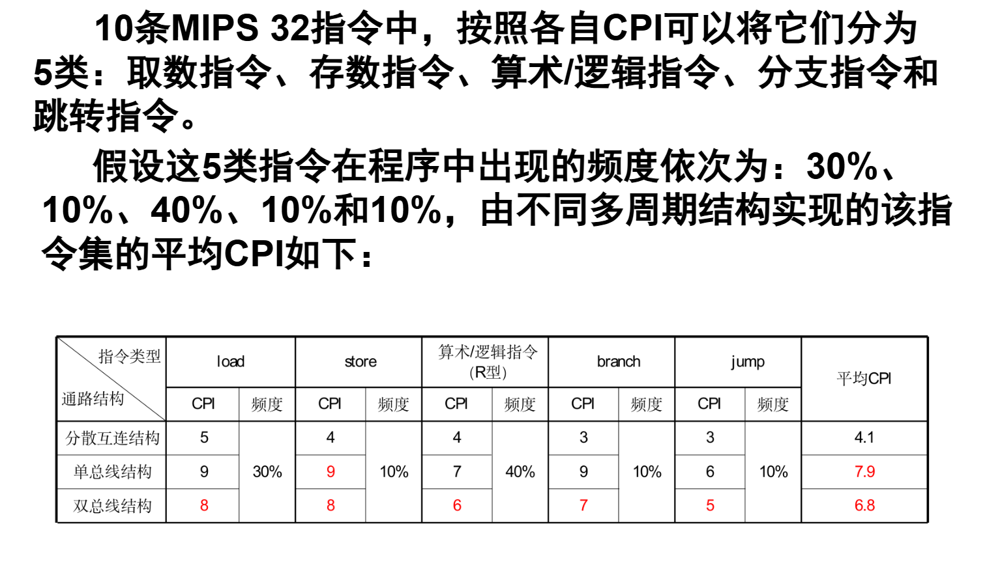

## 指令流水处理器

类似单周期，但重叠执行多条指令，效率更高。

**指令流水**：将指令的执行过程分为几个阶段，每个阶段由数据通路中不同操作部件执行，不同指令多个阶段在时间上重叠。

- 取指令FI（Fetch Instruction）：从指令存储器中读取指令
- 指令译码ID（Instruction Decode）：分析当前指令，同时读取寄存器
- 执行指令EX（Execute）：执行指令操作或计算地址
- 存储器访问MA（Memory Access）：对数据存储器进行读写操作
- 数据写回WB（Write Back）：将操作结果写回寄存器

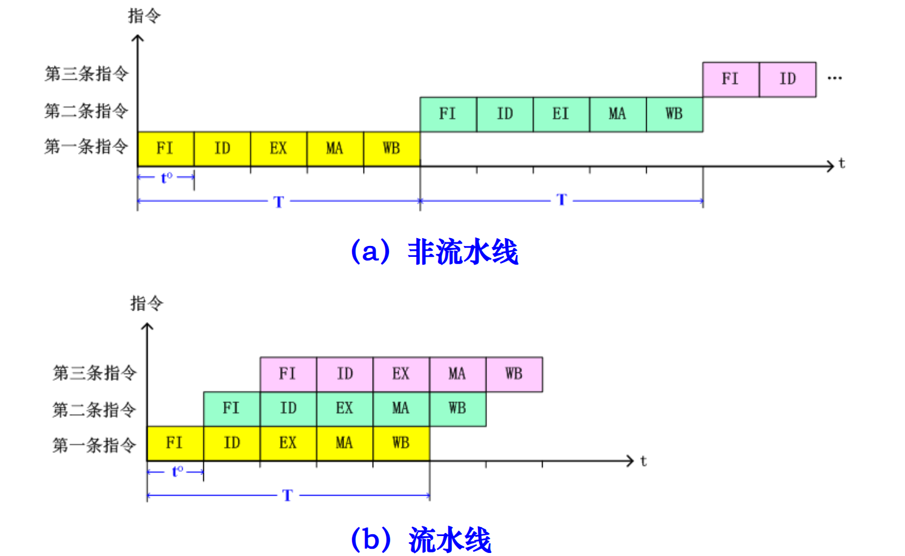

**流水线冒险（hazard）**：由于某些流水段不能正常工作而引起流水线停顿
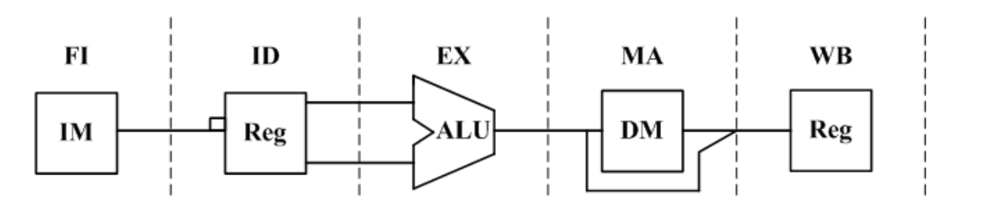

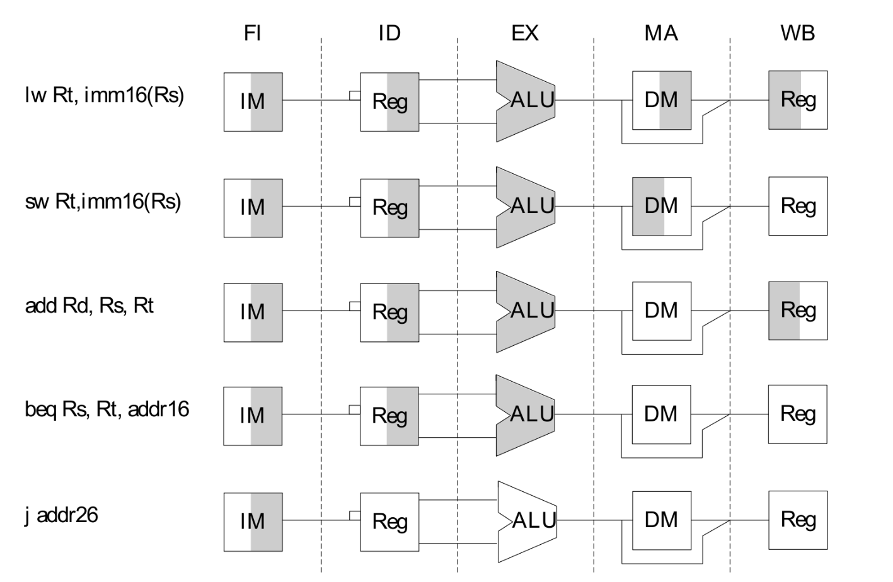

**结构冒险**：由于指令间竞争硬件资源引发。通过改进单周期避免（部件冗余）

**数据冒险**：生产数据的源指令和消费数据的目的指令重叠执行时，不能满足程序所要求的指令间数据处理的先后关系

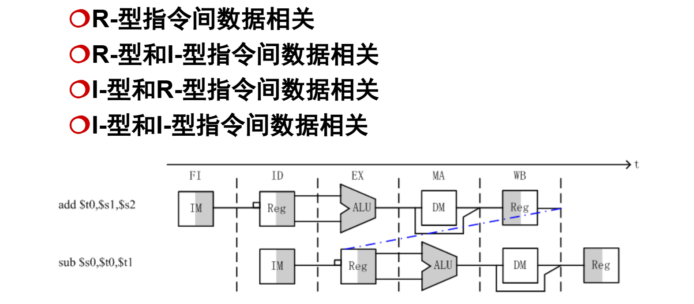

**控制冒险**：条件转移指令作出决定之前，其后续指令已经出现在流水线中

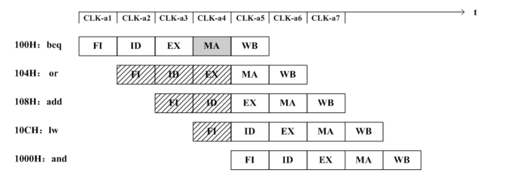

**流水线性能：**

- 吞吐率：单位时间内流水线所完成指令或输出结果的数量。
  最大吞吐率：在连续流动达到稳态后所获得的吞吐率：$TP_\max=\frac{1}{t^0}$
  实际吞吐率：流水线完成n条指令的实际吞吐率：$TP_a=\frac{n}{n+m+k-1}TP_\max$
  m段流水线，n条指令，各段时间均为$t^0$，第一条指令需要时间$mt^0$，之后每隔$t^0$输出一个结果，阻塞时间$kt^0$。当n>>m+k时，才会有$TP_a ≈TP_\max$

- 加速比：某程序以流水线执行的速度与等功能的非流水线执行的速度之比
  $$
  S=\frac{nm}{m+n-1}=\frac m {1+(m-1)/n}
  $$
  n>>m时，$S_\max ≈m$，即当流水线各段时间相等时，其最大加速比等于流水线段数

- 效率：流水线中各功能段部件的利用率
  $$
  E=\frac n {m+n-1}=\frac 1 m S=\text{TP}_p \cdot t^0
  $$
  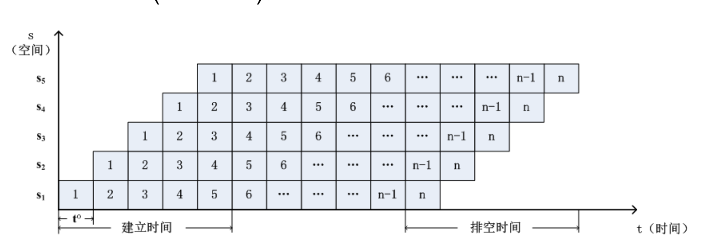

同步流水线一般结构：改造单周期

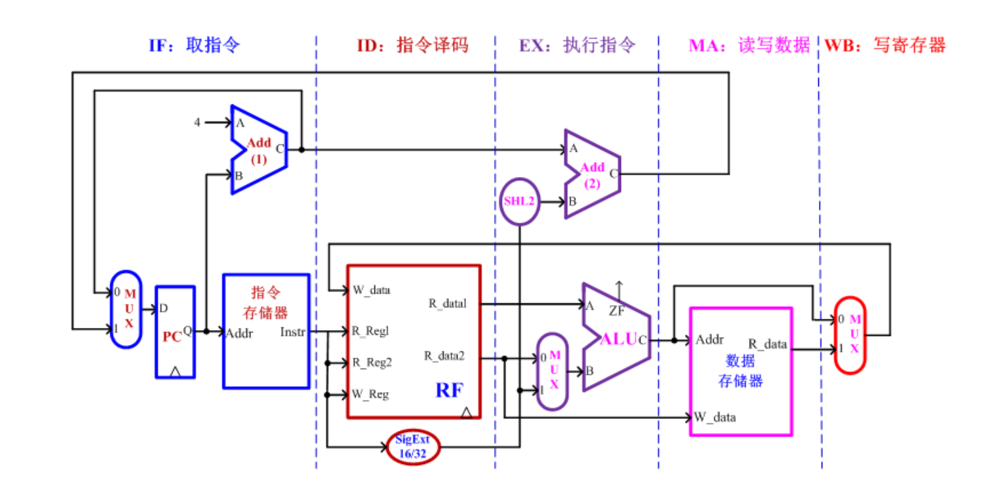

FI：取指令，加法器修正PC，写回

ID：控制器译码确定指令类型，从RF读数据

EX：由ALU对数据进行加工或计算，加法器计算转移地址

MA：DM读写数据

WB：数据写回RF

级间寄存器：使多条指令共享流水线数据通路，且保证流水线能够正确处理指令。

- FI/ID：
  - 指令寄存器IR：指令代码
  - 顺序程序计数器NPC1：顺序执行指令地址
- ID/EX：
  - 指令寄存器IR：指令代码
  - 顺序程序计数器NPC1：顺序执行指令地址
  - 源寄存器1Rs
  - 源寄存器2Rt
  - 立即数寄存器Imm32：16位扩展到32位立即数
- EX/MA：
  - 指令寄存器IR：指令代码
  - 源寄存器2Rt
  - 分支地址寄存器NPC2：分支指令的目的地址
  - 转移地址寄存器NPC3：转移指令的目的地址
  - ALU结果寄存器ALUOut：ALU执行结果
- MA/WB：
  - 指令寄存器IR：指令代码
  - ALU结果寄存器ALUOut：ALU执行结果
  - 数据存储器读出数据寄存器MEMOut：存储器数据

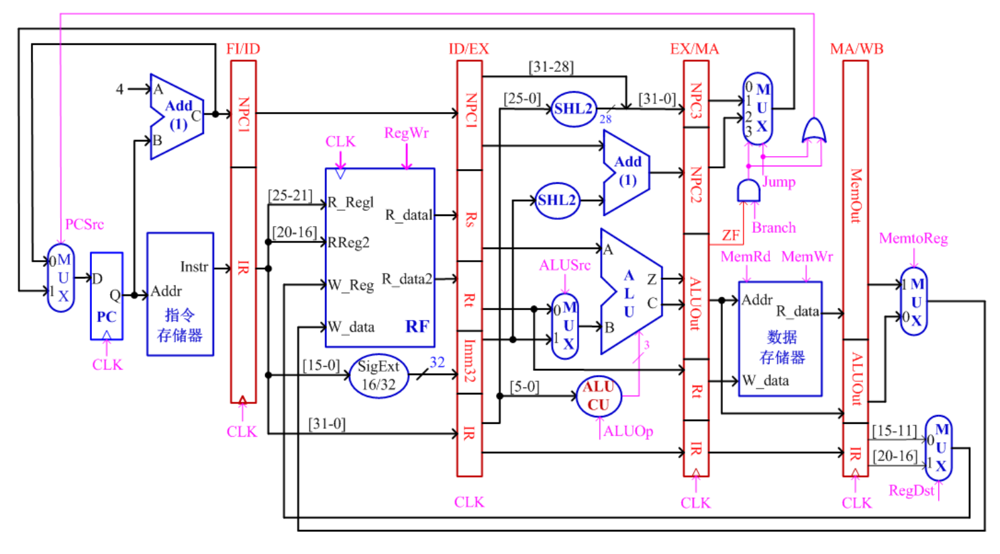

