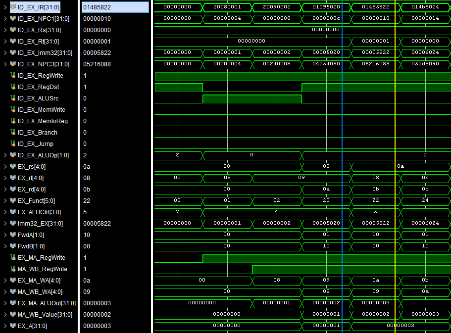
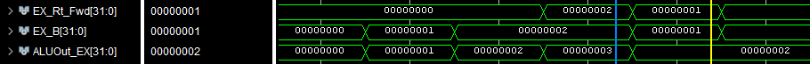
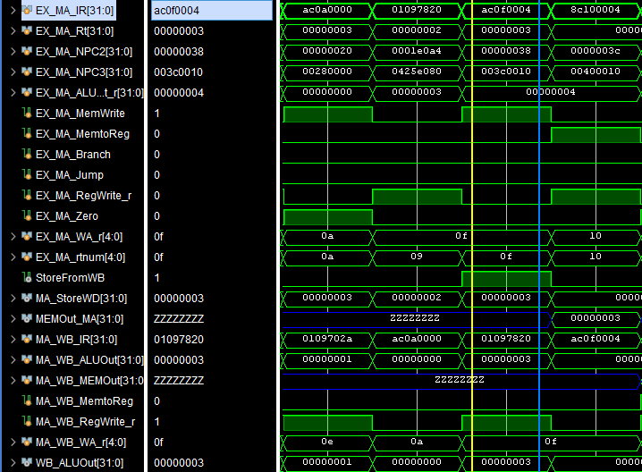
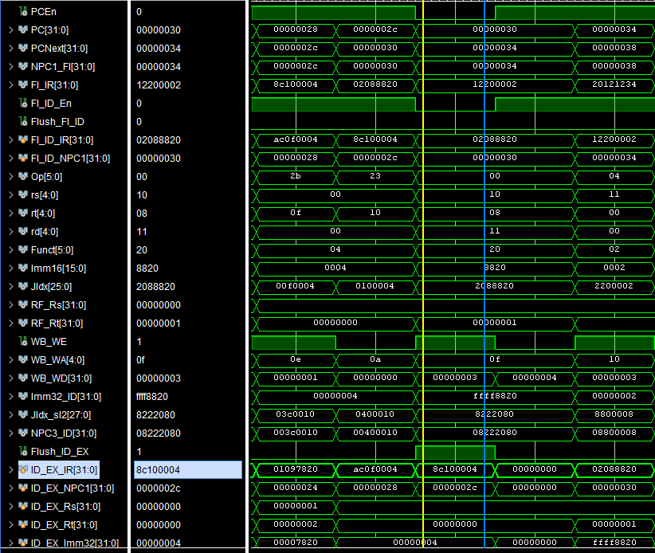
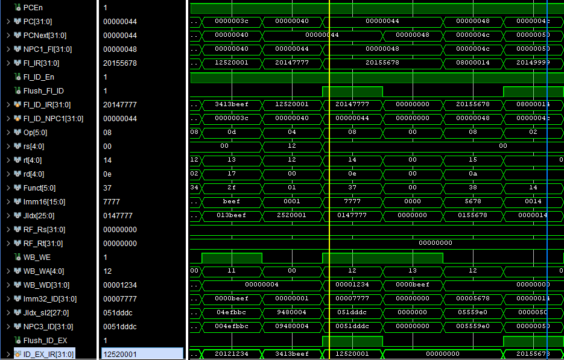
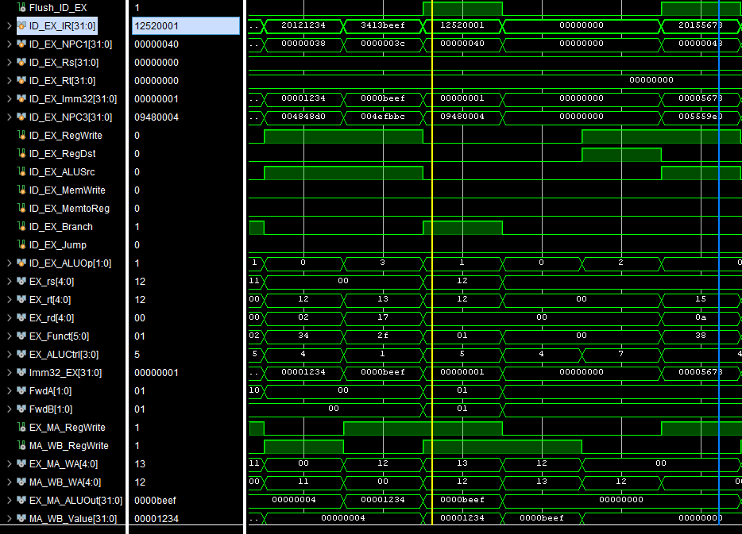
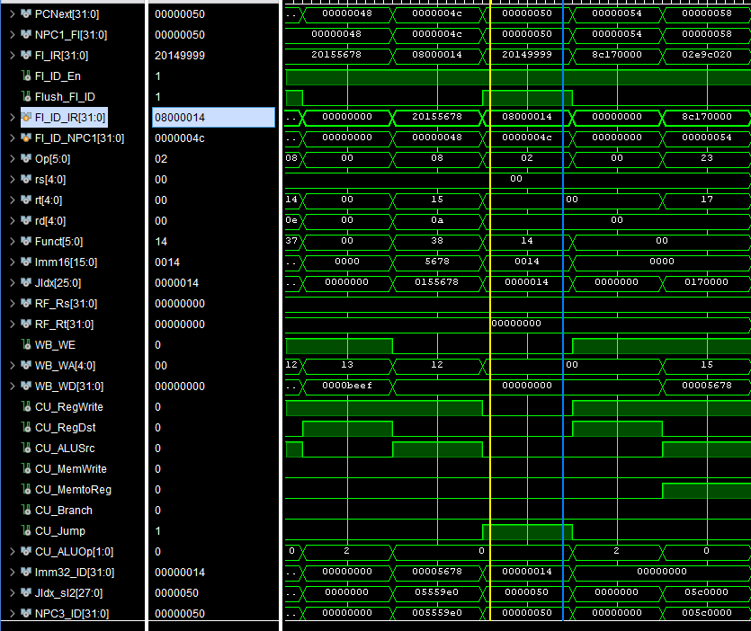

# 实验六    CPU综合设计

 

## 实验目的

1. 掌握复杂系统设计方法。

2. 深刻理解计算机系统硬件原理。

## 实验内容

1. 设计一个基于MIPS指令集的CPU，支持以下指令：{add, sub, addi, lw, sw, beq, j, nop}；

2. CPU需要包含寄存器组、RAM模块、ALU模块、指令译码模块；

3. 该CPU能运行基本的汇编指令；（D~C+）

​	以下为可选内容：

4. 实现多周期CPU（B-~B+）；

5. 实现以下高级功能之一（A-~A+）：

​	(1)实现5级流水线CPU；

​	(2)实现超标量；

​	(3)实现4路组相联缓存；

​	可基于RISC V 、ARM指令集实现。

**如发现代码为抄袭代码，成绩一律按不及格处理。**

## 实验要求

编写相应测试程序，完成所有指令测试。

## 实验代码及结果

在本实验中，我完成的内容是五级流水线CPU。在该部分，我会从思路、架构、代码等多方面阐述我的五级流水CPU的设计思想，并通过仿真代码来测试其结果。

###  设计要点

五级流水线 CPU 将数据通路划分为 FI、ID、EX、MA、WB五个阶段：

- 取指令FI（Fetch Instruction）：从指令存储器中读取指令
- 指令译码ID（Instruction Decode）：分析当前指令，同时读取寄存器
- 执行指令EX（Execute）：执行指令操作或计算地址
- 存储器访问MA（Memory Access）：对数据存储器进行读写操作
- 数据写回WB（Write Back）：将操作结果写回寄存器

流水化的核心是让不同指令在不同阶段并行执行，通过级间寄存器隔离各阶段的组合逻辑与数据，使每个时钟上升沿只推进一次阶段间交接，从而提高吞吐率。级间寄存器可以使多条指令共享流水线数据通路，且保证流水线能够正确处理指令：

- FI/ID：
  - 指令寄存器IR：指令代码
  - 顺序程序计数器NPC1：顺序执行指令地址
- ID/EX：
  - 指令寄存器IR：指令代码
  - 顺序程序计数器NPC1：顺序执行指令地址
  - 源寄存器1Rs
  - 源寄存器2Rt
  - 立即数寄存器Imm32：16位扩展到32位立即数
- EX/MA：
  - 指令寄存器IR：指令代码
  - 源寄存器2Rt
  - 分支地址寄存器NPC2：分支指令的目的地址
  - 转移地址寄存器NPC3：转移指令的目的地址
  - ALU结果寄存器ALUOut：ALU执行结果
- MA/WB：
  - 指令寄存器IR：指令代码
  - ALU结果寄存器ALUOut：ALU执行结果
  - 数据存储器读出数据寄存器MEMOut：存储器数据

对于五级流水CPU，需要重点关注三类冒险问题的解决：

1. 结构冒险：

   - 问题： 不同指令在同一拍可能争用同一硬件资源（例如取指与访存同时访问同一个存储器端口），导致流水线无法并行推进。

   - 解决方案**：** 采用资源分离与部件冗余的方式规避冲突。本设计将指令存储器 与数据存储器 分离，FI 阶段取指与 MA 阶段访存互不影响；同时顺序地址计算与分支目标地址计算由独立组合逻辑完成，从结构上避免单一加法器被多阶段竞争。

2. 数据冒险：

   - 问题： 后续指令需要使用前序指令尚未写回寄存器堆的结果，在流水线并行执行时会读到旧值。
   - 解决方案： 主要通过前递解决，并对前递无法覆盖的情况插入停顿。当后续指令需要使用前面指令的结果但尚未写回时，直接从流水线后段把结果送回 EX 阶段使用；而对 load 后立即使用这种结果产生较晚的情况，采用插入 bubble 让数据准备好后再继续执行。

3. 控制冒险：

   - 问题： 分支、跳转指令改变控制流，流水线在分支结果未确定前已按顺序取入后续指令，可能形成错路指令并产生错误写回或访存。
   - 解决方案： 默认按顺序取指，遇到分支、跳转确定改变 PC 后，通过flush 清空错路指令恢复正确控制流。分支在比较完成后若成立，就清除分支后已经进入流水线的错路指令；跳转则在确定目标地址后立即改向 PC，同时清空前段错误取入的指令，避免产生错误写回或访存。

### CPU结构介绍

在该部分，我将大致介绍代码中每个模块的功能、作用，理清它们之间的联系与结构。

- `PipelineCPU` ：顶层数据通路，通过使用其他模块的功能并组织五级流水线与级间寄存器，实现数据的传输、计算与指令的执行，建立五级流水CPU的基本结构。
- `ALU`：复用实验3中设计的ALU模块，实现基础的运算功能。
  - `ADD`：加法器。
  - `SUB`：减法器。
  - `SLL`：逻辑左移。
  - `SLT`：比较器。
- `ALUWrapper`：供顶层模块调用的接口，格式化ALU的输入输出，连接控制信号，在使用时更直观便捷。
- `ALUDec`：复用实验5中设计的ALU译码器，实现I型、R型指令，根据 `ALUOp` 与 `Funct` 生成运算控制信息，确定本条指令在执行级需要完成的具体运算类型。
- `ALUControlUnit`：在 `ALUDec` 的译码结果基础上进一步做格式转换，输出与 ALU 兼容的 `ALUControl`，供执行级直接调用。
- `ControlUnit / MainDec`：复用实验5中设计的主控制器，依据指令 `Opcode` 产生数据通路选择与写使能等控制信号（如 `RegWrite`、`MemWrite`、`MemtoReg`、`Branch`、`Jump`、`ALUSrc`、`RegDst`、`ALUOp` 等），并将这些控制信息随流水线逐级传递，从而驱动各阶段完成对应功能。
- `ProgramCounter / ProgramCounterEn`：维护 PC 作为取指地址来源，并在每个时钟沿更新为下一条指令地址；其中 `ProgramCounterEn` 在 `ProgramCounter` 基础上加入使能控制，用于在流水暂停时保持 PC 不变。
- `InstructionMemory / IMem`：取指存储器模块；`InstructionMemory` 负责地址到指令索引的转换与对齐，在实验4设计的`IMem` 基础上设计只读指令存储并输出对应指令字，作为 FI 阶段的指令来源。
- `RegFile`：复用实验4中设计的寄存器堆，提供两路组合读端口与一路同步写端口；在 ID 阶段读取源寄存器数据，在 WB 阶段按写使能将结果写回目的寄存器。
- `DataMemory / RAM_4Kx32`：数据存储器模块；`DataMemory` 作为对外接口，完成地址对齐与读写控制，内部调用实现4中设计的 `RAM_4Kx32` 实现 `lw/sw` 等访存指令在 MA 阶段的读写数据访问。
- `pipeline_lib`：将常用的扩展、移位、加法与多路选择功能封装为可复用组件，用于立即数处理、分支/跳转目标计算，以及各阶段关键数据通路的选择与拼接，降低顶层结构复杂度。
- `ForwardingUnitPipe`：数据前递控制模块，检测寄存器相关并产生前递选择，使执行级在不暂停流水的情况下优先使用来自后续级（如 EX/MA、MA/WB）的最新结果，解决典型 RAW 数据相关。
- `StoreForwardUnit`：针对 `store` 指令写数据的前递控制，确保当 `store` 的写数据来自前一条或更靠近写回级的结果时，MA 阶段写入内存的是最新值。
- `HazardUnit`：冒险检测与流水控制模块，负责 load-use 等无法仅靠前递解决的情况，通过对 PC 与前级寄存器的使能控制实现 stall，并在需要时对前级流水寄存器进行 flush 以消除控制相关带来的错误指令。

整体上，`PipelineCPU` 将取指、译码、执行、访存、写回拆分为五个阶段：PC 与取指存储器在 FI 提供指令流，FI/ID 将指令与 PC 信息交给 ID；主控制器与寄存器堆在 ID 产生控制并读出操作数，经 ID/EX 送入 EX，由 `ALUControlUnit` 配合 ALU 完成运算并结合前递/冒险控制处理相关性；执行结果进入 EX/MA 后在 MA 完成数据存储器访问，最终由 MA/WB 在 WB 选择写回数据并驱动 `RegFile` 写回，从而实现指令在流水线中的并行推进与正确执行。

### 流水线结构分析

在该部分，我将针对`PipelineCPU`模块，介绍整个流水线的工作流程。以下是代码部分：

```verilog
`timescale 1ns/1ps

module PipelineCPU(
    input wire clk,
    input wire rst
);
    // ============================================================
    // FI: Fetch Instruction (取指，PC+4 修正)
    // ============================================================
    wire        PCEn;
    wire [31:0] PC, PCNext, NPC1_FI;     // NPC1 = PC + 4
    wire [31:0] FI_IR;                   // FI stage instruction

    add32 u_add_npc1(.a(PC), .b(32'd4), .y(NPC1_FI));

    ProgramCounterEn  u_pc(.clk(clk), .rst(rst), .en(PCEn), .next_pc(PCNext), .pc(PC));
    InstructionMemory u_im(.Address(PC), .Instruction(FI_IR));

    // ----------------------------
    // FI/ID 级间寄存器
    //   IR   : 指令寄存器
    //   NPC1 : 顺序下一条地址
    // ----------------------------
    wire FI_ID_En, Flush_FI_ID;
    reg  [31:0] FI_ID_IR;
    reg  [31:0] FI_ID_NPC1;

    always @(posedge clk) begin
        if (rst) begin
            FI_ID_IR   <= 32'b0;
            FI_ID_NPC1 <= 32'b0;
        end else if (FI_ID_En) begin
            if (Flush_FI_ID) begin
                FI_ID_IR   <= 32'b0;
                FI_ID_NPC1 <= 32'b0;
            end else begin
                FI_ID_IR   <= FI_IR;
                FI_ID_NPC1 <= NPC1_FI;
            end
        end
    end

    // ============================================================
    // ID: Instruction Decode (译码 + 读寄存器)
    // ============================================================
    wire [5:0] Op    = FI_ID_IR[31:26];
    wire [4:0] rs    = FI_ID_IR[25:21];
    wire [4:0] rt    = FI_ID_IR[20:16];
    wire [4:0] rd    = FI_ID_IR[15:11];
    wire [5:0] Funct = FI_ID_IR[5:0];
    wire [15:0] Imm16 = FI_ID_IR[15:0];
    wire [25:0] JIdx  = FI_ID_IR[25:0];

    // RF 读出
    wire [31:0] RF_Rs, RF_Rt;

    // WB 写回信号
    wire        WB_WE;
    wire [4:0]  WB_WA;
    wire [31:0] WB_WD;

    RegFile u_rf(
        .CLK (clk),
        .WE3 (WB_WE),
        .RA1 (rs),
        .RA2 (rt),
        .WA3 (WB_WA),
        .WD3 (WB_WD),
        .RD1 (RF_Rs),
        .RD2 (RF_Rt)
    );

    // WB->ID Forwarding (解决 WB 写回与 ID 读取在同一拍的 RAW 冒险)
    wire [31:0] RF_Rs_Fwd = (WB_WE && (WB_WA != 0) && (WB_WA == rs)) ? WB_WD : RF_Rs;
    wire [31:0] RF_Rt_Fwd = (WB_WE && (WB_WA != 0) && (WB_WA == rt)) ? WB_WD : RF_Rt;

    // 控制信号
    wire CU_RegWrite, CU_RegDst, CU_ALUSrc, CU_MemWrite, CU_MemtoReg;
    wire CU_Branch, CU_Jump;
    wire [1:0] CU_ALUOp;

    ControlUnit u_cu(
        .Opcode   (Op),
        .RegDst   (CU_RegDst),
        .ALUSrc   (CU_ALUSrc),
        .MemtoReg (CU_MemtoReg),
        .RegWrite (CU_RegWrite),
        .MemRead  (),             // unused
        .MemWrite (CU_MemWrite),
        .Branch   (CU_Branch),
        .Jump     (CU_Jump),
        .ALUOp    (CU_ALUOp)
    );

    // Imm32：16 -> 32 扩展（ORI/ANDI 用零扩展，其余符号扩展）
    wire ImmZero_ID = (Op == 6'b001101) /*ORI*/ || (Op == 6'b001100) /*ANDI*/;
    wire [31:0] Imm32_ID_sign, Imm32_ID_zero, Imm32_ID;
    signext u_se (.in(Imm16), .out(Imm32_ID_sign));
    zeroext u_ze(.in(Imm16), .out(Imm32_ID_zero));
    assign Imm32_ID = ImmZero_ID ? Imm32_ID_zero : Imm32_ID_sign;

    // NPC3：跳转目标地址
    wire [27:0] JIdx_sl2;
    shl2_26 u_jsh(.in(JIdx), .out(JIdx_sl2));
    wire [31:0] NPC3_ID = {FI_ID_NPC1[31:28], JIdx_sl2};

    // ----------------------------
    // ID/EX 级间寄存器
    //   IR, NPC1, Rs, Rt, Imm32
    // ----------------------------
    wire Flush_ID_EX;
    reg  [31:0] ID_EX_IR;
    reg  [31:0] ID_EX_NPC1;
    reg  [31:0] ID_EX_Rs;
    reg  [31:0] ID_EX_Rt;
    reg  [31:0] ID_EX_Imm32;
    reg  [31:0] ID_EX_NPC3; 

    reg         ID_EX_RegWrite, ID_EX_RegDst, ID_EX_ALUSrc, ID_EX_MemWrite, ID_EX_MemtoReg;
    reg         ID_EX_Branch, ID_EX_Jump;
    reg  [1:0]  ID_EX_ALUOp;

    always @(posedge clk) begin
        if (rst) begin
            ID_EX_IR      <= 0;
            ID_EX_NPC1    <= 0;
            ID_EX_Rs      <= 0;
            ID_EX_Rt      <= 0;
            ID_EX_Imm32   <= 0;
            ID_EX_NPC3    <= 0;

            ID_EX_RegWrite<= 0; ID_EX_RegDst<=0; ID_EX_ALUSrc<=0; ID_EX_MemWrite<=0; ID_EX_MemtoReg<=0;
            ID_EX_Branch  <= 0; ID_EX_Jump  <= 0; ID_EX_ALUOp <= 0;
        end else begin
            if (Flush_ID_EX) begin
                // bubble：控制清零，数据清零
                ID_EX_RegWrite<=0; ID_EX_MemWrite<=0; ID_EX_MemtoReg<=0;
                ID_EX_Branch  <=0; ID_EX_Jump    <=0; ID_EX_RegDst  <=0; ID_EX_ALUSrc<=0; ID_EX_ALUOp<=2'b00;

                ID_EX_IR    <=0; ID_EX_NPC1<=0; ID_EX_Rs<=0; ID_EX_Rt<=0; ID_EX_Imm32<=0; ID_EX_NPC3<=0;
            end else begin
                ID_EX_IR    <= FI_ID_IR;
                ID_EX_NPC1  <= FI_ID_NPC1;
                ID_EX_Rs    <= RF_Rs_Fwd;
                ID_EX_Rt    <= RF_Rt_Fwd;
                ID_EX_Imm32 <= Imm32_ID;
                ID_EX_NPC3  <= NPC3_ID;

                ID_EX_RegWrite<= CU_RegWrite;
                ID_EX_RegDst  <= CU_RegDst;
                ID_EX_ALUSrc  <= CU_ALUSrc;
                ID_EX_MemWrite<= CU_MemWrite;
                ID_EX_MemtoReg<= CU_MemtoReg;
                ID_EX_Branch  <= CU_Branch;
                ID_EX_Jump    <= CU_Jump;
                ID_EX_ALUOp   <= CU_ALUOp;
            end
        end
    end

    // ============================================================
    // EX: Execute (ALU 运算 + 分支目标 NPC2 计算)
    // ============================================================
    wire [5:0] EX_Op   = ID_EX_IR[31:26];
    wire [4:0] EX_rs   = ID_EX_IR[25:21];
    wire [4:0] EX_rt   = ID_EX_IR[20:16];
    wire [4:0] EX_rd   = ID_EX_IR[15:11];
    wire [5:0] EX_Funct= ID_EX_IR[5:0];

    wire [3:0] EX_ALUCtrl;

    ALUControlUnit u_aluctrl(
        .ALUOp     (ID_EX_ALUOp),
        .Funct     (EX_Funct),
        .ALUControl(EX_ALUCtrl)
    );

    // ID 阶段已完成扩展，这里直接使用流水化的 Imm32
    wire [31:0] Imm32_EX = ID_EX_Imm32;

    // forwarding
    wire [1:0] FwdA, FwdB;
    wire        EX_MA_RegWrite, MA_WB_RegWrite;
    wire [4:0]  EX_MA_WA, MA_WB_WA;

    ForwardingUnitPipe u_fwd(
        .EX_MA_RegWrite(EX_MA_RegWrite),
        .MA_WB_RegWrite(MA_WB_RegWrite),
        .EX_MA_WA      (EX_MA_WA),
        .MA_WB_WA      (MA_WB_WA),
        .ID_EX_Rs      (EX_rs),
        .ID_EX_Rt      (EX_rt),
        .FwdA          (FwdA),
        .FwdB          (FwdB)
    );

    wire [31:0] EX_MA_ALUOut;   
    wire [31:0] MA_WB_Value;    

    wire [31:0] EX_A = (FwdA==2'b10) ? EX_MA_ALUOut :
                       (FwdA==2'b01) ? MA_WB_Value  :
                                       ID_EX_Rs;

    wire [31:0] EX_Rt_Fwd = (FwdB==2'b10) ? EX_MA_ALUOut :
                            (FwdB==2'b01) ? MA_WB_Value  :
                                            ID_EX_Rt;

    wire [31:0] EX_B = ID_EX_ALUSrc ? Imm32_EX : EX_Rt_Fwd;

    wire [31:0] ALUOut_EX;
    wire EX_Zero;
    ALUWrapper u_alu(.ALUControl(EX_ALUCtrl), .A(EX_A), .B(EX_B), .Result(ALUOut_EX), .Zero(EX_Zero));

    // Branch 判定提前到 EX 级
    wire BranchTaken_EX = (ID_EX_Branch && EX_Zero);

    // NPC2 = NPC1 + (Imm32<<2)
    wire [31:0] Imm32_sl2_EX;
    shl2_32 u_sh2(.in(Imm32_EX), .out(Imm32_sl2_EX));
    wire [31:0] NPC2_EX;
    add32 u_add_npc2(.a(ID_EX_NPC1), .b(Imm32_sl2_EX), .y(NPC2_EX));

    // 写回目的寄存器号
    wire [4:0] WA_EX = ID_EX_RegDst ? EX_rd : EX_rt;

    // ============================================================
    // EX/MA 级间寄存器
    //   IR, Rt, NPC2, NPC3, ALUOut
    //   （控制信号流水化）
    // ============================================================
    reg  [31:0] EX_MA_IR;
    reg  [31:0] EX_MA_Rt;        // store 写数据
    reg  [31:0] EX_MA_NPC2;
    reg  [31:0] EX_MA_NPC3;
    reg  [31:0] EX_MA_ALUOut_r;

    reg         EX_MA_MemWrite, EX_MA_MemtoReg, EX_MA_Branch, EX_MA_Jump, EX_MA_RegWrite_r;
    reg         EX_MA_Zero;
    reg  [4:0]  EX_MA_WA_r;
    reg  [4:0]  EX_MA_rtnum;     // store-forward 需要 rt 号

    always @(posedge clk) begin
        if (rst) begin
            EX_MA_IR<=0; EX_MA_Rt<=0; EX_MA_NPC2<=0; EX_MA_NPC3<=0; EX_MA_ALUOut_r<=0;
            EX_MA_MemWrite<=0; EX_MA_MemtoReg<=0; EX_MA_Branch<=0; EX_MA_Jump<=0; EX_MA_RegWrite_r<=0;
            EX_MA_Zero<=0; EX_MA_WA_r<=0; EX_MA_rtnum<=0;
        end else begin
            EX_MA_IR      <= ID_EX_IR;
            EX_MA_Rt      <= EX_Rt_Fwd;      // store data before ALUSrc
            EX_MA_NPC2    <= NPC2_EX;
            EX_MA_NPC3    <= ID_EX_NPC3;
            EX_MA_ALUOut_r<= ALUOut_EX;

            EX_MA_MemWrite<= ID_EX_MemWrite;
            EX_MA_MemtoReg<= ID_EX_MemtoReg;
            EX_MA_Branch  <= ID_EX_Branch;
            EX_MA_Jump    <= ID_EX_Jump;
            EX_MA_RegWrite_r <= ID_EX_RegWrite;
            EX_MA_Zero    <= EX_Zero;
            EX_MA_WA_r    <= WA_EX;
            EX_MA_rtnum   <= EX_rt;
        end
    end

    assign EX_MA_RegWrite = EX_MA_RegWrite_r;
    assign EX_MA_WA       = EX_MA_WA_r;
    assign EX_MA_ALUOut   = EX_MA_ALUOut_r;

    // store-data forwarding
    wire StoreFromWB;
    StoreForwardUnit u_sfw(
        .MA_WB_RegWrite(MA_WB_RegWrite),
        .MA_WB_WA      (MA_WB_WA),
        .EX_MA_Rt      (EX_MA_rtnum),
        .Sel_MA_WB     (StoreFromWB)
    );
    wire [31:0] MA_StoreWD = StoreFromWB ? MA_WB_Value : EX_MA_Rt;

    // ============================================================
    // MA: Memory Access (数据存储器读写)
    // ============================================================
    wire [31:0] MEMOut_MA;
    DataMemory u_dm(
        .clk      (clk),
        .MemRead  (EX_MA_MemtoReg),
        .MemWrite (EX_MA_MemWrite),
        .Address  (EX_MA_ALUOut_r),
        .WriteData(MA_StoreWD),
        .ReadData (MEMOut_MA)
    );

    // 控制冒险：Jump 在 ID 级生效（PCNext 直接使用 CU_Jump/NPC3_ID）

    // ============================================================
    // MA/WB 级间寄存器
    //   IR, ALUOut, MEMOut
    // ============================================================
    reg  [31:0] MA_WB_IR;
    reg  [31:0] MA_WB_ALUOut;
    reg  [31:0] MA_WB_MEMOut;
    reg         MA_WB_MemtoReg, MA_WB_RegWrite_r;
    reg  [4:0]  MA_WB_WA_r;

    always @(posedge clk) begin
        if (rst) begin
            MA_WB_IR<=0; MA_WB_ALUOut<=0; MA_WB_MEMOut<=0;
            MA_WB_MemtoReg<=0; MA_WB_RegWrite_r<=0; MA_WB_WA_r<=0;
        end else begin
            MA_WB_IR      <= EX_MA_IR;
            MA_WB_ALUOut  <= EX_MA_ALUOut_r;
            MA_WB_MEMOut  <= MEMOut_MA;
            MA_WB_MemtoReg<= EX_MA_MemtoReg;
            MA_WB_RegWrite_r <= EX_MA_RegWrite_r;
            MA_WB_WA_r    <= EX_MA_WA_r;
        end
    end

    assign MA_WB_RegWrite = MA_WB_RegWrite_r;
    assign MA_WB_WA       = MA_WB_WA_r;

    // ============================================================
    // WB: Write Back (写回 RF)
    // ============================================================
    wire [31:0] WB_ALUOut = MA_WB_ALUOut;
    wire [31:0] WB_MEMOut = MA_WB_MEMOut;
    wire [31:0] WB_Value  = MA_WB_MemtoReg ? WB_MEMOut : WB_ALUOut;

    assign MA_WB_Value = WB_Value;

    assign WB_WE = MA_WB_RegWrite_r;
    assign WB_WA = MA_WB_WA_r;
    assign WB_WD = WB_Value;

    // ============================================================
    // Hazard + PCNext 选择
    // ============================================================
    HazardUnit u_hzd(
        .ID_EX_MemtoReg(ID_EX_MemtoReg),
        .ID_EX_Rt      (ID_EX_IR[20:16]),
        .FI_ID_Rs      (rs),
        .FI_ID_Rt      (rt),
        .BranchTaken   (BranchTaken_EX),
        .ID_Jump       (CU_Jump),
        .PCEn          (PCEn),
        .FI_ID_En      (FI_ID_En),
        .Flush_FI_ID   (Flush_FI_ID),
        .Flush_ID_EX   (Flush_ID_EX)
    );

    // next PC: J > taken-branch > pc+4
    assign PCNext =
        CU_Jump        ? NPC3_ID :
        BranchTaken_EX ? NPC2_EX :
                         NPC1_FI;

endmodule
```

流水线整体按照 FI、ID、EX、MA、WB 五级划分，每一级只完成与该阶段职责对应的组合运算、访存、写回动作，阶段之间通过级间寄存器将本条指令需要的关键数据与控制信息进行传递，从而实现多条指令并行推进。下面介绍各阶段中进行的工作：

#### FI与FI/ID

1. `ProgramCounterEn` 在 `PCEn` 允许时更新 PC，并通过 `add32` 计算 PC+4 得到顺序下一条地址 `NPC1_FI`。

2. `InstructionMemory` 根据 PC 输出当前指令 `FI_IR`传入级间寄存器。

3. FI/ID 级间寄存器保存 `IR` 与 `NPC1`，为后续 ID 阶段提供译码与地址计算所需的基本信息；当发生 flush 时，FI/ID 注入空指令以清除前端的错误路径指令。

#### ID与ID/EX

1. 从 FI/ID 中取出指令并将指令分解为`Op`、`rs`、`rt`、`rd`、`Funct`、`Imm`、`JIdx`，由 `RegFile` 读出源寄存器操作数。
2. `ControlUnit`/`MainDec` 根据 `Opcode` 生成本条指令的数据通路控制信号。
3. 立即数扩展：依据指令类型，指令如`lw`、`sw`、`beq` 选择符号扩展 `signext`，指令如`ori`、 `andi`则选择零扩展`zeroext`，将 `Imm16` 扩展为 `Imm32_ID`；跳转目标地址 `NPC3_ID` 由 `shl2_26` 与高位拼接得到。
4. ID/EX 级间寄存器保存译码得到的关键数据，如`IR`、`NPC1`、`Rs`、`Rt`、`Imm32`、`NPC3`，同时将控制信号如 `RegWrite`、`RegDst`等流水化，供 EX 阶段继续使用；当需要插入 bubble 时，将控制信息清零进行等效。

#### EX与EX/MA

1. `ALUControlUnit` 将 `ID_EX_ALUOp` 与 `Funct` 组合译码为 `ALUControl`，为 EX 阶段确定运算类型；`ALUWrapper` 根据该控制信号完成具体运算，并输出 `ALUOut_EX` 与 `Zero` 等标志位，作为后续分支判定与写回数据来源的基础。
2. 将数据前递的主要工作集中在 EX 阶段完成：`ForwardingUnitPipe` 同时比较 EX/MA 与 MA/WB 两级的写回信息，生成 `FwdA`、`FwdB` 控制，从而在 ALU 两个操作数处选择最新的数据来源。其中前递优先级体现为：若 EX/MA 与 MA/WB 同时满足相关条件，优先使用 EX/MA 的结果，保证 ALU 使用的是距离当前指令最近产生的值，减少停顿并避免使用旧数据。
3. ALU 的第二操作数由 `ALUSrc` 决定：当为立即数类指令时使用 `Imm32_EX`，否则使用前递后的寄存器操作数；同时为了支持 store 的写数据正确前递，设计中将用于 store 的写数据单独保留为 `EX_Rt_Fwd`，并在进入 EX/MA 前就完成必要的前递处理，避免其被 `ALUSrc` 的立即数选择所影响。
4. 分支目标地址 `NPC2_EX` 在 EX 阶段完成计算（`NPC1 + (Imm32<<2)`），并利用 `Branch` 与 `Zero` 得到 `BranchTaken_EX`。将分支是否成立的判定放在 EX 阶段，可以与运算级复用比较结果，并在后续统一触发 `PCNext` 更新与流水线 flush。
5. 写回目的寄存器号在 EX 阶段由 `RegDst` 选择 `rt`/`rd` 得到 `WA_EX`，并随 EX/MA 级间寄存器一起传递，为后续 MA/WB 与 WB 写回提供一致的目的寄存器信息。
6. EX/MA 级间寄存器保存 EX 阶段产生/整理后的关键数据（如 `IR`、`ALUOut`、分支/跳转相关地址、store 写数据等），并将 `MemWrite`、`MemtoReg`、`RegWrite` 等控制信号继续流水化，使 MA 阶段只需依据已流水化的控制与数据完成访存操作。

#### MA与MA/WB

1. MA 阶段在 EX/MA 流水化控制信号作用下完成数据存储器访问：`DataMemory` 对 `RAM_4Kx32` 执行store 或 load，并输出 `MEMOut_MA` 作为 `load` 指令的读出结果；对于非访存类指令，该阶段主要起到通过流水级与对齐时序的作用。
2. 为保证 store 写数据的正确性，MA 阶段引入 `StoreForwardUnit`：当 store 的写数据来自更靠后的写回结果时，选择 MA/WB 的写回值作为实际写入数据，从而解决 store 数据依赖但不经过 ALU 输出的特殊 RAW 冒险场景。
3. MA/WB 级间寄存器保存写回阶段所需的关键内容，包括 `ALUOut`、`MEMOut`、`MemtoReg`、`RegWrite` 以及目的寄存器号等，使 WB 阶段能够在不重新计算的情况下直接完成最终写回选择与寄存器更新。

#### WB

1. WB 阶段依据 `MemtoReg` 在 `MEMOut` 与 `ALUOut` 间选择最终写回数据 `WB_Value`，并在 `RegWrite` 允许时写回 `RegFile`，完成指令结果提交。
2. 由于 `WB_Value` 同时被用于流水线前递（如 `MA_WB_Value` 参与 EX 阶段前递、以及 ID 阶段的 WB→ID 覆盖），因此 WB 阶段不仅承担“最终写回”，也提供了“统一的已提交/可前递结果”出口，便于在不同阶段复用同一份写回数据源。
3. PC 更新在顶层统一仲裁：`PCNext` 采用 Jump > taken-branch > PC+4 的优先级选择。其中 Jump 在 ID 阶段即可得到目标地址并立即改变取指方向；分支是否成立在 EX 阶段判定成立后再改变取指方向，二者配合 `HazardUnit` 的 flush 控制共同保证控制流正确。

### 冒险的解决

在该部分，我将详细介绍在流水线出现的冒险是如何在该实现中得到解决的。在代码中，我将数据前递与冒险控制模块放在`pipeline_ctrl`部分统一管理，先对代码进行介绍：

1. `ForwardingUnitPipe`：用于解决 EX 阶段的寄存器数据冒险。该模块对比当前 EX 阶段指令的源寄存器号与后续流水级即将写回的目的寄存器号，并结合写回使能生成前递选择信号，使 ALU 运算能够优先使用最新产生但尚未写回寄存器堆的结果，从而减少因数据带来的停顿。

```verilog
// ----------------------------
// 数据前推：EX/MA 与 MA/WB -> EX
// ----------------------------
module ForwardingUnitPipe(
    input  wire        EX_MA_RegWrite,
    input  wire        MA_WB_RegWrite,
    input  wire [4:0]  EX_MA_WA,        // EX/MA 写回目的寄存器号
    input  wire [4:0]  MA_WB_WA,        // MA/WB 写回目的寄存器号
    input  wire [4:0]  ID_EX_Rs,        // ID/EX 指令的 rs 字段
    input  wire [4:0]  ID_EX_Rt,        // ID/EX 指令的 rt 字段
    output reg  [1:0]  FwdA,
    output reg  [1:0]  FwdB
);
    always @(*) begin
        FwdA = 2'b00;
        FwdB = 2'b00;

        if (EX_MA_RegWrite && (EX_MA_WA != 5'd0) && (EX_MA_WA == ID_EX_Rs))
            FwdA = 2'b10;
        else if (MA_WB_RegWrite && (MA_WB_WA != 5'd0) && (MA_WB_WA == ID_EX_Rs))
            FwdA = 2'b01;

        if (EX_MA_RegWrite && (EX_MA_WA != 5'd0) && (EX_MA_WA == ID_EX_Rt))
            FwdB = 2'b10;
        else if (MA_WB_RegWrite && (MA_WB_WA != 5'd0) && (MA_WB_WA == ID_EX_Rt))
            FwdB = 2'b01;
    end
endmodule
```

2. `StoreForwardUnit`：用于解决 store 指令写入内存的数据相关问题。由于 store 的写数据不一定来自 ALU 输出通路，且可能依赖上一条或更靠后的写回结果，因此该模块专门判断 store 的写数据是否需要从 MA/WB 的写回值前递到 MA 阶段，保证最终写入内存的数据为最新值。

```verilog
// ----------------------------
// store 数据前推：EX/MA 的 store 写数据来自 MA/WB 写回值
// ----------------------------
module StoreForwardUnit(
    input  wire        MA_WB_RegWrite,
    input  wire [4:0]  MA_WB_WA,     // MA/WB 写回目的寄存器号
    input  wire [4:0]  EX_MA_Rt,     // EX/MA 指令的 rt 字段 - store 用
    output wire        Sel_MA_WB
);
    assign Sel_MA_WB = MA_WB_RegWrite && (MA_WB_WA != 5'd0) && (MA_WB_WA == EX_MA_Rt);
endmodule
```

3. `HazardUnit`：用于处理无法通过前递完全消除的冒险，并统一生成 stall/flush 控制。其核心职责为对 load-use 数据冒险进行暂停控制（冻结 PC 与 FI/ID，并在 ID/EX 注入 bubble），以及在分支成立或跳转发生时对前端流水线进行 flush，清除错误路径指令。

```verilog
// ----------------------------
// 冒险检测：load-use + 控制冒险 flush
// ----------------------------
module HazardUnit(
    input  wire        ID_EX_MemtoReg,
    input  wire [4:0]  ID_EX_Rt,        // ID/EX 的 rt 字段（load 的目的寄存器号）
    input  wire [4:0]  FI_ID_Rs,
    input  wire [4:0]  FI_ID_Rt,
    input  wire        BranchTaken,
    input  wire        ID_Jump,          // ID 阶段检测到 jump（用于 flush 前段）
    output reg         PCEn,
    output reg         FI_ID_En,
    output reg         Flush_FI_ID,
    output reg         Flush_ID_EX
);
    wire LoadUse = ID_EX_MemtoReg && ((ID_EX_Rt == FI_ID_Rs) || (ID_EX_Rt == FI_ID_Rt));

    always @(*) begin
        PCEn       = 1'b1;
        FI_ID_En   = 1'b1;
        Flush_FI_ID= 1'b0;
        Flush_ID_EX= 1'b0;

        // load-use：stall PC 和 FI/ID，同时在 ID/EX 注入 bubble
        if (LoadUse) begin
            PCEn      = 1'b0;
            FI_ID_En  = 1'b0;
            Flush_ID_EX = 1'b1;
        end

        // 控制冒险：分支生效或 jump，flush 前两级
        if (BranchTaken) begin
            Flush_FI_ID = 1'b1;
            Flush_ID_EX = 1'b1;
        end

        if (ID_Jump) begin
            Flush_FI_ID = 1'b1;
            Flush_ID_EX = 1'b1;
        end
    end
endmodule
```

在主结构中，针对不同冒险需要采用不同的处理方法：

1. 数据冒险处理：

- WB→ID 前递：在 ID 阶段对 `RegFile` 的读出结果做优先级覆盖。当 WB 阶段正要写回的目的寄存器与 ID 阶段读取的 `rs`或`rt` 相同，则直接使用 `WB_WD` 作为本拍的寄存器操作数，避免同时写回与读出导致读取到旧值的问题。
- EX 阶段前递：`ForwardingUnitPipe` 以 EX/MA、MA/WB 两级的写回目的寄存器号与写使能为依据，生成 `FwdA`/`FwdB` 控制，使 EX 阶段 ALU 的两个输入可在寄存器原值、 EX/MA 结果、MA/WB 写回值之间选择；通过设置前递优先级EX/MA 高于 MA/WB，保证在连续相关指令中优先使用最新计算结果。
- store 写数据前递：store 的写数据不经过 `MemtoReg` 选择、也不一定等同于 ALU 输出，因此单独使用 `StoreForwardUnit` 判断是否需要用 MA/WB 的写回值覆盖 store 写数据，保证写入内存的数据为最新结果。

2. load-use 冒险处理：当上一条指令为 load，且下一条指令立即使用该 load 的目的寄存器作为源操作数时，即使存在前递也无法在下一拍 EX 阶段得到有效数据。`HazardUnit` 在检测到该条件后冻结 PC 与 FI/ID，使取指与译码停在原指令，同时对 ID/EX 注入bubble将控制信息清零，从而让依赖指令延后一拍进入 EX，等待 load 数据在后续阶段可被前递或写回使用。

3. 控制冒险处理：

- 分支：分支是否成立在 EX 阶段得到 `BranchTaken_EX` 后，`HazardUnit` 对前端进行 flush，清除已经取到但不应执行的顺序路径指令，并使 PC 按分支目标继续取指。
- 跳转：Jump 在 ID 阶段即可得到跳转目标 `NPC3_ID`，顶层 `PCNext` 直接选择该目标地址，同时 `HazardUnit` 对前端进行 flush，避免顺序取到的指令继续向后推进。

### 仿真测试

#### 仿真指令设计与分析

为验证五级流水 CPU 的正确性，我在 `IMem` 中编写了一段按顺序执行的测试程序，并在仿真中完成统一复位、运行与结果判定。仿真流程为：生成时钟信号，复位保持一段时间后释放；随后让 CPU 运行足够多的周期，最后读取寄存器堆中的关键寄存器值并与期望值比较，输出 `TEST PASS/FAIL`。

测试指令序列的覆盖目标包括：
 1）基本算术/逻辑指令执行正确（addi、add、sub、and、or、slt）；
 2）数据冒险处理正确：包含 EX/MEM 与 MEM/WB 的数据前递，以及 load-use 场景必须插入气泡（stall PC 和 FI/ID、flush ID/EX）；
 3）访存行为正确：sw/lw 的读写结果与地址对齐一致，并额外验证紧跟 store 的写数据前递；
 4）控制冒险处理正确：分支 not taken/taken 的行为正确，taken 时能 flush 掉错误路径指令；Jump 在 ID 级生效后能跳过被覆盖指令；
 5）立即数扩展正确：对 `ori` 采用零扩展，保证结果为 `0x0000_BEEF`。

因此，预期结果体现为若干关键寄存器的最终值必须与程序语义一致：如算术链路产生的寄存器结果正确、两次 load-use 相关寄存器结果正确、分支/跳转应跳过的指令不应写回，以及内存读回值与此前 store 的结果一致。若所有检查项均满足，则判定流水线数据通路与冒险处理逻辑正确。

以下是我设计的指令：

```verilog
// 0. addi $t0,$zero,1
// 1. addi $t1,$zero,2
// 2. add $t2,$t0,$t1 // 需要对前两条 addi 的结果前递
// 3. sub $t3,$t2,$t0 // 需要对 t2 前递
// 4. and $t4,$t2,$t3
// 5. or $t5,$t4,$t1
// 6. slt $t6,$t0,$t1 // t6=1
// 7. sw $t2,0($zero) // mem[0]=3
// 8. add $t7,$t0,$t1 // t7=3
// 9. sw $t7,4($zero) // 紧跟 store，测 store-data 前递 mem[1]=3
// 10. lw $s0,4($zero) // s0=3
// 11. add $s1,$s0,$t0 // 紧跟 use，测 load-use stall s1=4
// 12. beq $s1,$zero,+2 // not taken，后面两条应执行
// 13. addi $s2,$zero,0x1234 // s2=0x1234
// 14. ori $s3,$zero,0xBEEF // 零扩展 s3=0x0000BEEF
// 15. beq $s2,$s2,+1 // taken：跳过 16，仅执行 17
// 16. addi $s4,$zero,0x7777 // 必须被 flush（不应执行）
// 17. addi $s5,$zero,0x5678 // 分支目标：s5=0x5678
// 18. j 20 // Jump 在 ID 生效：跳过 19
// 19. addi $s4,$zero,0x9999 // 必须被 jump 跳过（不应执行）
// 20. lw $s7,0($zero) // s7=mem[0]=3
// 21. add $t8,$s7,$t1 // 紧跟 use，测第二处 load-use stall t8=5
// 22. sw $t8,8($zero) // mem[2]=5
// 23. lw $s6,8($zero) // s6=5（验证 mem[2]）
// 24. j 24 // 自旋

rom[0]  = 32'h20080001;
rom[1]  = 32'h20090002;
rom[2]  = 32'h01095020;
rom[3]  = 32'h01485822;
rom[4]  = 32'h014B6024;
rom[5]  = 32'h01896825;
rom[6]  = 32'h0109702A;
rom[7]  = 32'hAC0A0000;
rom[8]  = 32'h01097820;
rom[9]  = 32'hAC0F0004;
rom[10] = 32'h8C100004;
rom[11] = 32'h02088820;
rom[12] = 32'h12200002;
rom[13] = 32'h20121234;
rom[14] = 32'h3413BEEF;
rom[15] = 32'h12520001;
rom[16] = 32'h20147777;
rom[17] = 32'h20155678;
rom[18] = 32'h08000014;
rom[19] = 32'h20149999;
rom[20] = 32'h8C170000;
rom[21] = 32'h02E9C020;
rom[22] = 32'hAC180008;
rom[23] = 32'h8C160008;
rom[24] = 32'h08000018;
```

以下是对这些指令执行结果进行的仿真测试代码：

```verilog
`timescale 1ns/1ps
module sim_PipelineCPU;
    reg clk = 0, rst = 1;

    PipelineCPU dut(.clk(clk), .rst(rst));

    always #5 clk = ~clk;

    initial begin
        // reset
        #20 rst = 0;

        repeat (200) @(posedge clk);

        $display("t0=%h t1=%h t2=%h t3=%h t4=%h t5=%h t6=%h t7=%h t8=%h",
            dut.u_rf.rf[8], dut.u_rf.rf[9], dut.u_rf.rf[10], dut.u_rf.rf[11],
            dut.u_rf.rf[12], dut.u_rf.rf[13], dut.u_rf.rf[14], dut.u_rf.rf[15], dut.u_rf.rf[24]);

        $display("s0=%h s1=%h s2=%h s3=%h s4=%h s5=%h s6=%h s7=%h",
            dut.u_rf.rf[16], dut.u_rf.rf[17], dut.u_rf.rf[18], dut.u_rf.rf[19],
            dut.u_rf.rf[20], dut.u_rf.rf[21], dut.u_rf.rf[22], dut.u_rf.rf[23]);

        if (dut.u_rf.rf[8]  === 32'h0000_0001 &&  // t0
            dut.u_rf.rf[9]  === 32'h0000_0002 &&  // t1
            dut.u_rf.rf[10] === 32'h0000_0003 &&  // t2
            dut.u_rf.rf[11] === 32'h0000_0002 &&  // t3
            dut.u_rf.rf[14] === 32'h0000_0001 &&  // t6
            dut.u_rf.rf[16] === 32'h0000_0003 &&  // s0
            dut.u_rf.rf[17] === 32'h0000_0004 &&  // s1 (load-use stall ok)
            dut.u_rf.rf[18] === 32'h0000_1234 &&  // s2
            dut.u_rf.rf[19] === 32'h0000_BEEF &&  // s3 (ORI zero-ext ok)
            dut.u_rf.rf[21] === 32'h0000_5678 &&  // s5 (branch taken ok)
            dut.u_rf.rf[20] === 32'h0000_0000 &&  // s4 must stay 0 (flush+skip ok)
            dut.u_rf.rf[23] === 32'h0000_0003 &&  // s7 (mem[0])
            dut.u_rf.rf[24] === 32'h0000_0005 &&  // t8 (second load-use stall ok)
            dut.u_rf.rf[22] === 32'h0000_0005     // s6 (mem[8])
        ) begin
            $display("TEST PASS: pipeline hazards/forwarding/branch/jump/ori all OK");
        end else begin
            $display("TEST FAIL");
        end

        $finish;
    end
endmodule

```

对于各条指令的执行结果，分析如下：

- 0   `addi t0,0,1` → `t0=1`
- 1   `addi t1,0,2` → `t1=2`
- 2   `add  t2,t0,t1` → `t2=3`（依赖 0/1，需前递）
- 3   `sub  t3,t2,t0` → `t3=2`（依赖 2，需前递）
- 4   `and  t4,t2,t3` → `t4=2`
- 5   `or   t5,t4,t1` → `t5=2`
- 6   `slt  t6,t0,t1` → `t6=1`
- 7   `sw   t2,0(zero)` → `mem[0]=3`
- 8   `add  t7,t0,t1` → `t7=3`
- 9   `sw   t7,4(zero)` → `mem[1]=3`（紧跟 store，测 store-data 前递）
- 10 `lw  s0,4(zero)` → `s0=3`
- 11 `add s1,s0,t0` → `s1=4`（紧跟 use，需 load-use stall）
- 12 `beq s1,zero,+2` → 分支判定失败，继续顺序执行
- 13 `addi s2,zero,0x1234` → `s2=0x00001234`
- 14 `ori  s3,zero,0xBEEF` → `s3=0x0000BEEF`（零扩展）
- 15 `beq s2,s2,+1` → 分支判定成功，跳过 16执行 17
- 16 `addi s4,zero,0x7777` → 不应执行（被 flush）
- 17 `addi s5,zero,0x5678` → `s5=0x00005678`
- 18 `j 20` → 跳过 19
- 19 `addi s4,zero,0x9999` → 不应执行（被 jump 跳过）
- 20 `lw  s7,0(zero)` → `s7=3`
- 21 `add t8,s7,t1` → `t8=5`（紧跟 use，需第二次 load-use stall）
- 22 `sw  t8,8(zero)` → `mem[2]=5`
- 23 `lw  s6,8(zero)` → `s6=5`
- 24 `j 24` → 自旋

最终结果：

1. 寄存器：

- `t0=1, t1=2, t2=3, t3=2, t4=2, t5=2, t6=1, t7=3, t8=5`
- `s0=3, s1=4, s2=0x00001234, s3=0x0000BEEF, s4=0, s5=0x00005678, s6=5, s7=3`

2. 内存：

- `mem[0] = 3`
- `mem[1] = 3`
- `mem[2] = 5`

#### 仿真波形分析

由于波形复杂，下面只针对几个典型现象进行分析：

**一、EX 数据冒险：前递生效**

指令：

- 0 `addi t0,1`
- 1 `addi t1,2`
- 2 `add  t2,t0,t1`  ← 依赖前两条 `addi` 的结果
- 3 `sub  t3,t2,t0` ← 再验证一次连续依赖





从图中可以观察到，当EX阶段执行指令2（01095020）时（对应图中蓝线），`FwdA`为01，`FwdB`为10，代表`Rs`寄存器的值从MA/WB 前递，`Rt`寄存器的值从 EX/MA 前递，观察`ALUOut_EX`也可得知，ALU正确地用`t0`、`t1`传回的值计算得出结果`3`，验证了数据前递的正确性。

**二、Store-data 冒险：store 写数据前递生效**

指令：

- 8 `add  t7,t0,t1`  ← 计算得到 `t7=3`
- 9 `sw   t7,4($zero)` ← 紧跟 store，测试 store 写数据前递



从图中可以观察到，当 MA 阶段执行指令 9（AC0F0004）时（对应图中蓝线），`EX_MA_MemWrite` 为 1，表示该周期对数据存储器执行写操作。与此同时，`StoreFromWB`为 1，说明 store 的写数据不直接取自 `EX_MA_Rt`，而是选择了 `MA_WB_Value` 进行前递。继续观察 `MA_StoreWD`，其数值为 `00000003`，与指令 8 的计算结果一致，因此该 store-data 前递链路能够保证紧邻 store 不会因为 RAW 冒险而写入错误数据，验证了 store 写数据前递的正确性。

**三、Load-use 冒险：HazardUnit 插入 stall + bubble**

指令：

- 10 `lw  s0,4($zero)`  ← 从 `mem[1]` 读回 `s0=3`
- 11 `add s1,s0,t0`     ← 紧跟 use，必须触发 load-use stall（否则会用到旧值）



从波形可以看到，在 `ID_EX_IR=8c100004`（lw）进入 EX 的同时，FI/ID 中已经取到下一条 `add`，此时 `FI_ID_IR` 对应 `add $s1,$s0,$t0`，因此 `rs=16($s0)`，而 lw 的目的寄存器号也满足 `ID_EX_Rt = ID_EX_IR[20:16] = 16`。`HazardUnit` 内部的 `LoadUse` 条件成立：`ID_EX_MemtoReg=1`且 `(ID_EX_Rt == FI_ID_Rs)` 。

因此 `HazardUnit` 采取的动作是 stall PC 和 FI/ID，并在 ID/EX 注入 bubble：

- `PCEn=0`：PC 不更新，保证下一拍不会继续向前取新指令
- `FI_ID_En=0`：FI/ID 保持不变，使 `add $s1,$s0,$t0` 这条指令“原地等一拍”
- `Flush_ID_EX=1`：将 ID/EX 控制信号清零，把这一拍送入 EX 的内容变成 bubble

效果上等价于在 `lw` 和其后依赖指令之间插入 1 个气泡。等到下一拍 `lw` 的数据在 MA/WB 形成 `MA_WB_Value` 后，`add` 再进入 EX 时就可以通过前递（来自 MA/WB）拿到正确的 `$s0`，从而保证 `s1 = s0 + t0` 的计算结果正确。

**四、控制冒险：分支判断的 flush**

指令：

- 15 `beq s2,s2,+1`     ← 分支判断成功
- 16 `addi s4,0x7777`   ← 被跳过（不应执行）
- 17 `addi s5,0x5678`   ← 分支目标（应执行）





从波形图中可以看到，在 `ID_EX_IR=12520001` 这一拍，分支指令进入 EX 级并完成比较，随后 `BranchTaken_EX` 判定为 1，`HazardUnit` 立即拉高 `Flush_FI_ID=1` 与 `Flush_ID_EX=1`：

- `Flush_FI_ID` 使得 FI/ID 级间寄存器被清零，因此能看到原本已经在前段出现的错路指令 `20147777`在 FI/ID 中被清成 `00000000`，相当于被跳过。
- `Flush_ID_EX` 会在同一拍对 ID/EX 注入 bubble，所以紧随分支后进入 ID/EX 的那条错路指令不会继续流到 EX/MA，能看到 `ID_EX_IR` 被清零成 `00000000` 的气泡。
- 同时 PC 侧保持 `PCEn=1`，并且 `PCNext` 选择分支目标地址（走 `BranchTaken_EX ? NPC2_EX : NPC1_FI`），所以接下来取到的指令会跳到目标位置，在 FI 阶段看到后续出现 `20155678`，说明分支重定向成功、错路指令被清除、目标指令继续执行。

**五、控制冒险：Jump 在 ID 级生效 + flush 前段**

指令：

- 18 `j 20`                ← Jump 在 ID 级改 PC
- 19 `addi s4,0x9999`       ← 必须被跳过（不应执行）
- 20 `lw  s7,0($zero)`      ← Jump 目标（应执行）



从波形图中可以看到，当 `FI_ID_IR=08000014`（第 18 条 `j 20`）进入 ID 阶段后，`ControlUnit` 在 ID 阶段立即译码得到 `CU_Jump=1`，并计算出跳转目标地址 `NPC3_ID`。由于顶层对 `PCNext` 的优先级选择为 `CU_Jump ? NPC3_ID : ...`，因此在该拍内 `PCNext` 已经切换到 `NPC3_ID`，同时 `HazardUnit` 也因为 `ID_Jump=CU_Jump=1` 拉高 `Flush_FI_ID=1` 与 `Flush_ID_EX=1`，用于清除前端错路指令。

结合 flush 的效果可以观察到两点：

- 对于错路指令 19：在 Jump 发生的这一拍，FI 阶段已经取到了顺序下一条 `addi s4,0x9999`（`FI_IR=20149999`）。但由于 `Flush_FI_ID=1`，FI/ID 级间寄存器在时钟沿被清零，因此原本将进入 ID 阶段的 `20149999` 在 `FI_ID_IR` 中被清成 `00000000`，等价于该指令被跳过，不会继续参与译码与执行。
- 对于 Jump 指令本身：由于 Jump 的控制流重定向已经在 ID 阶段完成，本设计不需要让 Jump 进入 EX 级继续执行；因此 `Flush_ID_EX=1` 会在同一拍对 ID/EX 注入 bubble，使得下一拍可观察到 `ID_EX_IR` 被清零为 `00000000`，避免把 Jump 或错路指令继续推进到 EX/MA。

随后在下一拍，`PCEn` 保持为 1，PC 在时钟沿更新到 `PCNext=NPC3_ID`，因此 FI 阶段开始从跳转目标取指，可以看到目标指令 20 的机器码 `8C170000` 出现在前端并进入 FI/ID，说明跳转重定向成功；同时指令 19 未进入后续流水级，验证 Jump 控制冒险得到了正确处理。

## 调试和心得体会

### 问题与调试

①**Jump / Branch 控制冒险处理不当，导致 PC 跳转失效或错路指令仍被执行**：初期我将 Jump 也当作需要在后级确认的控制冒险来处理，在 `HazardUnit` 中对 `ID_Jump` 同时拉高 `Flush_FI_ID` 与 `Flush_ID_EX`，结果把 jump 指令本身也冲刷掉，表现为 `PCNext` 没有跳到 `NPC3_ID`，波形里能看到 Jump 相关控制信号在流水后级始终不上升。通过对比 `PCNext` 的选择优先级与 flush 时序，我尝试将 Jump 改为在 ID 级生效（`PCNext` 直接选 `NPC3_ID`），并将 flush 逻辑按“Jump 已改 PC，本拍把前段变 bubble 即可”的思路单独处理，最终在波形中能稳定看到取指地址跳转且错路指令被清除。

②**ORI 立即数扩展错误，出现 `ffffbeef` 等异常结果**：仿真中发现目标寄存器写回值为 `0xFFFF_BEEF`，说明立即数被符号扩展而不是零扩展。通过检查 ID 阶段立即数生成路径，我将 `Imm32` 扩展逻辑拆分为符号扩展与零扩展两路，并依据 `Op` 对 ORI/ANDI 选择零扩展，其余指令选择符号扩展。修正后观察 `WB_Value` 与寄存器写回结果均为 `0x0000_BEEF`，与预期一致。

③**Load-use 冒险未正确停顿，导致依赖指令在 EX 使用到旧值**：在 `lw` 后紧跟使用该寄存器的指令时，若不插入停顿，会在波形中看到 `ID_EX_IR` 继续推进、`EX` 阶段操作数仍为旧数据。定位后确认应当由 `HazardUnit` 在 `ID_EX_MemtoReg=1` 且 `ID_EX_Rt==FI_ID_Rs/FI_ID_Rt` 时触发：`PCEn=0`、`FI_ID_En=0` 保持前段不动，同时 `Flush_ID_EX=1` 注入 bubble。通过对 `PC`、`FI_ID_IR`、`ID_EX_IR` 以及 `Flush_ID_EX` 的波形联动观察，最终能稳定看到卡一拍并插气泡的典型形态，随后依赖指令进入 EX 时再通过前递拿到正确数据。

④**前递链路选择不一致，导致 EX 操作数来源错误**：在连续相关指令（如 add/sub 链）中，若 `FwdA/FwdB` 编码或优先级处理不一致，会导致 EX 使用到 `ID_EX_Rs/Rt` 的旧值而非后级结果。排查时重点观察 `FwdA/FwdB`、`EX_A/EX_B`、`EX_MA_ALUOut`、`MA_WB_Value` 的对应关系，并核对EX/MA 优先于 MA/WB的前递原则，修正后可在波形中看到前递选择与 `ALUOut` 结果一致，寄存器写回值也满足预期。

### 心得体会

通过本次五级流水线 CPU 的实现，我的心得体会主要有以下几点：
 ①**流水线设计必须以时序一致性为核心**：级间寄存器不仅是数据缓存，更决定了信号在第几拍生效。控制信号若与数据通路错拍，即使组合逻辑正确也会出现功能错误。
 ②**冒险处理要分清触发时机与影响范围**：数据冒险优先用前递解决，无法前递（load-use）再用 stall + bubble；控制冒险关键在于何时确定跳转或分支，并只冲刷真正的错路指令，避免把有效指令也 flush 掉。
 ③**波形是最可靠的定位手段**：相比只看最终寄存器值，观察 `PC/PCNext`、级间寄存器 `IR`、`FwdA/FwdB`、`Flush`、`PCEn/FI_ID_En` 等信号能更快判断问题属于取指错误、停顿缺失、前递错误还是其他。
 ④**测试程序要覆盖典型现象**：用一段连续指令同时覆盖 EX 前递、store-data 前递、load-use stall、branch flush、jump 生效与立即数扩展，能够快速把功能性错误暴露出来，也更便于用波形说明设计正确性。

### 总结

本实验完成了五级流水线 CPU 的整体搭建，并在此基础上实现了数据前递、load-use 停顿以及分支/跳转的控制冒险处理。通过设计覆盖典型冒险场景的指令序列并配合波形分析，我逐步验证了各级数据通路、控制信号与级间寄存器的时序关系，最终使 CPU 能够在存在多种冒险的情况下仍保持正确执行。此次实验提升了我对流水线处理器结构与冒险机制的理解，让我对计算机组成课程中的相关结构有了更加全面的理解和认知。

## 附录：其余模块代码展示

由于其余模块多数为前面实验的复用，因此不做过多介绍，仅将其作为展示。

`pipeline_lib`：一些架构时用到的小功能模块，将这些功能都放在这个模块中完成。

```verilog
// 常用组合模块汇总

module mux2 #(parameter W=32)(input wire s, input wire [W-1:0] a,b, output wire [W-1:0] y);
    assign y = s ? b : a;
endmodule

module mux3 #(parameter W=32)(input wire [1:0] s, input wire [W-1:0] a,b,c, output wire [W-1:0] y);
    assign y = (s==2'b00)?a : (s==2'b01)?b : c;
endmodule

module signext(input wire [15:0] in, output wire [31:0] out);
    assign out = {{16{in[15]}}, in};
endmodule

module zeroext(input wire [15:0] in, output wire [31:0] out);
    assign out = {16'b0, in};
endmodule

module shl2_32(input wire [31:0] in, output wire [31:0] out);
    assign out = {in[29:0], 2'b00};
endmodule

module shl2_26(input wire [25:0] in, output wire [27:0] out);
    assign out = {in, 2'b00};
endmodule

module add32(input wire [31:0] a,b, output wire [31:0] y);
    assign y = a + b;
endmodule

module Decoder24(
    output reg [3:0] CS_i,
    input  [1:0] Sel
);
    always @(*) begin
        case(Sel)
            2'b00: CS_i = 4'b0001;
            2'b01: CS_i = 4'b0010;
            2'b10: CS_i = 4'b0100;
            2'b11: CS_i = 4'b1000;
        endcase
    end
endmodule

module Decoder38(A, Y);
    input [2:0] A;
    output reg [7:0] Y;
    integer i;
    
    always @(A) begin
        Y = 8'b1111_1111;
        for(i = 0; i<=7; i = i + 1)
            if (A == i)
                Y[i] = 0;
            else
                Y[i] = 1;
    end
endmodule
```

`IMem`：存放指令，后面会针对这些指令的仿真做详细描述。

```verilog
module InstructionMemory(
    input  [31:0] Address,
    output [31:0] Instruction
);
    // 取word地址（按字对齐）
    wire [5:0] word_addr = Address[7:2];  // 例：64 条指令

    IMem u_imem(
        .A (word_addr),
        .RD(Instruction)
    );
endmodule

module IMem(
    input  [5:0]  A,
    output [31:0] RD
);
    reg [31:0] rom [0:63];

    integer i;
    initial begin
        for (i = 0; i < 64; i = i + 1) begin
            rom[i] = 32'b0;
        end
        // 0. addi $t0,$zero,1
        // 1. addi $t1,$zero,2
        // 2. add $t2,$t0,$t1 // 需要对前两条 addi 的结果前递
        // 3. sub $t3,$t2,$t0 // 需要对 t2 前递
        // 4. and $t4,$t2,$t3
        // 5. or $t5,$t4,$t1
        // 6. slt $t6,$t0,$t1 // t6=1
        // 7. sw $t2,0($zero) // mem[0]=3
        // 8. add $t7,$t0,$t1 // t7=3
        // 9. sw $t7,4($zero) // 紧跟 store，测 store-data 前递 mem[1]=3
        // 10. lw $s0,4($zero) // s0=3
        // 11. add $s1,$s0,$t0 // 紧跟 use，测 load-use stall s1=4
        // 12. beq $s1,$zero,+2 // not taken，后面两条应执行
        // 13. addi $s2,$zero,0x1234 // s2=0x1234
        // 14. ori $s3,$zero,0xBEEF // 零扩展 s3=0x0000BEEF
        // 15. beq $s2,$s2,+1 // taken：跳过 16，仅执行 17
        // 16. addi $s4,$zero,0x7777 // 必须被 flush（不应执行）
        // 17. addi $s5,$zero,0x5678 // 分支目标：s5=0x5678
        // 18. j 20 // Jump 在 ID 生效：跳过 19
        // 19. addi $s4,$zero,0x9999 // 必须被 jump 跳过（不应执行）
        // 20. lw $s7,0($zero) // s7=mem[0]=3
        // 21. add $t8,$s7,$t1 // 紧跟 use，测第二处 load-use stall t8=5
        // 22. sw $t8,8($zero) // mem[2]=5
        // 23. lw $s6,8($zero) // s6=5（验证 mem[2]）
        // 24. j 24 // 自旋

        rom[0]  = 32'h20080001;
        rom[1]  = 32'h20090002;
        rom[2]  = 32'h01095020;
        rom[3]  = 32'h01485822;
        rom[4]  = 32'h014B6024;
        rom[5]  = 32'h01896825;
        rom[6]  = 32'h0109702A;
        rom[7]  = 32'hAC0A0000;
        rom[8]  = 32'h01097820;
        rom[9]  = 32'hAC0F0004;
        rom[10] = 32'h8C100004;
        rom[11] = 32'h02088820;
        rom[12] = 32'h12200002;
        rom[13] = 32'h20121234;
        rom[14] = 32'h3413BEEF;
        rom[15] = 32'h12520001;
        rom[16] = 32'h20147777;
        rom[17] = 32'h20155678;
        rom[18] = 32'h08000014;
        rom[19] = 32'h20149999;
        rom[20] = 32'h8C170000;
        rom[21] = 32'h02E9C020;
        rom[22] = 32'hAC180008;
        rom[23] = 32'h8C160008;
        rom[24] = 32'h08000018;

    end

    assign RD = rom[A];
endmodule
```

`ALU`及其相关功能模块：

```verilog
module ALUWrapper(
    input  [31:0] A,
    input  [31:0] B,
    input  [3:0]  ALUControl,   // 直接接 ALUControl
    output [31:0] Result,
    output        Zero
);
    wire ZF, CF, OF, SF, PF;

    ALU u_alu(
        .F (Result),
        .ZF(ZF),
        .CF(CF),
        .OF(OF),
        .SF(SF),
        .PF(PF),
        .A (A),
        .B (B),
        .OP(ALUControl)
    );

    assign Zero = ZF;   // 分支比较用的 Zero
endmodule

module ALU(
    output reg [31:0] F,    // 输出结果
    output ZF, CF, OF, SF, PF,  // 所有标志位
    input [31:0] A, B,     // 运算数
    input [3:0] OP         // 运算选择
);

    parameter SIZE = 32;  // 运算位数
    
    // 功能定义
    parameter ALU_AND = 4'b0000;  // 按位与
    parameter ALU_OR  = 4'b0001;  // 按位或
    parameter ALU_XOR = 4'b0010;  // 按位异或
    parameter ALU_NOR = 4'b0011;  // 按位或非
    parameter ALU_ADD = 4'b0100;  // 算术加法
    parameter ALU_SUB = 4'b0101;  // 算术减法
    parameter ALU_SLT = 4'b0110;  // 比较，若A<B，则输出1;否则输出0
    parameter ALU_SLL = 4'b0111;  // 逻辑左移，B逻辑左移A所指定的位数
    
    // 中间变量
    wire [7:0] EN;           // 运算使能信号
    wire [31:0] Fw, Fa;      // 线网输出F
    wire CF_temp;            // 临时进位标志
    wire C;                  // 最高位进位
    
    // 数据流描述
    assign Fa = A & B;  // 按位与
    
    // 行为描述
    always@(*) begin
        case(OP)
            ALU_AND: F <= Fa;        // 按位与
            ALU_OR : F <= A | B;     // 按位或
            ALU_XOR: F <= A ^ B;     // 按位异或
            ALU_NOR: F <= ~(A | B);  // 按位或非
            default: F <= Fw;        // 其他操作使用模块输出
        endcase
    end
    
    // 结构化描述
    // 3-8译码器，生成片选EN信号
	Decoder38 decoder38_1(OP[2:0], EN);
    
    // 算术加法
    ADD add_1(Fw, CF_temp, A, B, EN[4]);
    
    // 算术减法
    SUB sub_1(Fw, CF_temp, A, B, EN[5]);
    
    // 比较，若A<B，则输出1;否则输出0
    SLT slt_1(Fw, A, B, EN[6]);
    
    // 逻辑左移，B逻辑左移A所指定的位数
    SLL sll_1(Fw, A, B, EN[7]);
 
	assign C = (OP == ALU_ADD) ? CF_temp :
				(OP == ALU_SUB) ? ~CF_temp : 1'b0;
    // 标志位计算（从第一个代码移植）
    assign ZF = (F == 0);                            // 零标志位
    assign CF = (OP == ALU_ADD || OP == ALU_SUB) ? CF_temp : 1'b0;  // 进借位标志位
    assign OF = A[31] ^ B[31] ^ F[31] ^ CF;           // 溢出标志位
    assign SF = F[31];                               // 符号标志位
    assign PF = ~^F;                                  // 奇偶标志位
endmodule

module ADD(
    output reg [31:0] F,
    output reg CF,
    input [31:0] A, B,
    input EN
);
    always@(*) begin
        if(!EN) begin
            {CF, F} = A + B;
        end else begin
            F = 32'bz;
            CF = 1'bz;
        end
    end
endmodule

module SUB(
    output reg [31:0] F,
    output reg CF,
    input [31:0] A, B,
    input EN
);
    always@(*) begin
        if(!EN) begin
            {CF, F} = A - B;
        end else begin
            F = 32'bz;
            CF = 1'bz;
        end
    end
endmodule

module SLT(
    output reg [31:0] F,
    input [31:0] A, B,
    input EN
);
    always@(*) begin
        if(!EN) begin
            F = (A < B) ? 32'b1 : 32'b0;
        end else begin
            F = 32'bz;
        end
    end
endmodule

module SLL(
    output reg [31:0] F,
    input [31:0] A, B,
    input EN
);
    always@(*) begin
        if(!EN) begin
            F = B << A[4:0];  // 只使用A的低5位（最多移31位）
        end else begin
            F = 32'bz;
        end
    end
endmodule
```

`ALUControlUnit`与`ALUDec`：对ALU行为进行控制。由于实验5中做的`ALUDec`与实验6中对指令码的要求不一致，因此通过`ALUControlUnit`来让二者一致化。

```verilog
module ALUDec (
    input [5:0] Funct,
    input [1:0] ALUOp,
    output reg  [2:0] ALUControl
);
    always @(*) begin
        case (ALUOp)
            2'b00: ALUControl <= 3'b010; // add (for lw/sw/addi)
            2'b01: ALUControl <= 3'b110; // sub (for beq)
            2'b11: ALUControl <= 3'b001; // or  (for ori)
            default: begin
                case (Funct) // R-type Instructions
                    6'b100000: ALUControl <= 3'b010; // add
                    6'b100010: ALUControl <= 3'b110; // sub
                    6'b100100: ALUControl <= 3'b000; // and
                    6'b100101: ALUControl <= 3'b001; // or
                    6'b100110: ALUControl <= 3'b011; // xor
                    6'b100111: ALUControl <= 3'b100; // nor
                    6'b000000: ALUControl <= 3'b101; // sll
                    6'b101010: ALUControl <= 3'b111; // slt
                    default:   ALUControl <= 3'bxxx; // ???
                endcase
            end
        endcase
    end
endmodule

module ALUControlUnit(
    input  [1:0] ALUOp,
    input  [5:0] Funct,
    output [3:0] ALUControl
);
    wire [2:0] alu_ctl3;
    reg  [3:0] alu_ctl4;

    ALUDec u_ad(
        .Funct(Funct),
        .ALUOp(ALUOp),
        .ALUControl(alu_ctl3)
    );

    // Map 3-bit decoder output to the 4-bit ALU opcodes used by ALU.v
    always @(*) begin
        case (alu_ctl3)
            3'b000: alu_ctl4 = 4'b0000; // and
            3'b001: alu_ctl4 = 4'b0001; // or
            3'b010: alu_ctl4 = 4'b0100; // add
            3'b011: alu_ctl4 = 4'b0010; // xor
            3'b100: alu_ctl4 = 4'b0011; // nor
            3'b101: alu_ctl4 = 4'b0111; // sll
            3'b110: alu_ctl4 = 4'b0101; // sub
            3'b111: alu_ctl4 = 4'b0110; // slt
            default: alu_ctl4 = 4'b0000;
        endcase
    end

    assign ALUControl = alu_ctl4;
endmodule
```

`ControlUnit`与`MainDec`：对控制信号进行译码。

```verilog
module ControlUnit(
    input  [5:0] Opcode,
    output RegDst,
    output ALUSrc,
    output MemtoReg,
    output RegWrite,
    output MemRead,
    output MemWrite,
    output Branch,
    output Jump,
    output [1:0] ALUOp
);
    MainDec u_md(
        .Op      (Opcode),
        .MemtoReg(MemtoReg),
        .MemWrite(MemWrite),
        .Branch  (Branch),
        .ALUSrc  (ALUSrc),
        .RegDst  (RegDst),
        .RegWrite(RegWrite),
        .Jump    (Jump),
        .ALUOp   (ALUOp)
    );

    // 在只实现 lw/sw 的情况下：读内存 <=> MemtoReg = 1
    assign MemRead = MemtoReg;
endmodule

module MainDec (
    input [5:0] Op,
    output MemtoReg,
    output MemWrite,
    output Branch,
    output ALUSrc,
    output RegDst,
    output RegWrite,
    output Jump,
    output [1:0] ALUOp
);
    reg [8:0] Controls;

    assign {RegWrite, RegDst, ALUSrc, Branch, MemWrite, MemtoReg, Jump, ALUOp} = Controls;

    always @(*) begin
        case (Op)
            6'b000000: Controls <= 9'b110000010; // RTYPE
            6'b100011: Controls <= 9'b101001000; // LW
            6'b101011: Controls <= 9'b001010000; // SW
            6'b000100: Controls <= 9'b000100001; // BEQ
            6'b001000: Controls <= 9'b101000000; // ADDI
            6'b001101: Controls <= 9'b101000011; // ORI
            6'b000010: Controls <= 9'b000000100; // J
            default:   Controls <= 9'bxxxxxxxxx; // illegal Op
        endcase
    end
endmodule
```

`ProgramCounter`：程序计数器PC，每个指令+4。

```verilog
// ProgramCounter with enable
module ProgramCounterEn(
    input  wire        clk,
    input  wire        rst,
    input  wire        en,
    input  wire [31:0] next_pc,
    output wire [31:0] pc
);
    wire [31:0] pc_out;
    wire [31:0] pc_in = en ? next_pc : pc_out;

    ProgramCounter u_pc(
        .clk    (clk),
        .reset  (rst),
        .PC_in  (pc_in),
        .PC_out (pc_out)
    );

    assign pc = pc_out;
endmodule

module ProgramCounter(
    input        clk,
    input        reset,
    input  [31:0] PC_in,
    output reg [31:0] PC_out
);
    always @(posedge clk or posedge reset) begin
        if (reset) begin
            PC_out <= 32'b0;
        end else begin
            PC_out <= PC_in;
        end
    end
endmodule
```

`DataMemory`：主存，存放数据。由4K×32的RAM构成。

```verilog
module RAM_1Kx16(Data_out, Addr, Rst, RE, WE, CS, CLK, Data_in);
    parameter Addr_Width = 10;  //参数化地址线宽
    parameter Data_Width = 16;  //参数化数据线宽
    parameter SIZE = 2 ** Addr_Width;  //参数化大小1024
    output reg [Data_Width-1:0] Data_out;//数据输出
    input [Addr_Width-1:0] Addr;         //地址数据
    input Rst; //复位信号
    input RE;  //读使能信号
    input WE;  //写使能信号
    input CS;  //使能/片选信号
    input CLK; //时钟信号
    input [Data_Width-1:0] Data_in;  //数据输入

    integer i;//临时变量，用于for循环
    reg [Data_Width-1:0] RAM [SIZE-1:0]; //1024*16的RAM

    //always @(posedge CLK) begin //时钟同步
    always @(*) begin  //异步
        casex({CS, Rst, RE, WE})
            4'bx1xx : for(i = 0;i <= SIZE-1;i = i+1) RAM[i] = 0; 
            4'b1010 : Data_out <= RAM[Addr];  //读数据
            4'b1001 : RAM[Addr] <= Data_in;   //写数据
            default : Data_out = 16'bz;
        endcase
    end
endmodule

module RAM_4Kx32(
    output [31:0] Data_out,      // 32位数据输出
    input [11:0] Addr,           // 12位地址线
    input Rst,                   // 复位信号
    input RE,                    // 读使能
    input WE,                    // 写使能
    input CS,                    //片选
    input CLK,                   // 时钟
    input [31:0] Data_in         // 32位数据输入
);

    parameter Addr_Width = 12;   // 参数化地址线宽
    parameter Data_Width = 32;   // 参数化数据线宽
    
    wire [3:0] CS_i;             // 4位片选信号组
    
    // 2-4译码器：用地址最高2位生成4个片选信号
    Decoder24 decoder_inst(CS_i, Addr[Addr_Width-1:Addr_Width-2]);
    
    // 4个RAM_1Kx16模块，每个分为高16位和低16位两部分
    // CS0组：地址范围 0x000-0x3FF
    RAM_1Kx16 CS0_H_16bit(
        .Data_out(Data_out[31:16]), 
        .Addr(Addr[9:0]), 
        .Rst(Rst), .RE(RE), .WE(WE), .CS(CS_i[0]), .CLK(CLK), 
        .Data_in(Data_in[31:16])
    );
    RAM_1Kx16 CS0_L_16bit(
        .Data_out(Data_out[15:0]), 
        .Addr(Addr[9:0]), 
        .Rst(Rst), .RE(RE), .WE(WE), .CS(CS_i[0]), .CLK(CLK), 
        .Data_in(Data_in[15:0])
    );
    
    // CS1组：地址范围 0x400-0x7FF
    RAM_1Kx16 CS1_H_16bit(
        .Data_out(Data_out[31:16]), 
        .Addr(Addr[9:0]), 
        .Rst(Rst), .RE(RE), .WE(WE), .CS(CS_i[1]), .CLK(CLK), 
        .Data_in(Data_in[31:16])
    );
    RAM_1Kx16 CS1_L_16bit(
        .Data_out(Data_out[15:0]), 
        .Addr(Addr[9:0]), 
        .Rst(Rst), .RE(RE), .WE(WE), .CS(CS_i[1]), .CLK(CLK), 
        .Data_in(Data_in[15:0])
    );
    
    // CS2组：地址范围 0x800-0xBFF
    RAM_1Kx16 CS2_H_16bit(
        .Data_out(Data_out[31:16]), 
        .Addr(Addr[9:0]), 
        .Rst(Rst), .RE(RE), .WE(WE), .CS(CS_i[2]), .CLK(CLK), 
        .Data_in(Data_in[31:16])
    );
    RAM_1Kx16 CS2_L_16bit(
        .Data_out(Data_out[15:0]), 
        .Addr(Addr[9:0]), 
        .Rst(Rst), .RE(RE), .WE(WE), .CS(CS_i[2]), .CLK(CLK), 
        .Data_in(Data_in[15:0])
    );
    
    // CS3组：地址范围 0xC00-0xFFF
    RAM_1Kx16 CS3_H_16bit(
        .Data_out(Data_out[31:16]), 
        .Addr(Addr[9:0]), 
        .Rst(Rst), .RE(RE), .WE(WE), .CS(CS_i[3]), .CLK(CLK), 
        .Data_in(Data_in[31:16])
    );
    RAM_1Kx16 CS3_L_16bit(
        .Data_out(Data_out[15:0]), 
        .Addr(Addr[9:0]), 
        .Rst(Rst), .RE(RE), .WE(WE), .CS(CS_i[3]), .CLK(CLK), 
        .Data_in(Data_in[15:0])
    );
    
endmodule

module DataMemory(
    input        clk,
    input        MemRead,
    input        MemWrite,
    input  [31:0] Address,
    input  [31:0] WriteData,
    output [31:0] ReadData
);
    wire [11:0] word_addr = Address[13:2];  // 假设按字对齐

    RAM_4Kx32 u_ram(
        .Data_out(ReadData),
        .Addr    (word_addr),
        .Rst     (1'b0),
        .RE      (MemRead),
        .WE      (MemWrite),
        .CS      (MemRead | MemWrite),
        .CLK     (clk),
        .Data_in (WriteData)
    );
endmodule
```

`RegFile`：寄存器堆，实现寄存器的读取与写入。

```verilog
`define DATA_WIDTH 32

module RegFile
    #(parameter ADDR_SIZE = 5)
    (input CLK, WE3,
     input [ADDR_SIZE-1:0] RA1, RA2, WA3,
     input [`DATA_WIDTH-1:0] WD3,
     output [`DATA_WIDTH-1:0] RD1, RD2);

    // 32×32 寄存器堆，初始清零
    reg [`DATA_WIDTH-1:0] rf[2 ** ADDR_SIZE-1:0];

    integer i;
    initial begin
        for (i = 0; i < (1 << ADDR_SIZE); i = i + 1)
            rf[i] = {`DATA_WIDTH{1'b0}};
    end

    // 数据写入，保持 $zero 不可写
    always @(posedge CLK)
        if (WE3 && (WA3 != 0)) rf[WA3] <= WD3;

    // 数据读出
    assign RD1 = (RA1 != 0) ? rf[RA1] : {`DATA_WIDTH{1'b0}};
    assign RD2 = (RA2 != 0) ? rf[RA2] : {`DATA_WIDTH{1'b0}};

endmodule
```

