[TOC]

# 第1章 引论

计算机网络定义的三个观点：

- 广义观点（通信视角）：任何实现信息传输的系统都可视为网络，包括电信网等
- 用户透明观点（虚拟化视角）：对用户呈现为单一虚拟计算机的系统，分布式处理，位置无关性
- 资源共享观点（主流视角）：自治计算机互连实现资源共享的系统

资源共享三要素：

- 资源共享：**硬件、软件、数据**
- 自治系统：独立启动、停止，本地操作系统管理，故障隔离
- 通信协议：分层，**语法、语义、时序**

发展阶段：

1. 单计算机中心时代
2. 分组交换革命
3. 标准化与开放互联
4. 融合与创新时代

以单计算机为中心的联机系统：mastermind，集中控制。缺点：主机负荷重，线路利用率低，可靠性差

**分组交换网络**（分布式）：多主机中心，主机直连，网络结构从主机-终端变为主机-主机，主机负责数据处理和通信工作

以分组为单位存储转发。分组原因：减少中间结点的负担，减少中间结点存储转发时延，减少出错以后的重发成本。
先存储后转发：进行差错检测，进行分段以后的重组，进行地址识别。

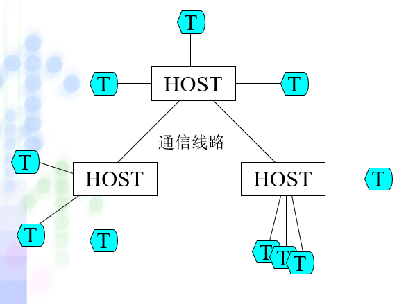

通信子网和资源子网构成**现代计算机网络的核心框架**。通过协议交互。

- **通信子网**是分组交换网络的**传输骨架**，专门负责数据的路由与转发

  包括**通信线路**和**网络互连设备**。功能：实现分组的高效、可靠传输，涉及路径选择、流量控制、差错检测等关键技术

- **资源子网**是网络的大脑，专注于**信息处理与服务提供**。
  
  - 服务器：提供计算、存储或应用服务
  - 客户计算机：发起请求，消费服务

- 终端设备：数据源和目的地
- 终端适配器：协议转换、接口适配
- 公共数据通信网：核心传输网络，ISP建设维护

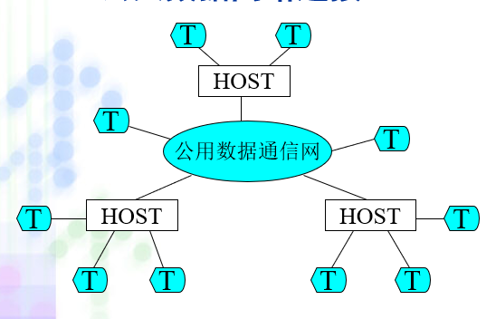

网络体系结构标准化：分层、协议。厂商标准→国际标准OSI/RM→事实标准TCP/IP

网络发展的两大驱动力：局域网LAN、Internet全球化

三网合一：**传统电信网、计算机互联网、有线电视网络**。技术融合、业务融合

全光网络：骨干网和接入网采用光纤作为传输介质，骨干网的电节点被光节点取代

物联网：物物相连的互联网，分四层：感知层、网络层、平台层、应用层

软件定义网络SDN：包含三层（基础设施层、控制层、应用层）

- 集中控制
- 开放接口
- 网络虚拟化

网络分类：

按覆盖范围：

- 个域网PAN
- 局域网LAN
- 城域网MAN
- 广域网WAN

按通信介质：

- 有线网
- 无线网

按用户：

- 公用网
- 专用网

按网络控制方式：

- 集中式
- 分布式

按网络环境：

- 部门网络
- 企业网络
- 校园网络

按传输技术：

- 广播式
- 点到点式

网络结构：

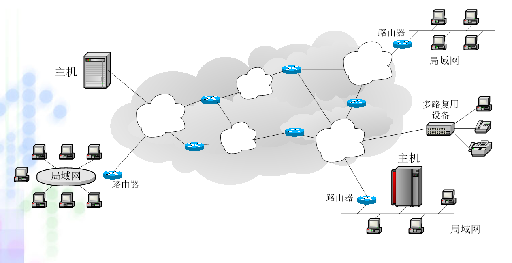

- 主机host：终端设备，生成、消费数据
- 路由器router：路径选择、数据包转发
- 多路复用设备multiplexer：通过频分复用或时分复用技术，将多个信号合并到单一信道传输
- 网络云network cloud：抽象表示复杂网络基础设施，隐藏内部细节

**拓扑结构**：网络的物理连接方式

- 总线型结构（最简单）：所有节点共享单一传输介质。优点：成本低；缺点：冲突域问题，单点故障全网瘫痪
- 星形结构：以中央节点为核心，通过独立点对点链路辐射状连接所有终端节点。优点：扩展灵活、集中式控制、故障不扩散；缺点：线路长度长，布线复杂，依赖中央节点
- 环形结构：首尾相连的总线型结构，通信线路将各节点连接成一个闭合的环，用令牌控制协调各节点数据发送。优点：适合光纤；缺点：环路可靠性、扩展性
- 树形结构：分层递归的结构，由根节点、叶结点构成，单向数据流。优点：分层网络，容错大；缺点：集中式控制，对上层节点依赖性强
- **网状形结构**（全连接/部分连接）：多路径互连，去中心化，动态路由。优点：可靠性高；缺点：通信线路冗余大，传输效率低

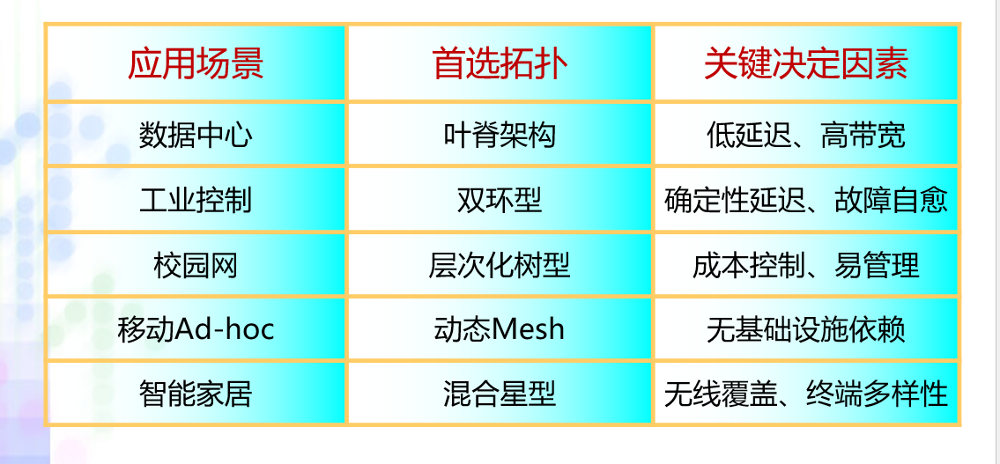什么玩意？

**逻辑结构**：信道连接与数据传输方式

- **广播式网络**：所有节点共享一条公共通信信道，任一台计算机发出的信息可以被其他所有计算机接收，两台以上计算机同时发送会产生冲突。关键技术：**介质访问控制方法**，冲突处理双策略（冲突检测与消除，冲突避免机制等）

- **点到点式网络**：一条线路连接两个网络互连设备（专用链路），**路由选择**

网络性能：时延delay。把传播介质想成一个管道

- 发送时延transmission delay： packet进管道花的时间。计算：packet长度/发送速度
- 传播时延propagation delay： packet在管道里面花的时间。计算：管道长度/传播速度
- 处理时延processing delay：处理packet所用的时间
- 排队时延queueing delay： packet同时到，需要排队
- 转发时延relay delay： processing delay+queueing delay
- 总delay： transmission+propagation+relay

时延带宽积（比特长度）： propagation delay × bandwidth。表示管道大小（长×宽）

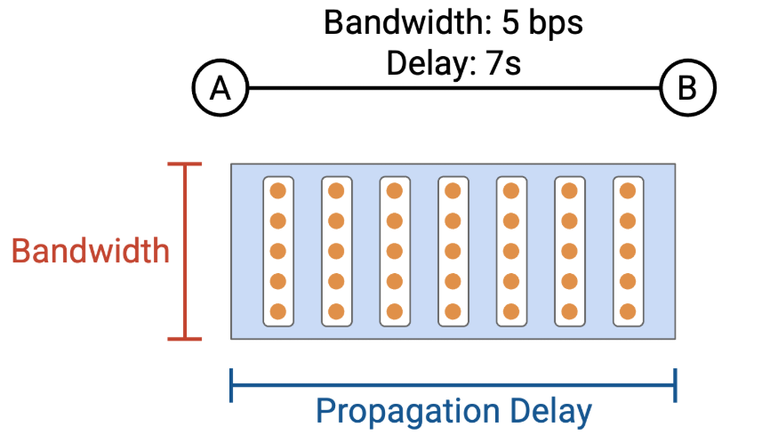

信息传输速率：每秒传输的编码前的数字数据的二进制位数，单位bps，简称**比特率**。（带宽bandwidth即最大比特率）

码元传输速率：数字数据编码后的传输信号在信道上的传输速率，单位波特，即**波特率**

传输速率：比特率Rb+波特率RB.   $R_b=R_B\times log₂(M)$，M是码元采用的状态数

带宽bandwidth：信号具有的频带宽度（Hz）；信道的最大传输速率（bps）

吞吐量throughput：单位时间内通过网络的实际数据数量，计算：数据量/delay

可靠性：误码率：传输的数据被传错的概率；误比特率

国际标准化组织ISO

RFC： Internet标准

# 第2章 网络体系结构

分层思想的价值：

- 分离关注点：将大问题分解为小问题
- 抽象与封装：每一层为上一层提供服务，本层不用管其它层的事
- 模块化设计与互操作性：某一层内部改变不会影响其它层工作
- 简化设计与调试：设计与调试分层进行，各司其职

优点：

- 各层独立：每一层不需要知道下一层如何实现，只用实现层间服务
- 灵活性好：任意层变化，接口不变不影响其它层
- 结构上分开
- 易于实现和维护
- 促进标准化

原则：

- 根据功能需要分层
- 每层功能明确
- 每层功能选择有利于制定国际标准
- 每层接口信息量尽可能少
- 层数足够多，避免不同功能混在同一层
- 层数不能太多，避免体系结构太庞大

网络研究方法：

- 按功能抽象分层
- 定义相邻层间接口
- 定义相同层间通信的规则：协议

**网络体系结构**：为了完成计算机之间的通信合作，把各个计算机互联的功能划分成定义明确的层次，并规定对等实体进行通信的协议。这些层和协议的集合被称为网络体系结构

重要定义：

**实体entity**：层中的活动元素，可以是软件、硬件，即层功能的执行者

**对等实体peer entity**：位于不同系统的同一层实体。

**层layer**：每层实体与同一系统相邻实体交互，与不同系统对等实体交互

**协议protocol**：计算机网络同等层次中，通信双方进行信息交换时必须遵守的规则

- 语法syntax：以二进制形式表示的命令和相应的结构
- 语义semantics：由发出的命令请求，完成的动作和回送的响应组成的集合
- 同步/定时关系timing：有关通信操作执行的顺序

**服务service**：实体n向实体n+1提供的通信能力。每一层功能的本质是为上层提供服务

**接口interface**：位于相邻层间，定义下层向上层提供的原语操作和服务。

服务提供者：提供n服务的下一层实体，分为直接（n层）和间接（n层及以下）

服务用户：接受n服务的上一层实体，分为直接（n+1层）和间接（n+1层及以上）

**服务访问点SAP**（Service Access Point）：邻层实体间的逻辑接口，层间服务必须在SAP上进行。

- 物理层：网卡接口
- 链路层：MAC地址
- 网络层：IP地址
- 传输层：port
- 应用层：用户界面UI

**数据单元DU**：在网络中信息传送的单位。对等实体按协议传，相邻层实体按服务传

- 协议数据单元**PDU**：不同系统的对等实体为实现该层协议锁交换的信息单位
- 服务数据单元**SDU**：上层服务用户所要求传递的数据单元
- 接口数据单元**IDU**：同一系统的相邻层实体的一次交互中，经过层间接口的信息单元

协议数据单元：PCI（协议控制信息）+ 用户数据。就是header+payload呗

接口数据单元：ICI（接口控制信息）+ 接口数据。相邻层对话时短暂传递。接口数据就是上层PDU或本层SDU，其实就是要传到网络的数据

服务数据单元：由于PDU大小受限，PDU的用户数据部分是经过分段或合并的SDU

呃这几个意思可能就是，DU就是网络里的数据，PDU就是本层加了一个header和上一层传下来的payload一块的一个部分，IDU就是从上往下传的时候需要有点手段在层间沟通，SDU就是要传的数据本身，被PDU重组变成payload

**连接connection**： n连接就是n+1实体借用其下所有n层及以下实体的通信能力，而与其对等实体之间形成的一条逻辑通路。n+1层对等实体通信必须通过相邻下层及下面各层通信完成

连接可以看传输层传数据的方法，比如三次握手、正常传数据、四次挥手

服务分类：

- 面向连接的服务：传送数据时，首先建立连接，然后用该连接传送数据。使用完后关闭连接。特点：容易控制，顺序性好
- 无连接服务：直接使用服务传送数据，每个包独立进行路由选择。特点：不好控制，顺序性差

连接过程：

- 建立连接：（核心：分配资源，保证服务质量）正式传数据前，必须通过一系列控制信息交换来协商参数、分配资源，确认对方愿意且能够通信。
- 数据传输：双方沿着这条已建立的连接进行对话，所有数据都通过这条逻辑路径传输
- 释放连接：释放之前分配的资源

服务原语：相邻层实体交流的信息。

- 请求request：上层发给下层（sender发数据时）
- 指示Indication：下层发给上层（recipient收数据时）
- 响应response：上层发给下层（对indication的答复）
- 证实confirm：下层发给上层（确认request完成）

总的来说，协议是同层对等实体交流，服务是下层给上层的接口

协议与服务关系：实体利用协议实现服务定义的接口，只要服务不变，可以任意改变协议

重点：**OSI参考模型：**

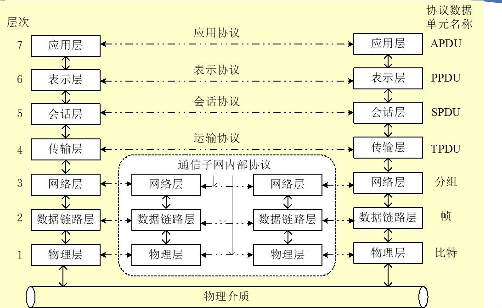

**物理层**：实现在物理媒体上透明地传送原始比特流

**数据链路层**：在物理线路上提供可靠的数据传输，使之对网络层呈现为一条无错的线路

**网络层**：在源结点与目的结点之间建立、维护、终止网络连接

**传输层**：为源端应用到目的应用提供可靠的、满足服务质量要求的数据传输服务

**会话层**：建立、管理和中止不同机器上的应用程序之间的会话

**表示层**：处理被传送数据的表示问题，即信息的语法和语义

**应用层**：为用户的应用程序提供网络通信服务

五六层压根没啥用，垃圾模型，但是还得背

TCP/IP模型：甚至比上面那坨还早，无敌了

应用层：提供各种Internet管理和应用服务

传输层：提供end to end应用数据传送服务

网络层：控制通信子网提供source to destination的IP packet传送

网络接口层：物理层和数据链路层

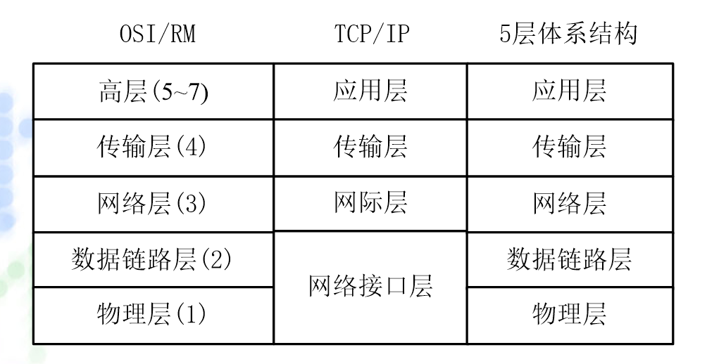

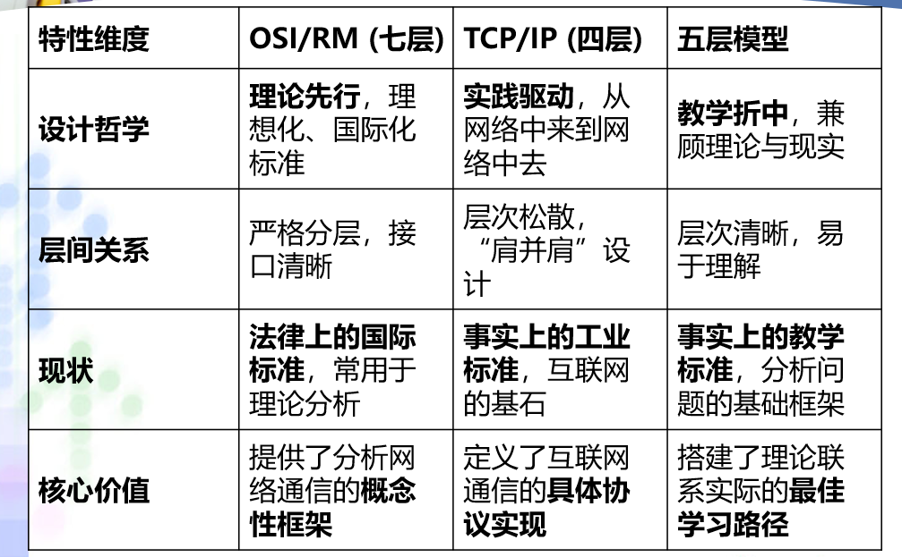

五层模型是对的

**数据的形式：报文message→段segment→分组packet→帧frame→比特流bitstream**

# 第3章 应用层

应用层协议设计：看传输层用哪种协议；看对等实体传送的数据单元类型与格式；看对等应用层实体通信规则与时序关系

应用大部分采用客户机/服务器（client/server）模式

## DNS

Internet编址：

- 域名地址：浏览器输入的URL，人类能读
- IP地址：定位主机和路由器的接口。通过DNS转换为域名
- MAC地址：LAN中识别机器的接口，每台机器硬件刻录

域名：层次化的主机名

域名系统：将域名解析为IP地址

DNS：分布式数据库，包含域名到 IP地址的映射。采用分布式域名数据库，运行数据库的计算机叫DNS服务器name server。每一个有域名的组织都要有DNS服务器，提供自己域名的映射服务。

DNS name server：

- **本地域名服务器**：local name server，每个组织/企业的DNS服务器
- **根域名服务器**：root name server，为下级域名服务器提供域名解析服务
- **认证域名服务器**：authoritative name server，每台Internet中的主机都应该在所在域的域名服务器中注册，提供注册的域名服务器就是该主机的认证域名服务器。是主机所在单位的DNS服务器

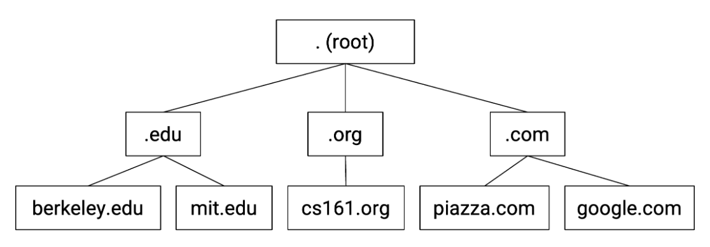

DNS服务器功能：

- 直接处理域内的域名解析请求
- 向其他DNS服务器发出查询请求来处理对其他域的域名解析请求
- 缓存对其他域的域名解析请求的结果

DNS服务器操作：

- 如果本地域名服务器不能解析域名，就向root询问
- root告诉与哪一个域名服务器联系，然后多次递归往返

 **递归查询**、**迭代查询**

域名记录（resolution record）类型：

- A：IP地址
- NS：指定域名解析由哪个name server进行
- CNAME：别名
- MX：邮件
- PTR：域名指针，反向查找
- SOA：DNS系统基本信息

迭代查询：

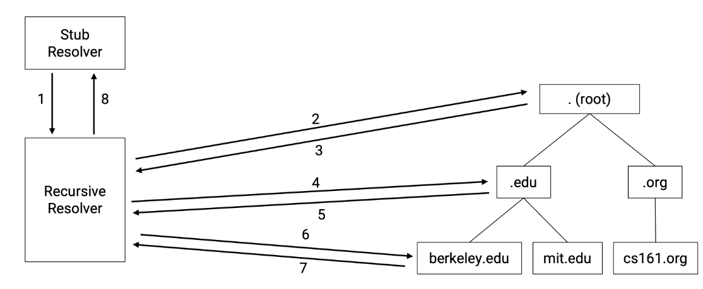

注意：递归查询每个服务器只发一次请求，下一次查询由下一个服务器进行。如上图中recursive resolver给root发，然后resolver就不管了，root继续查。递归查询现在都没人用了，还在考

讲了如同没讲啊！！！

##  电子邮件

电子邮件系统组成：

- **用户代理**（user agent）：编辑、发送、接收、阅读、管理电子邮件

- **邮件服务器**（server）：类似邮局，接收和转发电子邮件，向发信人报告邮件发送状态，按客户服务器方式工作

- **电子邮件协议**

  - 发送、转发邮件：**SMTP**（Simple mail transfer protocol）、**MIME**（multipurpose Internet mail extension）
  - 读取邮件：**POP3**（post office protocol）、**IMAP4**（Internet message access protocol）

  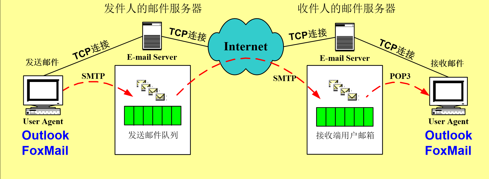

电子邮件地址：用户名@邮件服务器域名

**SMTP**：通过TCP连接两个邮件服务器**传输邮件**

邮件格式：
邮件头：收件人地址、投递日期、邮件主题、发件人地址
邮件体：正文

支持SMTP协议的邮件服务器之间采用Client/Server方式工作，连接发起方为client，接收方为server，连接建立后通过SMTP协议对话。

SMTP特点：

- 电子邮件无论内容多少都用一个报文发送
- 所有邮件内容都用ASCII传送
- 所有二进制文件内容必须用MIME格式转化为ASCII

电子邮件三种编码标准：

- UU（unix-to-unix encoding）
- MIME标准（Multipurpose Internet Mail Extensions）
- Binhex编码

POP3：基于**TCP**，Client/Server方式。功能：为用户提供邮箱，保存收到的邮件，把邮件传输给用户，**离线**

IMAP：基于**TCP**，Client/Server方式。功能：为用户提供邮箱，保存收到的邮件，用户可直接操作IMAP服务器上自己的邮件文件夹，需要打开邮件时邮件才传到客户端，**在线**

**问题：**简述电子邮件传输系统的组成。电子邮件传送的三个阶段是什么？为什么在接收邮件是不⽤SMTP⽽⽤POP3？为什么在接收时不⽤POP3⽽⽤IMAP？

回答：

1. 组成：
   - 用户代理：与电子邮件系统的接口，编辑、发送、接收、阅读、管理电子邮件
   - 邮件服务器：发送和接收邮件，向发件人报告结果
   - 电子邮件协议：发送SMTP和读取POP3等
2. 三个阶段：
   - 连接建立
   - 邮件传输
   - 连接中止
3. POP3更适合接收邮件。POP3允许用户收到邮件后保存在本地并编辑，SMTP只负责传递邮件，不保存
4. IMAP更高级，可以让用户决定要不要下载，提高收发、阅读速度

## 文件传输协议FTP

FTP： File Transfer Protocol

传送文件：本地到远程主机为上载upload，远程到本地主机叫下载download

FTP可以传各种类型文件。登录FTP服务器的用户需要注册才能登录，但有的服务器也允许匿名登录

FTP基于**TCP**，使用TCP实现文件传输，以Client/Server方式工作。
FTP客户程序运行在用户计算机上，用户通过它发出传输文件的请求
FTP服务程序运行在服务器上，接收并响应客户程序的请求，把指定文件发送到客户端

进行文件传输时，建立两个TCP连接：（建立就是三次握手，断开就是四次挥手）

- **控制连接**：客户程序与FTP服务器的端口21建立控制连接，在整个会话过程中维持连接，用于传输请求和应答信息，**由客户端发起**
- **数据连接**：用于传输文件，每传输一个文件都要建立一个数据连接，**由服务器发起**

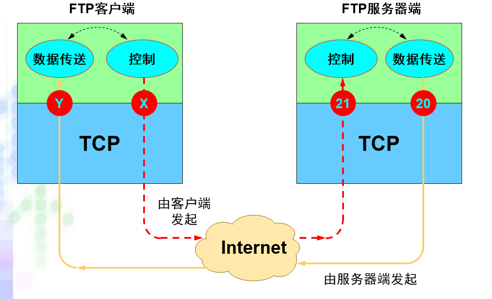

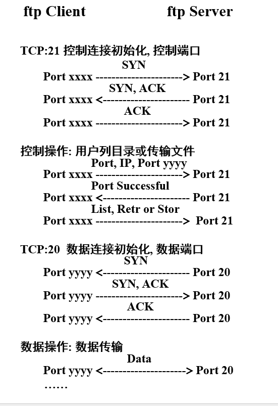

## 万维网WWW

浏览器是用来解释Web页面并完成相应转换和显示的程序，通过Web页面来进行信息的传递和交流

Web页面使用html编写的文档，包括文字、图像、声音、动画、视频等各种信息，也包括链接等

主页是进入一个网站首先看到的页面

超文本Hypertext：可以链接到其他文档的文字，包含了到其他文档或同一文档不同部分的超链接

超媒体Hypermedia：通过图形完成的链接，或指通过链接可以获得多媒体信息或播放多媒体信息

Web服务器：Web页面向浏览器提供服务的服务器

HTML超文本标记语言：编写Web页面的标准语言，通过标记对Web文档的格式及链接进行定义的一系列规定

HTTP超文本传输协议：浏览器和Web服务器之间的通信协议

WWW设计目标：

- 分布式信息系统
- 对多重协议提供一个统一通用的接口
- 对超媒体支持
- 可扩充性，能够支持所有的数据格式

**HTTP：**

- 以Client/Server模型为基础，支持二者通信及相互传送数据，一个服务器可以为分布在世界各地的许多客户服务。
- 简易性，client只需发送请求方式和URL等少量信息即可得到服务器应答
- 灵活性与内容-类型标识：允许任意类型数据传送
- **无连接性**：每次连接只处理一个请求，要建立连接需要先发出请求，收到响应，然后断开连接，效率高
- **无状态性**：无须记忆状态，效率高，应答快，但是每次连接需要传送较多的信息
- 元信息：关于信息的信息，描述发送对象的语言和类型，收到数据的浏览器可以根据元信息确定服务器发来的是什么内容，预料有多少数据，确知是否接收到完整的数据，以及发送过程中是否有错

HTTP报文格式：request和response

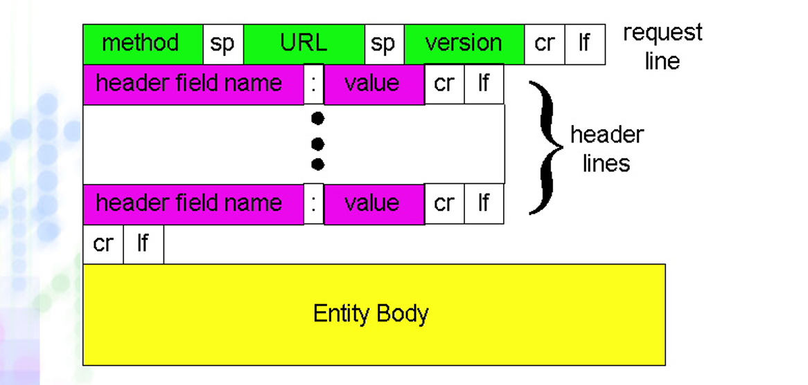

response会传一个状态响应码

v1.0：每次请求都建立TCP连接

v1.1：支持长连接、流水线

v2.0：支持多路复用并行传输，支持头部压缩、服务器推送

v3.0：使用基于**UDP**的QUIC协议

Cookies：服务器产生一个数字，做cache功能，response中发送cookie给client，后续发送request时发送cookie

Conditional GET：如果客户端有未修改的对象则不必重新发送该对象，节省带宽，提高响应速度

浏览器功能：

- 接收URL输入并发送请求报文
- 显示并解释收到的相应报文
- 导航功能
- 服务功能
- 接受用户对浏览器的设置

**URL**（Uniform Resource Locator）统一资源定位器：Web地址，是Web页面中定义信息资源位置的标准方法
构成：协议+主机（端口号）+路径+文件名

**Web缓存**：满足客户的请求但是不需要重新连接原始的服务器

**静态网页**：由HTML构成的文件

**动态网页**：Web服务端通过程序动态生成的页面，属于临时性页面内容

**活动网页**：为了网页能动态变化，在网页中加入程序代码

Internet多媒体应用：对端到端延迟、延迟变动十分敏感，可以容忍数据丢失。分为存储式音频和视频，实况音频和视频流，实时交互类音频和视频

**存储式音视频**：客户端从服务器请求其所存储的压缩的音频和视频文件。

- 有交互性，用户可以进行控制操作
- 有延迟

**实况音视频**：除了在Internet上传播外，与传统的radio和TV是一样的，不能交互

**实时交互式音视频**：电话或视频会议，对延迟要求严格

对网络要求从低到高

Internet应用的模式演进：

1. 客户/服务器模式：大部分网络应用的基础，分别指参与一次通信的两个应用实体，客户主动发起通信请求，服务器被动等待通信建立
2. 浏览器/服务器模式：客户主机上的用户访问接口是通过WWW浏览器实现的，期中，一部分事务逻辑在前端实现，主要事务逻辑在服务器端实现，形成三层结构
3. 对等网络模式：P2P，任何节点都可以作为服务器或者客户机。分为**集中式、分布式、混合式**
4. 云计算、雾计算、霾计算

# 第4章 传输层

## 概述

引入传输层原因：

- 消除网络层的不可靠性
- 提供从源端主机到目的端主机的可靠的、与实际使用的网络无关的信息传输

传输服务：

- 传输实体：完成传输层功能的软硬件
- 服务质量QoS：
  面向连接的传输服务（TCP）：连接建立、数据传输、连接释放
  无连接的传输服务（UDP）

传输层功能：

- 向上层屏蔽通信子网的实现细节
- 弥补上层提出要求和下层提供服务间的差异
- 提供进程级的访问能力

TCP（Transmission Control Protocol）：面向连接的、可靠的、端到端的、基于字节流的传输协议

UDP（User Data Protocol）：无连接的端到端协议

Socket：为上层实体提供一种透明的访问网络能力，是一组传输层的服务原语（OS中实现）

- 流式套接字（SOCK_STREAM）：针对TCP
- 数据包式套接字（SOCK_DGRAM）：针对UDP
- 原始式套接字（SOCK_RAW）：使用网络层服务的协议，如ICMP

## 拥塞控制

**拥塞congestion：网络上有太多包时，性能会下降**

拥塞产生原因：

- 多个输入对应一个输出
- 慢速处理器
- 低带宽线路

拥塞检测标准：（其实就是loss-based与delay-based，TCP使用loss-based）

- 缺乏缓冲区造成的丢包率
- 平均队列长度
- 超时重传的包数目
- 平均包延迟
- 包延迟变化

拥塞监测位置：

- 源结点（host-based）
- 中间路由器（router-assisted）

**拥塞控制**congestion control：确保通信子网能够承载用户提交的通信量，全局问题

**流量控制**flow control：与点到点通信量有关，主要解决快速发送方与慢速接收方的问题，局部问题

拥塞控制方法：

- 开环控制：力求避免，但不能绝对避免。避免拥塞发生，不考虑网络当前状态
- 闭环控制：基于反馈，发生拥塞后调整系统

没有拥塞控制方法能够保证绝对的避免

**开环拥塞控制**：强迫包以可预测的速率发送

**漏桶算法**leaky bucket：将用户发出的不平滑的数据包流转变成网络中平滑的数据包流，强迫输出按平均速率进行

**令牌桶算法**token bucket：漏桶存放令牌，每隔一段时间产生一个令牌，令牌累积到超过漏桶上界时不再增加。包传输前必须获得一个令牌，传输之后删除该令牌。

二者区别：

- 流量整形策略不同：漏桶算法不允许空闲主机积累发送权，以便以后发送大的突发数据；令牌桶算法允许，最大为桶的大小
- 漏桶中存放的是数据包，桶满了丢包；令牌桶中存放的是令牌，桶满了丢令牌不丢包

**闭环拥塞控制**：

**抑制分组方法**：路由器监控输出线路及其他资源的利用情况，超过某个阈值，则此资源进入警戒状态。每个新包到来，检查它的输出线路是否处于警戒状态，若是，则向源主机发送抑制包，包中指出发生拥塞的目的地址，同时将原包打上标记正常转发。源主机收到抑制包后，按一定比例减少发向特定目的地的流量，并在固定时间间隔内忽略指示同一目的地的抑制包，然后开始监听，若仍然拥塞，则继续，不拥塞（没有抑制包）则增加负载。策略：AIMD（additive increase, multiplicative decrease）比例减少，常量增加

**负载丢弃方法**：将包丢弃。针对不同服务，采用不同丢弃策略：文件传输丢新包（wine），多媒体丢旧包（milk）。早期丢弃包会减少拥塞发生概率，提高网络性能。

AQM：主动队列管理

REQ：随机早期检测

**网络服务质量**QoS（quality of service）：网络在传输数据流时要求满足的一系列服务请求。
基于QoS的拥塞控制不但可以防止拥塞，还会根据数据流的不同传输要求来分配延迟时间，将影响集中分配到传输延时要求不高的数据流上，而保证传输要求高的数据流顺利、优先通过。

## UDP

设计理念：

- 不需要建立连接
- 简单：发送者和接收者都不需要连接的状态
- 短报头：开销小
- 无拥塞控制：按需发送
- 用于多媒体数据传输（低负载如DNS，速率敏感）

UDP header：（8B）

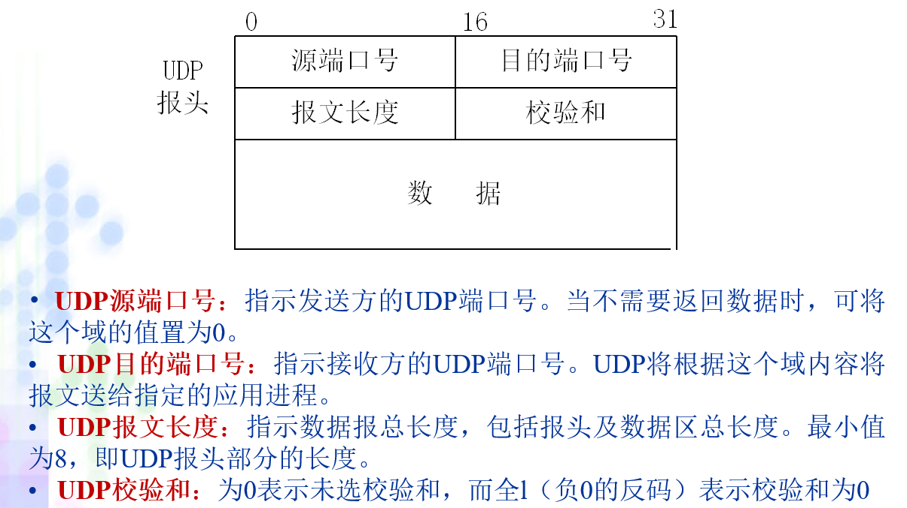

伪报头：

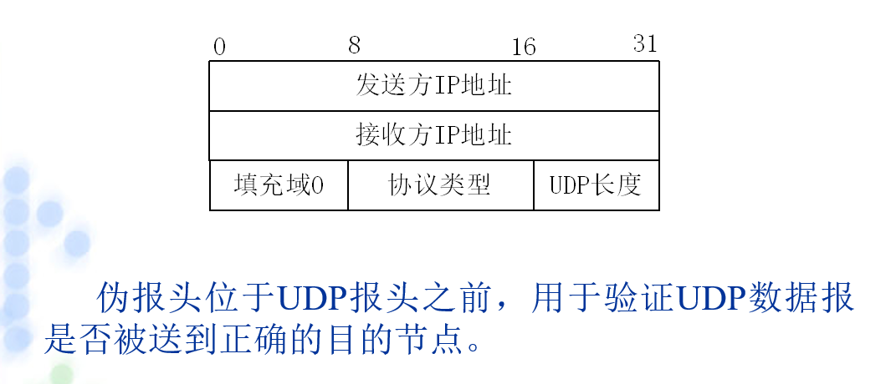

实时流媒体传输协议：（知道名字）

- 实时传输协议RTP（Real-time Transport Protocol）：为实时应用提供端到端传输
  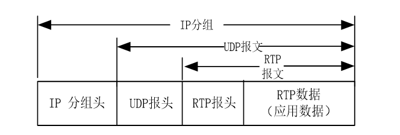
- 实时传输控制协议RTCP（Real-time Transport Control Protocol）：和RTP配合使用，以有效的反馈和最小的开销使传输效率最佳化，特别适合传送网上的实时数据。

## TCP

TCP：

- 用于在各种网络上提供有序可靠的**面向连接**的数据传输服务
- 为了使TCP独立于特定网络，对报文长度限定为小于64KB
- 面向字节流（byte stream）
- 捎带应答（Piggybacking）：将ack附在数据中发送，如果没有数据则等待并设置计时器，超时后再发送

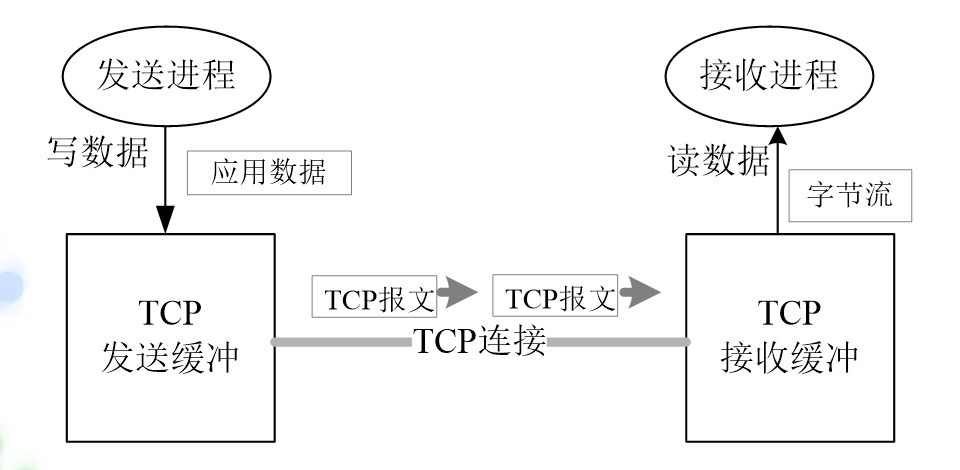

TCP header：（20B）

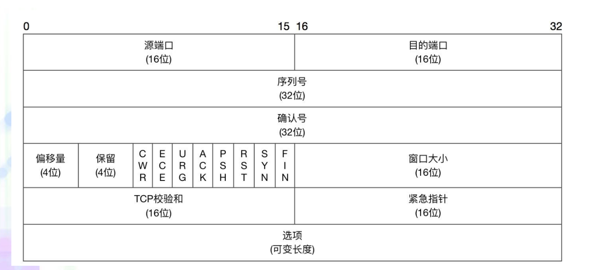

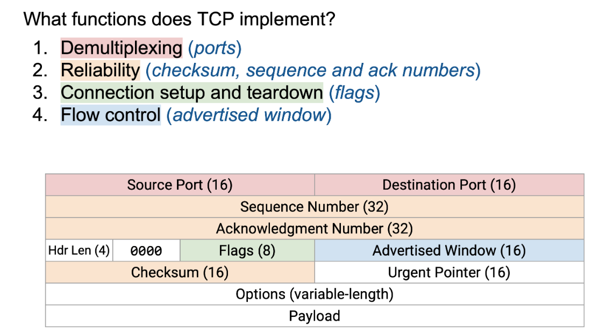

URG：和紧急指针配合使用，发送紧急数据；

ACK：确认号是否有效；

PSH：指示接收方对接收数据不做缓存，立刻交付应用程序；

RST：由于不可恢复的错误重置连接；

SYN：用于连接建立指示；

FIN：用于连接释放指示

窗口大小：用于基于可变滑动窗口的流控，指示发送方从确认号开始可以再发送窗口大小的字节流

建立连接：三次握手：

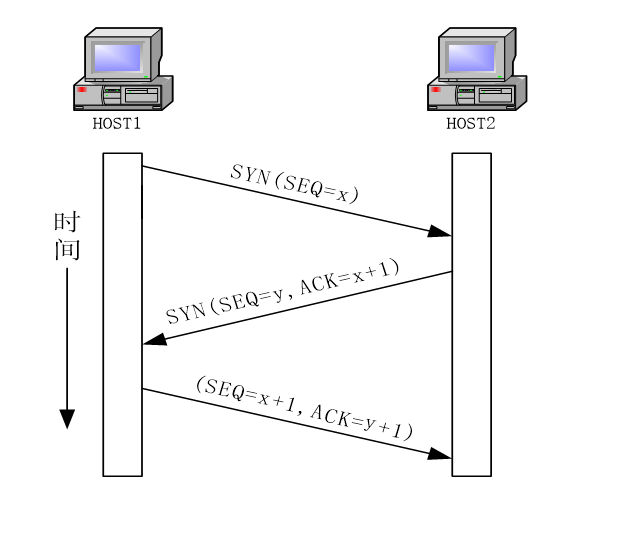

释放连接：四次挥手

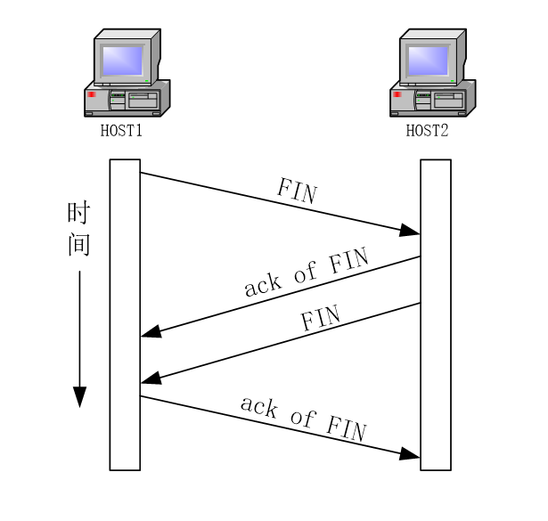

TCP的超时与重传：对于每个连接维持一个变量RTT，每收到一个应答，从计时器中得到当前往返时间M，然后利用下式估算新的RTT：
$$
RTT=\alpha RTT + (1-\alpha)M
$$
TCP的窗口管理：

- 基于确认和可变窗口大小
- 窗口大小为0时发送方不能发TCP段，但是：
  - 紧急数据可以发送
  - 为防止死锁，发送方可以发送1字节TCP段，以便让接收方重新声明确认号和窗口大小

改进传输层性能：

- 发送方缓存应用程序数据，等到形成比较大的段再发出
- 在没有可能进行捎带的情况下，接收方延迟发送确认段

flow control：

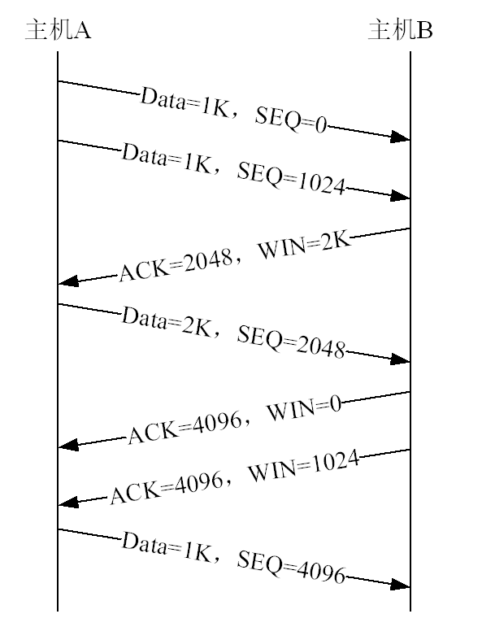

- Nagle算法：当应用程序每次向传输实体发出一个字节时，传输实体发出第一个字节并缓存所有其后字节直至收到第一个字节的确认；然后将已缓存的所有字节组段发出并对再收到的字节缓存，直至收到下一个确认
- Clark算法解决傻窗口症状：
  - 傻窗口症状：当应用程序一次从传输层实体读出一个新字节时，传输层实体会产生一个一字节的窗口更新段，使得发送方只能发送一个字节
  - 解决：限制接收方只有在具备一半的控缓存或最大段长的空缓存时，才产生一个窗口更新段

TCP出现拥塞的两种情况：快网络小缓存接收者，慢网络大缓存接收者。潜在因素：网络能力，接收能力

处理第一种拥塞的措施：在连接建立时声明最大可接受段长度，利用可变滑动窗口协议防止出现拥塞

处理第二种拥塞的措施：发送方维护可变发送窗口和拥塞窗口，按两个窗口的最小值发送。拥塞窗口按**慢启动**slow start和**拥塞避免**congestion avoidance算法变化。

slow start：连接建立时cwnd初始为该连接允许的最大段长（MSS，即一个packet），阈值threshold为64K。发出一个最大段长的TCP段，若正确确认，就翻倍（每收到一个ack就多发一个packet），重复直到发生丢包超时或cwnd大于阈值

congestion avoidance： cwnd大于阈值，窗口线性增长，一个RTT增加一个packet，直至丢包；丢包后ssthresh设置为当前cwnd一半，cwnd重新设置为一个packet，执行slow start。

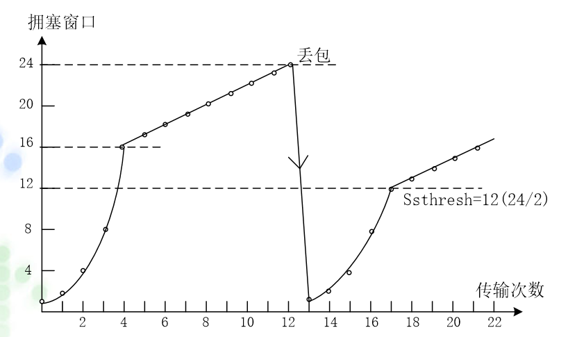

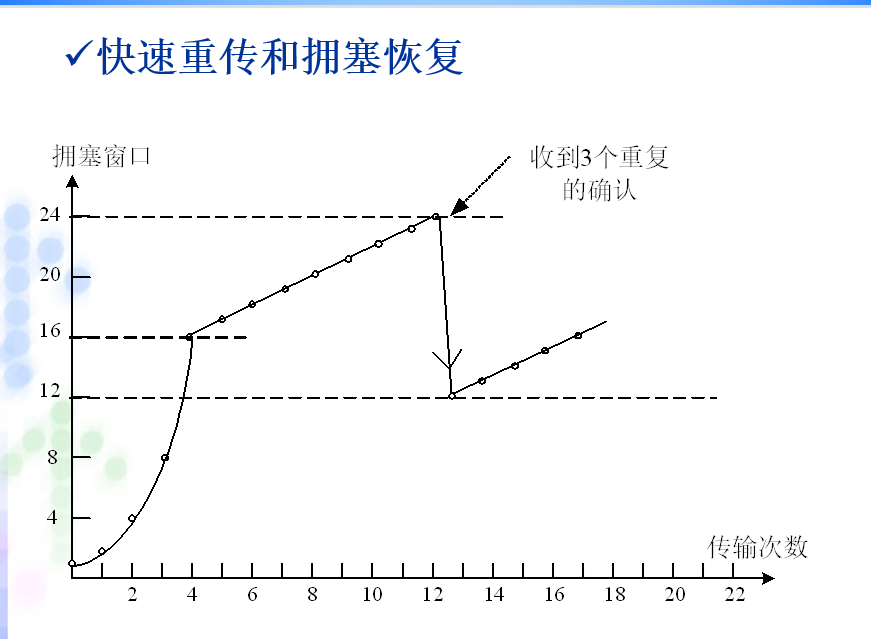

这里才是AIMD，收到三个重复ack后减半继续AIMD，直到出现timeout这种严重现象才返回slow start

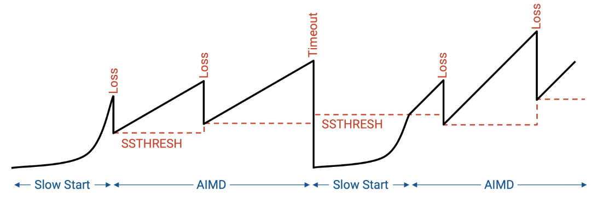

fast recovery疑似没讲

QUIC（Quick UDP Internet Connections）：使用UDP进行传输，在两个端点间建立连接，支持多路复用。低延迟连接，安全可靠，前向纠错，连接迁移，改进的拥塞控制，无队头阻塞的多路复用

# 第5章 网络层

## 概念

网络服务目标：

- 服务与通信子网技术无关
- 通信子网的数量、类型和拓扑结构对于传输层是隐蔽的
- 传输层获得的网络地址应该采用统一编号

设计焦点：提供面向连接的服务还是无连接服务

- 面向连接服务：通信子网应该提供可靠的、面向连接的服务，而将复杂的功能放在网络层
- 无连接服务（best-effort）：通信子网无论怎么设计都不可靠，因此网络层只提供无连接服务，将复杂功能放在传输层

**虚电路**（virtual circuit）：

- 提供**面向连接**的服务
- 要先发送虚呼叫分组，一方面通知目的主机要求建立连接，另一方面寻找一条合适的路由
- 若目标主机同意通信，则发应答，然后使用虚呼叫时建立的虚电路进行数据交换
- 通信结束后，释放虚电路

**数据报**（datagram）：

- 提供**无连接**服务
- 主机有数据可随时发送
- 每个分组携带完整的目的地址，独立进行路由选择

哦！我突然明白了，原来分组指的是packet，原来分组交换指的是packet switching！哈哈太搞笑了计网

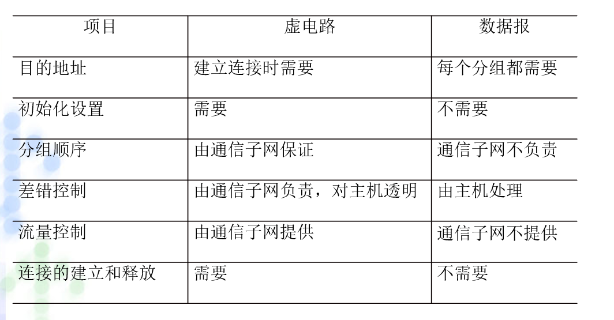

## 路由算法与路由器

网络层最重要的地方他就讲这么点，唉唉

路由算法要解决的问题：如何在网络中源主机和目的主机之间找到一条最佳的或适合的路由。用forwarding table

路由算法评价特性：正确性、简单性、健壮性、稳定性、公平性、最优性

按转发方式和数据副本数量分：全路路由算法（广播）、多路路由算法（多播）、单路路由算法（单播）

按健壮性和简单性：

- 非自适应算法，**静态路由**：不更新路由表，用静态路由表（固定）。特点: 简单、开销少、灵活性差。
- 自适应算法，**动态路由**：根据网络流量和拓扑结构的变化更新路由表。特点：开销大，健壮性和灵活性好

自适应算法工作过程：

- 测量有关路由选择的网络参数
- 将路由信息传送到适当的网络节点（孤立式、集中式、分布式）
- 计算和更新路由表
- 根据新路由表执行分组的转发

分层路由：分而治之，根据需要，将路由器分成区域，但路由表中的路由不一定是最佳路由

**距离向量路由算法**（distance-vector routing）：动态路由，RIP协议。在相邻路由器间周期性地相互交换各自的路由信息，同时当网络拓扑结构发生变化时，路由器之间也将及时地相互通知有关变更信息。维护路由表存最佳距离和线路，不断与邻居交流，接收和发送路由信息，选最好的

路由环路问题：

- 水平分割split horizon
- 定义向量距离的最大值（16）
- 挂起计数器（hold-down timers）
- 触发式更新（triggered updates）

**链路状态路由算法**（link-state routing）：动态路由，OSPF，IF-IF。
链路状态包：以发送方标识符开头，后面是序号、年龄和一个邻居节点列表，每个邻居都有发送方到它们的延迟或开销，定期创建或发生重大事件时创建。
将链路状态包广播发送给所有其他路由器：洪泛flood。控制flood：每个包包含一个序号，每次发送新包时+1，路由器记录信息对，当一个链路状态包到达时，若是新的则分发，若是重复的则丢弃，若序号比最大序号小则丢弃
最短路径：Dijkstra算法

问题：序号循环使用；路由器崩溃后序号重置；序号出错

解决：

- 32位序号
- 增加年龄age，没秒age-1，为0时丢弃
- 链路状态包到达后延迟一段时间，并与其他已到达的来自同意路由器的链路状态包比较序号，丢弃重复包，保留新包
- 链路状态包需要应答

路由器：**总线型、交叉开关型、共享存储器型**

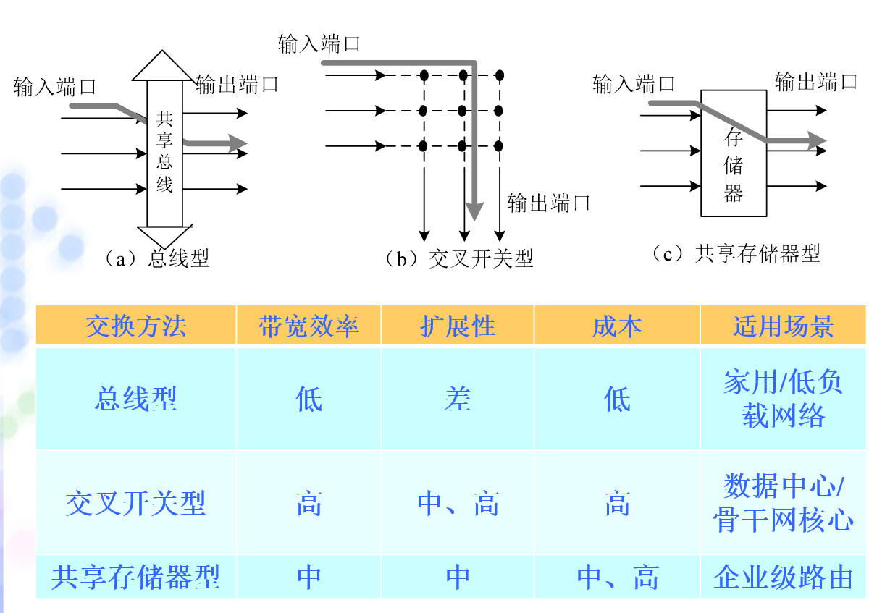

## 网络互联

互联网internet：两个或多个网络构成互联网（network of networks）

分类：

- 广域网与广域网互连
- 广域网和局域网的互连
- 局域网和局域网的互连
- 两个局域网通过广域网的互连

网络互联设备：（用哪一层设备，该层及以下的协议可以不同）

- **中继器**repeater：**物理层**设备，在电缆段拷贝bit。对弱信号进行放大或再生，以便延长传输距离
- **网桥**bridge：**数据链路层**设备，在局域网之间存储转发帧，可以改变帧格式
  可以连两个采用不同链路层协议、不同传输介质、不同传输速率的网络，以**接收、存储、地址过滤与转发**的方式实现网络通信，在数据链路层以上需要使用相同协议，可以分隔两个网络的广播通信量，有利于改善性能和安全性

- **路由器**router：**网络层**设备，在网络之间存储转发包，必要时做网络层协议转换
  协议不同需要用多协议路由器：要为不同协议维护不同的路由表
  网络层解决问题：路由选择、拥塞控制、差错处理、分段技术  
- **网关**gateway：传输网关/应用网关。连接不同的应用，完成传输层或应用层的协议转换（应用级防火墙）

自治系统AS

内部网关协议IGP（Interior gateway protocol）和外部网关协议EGP（Exterior）

## IPv4协议栈

IP：提供**无连接的数据报**传送机制，尽力而为best-effort，不保证可靠性

IP功能：

- 无连接数据报传输
- 数据报路由
- 分组的分段和重组

IP address：五类ABCDE：即A（/8），B（/16），C（/24）
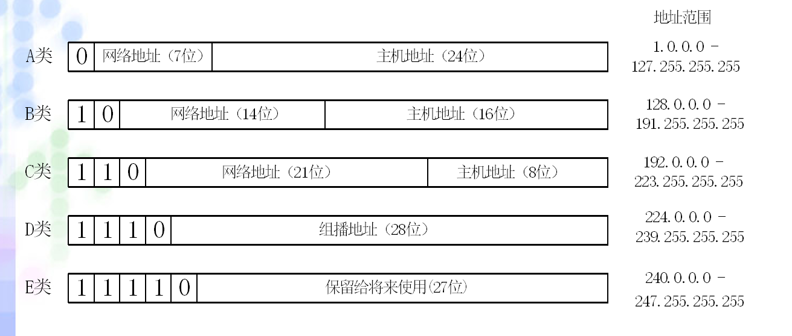

- 主机号全1：广播
- 主机号全0：网络本身
- 网络号全0：本网络
- 32位IP地址全1用于本网广播，称为有限广播地址
- A类地址127是保留地址，用于测试以及本地机进程通信，称为回送地址

子网subnet：为了便于管理和使用，将网络划分为更小的网络，这种再原来IP地址结构的基础上增加一级结构的方法称为子网划分

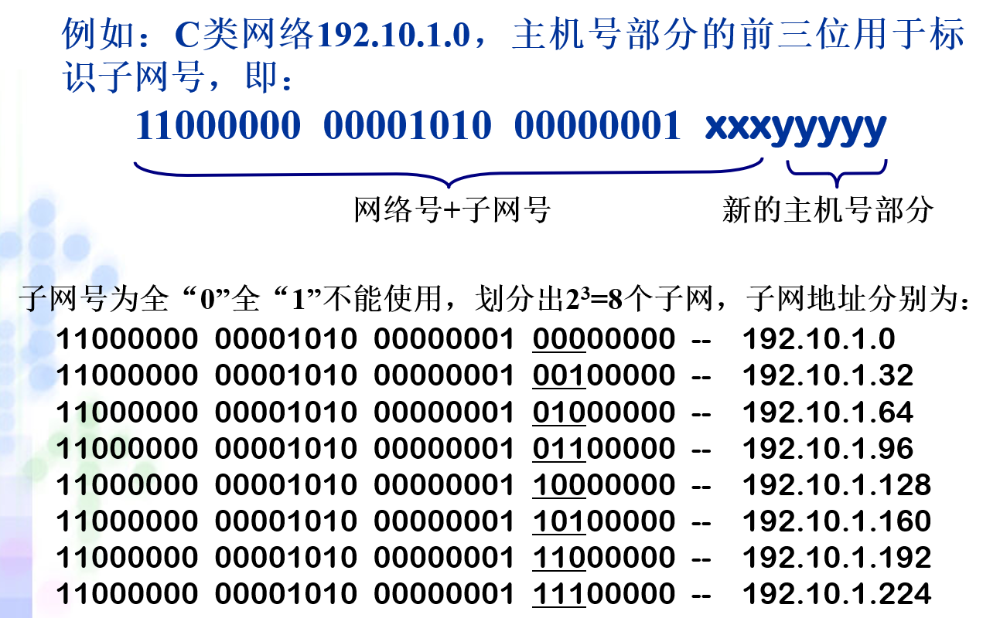

子网掩码（subnet mask）：32位，网络号（包括子网号）全1，主机号全0

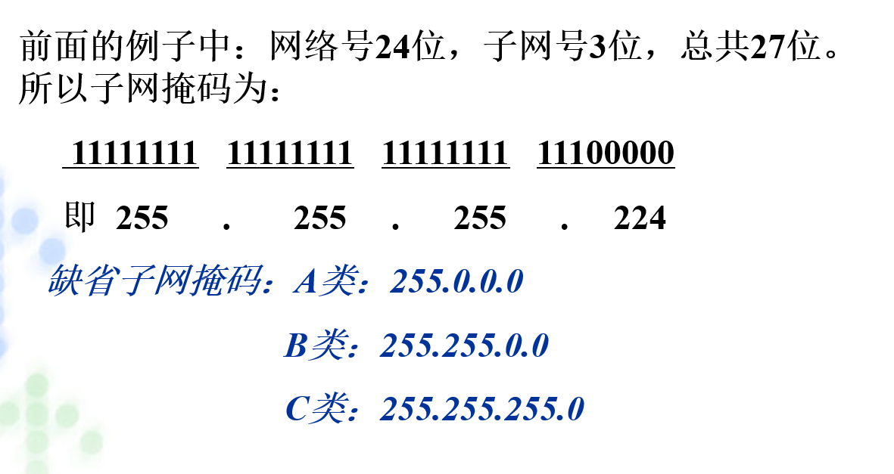

子网地址：子网掩码和IP地址相与

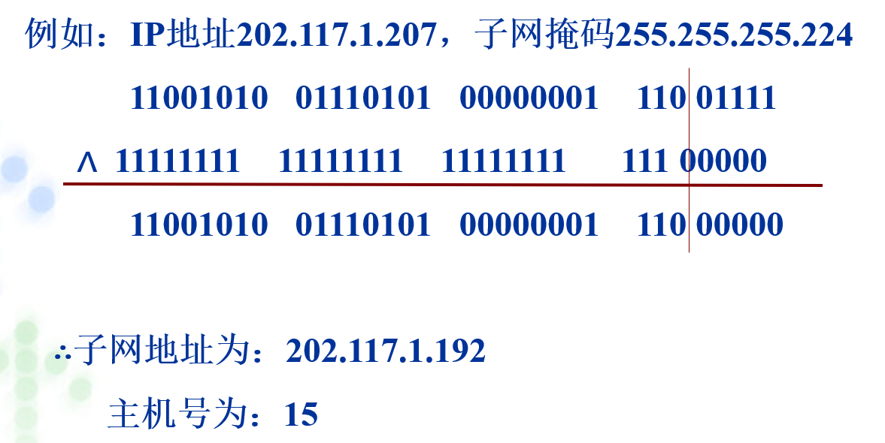

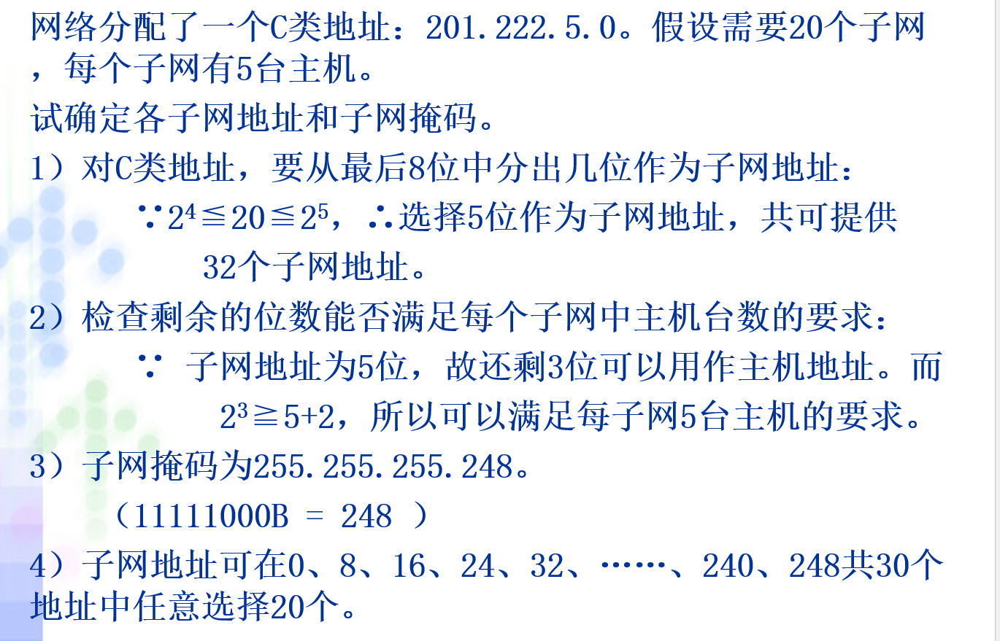

IP分组（packet）的转发特点：

- 每个IP分组包含目的主机的IP地址
- IP地址中的网络地址唯一标识Internet中的一个物理网络
- 所有连接到相同物理网络的主机和路由器共享其地址中的网络地址部分，他们在这个网络上可以直接通信
- Internet中的每个物理网络至少有一个与之相连的路由器，通过定义还可至少和另一个物理网络互连，路由器可在该网上为主机或其他路由器转发分组

在路由器中根据目的IP地址进行路由转发。目标网络由IP地址和子网掩码描述

 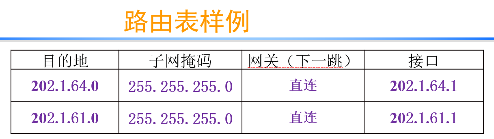

CIDR（classless inter-domain routing）：将剩余C类地址分成大小可变的地址空间，不分类（有多少主机，就分配合适的网络地址）
最长匹配原则：路由查找时，若多个路由表项匹配成功，选择掩码长的路由表项（选更小的网络）

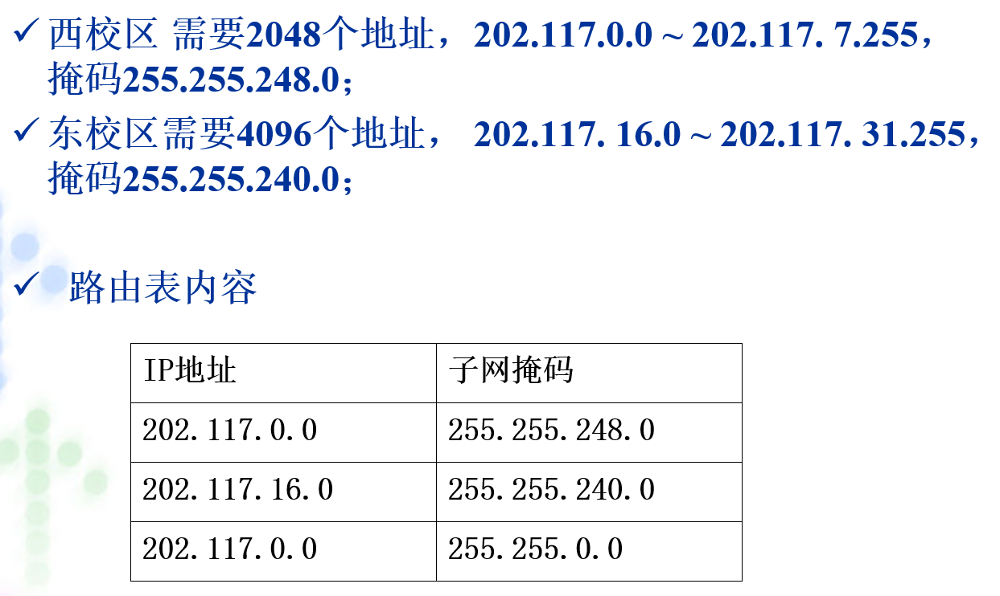

IP packet（分组）：header：20字节固定部分和变长（最多40字节）的可选部分

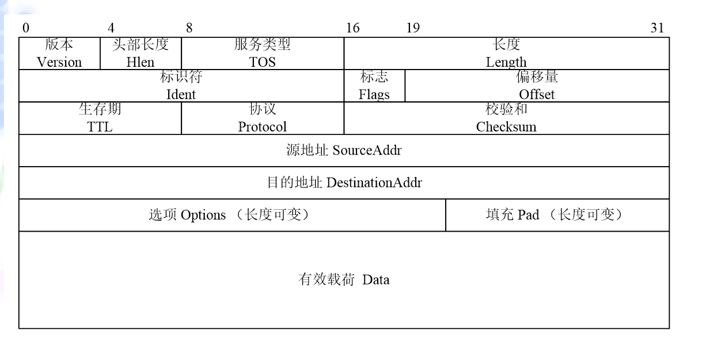

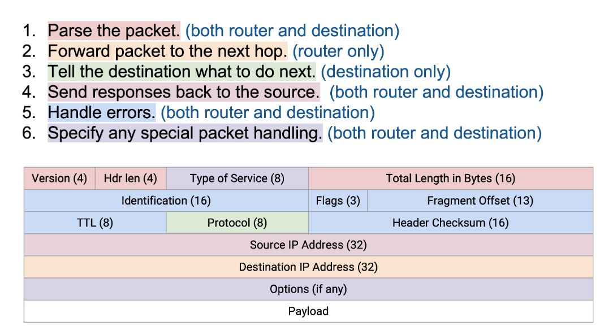

fragmentation： ID、Flags、offset三个共同完成

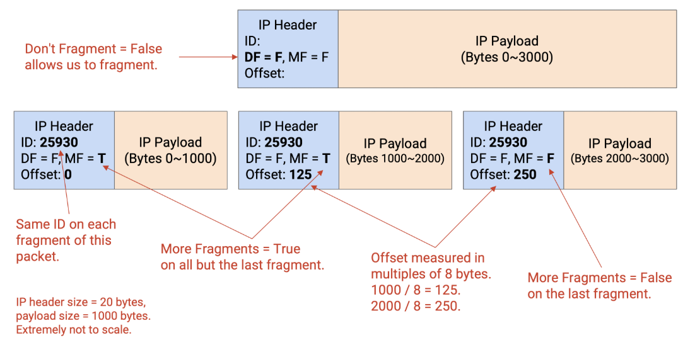

ARP（Address Resolution Protocol）：IP地址与MAC地址映射。完成从IP地址到MAC地址的转换，使网络层与硬件及数据链路层隔离。建立ARP表存放映射对：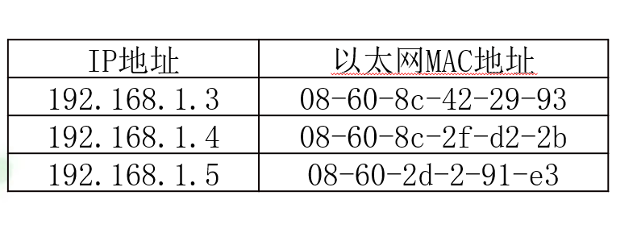
若在同一子网内，用目的IP地址查，否则用缺省网关IP地址在ARP表中查。若未找到，则发送广播包，目的主机收到后应答。启动时广播自己的映射。有TTL，超时删除。

NAT（network address translation）：部署在网络出口，将内部网络IP地址换成出口IP地址，提供公网可达性和上层协议的连接能力。解决私有网络与Internet网络互联的问题（保护私网）
应用程序级网关技术ALG：对应用程序地址进行NAT

DHCP（Dynamic Host Configuration Protocol）：基于UDP，C/S模式，提供动态制定IP地址和参数配置的机制。DHCP服务器提供三种IP地址分配方式：

- 手工分配
- 自动分配：一但得到就一直用这个IP地址
- 动态分配：租约到期释放这个地址

ICMP：发送差错报告和控制信息

路由信息协议RIP（Routing Information Protocol）：distance-vector，用hop度量，设置最大hop=16，用于小型互联网。定期和邻居交换完整距离表，把机器分为主动和被动（路由器主动，路由器、主机被动）

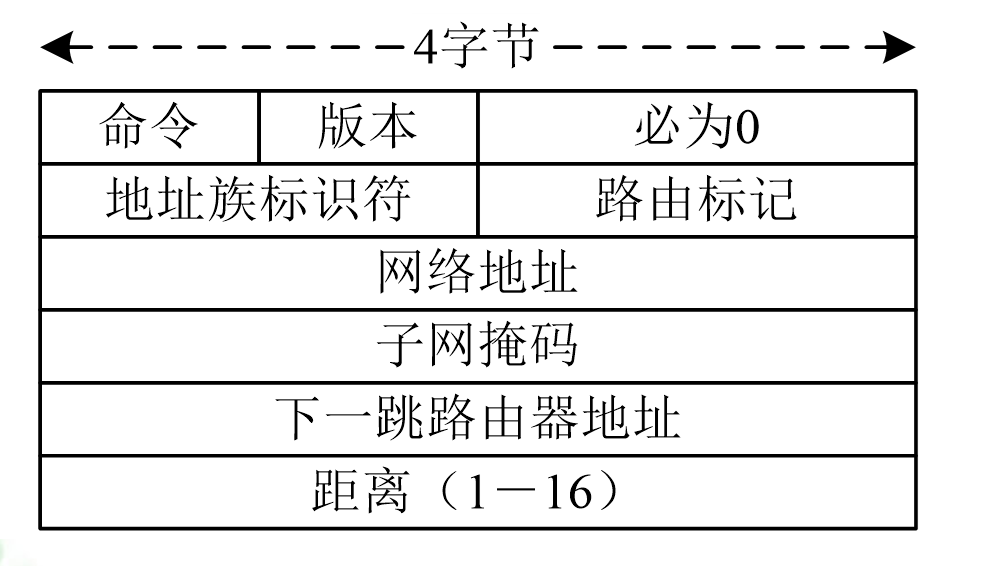

开放最短路径优先OSPF（Open Shortest Path First）：link-state
网络类型：

- 广播多路访问型
- 点到点型
- 非广播多路访问型

链路状态广播数据包LSA（link-state advertisement）：五类

- 所有OSPF都有：描述路由器上连接到某个区域的链路或是某个端口的状态信息
- 指派路由器产生：在一个广播多路访问型网络，这种LSA描述该网段上连接的所有路由器的状态信息
- 区域边界路由器产生：
- AS边界路由器产生：这两种是到某一个区域外部的路由信息，只在某一个特定区域传播
- AS边界路由器产生：描述到AS外的目的地陆游信息，会在AS中所有区域传播（iBGP）

边界网关协议BGP（Border Gateway Protocol）：在不同AS之间路由器进行路由信息交换。path-vector，记录路径
消息类型：

- Open：确定邻居关系，和邻居路由器建立BGP连接
- Update：更新路由信息，包括传输单一路由信息、取消路由等
- Notification：报告协议操作过程中检测到的差错
- Keepalive：验证连接可用性

## IPv6

IPv6特点：

- 128位地址
- 层次化网络结构，提高路由效率
- header 简洁灵活，效率更高，易于扩展
- 支持自动配置
- 支持端到端安全
- 支持移动特性
- 新增流标签功能，更利于支持QoS

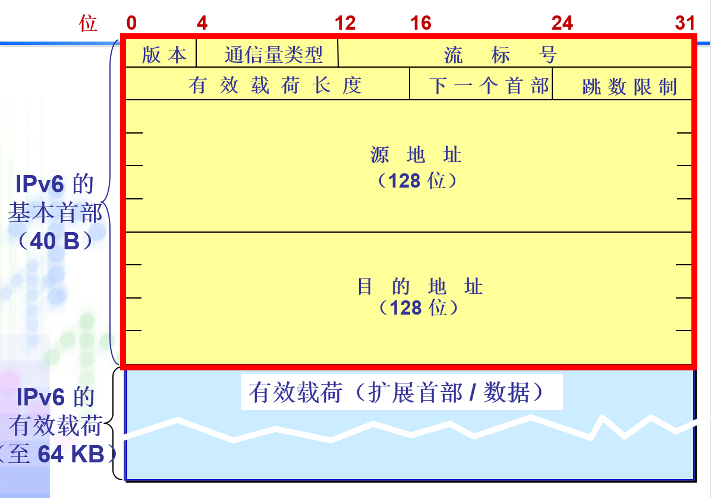

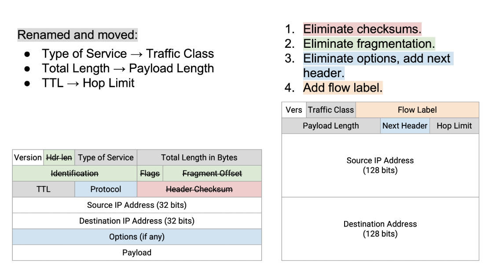

header：

- 固定40字节，称为基本首部
- 字段数减少到8个
- 取消了检验和，加快处理速度
- 允许多个扩展首部
- 所有扩展首部和数据合起来叫有效载荷或净负荷

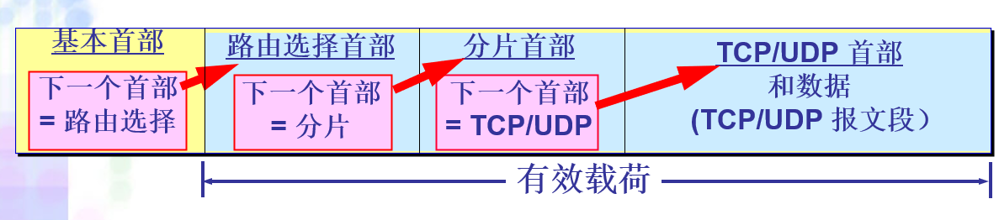

IPv6目的地址：

- **单播**unicast：点对点通信
- **多播**multicast：一点对多点通信
- **任播**anycast：目的是一组计算机，但选择（最近）一个交付数据报

地址表示：

- 冒号十六进制记法。零压缩：一串连续零用一对冒号取代
- 点分十进制记法后缀：0:0:0:0:0:0:128.10.2.1，斜线表示法可用

将128位地址空间分为两部分：

- 第一部分：可变长度的类型前缀，定义地址目的
- 第二部分：其余部分，长度也可变

v4到v6的过渡方案：

- **双协议栈**：一部分主机或路由器装有两个协议栈
- **隧道技术**：将一种协议完全封装到另一种协议
- **协议转换技术**

ICMPv6：反馈差错，增加消息类型，完成ARP的活

软件定义网络SDN：

实现方案：

- 基于专用接口：硬件和软件紧耦合
- 基于叠加网络：逻辑/叠加网络
- 基于开放协议：硬件和软件松耦合

分三层：转发层、控制层、应用层

交换机、南向接口、控制器、北向接口

OpenFlow：南向接口。流表、安全通道、OpenFlow协议

# 第6章 数据链路层

## 概述与帧

为什么设计数据链路层：

- 在原始的物理传输线路上传输数据信号是有差错的，存在一定的误码率
- 在有差错的线路上进行无差错传输，向网络层提供高质量服务
- 从网络参考来看，物理层之上的各层都有改善数据传输质量的要求，数据链路层是最重要的一层

数据链路层：为了提供功能上和规程上的方法，以便建立、维护和释放网络实体间的数据链路

链路：一条无源的点到点或点到多点的物理线路段。中间没有交换节点，但允许包含信号中继设备

数据链路：物理链路+控制数据传输的通信协议

数据链路层协议：保障数据能迅速、正确、有效地从发送点到达接收点所采用的控制方式，也被称作数据链路控制规程

数据链路层基本功能：

- 数据链路管理：链路建立、维护和释放
- 帧定界（成帧）：最基本功能，将IP packet封装成frame，添加首尾实现帧同步，让接收方从bit stream中识别每一个frame的开始和结束
- 流量控制：解决收发双方速度不匹配的问题，防止发送方过快导致接收方缓冲区溢出
- 差错控制：利用CRC等技术检测帧是否在传输中出错，并通过重传机制来纠正错误，实现可靠传输
- 数据区分：能够区分帧里传输的是业务数据还是控制信息
- 透明传输：无论数据是什么组合都应该顺利传输，因此采用字节填充或比特填充等技术解决特殊字符冲突的问题
- 寻址：在frame header增加MAC地址，保证frame能被送达正确的目的节点
- 介质访问控制：在广播式网络中至关重要，决定当主机共享同一信道时，谁有权在什么时候发送数据

帧边界划分：将比特流分成离散的帧

帧边界划分方法：

- **字符计数法**：在帧头用一个域来表示整个帧的字符个数。缺点：若计数出错，对本帧和后面的帧有影响
- **首尾界符法**：DLE STX表示帧开始，DLE ETX表示帧结束，DLE DLE表示传送数据信息中的DLE
  
  缺点：局限于八位字符和ASCII字符，使用面不宽
- **首尾标志法**：帧的起始和结束都用一个特殊的位串01111110为标记。用0比特插入删除技术，在传送的数据信息中每遇到**5个连续的1在其后面加0**，防止被识别成开始结束
- **物理层编码违例法**：使用物理层编码规则中未定义的非法的电信号组合来标记帧的起始和结束。只适用于物理层编码有冗余的网络，如曼彻斯特编码。违例码：持续高电平或低电平或不符合跳变规则的信号。

## 差错控制

差错产生的原因及分类：

- **随机噪声**：信道的电气特性引起信号幅度、频率、相位的畸变，导致随机性差错
- **冲击噪声**：闪电、大功率电机的启停等，导致突发性差错

数据链路层出错情况：

- **帧出错**：数据帧
- **帧丢失**：数据帧、应答帧

差错控制目的：保证帧正确送交上层，在接收方能够判断接收的数据是否正确，若错误还可能要恢复错误

基本策略：数据码元+冗余码元（校验码）

常用方法：

- **检错反馈重发**：接收方检测到错误后，通过反馈信道要求发送方重新发送该帧
- **自动纠错**：在冗余码中加入足够的信息，使接收方在发现错误时能够纠正
- 混合方式：对少量错误自动纠正，对无法纠正的错误要求重发

 码字：一个帧包括m个数据位，r个校验位/冗余位，称为n位码字，n=m+r

**纠错码**：加入足够多冗余位，使接收方不仅知道有差错发生，并知道哪些位发生差错

**检错码**：加入少量冗余位，使接收方仅知道有差错发生，但不知道什么位置出错。需要使用请求重发机制。

**海明码：**

海明距离：两个码字的海明距离即两个码字**不相同位的个数**。编码方案的海明距离：任意两个码字海明距离的最小值

海明定理：海明距离越大，容错能力越强。

- **检测**d位错，编码方案的海明距离至少为**d+1**。发生d位错时，不会由一种合法编码变为另一种合法编码。
- **纠正**d位错，编码方案的海明距离至少为**2d+1**。发生d位错时，出错编码仍然最接近于原始的正确编码

**奇偶校验码：**（检错码）在数据后添加一个奇偶位。偶校验：让1的个数为偶数；奇校验：1的个数为奇数。若奇偶结果不正确，就知道出现错误。
校验能力低，难以适用于块数据传输
垂直水平奇偶校验码：同时对数据的行和列进行奇偶校验，提高检错能力

**循环冗余校验码CRC**：将二进制位串表示为多项式。如110001表示为  $x^5+x^4+1$，每一个bit对应幂项系数。

核心：生成多项式$G(x)$：

- 收发两方事先约定
- 生成多项式的最高位和最低位必须是1
- 生成多项式必须比传输信息对应的多项式短

校验过程：CRC码（校验和）加在帧尾，使带CRC码的多项式能被 $G(x)$除尽。接收方接收时，用 $G(x)$除它，若有余数则传输出错。

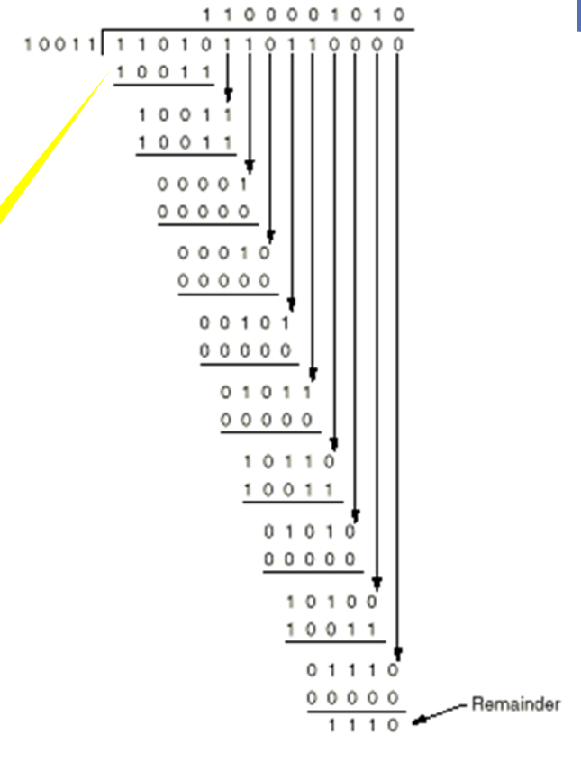

注意：CRC计算中用异或，不用减法

标准化：四个多项式

无差错：凡是接受的数据帧能以非常接近于1的概率认为这些帧在传输过程中没有产生差错。CRC不能检测出所有差错，但是基本没啥问题

**检验和checksum：**

1. 将检验字段初始化0
2. 将待发送数据拆分成若干个与检验字段等长的分片，如果最后一个分片长度不足，则补0对齐
3. 将所有分片执行1的补码和运算，将累加结果取反
4. 将计算结果置入检验字段发送
5. 接收端执行相同过程，若校验和为0标明没差错
6. 适用于高层协议，如TCP、IP

## 流量控制

流量控制其实就是一个小TCP。第一个，单工停等协议，他是没有window的TCP，每次只有一个packet in flight，且使用的是individual ACK + NACK来实现。第二个，ARQ，选择重传是典型的TCP方式，全部重传则可以降低接收方OS buffer的要求，但是太浪费资源。滑动窗口就是一个比较原始的cwnd，它不会根据拥塞情况来调整大小，而是一个固定的window，且收发两方不一样。TCP是full duplex，所以各自维护各自发packet所需的wnd=cwnd和rwnd的最小值，在TCP中接收窗口其实就是OS buffer。在TCP发packet接收方收到后，会将这些packet存在OS buffer中，根据序号进行重组，并通过cumulative ACK来告诉发送方应该发什么，这就是一个选择重传。在这个ARQ的滑动窗口中，很多东西其实都有TCP的设计思想，主要区别还是这个接收窗口吧，而且这个window不会进行fast recovery。

流量控制目标：控制发送方的数据发送能力，使之不能超过接收方的数据接收能力

流量控制常用方法：停等协议、滑动窗口协议

**单工停等协议**：（考计算）
发送方：从高层取数据、封装成帧、送到发送缓冲区、发送帧、等待对方应答
接收方：等待对方数据帧、接收帧、送到接收缓冲区、提交数据给高层、发送应答

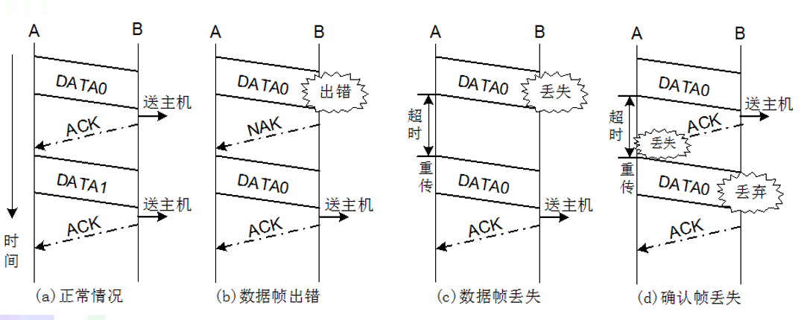

单工停等协议面对差错：
应答方式：正向应答ACK、负向应答NAK，双向应答（结合两种）
常用**正向应答+超时重传**来解决差错控制。数据序号采用**循环序号**。

降低应答数量：

- **单帧应答**：每收到一帧就回一个ACK，简单但开销大
- **成批应答**：成功接收连续多个帧后，只用一个ACK来确认一整批，效率高
- **附载应答**：接收方不单独发ACK，而是等待自己有数据要发送时，将ACK搭载在数据帧上一同发回

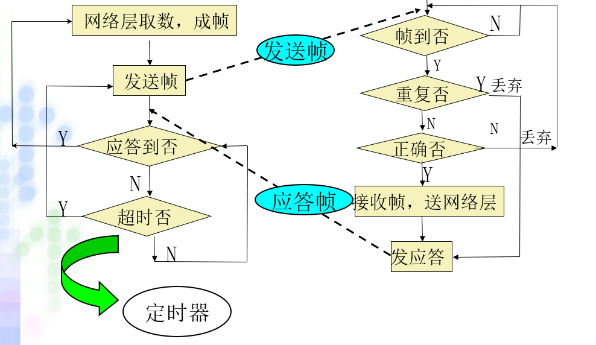

**连续ARQ协议**：不需要收到应答帧就可连续不断的发后续帧，克服停等ARQ协议效率底下的问题。

帧出错处理策略：传输资源与存储资源博弈

- **全部重传ARQ**：只要有一帧出错，就从出错帧开始重传之后所有帧。浪费传输资源，接收方缓冲区只要一个
- **选择重传ARQ**：一帧出错只重传出错帧。节省传输资源，接收方需要有足够缓冲区        

**滑动窗口协议**：对连续ARQ协议的改进，能够控制已发送但未确认的数据帧个数，需要发送窗口与接收窗口配合工作

发送窗口：

- 窗口大小 $W_T$：没有收到接收方确认信息的情况下发送方最多可以发送的帧个数
- 窗口内帧类型：已发送帧（未收到确认）、允许发送帧（尚未发送的帧）

接收窗口：

- 窗口大小 $W_R$：允许连续接收未处理帧的个数
- 控制哪些帧可以接收，哪些帧不能接收：当到达数据帧序号与接收窗口序号一致才能接收

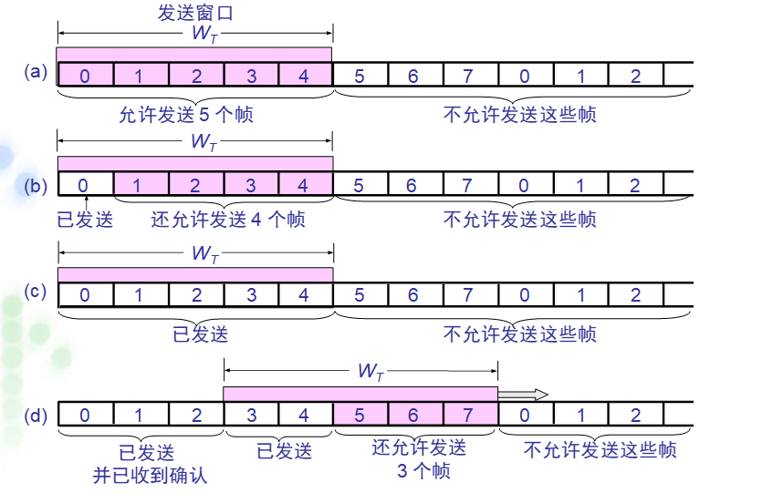

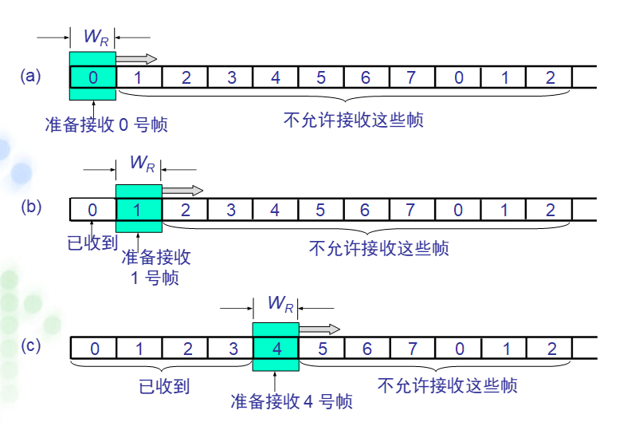

接收窗口保证帧顺序完全正确。

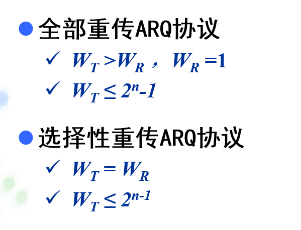（n表示帧序号的二进制位数）

## 广播信道访问控制

信道就是shared medium

按信道连接方式网络分类：

- 点到点信道网络：广域网主导
- 广播信道（多路访问信道、随机访问信道，multiple access protocols）：局域网主导
- 广播信道网络：如何解决信道争用

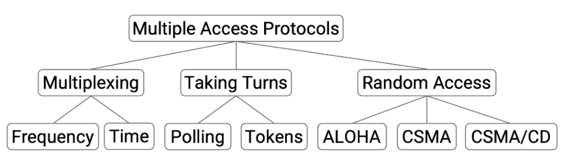

**静态分配**：平均分配

- 频分多路复用FDM：将频带平均分配给每个要参与通信的用户（每个用户独占一个频段进行通信，如FM、AM等）
- 时分多路复用TDM：让每个用户拥有固定的信道传送时槽，每个用户在特定时间片内独占整个信道
- 优点：适合用户较少、数目固定、各用户通信量都较大的情况
- 缺点：无法灵活适应站点数及其通信量的变化，浪费资源

**动态分配**：根据当前对信道请求的情况动态协调各用户对信道的使用权

无冲突协议—**令牌协议**：网络中流转着唯一的被称为令牌token的控制帧，要发送数据必须先截获令牌，避免冲突

**ALOHA协议**：用于任何无协调关系的用户争用单一共享资源使用权的系统。

- 纯ALOHA协议：用户有数据要发送时可以直接发至信道，然后监听信道看是否产生冲突。若产生冲突，则等待一段随机时间重传
- 时间片ALOHA协议：把信道时间分成离散的时间片，片长为最大帧所需的发送时间。每个节点只能在时间片开始时才允许发送。

**载波监听多路访问协议CSMA**（Carrier Sense Multiple Access）：
载波监听：站点在为发送帧而访问传输信道之前，首先监听信道有无载波，若有载波，说明已有用户在使用信道，则不发送帧以避免冲突
多路访问：多个用户共用一条信道

- **1-坚持式CSMA**：若节点有数据发送，先监听信道。若空闲，则发送数据，若忙，则**继续监听**直到信道变成空闲，然后发。
  优点：减少信道空闲时间
  缺点：增加了发生冲突的概率
  广播延迟对协议性能的影响：广播延迟（就是propagation delay）越大，发生冲突的可能性越大，协议性能越差
- **非坚持式CSMA**：若节点有数据发送，先监听信道，若空闲则发送，若忙，则**等待一段随机时间**，然后发
  优点：减少冲突概率
  缺点：增加信道空闲时间，数据发送延迟增大
  信道效率比1-坚持CSMA高，传输延迟比1-坚持CSMA大
- **p-坚持式CSMA**：适用于时槽（时间片）信道。若有数据发送，先监听，若空闲，则**以概率p发送数据**，以**概率1-p延迟至下一个时槽发送**。若忙，则**等待下一个时槽**重新发送

**带冲突检测的载波监听多路访问协议CSMA/CD（Carrier Sense Multiple Access with Collision Detection）**：

引入冲突检测原因：当两个帧传输发生冲突时，两个被损坏帧继续传送毫无意义，资源浪费。如果边发送边监听，并在监听到冲突后立即停止发送，可以提高信道的利用率。

工作流程：使用CSMA进行数据发送，如果检测到冲突，立即停止发送，并发出一个瞬间干扰信号，让所有节点都知道发生了冲突。在发出干扰信号后，等待一段随机时间（退避），再重复发送过程。
重点：边发送边检测，随机退避

## 点对点数据链路协议 P2P 

点到点通信场景：路由器到路由器；通过拨号上网，连到路由器或接入服务器

**SLIP（Serial Line IP）**：封装协议，定义一系列特殊字符序列，将IP packet在串行线路上封装成帧格式。用一个标记字节来定界，采用字符填充技术。问题：

- 不提供差错校验
- 只支持IP
- IP地址不能动态分配
- 不提供身份认证
- 多种版本并存，互连困难

**PPP（Point-to-Point Protocol）**：提供差错校验、支持多种协议、允许动态分配IP地址、支持认证等。以**帧为单位**发送，而不是原始IP包，采用**字符填充**技术。组成部分：

- **链路控制协议LCP**（Link Control Protocol）：建立、配置和测试数据链路连接
- **网络控制协议NCP**（Network Control Protocol）：建立、配置不同网络层协议

## Ethernet

注：介质访问控制=MAC，时槽=time slice

局域网：将小区域内各种通信设备互连在一起的通信网络。

以太网：局域网的典型代表

特点：

- 覆盖范围小
- 高传输速率
- 低误码率

技术：采用基带传输。管理属性：为一个单位所拥有，自行建设，不对外提供服务

IEEE802局域网：将链路层分为**逻辑链路控制子层**（LLC，更接近网络层）和**介质访问控制子层**（MAC）
将功能中与硬件相关的部分和与硬件无关的部分分开，降低实现的复杂度。
传统共享式局域网特点：共享信道，需要解决**介质访问控制**（MAC，Medium Access Control）问题。
LLC与介质、拓扑**无关**，MAC与介质、拓扑**相关**

Ethernet和IEEE802.3帧格式不同

以太网物理层类型：**数字Base数字或字母**
开头数字：代表传输速率，单位是Mbps。
中间词：代表传输技术，Base代表基带传输，Broad代表宽带传输
最后的字母或数字：代表传输介质或段最大长度。数字代表**单段电缆最大长度，单位100米**，字母代表介质类型，T为双绞线（Twisted Pair）、F为光纤（Fiber），X为特殊编码或多种介质。

举例：10Base5：10Mbps，基带传输，500米最大长度；100BaseT：100Mbps，基带传输，双绞线

**传统以太网介质访问控制方法**：

二进制指数退避**binary exponential backoff**：就是每次等待时间范围×2，如第一次等待范围0~2秒随机，冲突了变成0 ~ 4秒随机，以此类推

注：每次发送前强制要求9.6μs的帧间间隙

写完才发现他讲二进制指数退避了：将冲突发生后的时间划分为**51.2微秒**的时槽，以时槽为单位，发生第一次冲突[0, 1] ，发生第二次冲突[0, 1, 2, 3]，以此类推，第10次冲突后固定在0~1023间，第16次冲突后发送失败，报告上层

**最短帧长制约**：为了检测到所有冲突，避免帧的第一个比特到达电缆的远端前帧已经发完，帧发送时间应该大于往返延迟时间（冲突检测时间）。10MbpsLAN：最大冲突检测时间为 **51.2μs**，最短帧长为 **64Byte**。网络速度提高，最短帧长增大，站点间距离减小

以太网帧格式：（不要求）

PA：前同步码：10101010序列，用于接收方与发送方同步

SFD：帧首定界：10101011

DA：目的MAC；SA：源MAC

TYPE：类型，如IPv4、IPv6

LEN：数据长度（0-1500B）

LLC PDU+PAD：最少46字节，最多1500字节

PAD：填充字段，保证帧长不少于64字节，若帧长不足46字节则补足。

FCS：帧校验序列（CRC）

MAC地址：六个字节，前三个字节由IEEE802分配给厂商，后三个字节由厂商唯一地分配给所生产的网卡。

目的地址最高位：0表示单播，1表示多播或广播。如果所有位都是1，则是广播地址。次高位是0表示全局管理地址，为1表示局部管理地址。

快速以太网：将比特时间从100ns缩短为10ns。标准：

- 100Base-TX：2对5类双绞线
- 100Base-FX：2芯多模光纤
- 100Base-T4：4对3类双绞线

呃呃历史遗迹学这干啥煞笔教材

千兆以太网改进技术：**载波延伸**（carrier extension）和**帧突发**（packet bursting）

- 可以采用半双工和全双工两种方式，在全双工模式下，无冲突发生，不使用冲突检测
- 最小帧长仍保持64字节，但规定争用期为512字节，若小于512字节，物理层发送扩展载波符号序列填充
- 为了改善短帧传送效率，增加帧突发功能（允许一次突发发送多个帧）

帧突发：

- 发方被允许连续发送若干帧，其中第一个帧按CSMA/CD发送
- 第一个短帧必须进行**载波扩展**至一个512B时槽，若发送成功就可以发其他的
- 发方为了连续占有信道，用96位载波扩展填充帧间隙IFG，这样其他主机在IFG期间仍可继续监听到载波
- 冲突只能发生在第一个时槽之内；因此，以后连续发送的帧即使是短帧也不比进行载波扩展

10G比特以太网（万兆以太网）：

- 不再支持单工模式，只定义全双工模式
- 只能用光纤做介质
- 不采用CSMA/CD
- 使用64B/66B和8B/10B两种编码方式
- 定义两种物理层，分别用于支持局域网和广域网

重要：

**网桥bridge**：工作在数据链路层的网络互连设备，它在互连的LAN之间实现帧的存储和转发。

- 在数据链路层上实现局域网互连
- 能够互连两个采用不同数据链路层协议、不同传输介质与不同传输速率的网络
- 以**接收、存储、地址过滤和转发**的方式实现互连的网络之间的通信
- 在数据链路层以上采用相同协议
- 可以分隔两个网络间的**广播通信量**，有利于改善互连网络的性能和安全性

透明网桥/生成树网桥：（就是STP）

- 网桥工作在**混杂**方式，接收所有的帧
- 接收到帧后，通过查询**地址/端口对应表**来确定是丢弃还是转发
- 网桥刚启动，**地址/端口对应表**为空，采用**洪泛**转发帧
- 在转发过程中采用逆向学习算法收集MAC地址，通过分析帧的源MAC地址得到与端口的对应关系，写入对应表
- 不断更新表并定时检查

**以太网交换机**：在多端口网桥的基础上发展起来，是一种改进的局域网桥
与传统网桥相比：

- 能提供更多接口，直接连接计算机
- 大多采用基于硬件的转发机制，性能更好
- 一般用于连接同种类型的局域网

类型：

- 存储转发式交换：交换机先完整接收整个数据帧，进行差错校验，确认无误后再转发出去，有错则丢弃，可靠性高有延迟
- 直通式交换：只要接收到帧头，查看目的MAC地址，开始转发，无需等待整个帧接收完毕。速度快，可能转发错误帧
- 碎片交换：折中，先接收前64个字节，确保不是冲突碎片且地址正确后，就开始转发，在速度和可靠性之间取得了平衡

**虚拟局域网**：在交换式局域网的基础上，采用网络管理软件构建的可跨越不同网段、不同网络的端到端的逻辑网络

- 网络设备的移动、添加和修改的管理开销减少
- 可以控制广播风暴
- 可提高网络的安全性

划分方法：基于**端口**（单交换机端口、多交换机端口）、基于MAC地址、基于网络层、基于IP组播

TPID：固定为0x8100，为VLAN

TCI：优先级、CFI、VLAN ID

## 无线局域网

优点：

- 灵活性和移动性
- 安装便捷
- 易于进行网络规划和调整
- 故障定位容易
- 易于扩展

拓扑类型：有中心拓扑、无中心拓扑

IEEE802.11网络模式：独立基本服务集网络IBSS、基本服务集网络BSS、扩展服务集网络ESS

IEEE802.11 的MAC子层：

- **分布协调功能子层**DCF：数据传输的基本方式 ，作用于信道竞争期，保证每个节点使用CSMA，是必须的
- **点协调功能子层**PCF：工作于非竞争期，使用集中控制接入算法，保证某些节点能优先使用信道，可选

CSMA/CA（再看一下ppt）：无线共享信道控制，隐藏节点和暴露节点
发送前预约信道：发起请求、广播许可、预约生效
虚拟载波侦听：NAV定时器，指示下次信道空闲检测前还需等待的时间

蓝牙：微微网、散射网

ZigBee

移动网络：移动站点、基站子系统、移动交换中心

# 第7章 数据通信与物理层

## 数据通信的理论基础

数据在物理介质上传输时，本质上是通过电压的高低、电流的大小或光信号的强弱等物理量的变化来代表二进制的0和1。用单值函数 $f(t)$表示。

傅立叶分析：

- 对不同傅立叶分量的衰减不同，因此引起输出的失真
- 通过信道的谐波次数越多，信号越逼真

传送的信号脉冲频率越高，要求信道的带宽越大

## 数据通信系统模型

三个核心部分：

- **源系统**：包括源点和发送器
- **传输系统**：连接源系统和目的系统的物理通道或网络。是数据传输的必经之路
- **目的系统**：包括接收器和终点

五个基本组件：

- **输入数据/源点信息**：由源点设备产生，等待发送的原始数字比特流
- **发送的信号**：发送器将数据转换为适合在信道中传输的形式

- **在传输系统上传送的信号**：信号在信道中实际传播的形式
- **接收的信号**：接收器从信道中获取到的信号
- **输出数据/终点信息**：接收器将信号还原后，最终交付给终点设备的数字信息

数据通信系统任务：把携带信息的数据用物理信号形式通过介质传送到目的地

问题：信息和数据不能直接在介质上传输

解决：信息→数据→信号

数据表示：模拟数据（连续值）、数字数据（离散值），模电和数电

数据传输方式：模拟信号、数字信号

信道类型：模拟信道、数字信道

信道通信方式：

- **单工通信方式**：信息只能单向传输，监视信号可回送
- **半双工通信方式**：信息可以双向传输，但在某一时刻只能单向传输
- **全双工通信方式**：信息可以同时双向传输，一般采用四线式结构

数据传输方式：

- **基带信号**：信源发出的没有经过调制的原始电信号
- **基带传输**：将基带信号直接传送到通信线路上的传输方式，分为模拟基带信号和数字基带信号，适合短距离
- **频带传输**：基带信号经过调制后送到通信线路上的传输方式，适合长距离

数字数据的基带传输：低电平0，高电平1，适用于低速和高速。限制：因基带信号所占的频率成分很宽，所以对传输线路有一定的要求。核心内容：编码方式（NRZ、曼彻斯特编码等）

## 数据编码

编码方式：

- **NRZ**（不归零编码）：高电平1，低电平0。缺乏自同步能力，出现长串连续信号时难以区分每个比特的边界
- **曼彻斯特编码**：每个比特**中间**有一次电平跳变，从高到低代表0，从低到高代表1。自同步编码。
- **差分曼彻斯特编码**：用比特**开始**处有无跳变来编码数据（就像时钟上升下降沿）。抗干扰能力更强

**频带传输**：在一定频率范围内的线路上，进行载波传输。用基带信号对载波进行调制，使其变为适合于线路传送的信号。

**调制**：用基带脉冲对载波信号的某些参量进行控制，这些参量随基带脉冲变化

**解调**：调制的反变换

调制器：波形变换器，将数电变成模电

解调器：波形识别器，将模电变成数电

载波：正弦波信号。 $Asin(\omega t+\phi)$ ，A幅度，ω频率，φ相位

调制技术：

- **幅移键控法ASK**：改变A。最简单，抗干扰差
- **频移键控法FSK**：改变ω。抗干扰比ASK好
- **相移键控法PSK**：改变φ。最常用、最高效

模拟数据数字传输核心是解决**模拟信号数字化**的问题

- Nyquist采样定理：采样频率必须大于原始模拟信号中最高频率的两倍
- PCM（Pulse Code Modulation）编码：分为三步
  - **采样**：基于Nyquist采样定理，每隔固定时间采集一次模拟信号的振幅值
  - **量化**：将无穷多个可能的振幅值划分成有限多个量化级（如 $2^n$）
  - **编码**：将每个采样点的振幅值用n位二进制数表示它所属的量化级，如128级用7位
- 差分脉冲代码调制：根据前后两个采样值的差进行编码

信道带宽是有限的，对应的数据速率是有限的

信道极限容量：

- **Nyquist公式**：用于理想低通信道，无噪声。
  $$
  C=2H\log_2V
  $$
  C为信道最大数据传输速率，单位bps
  H是信道带宽，单位Hz
  V是线路上传输信号所采用的离散电平的级数，如用01表示两种电平，V就是2

- **Shannel公式**：高斯噪声干扰信道
  $$
  C=H\log_2(1+\frac S N)
  $$
  $\frac S N$是平均信噪比，即信号功率S和噪声功率N的比值，衡量信道质量。
  用分贝db表示信噪比：
  $$
  \frac S N _{db}=10\log_{10} \frac S N
  $$
  

  记忆：信噪比是多少db，S/N就是十的多少除以10次方

  Shannel公式给出了信道能达到的最高传输速率，因为噪声的存在使编码级数不能无限增加

## 传输介质

有线介质：同轴电缆、双绞线、光纤等。需布线，抗干扰性好。

无线介质：通过大气进行各种形式的传播，如微波、红外线、卫星信道等。特点：无需布线，抗干扰性差

有线：

- **双绞线**：既可以传输**模拟信号**，也可以传输**数字信号**，采用**点到点连接**，抗干扰性高频传输时劣于其他有线介质，带宽性能取决于铜线粗细、传输距离、采用技术。分类：STP、UTP
- **同轴电缆**：75Ω传模拟信号距离长，50Ω传数字信号距离短。采用**多点连接**
- **光纤**：三个部分：纤芯、包层、护套。纤芯由塑料、玻璃或超高纯石英玻璃组成，通过**光信号**表示数电信号。发送方需要**电光转换设备**，接收方需要**光电转换设备**。布线中使用光缆，一根光缆由多根光纤组成
  **多模**光纤：允许多束光线在纤芯内以不同反射角进行传播
  **单模**光纤：允许一束光线传播，没有反射

光纤衰减窗口：850nm、1310nm、1550nm

无线：

- **无线电传输**：低频到中频的无线电波，绕射能力强，能够绕过障碍物，传播距离远。用于广播、对讲机等
- **微波传输**：频率更高、方向性更强
  - **地面微波**：需要建立地面中继站，用于远距离电话和电视信号传输，两个站之间距离50-100km
  - **卫星通信**：看做特制的、高悬于太空的微波中继站，覆盖范围广，实现全球通信，GPS导航等，延迟较大。
    地球同步卫星：与地面站相对固定位置，使用3个卫星覆盖全球，传输延迟时间长
- **红外线和毫米波**：
  红外线：方向性好，穿透性差，适合短距离、点对点无线通信，如电视遥控器
  毫米波：频率极高，带宽极大，提供极高的速度。穿透性差，传输距离短，容易被障碍物阻挡
- **光波传输**：利用可见光进行通信

传输介质的选择：速度、信号衰减、电磁干扰、安全性、费用

## 信道复用技术

DM： Division Multiplexing

由于一条传输线路的能力远远超过传输一个用户信号所需的能力，为了提高线路利用率，经常让多个信号同时共用一条物理线路

**时分复用TDM**：当传输介质的**位传输率**大于单个信号的要求时，为有效地利用传输系统将多个信号同时在一条传输线路上传输的技术。过程：将时间分为等长时间片，通过时间片轮转RR方式让时间片依次分配给指定的信号，接收方也通过RR在制定的时间片依次接收指定的信号。

- **同步**TDM：将时间轴划分为固定数量的时隙，循环分配，会浪费资源
- **异步**TDM：动态分配，只分配给有数据要发送的用户。提高线路利用率，需要地址信息

**频分复用FDM**：当传输介质的**带宽**大于单个信号的要求时，为有效地利用传输系统，将多个信号同时在一条传输线路上传输的技术。
过程：通过调制将不同信号的频率**调制**到不同的频率范围，将多路信号**合成**为一路频率范围更大的信号进行**发送**，接收方**解调**还原多路信号

**波分复用WDM**：整个波长频带被划分为若干个波长范围，每个用户占用一个波长范围进行传输，是频分复用的特殊形式。

**码分复用CDM**：等同于CDMA码分多址。允许多个用户在同一时间使用相同的频率频带进行通信而不互相干扰。抗干扰能力强，增大系统的通信容量

CDMA原理：将一个比特时间细分为m个更短时间段，称为**码片chip**，m通常为64或128。每个站点或用户被指派一个唯一的m位嘛片序列。发1则发送m位码片序列，发0则发送码片序列的二进制反码。任意两个码片序列（S, T）必须满足正交关系：
$$
S \cdot T =0, S\cdot S=1, S\cdot S'=-1,S\cdot T'=0
$$

## 数据交换技术

交换：在多结点通信网络中，为有效利用通信设备和线路，一般希望动态地设定通信双方间的线路，动态地接通或断开通信线路。

**电路交换**（circuit switching）：（核心思想是reservation预约。）直接利用可切换的物理通信线路，连接通信双方。建立电路、传输数据、拆除电路。发送前必须建立点到点的临时、专用的物理通路。

**报文交换**（message switching）：信息以报文（逻辑上完整的信息段）为单位进行**存储转发**。线路利用率高，要求中间结点缓冲大，延迟时间长

**分组交换**（packet switching）：（核心思想是best-effort）信息以分组为单位进行存储转发。源结点把报文分为packet，在中间结点存储转发，目的结点把packet合成报文。
分组：比报文还小的信息段，通常由最大长度限制。
信元：大小固定的信息段

分组交换特点：网络节点设备中不预先分配资源，线路利用率高，结点存储器利用率高，易于重传，可靠性高，易于开始新的传输，让紧急信息先通过，额外信息增加。分类：

- 数据报交换datagram：（无连接）每个分组**独立**路由，适用于传送少量分组，速度快，较好地处理拥塞，较为可靠
- 虚电路交换virtual circuit：（建立连接）所有分组只做一次路由，发送分组前建立虚电路，相对于数据报，网络在处理拥塞时困难，不可靠

## 物理层规程

物理层：提供机械的、电气的、功能的和规程的特性，目的是启动、维护和关闭数据链路实体间进行比特传输的物理连接，这种连接可能通过中继系统，在中继系统内的传输也在物理层。

物理层功能：在两个网络设备之间提供透明的比特流传输。

物理层关注内容：物理连接的启动和关闭，正常数据的传输，以及物理连接的维护管理

**数据终端设备DTE**：具有一定的数据处理能力以及收发能力的数据输入输出设备、终端设备或计算机等终端装置

**数据通信设备DCE**：自动呼叫应答设备、交换机以及其他一些中间装置的集合。作用是在DTE和传输线路之间提供信号变换和编码的功能，并且负责**建立、保持和释放**数据链路连接。

**机械特性**：主要定义物理连接的**边界点**，即接插装置。规定物理连接时所用的**规格**、**引脚的数量**和**排列情况**

**电气特性**：规定传输二进制位时，线路上信号的**电压高低、阻抗匹配、传输速率和距离限制**

**功能特性**：主要定义各条物理线路的功能，分为四类：数据、控制、定时、地

**规程特性**：说明交换电路进行数据交换的一组操作序列。

T1标准（1.544）和E1标准（2.018）

终于赤完了！

# 第8章 网络安全

AI整理：

### **一、网络安全基础与威胁**

1. **网络安全定义**：国际标准化组织ISO定义为：为数据处理系统建立和采用的安全防范技术，以保护计算机**硬件、软件和数据**不因偶然和恶意的原因遭到破坏、更改和泄露。
2. **主要威胁**：非授权访问、信息泄漏或丢失、破坏数据完整性、**拒绝服务攻击DoS**、利用网络传播病毒等。
3. **安全目标**：**保密性、完整性、可用性**。
4. **密码学组成**：包括密码编码学和密码分析学。**密码编码学**是密码体制的设计学，**密码分析学**是在未知密码的情况下从密文推导出明文的技术。

### **二、密码体制与算法**

1. **对称密钥体制**：核心是加密和解密采用**相同**的密钥。又称为传统密钥、秘密密钥、单钥密钥加密算法。
2. 对称算法分类：
   - **流密码**（序列密码）：一次只对明文中的**单个位（或字节）**加密运算。
   - **块密码**（分组密码）：对明文的**一组位**进行加密运算。
3. **DES算法**：世界上第一个公认的实用密码算法标准，是一种典型的**分组加密**算法。其分组长为**64位**，使用密钥**64位**，经过总共**16轮**的替代和换位变换。
4. **公开密钥体制（非对称）**：需要公开密钥（PK）和私有密钥（SK）两个密钥。
5. 公开密钥算法特点：
   - 公式：**$D_{SK}(E_{PK}(X)) = X$**。
   - 加密密钥公开，但不能用它来解密，即 $D_{PK}(E_{PK}(X)) \neq X$。
   - 从已知的 PK 实际上**不可能推导出 SK**。
6. **RSA算法**：公开密钥体制中最著名的算法。

### **三、认证、数字签名与密钥管理**

1. **认证分类**：包括**用户身份认证**（用于鉴别身份）和**消息可靠性认证**（报文鉴别）。
2. **消息认证（报文鉴别）**：主要用于验证所收到的消息确实来自**真正的发送方**且**未被修改**。
3. **消息认证技术**：最常用的技术是**消息认证码（MAC）\**和\**散列函数**。
4. **数字签名**：解决**否认、伪造、冒充、篡改**等引发的争端。
5. **KDC（密钥分发中心）**：作为诸多实体间的中介，解决两个实体通过网络实现**对称密钥**的共享问题。

### **四、网络安全技术（防火墙、IDS、VPN）**

1. 防火墙基本特性：
   - 内、外网间的所有数据流都须经过防火墙；
   - 只有符合**安全策略**的数据流才能通过；
   - 自身应具有强的**抗攻击免疫力**。
2. 防火墙技术类型：
   - **包过滤型**：最基本技术，根据数据包头中的源/目的IP、协议类型、端口等信息确定是否允许通过。
   - **状态监测型**：包过滤的智能升级版，关心数据包之间**“连接的状态”**，内部维持一个**状态连接表**。
   - **应用代理型**（代理服务器）：安全性高、速度较慢、配置复杂。
3. **入侵检测（IDS）**：监视主机或网络系统的运行状态，发现各种攻击企图、攻击行为或者攻击结果。分类包括：异常检测和特征检测。
4. **虚拟专用网（VPN）**：架构在**公用网络服务商**所提供的网络平台之上的**逻辑网络**。
5. **VPN安全技术**：**隧道技术**、加解密技术、设备身份认证技术、访问控制技术。

### **五、IPSec 协议**

1. **IPSec 定义**：IP安全协议，提供网络层保密和源站鉴别。
2. IPSec 构成：
   - **鉴别首部 AH**：提供源站鉴别和数据完整性，但**不能保密**。
   - **封装安全有效载荷 ESP**：提供源站鉴别、数据完整性和**保密**。

### **六、网络管理**

1. **网管定义**：控制一个网络系统，使得它具有最高的效率和生产力的过程。
2. **五大功能域**：**配置管理CM、故障管理FM、性能管理PM、计费管理AM、安全管理SM**。
3. **网管模型**：采用**管理者-代理（Manager-Agent）**模型。
4. **SNMP协议**：简单网络管理协议，目前被广泛实现并普遍使用。
5. **MIB（管理信息库）**：描述为一棵**抽象树**，所有的被管对象都包含在其中。
6. **OID（对象标识符）**：唯一地标识或命名树中的各种 MIB 对象。
7. SNMP操作：
   - **GetRequest**：提取参数值；
   - **SetRequest**：设置参数值；
   - **Trap**：**代理进程主动发出**的报文，通知管理进程有事件发生。

### **七、区块链**

1. **区块链定义**：一种使用**去中心化共识机制**去维护一个完整的、分布式的、**不可篡改**的账本数据库的技术。
2. **区块链关键点**：去中心化、去信任、集体维护、可靠数据库、时间戳、**非对称加密**。
3. 区块链分类：
   - 发展阶段：1.0（可编程货币）、2.0（金融）、3.0（社会）。
   - 应用场景：**非许可链**（公链，任何人可加入）、**许可链**（联盟链和私链，半开放）。
4. **共识算法**：实质是规则，实现账本数据的一致性和正确性。常用算法包括：**PoW、PoS、DPOS、PBFT**。
